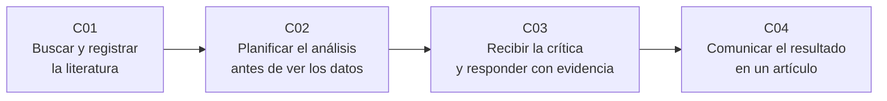

# B20 — Metodología de la investigación científica

**Programa:** Programa Integral de Astronomía, Astrofísica, Ciencias Espaciales e Ingeniería Aeroespacial
**Área:** A02 — Matemática, física computacional y métodos científicos
**Nivel:** N4 → N5 (profesional e investigación) · **Clases:** 4 · **Carga:** por calibrar con el uso
**Estado:** guía pedagógica del bloque. Las cuatro clases están redactadas y conservan el estado E0 en el catálogo hasta registrar revisión disciplinar. Bloque nuevo de la estructura `0.2.0`: sus clases no existen en la línea base.

## 🎯 Propósito del bloque

Reúne las prácticas que convierten un análisis en investigación: **buscar** lo que ya se sabe de forma reproducible, **planificar** el análisis antes de ver los datos, **someter** el trabajo a la crítica de especialistas y **comunicarlo** con honestidad. Se apoya en la estadística de B12 y en el hábito de evidencia de A01, y lo lleva al terreno del trabajo profesional.

## 📚 Al terminar el bloque podrás

1. Diseñar y registrar una búsqueda bibliográfica que otra persona pueda repetir.
2. Redactar un plan de análisis con variable principal, tamaño de muestra y reglas de decisión, y distinguir lo confirmatorio de lo exploratorio.
3. Responder a un árbitro punto por punto, con evidencia y trazabilidad.
4. Escribir un artículo breve cuyas conclusiones no superen lo que sostiene la evidencia.
5. Presentar medidas con unidad, incertidumbre y regla de redondeo declarada.
6. Declarar datos, código, versiones y desviaciones.

## 🧭 Secuencia del bloque

**Descripción textual.** Cuatro etapas encadenadas: de la búsqueda de lo conocido (C01) se pasa al plan de análisis fijado de antemano (C02); de allí a la revisión por pares y la respuesta documentada (C03); y se cierra con la redacción del artículo que reúne todo (C04).

## 🗂️ Las 4 clases en resumen

**Navegación:** cada clase enlaza a la anterior, a la siguiente y a este bloque. Los resúmenes describen lo que enseña cada clase redactada; todas están pendientes de revisión disciplinar. La columna «Evidencia» indica el producto que demuestra el aprendizaje.

| ID | Clase | Qué se aprende | Evidencia |
|---|---|---|---|
| [B20-C01](../clases/B20/B20-C01-busqueda-bibliografica-sistematica-y-gestion-de-referencias/CLASE.md) | Búsqueda bibliográfica sistemática y gestión de referencias | Pasar de una pregunta a consultas registradas (arXiv, ADS), criterios de inclusión fijados antes, eliminación de duplicados, flujo que cuadra y referencias con identificadores persistentes. | Hoja de protocolo de búsqueda |
| [B20-C02](../clases/B20/B20-C02-diseno-de-un-plan-de-analisis-y-preregistro/CLASE.md) | Diseño de un plan de análisis y preregistro | Separar lo confirmatorio de lo exploratorio; el costo de elegir el análisis después (`1 − (1 − α)^k`); tamaño de muestra y potencia; reglas condicionales; declarar el estado de los datos y las desviaciones. | Plan de análisis preregistrable |
| [B20-C03](../clases/B20/B20-C03-revision-por-pares-y-respuesta-a-arbitros/CLASE.md) | Revisión por pares y respuesta a árbitros | Funciones y deberes de autor, árbitro y editor; clasificar comentarios; comprobar una objeción con un análisis de sensibilidad; carta de respuesta con cita, decisión, acción y lugar. | Carta de respuesta a árbitros |
| [B20-C04](../clases/B20/B20-C04-redaccion-de-un-articulo-cientifico/CLASE.md) | Redacción de un artículo científico | Estructura IMRaD, resumen sin exageración, medidas con incertidumbre y redondeo declarado, tablas y figuras accesibles, declaración de datos y código, envío a un archivo de preprints. | Borrador de artículo breve |

## 🧵 Hilos que atraviesan el bloque

- **Decidir antes de mirar:** C01 (criterios antes de los resultados) y C02 (plan antes de los datos) comparten la misma disciplina.
- **Registro y trazabilidad:** el protocolo de C01, el plan archivado de C02, la carta de C03 y las declaraciones de C04 dejan huella verificable.
- **Honestidad sobre los límites:** cobertura de la búsqueda, análisis exploratorio rotulado, desviaciones y conclusiones acotadas.
- **Datos rotulados:** en todo el bloque los datos son observados, estimados, sintéticos o simulados; los laboratorios usan datos sintéticos o simulados con pruebas contra casos de referencia.

## 📝 Evaluación del bloque (propuesta, por calibrar)

- Una evidencia por clase, con rúbrica publicada antes y recuperación con evidencia distinta.
- Portafolio que encadene las cuatro piezas sobre una misma pregunta: protocolo → plan → carta → borrador.
- Condiciones críticas que no se compensan con promedio: criterios fijados antes de ver los resultados, análisis exploratorio rotulado, ningún comentario sin respuesta, desviaciones declaradas, conclusiones no superiores a la evidencia y solo fuentes consultadas.

## ⚠️ Seguridad y límites

Es un bloque educativo: no sustituye las instrucciones de una revista ni el criterio de un estadístico o de un comité de ética. Las claves de acceso a servicios bibliográficos son personales y no se publican. Los manuscritos ajenos son confidenciales. Los resultados de simulación no se presentan como observados. Las normas citadas en las clases provienen en parte de revistas médicas y se usan como ejemplo de buena práctica transferible; no se enseñan procedimientos de revistas de astronomía concretas porque no se pudieron consultar.

## Fuentes de orientación preliminar

Las fuentes efectivamente consultadas para cada afirmación están en la sección 11 de cada clase; esta lista es solo de orientación.

- **[ADS]** [NASA Astrophysics Data System](https://ui.adsabs.harvard.edu/) — Índice bibliográfico de la literatura astronómica; su API se describe en el repositorio `adsabs-dev-api`.
- **[arXiv]** [arXiv API User's Manual](https://info.arxiv.org/help/api/user-manual.html) y [ayuda de envíos](https://info.arxiv.org/help/submit/index.html).
- **[COS]** [Center for Open Science: Preregistration](https://www.cos.io/initiatives/prereg).
- **[ICMJE]** [Recomendaciones del ICMJE](https://www.icmje.org/recommendations/) — Normas de revistas médicas, usadas como ejemplo transferible.

> La asociación de estas fuentes es orientativa por bloque. Las cifras y afirmaciones de cada clase se respaldan en la tabla de fuentes de la propia clase.

[🏠 Volver al programa](../../README.md)
