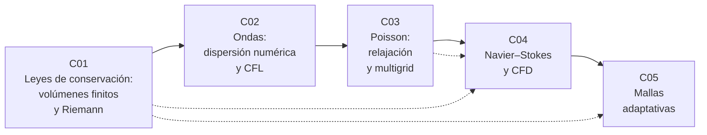

# B21 — Métodos numéricos para EDP y fluidos computacionales

**Programa:** Programa Integral de Astronomía, Astrofísica, Ciencias Espaciales e Ingeniería Aeroespacial
**Área:** A02 — Matemática, física computacional y métodos científicos
**Nivel:** N3 · **Clases:** 5 · **Carga:** por calibrar con el uso
**Estado:** guía pedagógica del bloque (bloque nuevo de la estructura `0.2.0`). Las 5 clases están redactadas y pendientes de revisión disciplinar; todas conservan el estado E0 en el catálogo hasta registrar esa revisión. El [programa completo](../../PROGRAMA_ACADEMICO_COMPLETO.md) lista el área.

## 🎯 Propósito del bloque

Enseña a **resolver numéricamente las ecuaciones en derivadas parciales** que gobiernan fluidos, plasmas, ondas y potenciales, y sobre todo a **comprobar que el resultado es correcto**: conservación, estabilidad, orden de convergencia y comparación con soluciones exactas. Continúa el bloque de ecuaciones diferenciales y simulación numérica (B11), que trata las ecuaciones ordinarias y las mallas fijas.

## 📚 Al terminar el bloque podrás

1. Escribir un esquema de volúmenes finitos que conserve masa, momento y energía y calcular el flujo en una interfaz con un solucionador de Riemann aproximado.
2. Predecir y medir el error de fase de un esquema de ondas y fijar el paso de tiempo con la condición CFL.
3. Resolver la ecuación de Poisson con relajación y con multigrid, y explicar por qué el segundo escala linealmente.
4. Plantear las ecuaciones de Navier–Stokes, elegir entre formulación compresible e incompresible y verificar un solucionador con una solución exacta.
5. Decidir dónde refinar una malla, transferir datos entre niveles de forma conservativa y corregir los flujos entre niveles.
6. Presentar para cada solucionador un informe de verificación con datos rotulados como sintéticos o simulados.

## 🧭 Secuencia del bloque

**Descripción textual.** Cinco clases encadenadas: C01 aporta la conservación y la CFL; C02 el análisis de error por dispersión; C03 el solucionador elíptico; C04 los reúne en un solucionador de fluidos incompresibles (con la formulación compresible apoyada en C01); C05 añade la resolución variable, que depende de la conservación de C01 y del paso de tiempo de C02 y C04.

## 🗂️ Las 5 clases en resumen

**Navegación:** cada clase desarrollada enlaza a la anterior, a la siguiente y a este bloque. Los resúmenes son la **especificación pedagógica** (pendiente de revisión disciplinar). La columna «Evidencia» indica el producto que demostrará el aprendizaje.

| ID | Clase | Qué se aprende | Evidencia |
|---|---|---|---|
| [B21-C01](../clases/B21/B21-C01-volumenes-finitos-y-solucionadores-de-riemann-para-leyes-de-conservacion/CLASE.md) | Volúmenes finitos y solucionadores de Riemann para leyes de conservación | Actualización conservativa, flujos de Rusanov y HLL, paso por CFL y verificación con el tubo de choque de Sod. | Informe de verificación del solucionador |
| [B21-C02](../clases/B21/B21-C02-ecuacion-de-onda-esquemas-y-dispersion-numerica/CLASE.md) | Ecuación de onda: esquemas y dispersión numérica | Salto de rana, relación de dispersión discreta, error de fase, estabilidad y puntos por longitud de onda. | Informe de dispersión numérica |
| [B21-C03](../clases/B21/B21-C03-ecuacion-de-poisson-relajacion-y-multigrid/CLASE.md) | Ecuación de Poisson: relajación y multigrid | Estencil de cinco puntos, Jacobi y Gauss–Seidel, suavizado, ciclo V y separación de errores. | Informe de convergencia del solucionador de Poisson |
| [B21-C04](../clases/B21/B21-C04-ecuaciones-de-navier-stokes-y-dinamica-de-fluidos-computacional/CLASE.md) | Ecuaciones de Navier-Stokes y dinámica de fluidos computacional | Formulaciones compresible e incompresible, método de proyección, números de Reynolds y Mach, vórtice de Taylor–Green. | Informe de verificación de un solucionador de fluidos |
| [B21-C05](../clases/B21/B21-C05-mallas-adaptativas-amr/CLASE.md) | Mallas adaptativas (AMR) | Criterio de refinamiento, restricción y prolongación conservativas, subciclado y corrección de flujo. | Informe de verificación de un esquema adaptativo |

## 🧵 Hilos que atraviesan el bloque

- **Conservación:** C01 la define, C05 muestra cómo se pierde en una interfaz entre mallas y cómo se corrige.
- **Verificación:** cada clase compara con una solución exacta o con una relación analítica (Sod, modo discreto, solución discreta de Poisson, Taylor–Green, masa total).
- **Paso de tiempo:** CFL en C01 y C02, límite difusivo en C04, subciclado en C05.
- **Orden de convergencia:** heredado de B11-C05 y medido en todas las clases.

## 📝 Evaluación del bloque (propuesta, por calibrar)

- Un informe de verificación por clase, con tablas equivalentes a las gráficas, retroalimentación y recuperación con evidencia distinta.
- Las condiciones críticas (comparar con una solución exacta o de referencia, rotular lo sintético y lo simulado, citar solo lo consultado) no se compensan con promedio.

## 🛡️ Seguridad, ética y límites

Ninguna simulación del bloque es operativa: los datos son sintéticos y adimensionales y las escalas físicas, ilustrativas. No debe usarse para pronosticar clima espacial, diseñar vehículos o evaluar riesgos reales sin la verificación y validación de un proyecto.

## Fuentes consultadas por el bloque

- **[ATHENA]** Stone et al., «Athena: a new code for astrophysical MHD», arXiv:0804.0402 — volúmenes finitos, HLLE y CFL. Consultada el 2026-11-05.
- **[RAMSES]** Teyssier, «Cosmological hydrodynamics with adaptive mesh refinement: a new high resolution code called RAMSES», arXiv:astro-ph/0111367 — AMR, relajación de Poisson y CFL. Consultada el 2026-11-05.
- **[ATHENA++]** Stone et al., «The Athena++ adaptive mesh refinement framework», arXiv:2005.06651 — AMR por bloques, corrección de flujo y multigrid completo. Consultada el 2026-11-05.
- **[NASA-GLENN]** NASA Glenn, páginas *Navier-Stokes Equations* y *Euler Equations* (https://www.grc.nasa.gov/www/k-12/airplane/nseqs.html, https://www.grc.nasa.gov/www/k-12/airplane/eulereqs.html). Consultadas el 2026-11-05.

> Cada clase detalla qué respalda cada fuente y qué resultados estándar no se atribuyen a una fuente consultada.

## Roles que lo usan

- [Heliofísica y climatología espacial](../../rutas/heliofisica-y-climatologia-espacial.md)
- [Matemática y computación científica espacial](../../rutas/matematica-y-computacion-cientifica-espacial.md)

[🏠 Volver al programa](../../README.md)
