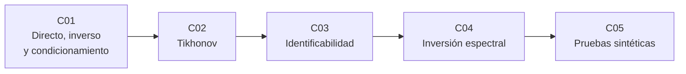

# B22 — Problemas inversos y estimación de modelos

**Programa:** Programa Integral de Astronomía, Astrofísica, Ciencias Espaciales e Ingeniería Aeroespacial
**Área:** A02 — Matemática, física computacional y métodos científicos
**Nivel:** N3 · **Clases:** 5 · **Carga:** por calibrar con el uso
**Estado:** guía pedagógica del bloque. Las 5 clases enlazadas en la tabla están redactadas con texto, ejercicios y laboratorio; todas conservan el estado E0 en el catálogo hasta registrar revisión disciplinar. Bloque nuevo de la estructura vigente.

## 🎯 Propósito del bloque

Enseña a **recuperar causas desde efectos** (una imagen nítida desde una imagen borrosa, una temperatura desde un espectro) sin engañarse: cuándo la inversión directa es inservible, cómo se estabiliza, cuándo los datos determinan los parámetros y cómo se prueba un método. Completa a [B10-C07](../clases/B10/B10-C07-proyecciones-y-minimos-cuadrados/CLASE.md), que solo trata mínimos cuadrados.

## 📚 Al terminar el bloque podrás

1. Distinguir problema directo e inverso y diagnosticar el mal condicionamiento con el número de condición.
2. Regularizar con Tikhonov y elegir el parámetro por curva L y por discrepancia.
3. Decidir si un parámetro es identificable estructural y prácticamente, con intervalos de perfil.
4. Invertir espectros sintéticos con restricciones físicas y detectar el error de modelo.
5. Probar una inversión con datos sintéticos evitando el «crimen inverso».

## 🧭 Secuencia del bloque

**Descripción textual.** Cinco clases encadenadas: el problema y su diagnóstico (C01), el remedio clásico (C02), la pregunta de qué determinan los datos (C03), la aplicación a espectros (C04) y la validación honesta (C05).

## 🗂️ Las 5 clases en resumen

Cada clase desarrollada enlaza a la anterior, a la siguiente y a este bloque. La columna «Evidencia» indica el producto que demuestra el aprendizaje.

| ID | Clase | Qué se aprende | Evidencia |
|---|---|---|---|
| [B22-C01](../clases/B22/B22-C01-problemas-directos-e-inversos-y-mal-condicionamiento/CLASE.md) | Problemas directos e inversos y mal condicionamiento | Condiciones de Hadamard, espacio nulo, valores singulares y cota `κ·error`; por qué la inversión ingenua colapsa. | Diagnóstico de un problema inverso |
| [B22-C02](../clases/B22/B22-C02-regularizacion-de-tikhonov/CLASE.md) | Regularización de Tikhonov | Funcional, factores de filtro, curva L, discrepancia y sesgo. | Informe de una inversión regularizada |
| [B22-C03](../clases/B22/B22-C03-identificabilidad-de-parametros/CLASE.md) | Identificabilidad de parámetros | Rango del jacobiano, Fisher y Cramér–Rao, verosimilitud de perfil. | Informe de identificabilidad |
| [B22-C04](../clases/B22/B22-C04-inversion-espectral/CLASE.md) | Inversión espectral | Planck como modelo directo; ajuste de temperatura; mezcla con Tikhonov y no negatividad; error de modelo. | Informe de inversión espectral |
| [B22-C05](../clases/B22/B22-C05-pruebas-de-inversion-con-datos-sinteticos/CLASE.md) | Pruebas de inversión con datos sintéticos | Crimen inverso, discrepancia de modelo, barrido de ruido y cobertura. | Protocolo de prueba sintética |

## 🧵 Hilos que atraviesan el bloque

- **Condicionamiento:** C01 lo mide; C02 lo amortigua; C04 lo sufre (`cond ≈ 10¹¹`).
- **Honestidad:** C03 (intervalos abiertos), C04 (`χ²/gl`) y C05 (crimen inverso) enseñan a no informar más de lo que los datos permiten.
- **Todo es sintético:** los laboratorios usan datos sintéticos rotulados, con pruebas contra soluciones exactas.

## 📝 Evaluación del bloque (propuesta, por calibrar)

- Evidencia por clase con rúbrica de cuatro niveles.
- Condiciones críticas que no se compensan con promedio: no presentar lo sintético como observado, no informar un parámetro con intervalo abierto como valor puntual, no presentar un resultado con crimen inverso como precisión, citar solo lo consultado.

## ⚠️ Seguridad y límites

Material educativo con datos sintéticos; no sirve como procedimiento de reducción de datos reales. Un resultado de inversión es una estimación condicionada al modelo y al método: debe declararse.

## Fuentes de orientación preliminar

- Hansen, P. C., «The L-curve and its use in the numerical treatment of inverse problems» (2001) — Tikhonov y curva L (consultado parcialmente).
- Raue et al., *Bioinformatics* 25(15), 2009 — identificabilidad y verosimilitud de perfil (consultado parcialmente).
- Wirgin, «The inverse crime», arXiv:math-ph/0401050 — resumen.
- Madhusudhan, «Atmospheric Retrieval of Exoplanets», arXiv:1808.04824 — resumen.
- NIST CODATA — constantes `h`, `k`, `c`.

> Las referencias exactas, la fecha de consulta y el estado de cada una están en la sección 11 de cada clase.

## Roles que lo usan

- [Matemática y computación científica espacial](../../rutas/matematica-y-computacion-cientifica-espacial.md)

[🏠 Volver al programa](../../README.md)
