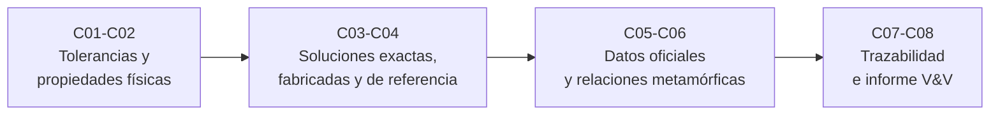

# B23 — Verificación y validación de software científico

> **Bloque nuevo de la estructura vigente.** Sus 8 clases están redactadas y pendientes de revisión disciplinar; no están verificadas, impartidas ni validadas por terceros y conservan el estado E0 en el catálogo de la línea base, donde no figuran. El [programa completo](../../PROGRAMA_ACADEMICO_COMPLETO.md) las lista junto con el resto del área.

**Programa:** Programa Integral de Astronomía, Astrofísica, Ciencias Espaciales e Ingeniería Aeroespacial
**Área:** A02 — Matemática, física computacional y métodos científicos
**Nivel:** N3 → N4 (desarrollo y profesional) · **Clases:** 8 · **Carga:** por calibrar con el uso
**Estado:** guía pedagógica del bloque (resumen de qué se aprende en cada clase). Las clases enlazadas en la tabla están redactadas; todas esperan revisión disciplinar.

## 🎯 Propósito del bloque

Enseña a **demostrar que un programa científico es correcto para un uso concreto** y a dejarlo por escrito. Recorre las preguntas en orden: ¿calcula bien lo que dice calcular? (verificación), ¿representa bien el mundo? (validación), ¿puedo reproducir cada cifra? (trazabilidad) y ¿puede otra persona juzgar mi conclusión? (informe). Todo con el mismo ejemplo conductor: la órbita de la Tierra y de un satélite bajo J2.

## 📚 Al terminar el bloque podrás

1. Diseñar pruebas numéricas con tolerancias derivadas del método y del problema, y medir su sensibilidad con defectos inyectados (mutantes).
2. Convertir propiedades físicas (conservación, simetrías, reversibilidad) en pruebas y reconocer los defectos a los que son ciegas.
3. Usar soluciones exactas y el orden observado de convergencia para verificar un algoritmo, y diagnosticar defectos de algoritmo frente a defectos de modelo.
4. Fabricar soluciones (MMS) y usar un código independiente como referencia cuando no hay solución exacta.
5. Validar un modelo frente a un conjunto de referencia con criterios fijados antes de comparar, y registrar el dominio de validación.
6. Probar programas sin oráculo con relaciones metamórficas justificadas.
7. Trazar cada cifra a sus datos, código, parámetros y versiones con una huella verificable.
8. Redactar un informe de verificación y validación con uso previsto, criterios, advertencias y límites.

## 🧭 Secuencia del bloque

**Descripción textual.** Cuatro tramos encadenados: pruebas que no necesitan referencia externa (C01–C02), verificación con respuestas conocidas o fabricadas (C03–C04), validación y pruebas sin oráculo (C05–C06) y cierre con trazabilidad e informe (C07–C08).

## 🗂️ Las 8 clases en resumen

**Navegación:** cada clase enlaza a la anterior, a la siguiente y a este bloque. Los resúmenes describen lo que enseña cada clase redactada; la columna «Evidencia» indica el producto que demostrará el aprendizaje.

### Tramo 1 · Pruebas sin referencia externa

| ID | Clase | Qué se aprende | Evidencia |
|---|---|---|---|
| [B23-C01](../clases/B23/B23-C01-pruebas-unitarias-numericas-con-tolerancias/CLASE.md) | Pruebas unitarias numéricas con tolerancias | Error absoluto y relativo, criterios `isclose`, precisión de máquina y ulp; derivar la tolerancia de un caso exacto, un residuo o un requisito; medir la sensibilidad con mutantes. | Batería de pruebas con tolerancias justificadas |
| [B23-C02](../clases/B23/B23-C02-pruebas-de-propiedades-fisicas/CLASE.md) | Pruebas de propiedades físicas | Energía, momento angular, reversibilidad y simetría de rotación como pruebas; cota de energía `c·h²` derivada del orden; defectos a los que las propiedades son ciegas. | Tabla de propiedades con tolerancias y mutantes |

### Tramo 2 · Verificación con respuestas conocidas

| ID | Clase | Qué se aprende | Evidencia |
|---|---|---|---|
| [B23-C03](../clases/B23/B23-C03-casos-analiticos-de-validacion/CLASE.md) | Casos analíticos de validación | Solución exacta de Kepler como referencia, orden observado de convergencia, diferencia entre defecto de algoritmo y de modelo, y trampas de los puntos especiales. | Informe de orden observado de un integrador |
| [B23-C04](../clases/B23/B23-C04-soluciones-de-referencia-y-manufactured-solutions/CLASE.md) | Soluciones de referencia y manufactured solutions | Método de soluciones fabricadas en difusión de calor, estudios de refinamiento separados en espacio y tiempo, mallas que disfrazan defectos y código de referencia independiente. | Batería MMS para un solucionador propio |

### Tramo 3 · Validación y pruebas sin oráculo

| ID | Clase | Qué se aprende | Evidencia |
|---|---|---|---|
| [B23-C05](../clases/B23/B23-C05-validacion-con-conjuntos-oficiales/CLASE.md) | Validación con conjuntos oficiales | Contraste con una efeméride de JPL Horizons, verificación de los datos copiados, criterios de aceptación previos, investigación de un criterio incumplido y dominio de validación. | Informe de validación con criterios previos |
| [B23-C06](../clases/B23/B23-C06-pruebas-metamorficas/CLASE.md) | Pruebas metamórficas | Relaciones entre ejecuciones (composición, simetrías, unidades, reversibilidad) para un propagador con J2; relaciones falsas; matriz de defectos y ceguera a defectos coherentes. | Matriz de relaciones metamórficas |

### Tramo 4 · Trazabilidad e informe

| ID | Clase | Qué se aprende | Evidencia |
|---|---|---|---|
| [B23-C07](../clases/B23/B23-C07-trazabilidad-cientifica-de-resultados/CLASE.md) | Trazabilidad científica de resultados | Registro de procedencia, huella SHA-256 de datos y código con fin de línea normalizado, qué entra y qué no en la huella, y los tres estados de la reproducción. | Registro de procedencia verificable |
| [B23-C08](../clases/B23/B23-C08-informe-de-verificacion-y-validacion/CLASE.md) | Informe de verificación y validación | Estructura de un informe V&V: uso previsto, criterios, regla de decisión, advertencias, incertidumbre, límites y procedencia; generación y pruebas de coherencia del informe. | Informe V&V con su generador |

## 🧵 Hilos que atraviesan el bloque

- **Tolerancia:** C01 la deriva; C02, C03 y C04 la ligan al orden del método; C06 la ancla al ruido del integrador; C08 la convierte en criterio de aceptación.
- **Ceguera de las pruebas:** cada clase muestra un defecto que su técnica no ve (GM coherente, constante mal escalada, signo de J2) y la técnica que sí lo ve.
- **Verificación frente a validación:** C01–C04 y C06 verifican; C05 valida contra un conjunto oficial; C08 los separa en el informe.
- **Evidencia:** C05 fija criterios antes, C07 vincula cada cifra con su origen y C08 reúne todo en una decisión con límites.

## 📝 Evaluación del bloque (propuesta, por calibrar)

- Un producto por clase (batería, tabla, informe, matriz, registro) con rúbrica publicada antes y retroalimentación con recuperación mediante evidencia distinta.
- Portafolio: primera versión, retroalimentación y cambio.
- Las condiciones críticas (no ocultar un criterio incumplido, no presentar datos sintéticos como observados ni una efeméride como observación, no afirmar corrección por pasar propiedades) no se compensan con promedio.

## ⚠️ Seguridad y límites

El bloque es educativo. Los laboratorios usan datos sintéticos y una efeméride pública; sus resultados no sirven para navegación, predicción de encuentros ni operación de misiones, y un informe V&V educativo no sustituye procesos formales de verificación de software de vuelo. Cualquier uso real requiere los requisitos y revisores del marco aplicable.

## 👥 Roles que lo usan

- [Matemática y computación científica espacial](../../rutas/matematica-y-computacion-cientifica-espacial.md)

## Fuentes consultadas en el bloque

- **[NASA-STD-7009B]** NASA, [Standard for Models and Simulations](https://standards.nasa.gov/sites/default/files/standards/NASA/B/1/NASA-STD-7009B-Final-3-5-2024.pdf) (2024-03-05) — Definiciones de verificación y validación, dominios y contenido del reporte de resultados.
- **[Horizons]** NASA/JPL, [Horizons API](https://ssd-api.jpl.nasa.gov/doc/horizons.html) — Efeméride de referencia para la validación.
- **[IAU]** [Resolución B3 de 2015](https://arxiv.org/abs/1510.07674) y [Resolución B2 de 2012](https://syrte.obspm.fr/IAU_resolutions/IAUResol_2012_0.html) — `GM☉` nominal y unidad astronómica.
- **[Sandia]** Salari y Knupp, [Code Verification by the Method of Manufactured Solutions](https://www.osti.gov/biblio/759450) — Solo el resumen se consultó.
- **[Chen 2018]** Chen et al., *Metamorphic Testing: A Review of Challenges and Opportunities*, DOI 10.1145/3143561 — Solo la ficha bibliográfica se consultó (fuente parcial).
- **[Documentación]** NumPy `isclose`, Python `math` y `hashlib`, pytest `approx`, SciPy `solve_ivp`, W3C PROV-DM, principios FAIR — Detalle y estado en la sección 11 de cada clase.

> Cada clase lista en su sección 11 lo que realmente consultó, con fecha y estado. Esta lista solo orienta; las fuentes parciales están marcadas.

[🏠 Volver al programa](../../README.md)
