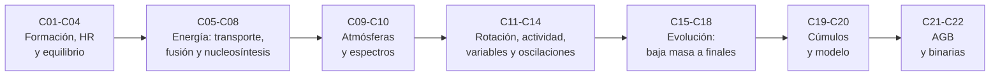

# B24 — Física y evolución de estrellas

> **Bloque ampliado (`0.2.0`).** Además de las 20 clases de la malla base, el bloque tiene 2 clases programadas por la ampliación (`B24-C21` a `B24-C22`), redactadas y listadas en el tramo 7. Ver el [programa completo](../../PROGRAMA_ACADEMICO_COMPLETO.md).

**Programa:** Programa Integral de Astronomía, Astrofísica, Ciencias Espaciales e Ingeniería Aeroespacial
**Área:** A03 — Astrofísica y ciencias fundamentales del universo
**Nivel:** N3 (fundamentos disciplinares) · **Clases:** 20 + 2 de la ampliación · **Carga:** por calibrar con el uso
**Estado:** guía pedagógica del bloque (resumen de qué se aprende en cada clase). Las clases enlazadas en la tabla ya están redactadas; todas conservan el estado E0 en el catálogo hasta registrar revisión disciplinar. Las clases `B24-C21` y `B24-C22` (ampliación `0.2.0`) también están redactadas y conservan el mismo estado.

## 🎯 Propósito del bloque

Enseña **cómo nace, vive y muere una estrella** con las leyes de la física: cuándo una nube colapsa, qué sostiene una estrella, cómo viaja su energía, qué reacciones la alimentan, qué vemos de ella (espectros, rotación, actividad, variabilidad, oscilaciones) y qué camino evolutivo sigue según su masa y su pertenencia a un sistema binario. Cada clase cierra con un cálculo verificable contra un caso analítico o una referencia independiente.

## 📚 Al terminar el bloque podrás

1. Decidir si una nube de gas colapsa y estimar cuánto tarda, y seguir la energía de una protoestrella.
2. Situar una estrella en el diagrama de Hertzsprung–Russell y calcular su radio desde `L` y `T_ef`.
3. Plantear el equilibrio hidrostático y el transporte de energía, y estimar presión, temperatura y tiempo de difusión.
4. Calcular el balance energético de la fusión de hidrógeno y la sensibilidad a la temperatura de la cadena p-p y el ciclo CNO, y seguir la nucleosíntesis posterior.
5. Interpretar espectros, clasificación, rotación, campos y actividad como propiedades de la estrella.
6. Usar la variabilidad y las oscilaciones como sonda de la estructura.
7. Describir la evolución de estrellas de baja masa y masivas, la fase AGB, los finales de vida y el papel de las binarias, y datar cúmulos.
8. Construir un modelo simplificado de estructura estelar (politropo) y contrastarlo con valores de referencia.

## 🧭 Secuencia del bloque

**Descripción textual.** Siete tramos encadenados: nacimiento y equilibrio (C01–C04), fuentes y transporte de energía (C05–C08), lo que vemos de la superficie (C09–C10), rotación, actividad y variabilidad (C11–C14), evolución según la masa (C15–C18), cúmulos y modelo integrador (C19–C20) y la ampliación con la fase AGB y la evolución binaria (C21–C22).

## 🗂️ Las 22 clases en resumen (20 de la malla base + 2 de la ampliación)

**Navegación:** cada clase desarrollada enlaza a la anterior, a la siguiente y a este bloque; mientras una clase siga solo programada, su enlace lleva a su fila en esta tabla.

La columna «Evidencia» indica el producto que demostrará el aprendizaje. Los laboratorios usan datos **sintéticos** o **ilustrativos** (rotulados) o valores publicados con fuente y fecha.

### Tramo 1 · Nacimiento y equilibrio

| ID | Clase | Qué se aprende | Evidencia |
|---|---|---|---|
| [B24-C01](../clases/B24/B24-C01-colapso-de-nubes-moleculares/CLASE.md) | Colapso de nubes moleculares | Criterio de Jeans y tiempo de caída libre; cómo escalan con la temperatura y la densidad. | Ficha de un núcleo colapsante |
| [B24-C02](../clases/B24/B24-C02-formacion-de-protoestrellas/CLASE.md) | Formación de protoestrellas | Energía gravitatoria, virial, tiempo de Kelvin–Helmholtz y luminosidad de acreción. | Ficha energética de una protoestrella |
| [B24-C03](../clases/B24/B24-C03-diagrama-de-hertzsprung-russell/CLASE.md) | Diagrama de Hertzsprung-Russell | Radio desde `L` y `T_ef`, magnitudes y regiones del diagrama. | Tabla HR de cuatro estrellas |
| [B24-C04](../clases/B24/B24-C04-equilibrio-hidrostatico-estelar/CLASE.md) | Equilibrio hidrostático estelar | Balance presión–gravedad, presión central, virial y tiempo dinámico. | Ficha de equilibrio de una estrella |

### Tramo 2 · Energía: transporte, fusión y nucleosíntesis

| ID | Clase | Qué se aprende | Evidencia |
|---|---|---|---|
| B24-C05 | Transporte radiativo y convectivo | Difusión de fotones, criterio de Schwarzschild y gradiente adiabático. | Informe de transporte de energía |
| B24-C06 | Fusión de hidrógeno | Defecto de masa, energía por reacción y tiempo en secuencia principal. | Balance energético de la fusión |
| B24-C07 | Ciclo CNO y cadena protón-protón | Pico de Gamow y sensibilidad de la tasa a la temperatura. | Comparación p-p frente a CNO |
| B24-C08 | Nucleosíntesis estelar | Etapas de quemado y energía por unidad de masa de cada combustible. | Tabla de combustibles estelares |

### Tramo 3 · Superficie y espectros

| ID | Clase | Qué se aprende | Evidencia |
|---|---|---|---|
| B24-C09 | Atmósferas y opacidades | Atmósfera gris, profundidad óptica, opacidad de Thomson y límite de Eddington. | Perfil de una atmósfera gris |
| B24-C10 | Espectros y clasificación estelar | Ley de Wien, Boltzmann y Saha, y la secuencia espectral. | Ficha de clasificación de una estrella |

### Tramo 4 · Rotación, actividad, variabilidad y oscilaciones

| ID | Clase | Qué se aprende | Evidencia |
|---|---|---|---|
| B24-C11 | Rotación y campos magnéticos | Velocidad ecuatorial, rotación crítica, conservación del momento angular y del flujo. | Ficha de rotación y campo |
| B24-C12 | Manchas y actividad estelar | Curva de luz de una mancha, periodo de rotación y contraste. | Curva de luz sintética de una estrella con manchas |
| B24-C13 | Estrellas variables | Relación periodo–luminosidad, módulo de distancia y relación periodo–densidad. | Calibración periodo–luminosidad |
| B24-C14 | Asterosismología inicial | Modos acústicos, separación grande y escalas con la densidad media. | Ficha asterosísmica |

### Tramo 5 · Evolución según la masa

| ID | Clase | Qué se aprende | Evidencia |
|---|---|---|---|
| B24-C15 | Estrellas de baja masa | Vida en secuencia principal y su dependencia de la masa. | Tabla de vidas por masa |
| B24-C16 | Gigantes rojas | Expansión y enfriamiento, radio de gigantes y quemado en capa. | Ficha de una gigante roja |
| B24-C17 | Estrellas masivas y pérdida de masa | Límite de Eddington, vientos y masa perdida acumulada. | Balance de masa de una estrella masiva |
| B24-C18 | Etapas finales de evolución | Politropo `n = 3`, masa de Chandrasekhar y destinos finales. | Ficha de remanentes |

### Tramo 6 · Cúmulos y modelo integrador

| ID | Clase | Qué se aprende | Evidencia |
|---|---|---|---|
| B24-C19 | Cúmulos y edades estelares | Punto de desvío, isócronas y edad de un cúmulo. | Edad de un cúmulo sintético |
| B24-C20 | Modelo simplificado de estructura estelar | Modelo politrópico del Sol contrastado con valores de referencia. | Modelo politrópico validado |

### Tramo 7 · Ampliación `0.2.0`: fase AGB y evolución binaria

| ID | Clase | Qué se aprende | Evidencia |
|---|---|---|---|
| B24-C21 | Rama asintótica de gigantes: pulsos térmicos y proceso s | Pulsos térmicos, dragados y capturas lentas de neutrones. | Ficha de la fase AGB |
| B24-C22 | Evolución binaria: lóbulo de Roche y transferencia de masa | Radio del lóbulo de Roche y evolución del semieje con transferencia de masa. | Ficha de una binaria interactuante |

## 🧵 Hilos que atraviesan el bloque

- **Equilibrio y energía:** C04 plantea el equilibrio; C05–C08 explican de dónde viene y cómo sale la energía; C20 los integra en un modelo.
- **Escalas de tiempo:** C01 (caída libre), C02 (Kelvin–Helmholtz), C04 (dinámico), C06 y C15 (nuclear) ordenan los ritmos de una estrella.
- **Lo que observamos:** C03, C09–C14 conectan la física con luz, espectros, ritmos y oscilaciones.
- **Evolución:** C15–C19 y C21–C22 siguen a la estrella de la secuencia principal a su final y su dependencia de la masa y de una compañera.
- **Verificación independiente:** cada laboratorio contrasta con un caso analítico o una referencia.

## 📝 Evaluación del bloque (propuesta, por calibrar)

- Fichas y ejercicios por clase, con retroalimentación y recuperación con evidencia distinta.
- Portafolio: el modelo politrópico validado (C20) con su comparación frente a valores de referencia.
- Las condiciones críticas (rotular lo ilustrativo, sintético y de modelo, no presentar una cota como valor real y citar solo lo consultado) no se compensan con promedio.

## ⚠️ Seguridad y límites

El bloque es educativo. Los modelos son simplificados (esferas sin rotación ni campo, relaciones de escala ilustrativas) y no sustituyen a los códigos de evolución estelar ni a la literatura primaria. Los valores del Sol que proceden de un modelo se rotulan como tales. Las cifras publicadas se citan con fecha de consulta.

## Fuentes de orientación preliminar

- **[NASA-DATA]** [NASA Science Data](https://science.data.nasa.gov/) — Portal general de datos y servicios científicos.
- **[ESA-SCIENCE]** [European Space Agency Science](https://www.esa.int/Science_Exploration/Space_Science) — Misiones, descubrimientos y material científico institucional.
- **[LIGO]** [LIGO Scientific Collaboration](https://www.ligo.org/) — Observaciones y métodos de ondas gravitacionales.
- **[ADS]** [NASA Astrophysics Data System](https://ui.adsabs.harvard.edu/) — Índice bibliográfico de literatura astronómica y física.

> La asociación de estas fuentes es orientativa por bloque. Las fuentes realmente consultadas para cada afirmación se registran en la sección 11 de cada clase.

[🏠 Volver al programa](../../README.md) · [➡️ B25 — Galaxias y medio interestelar](./B25-galaxias-y-medio-interestelar.md)
