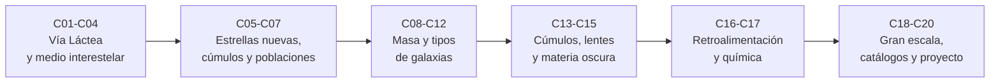

# B25 — Galaxias y medio interestelar

**Programa:** Programa Integral de Astronomía, Astrofísica, Ciencias Espaciales e Ingeniería Aeroespacial
**Área:** A03 — Astrofísica y ciencias fundamentales del universo
**Nivel:** N3 (fundamentos disciplinares) · **Clases:** 20 · **Carga:** por calibrar con el uso
**Estado:** guía pedagógica del bloque (resumen de qué se aprende en cada clase). Las 20 clases enlazadas en la tabla ya están redactadas; todas conservan el estado E0 en el catálogo hasta registrar revisión disciplinar. Este bloque no tiene clases programadas por la ampliación.

## 🎯 Propósito del bloque

Enseña **cómo está organizada una galaxia y qué hay entre sus estrellas**, con la física de las clases anteriores: la estructura y el movimiento de la Vía Láctea, las fases del gas y el polvo, dónde y a qué ritmo nacen las estrellas, cómo se agrupan, cómo se pesa una galaxia o un cúmulo (rotación, dispersión, gas caliente y lentes), qué papel tienen los núcleos activos, las fusiones y la retroalimentación, cómo evoluciona la composición química y cómo se distribuyen las galaxias a gran escala, con sus sesgos de selección. Cada clase cierra con un cálculo o una simulación verificable contra un caso analítico o una referencia independiente.

## 📚 Al terminar el bloque podrás

1. Describir la estructura de la Vía Láctea, estimar la masa interior desde la rotación y comparar el disco exponencial con la masa estelar.
2. Usar la espiral logarítmica y el problema del enrollamiento para razonar sobre brazos y barra.
3. Caracterizar las fases del medio interestelar por temperatura, densidad, presión y velocidad del sonido, y pesar nubes moleculares con CO y polvo.
4. Estimar el tamaño de una región ionizada, el tiempo de agotamiento del gas y la dinámica de un cúmulo estelar.
5. Calcular constantes de Oort, frecuencia epicíclica y momentos de una función de masa inicial.
6. Calcular la curva de rotación de un disco, el halo necesario y un halo NFW comparado con datos locales.
7. Describir galaxias con el perfil de Sérsic, pesar enanas, cúmulos de galaxias y lentes, y plantear el balance de energía de un núcleo activo, de una fusión y de la retroalimentación.
8. Seguir la evolución química con un modelo de caja cerrada, medir el agrupamiento con la función de correlación y reconocer sesgos de selección.
9. Diseñar y validar un clasificador de galaxias con requisitos medibles y métricas desglosadas.

## 🧭 Secuencia del bloque

**Descripción textual.** Seis tramos encadenados: la galaxia propia y su gas (C01–C04), el nacimiento de las estrellas y su dinámica (C05–C07), la masa y la variedad de las galaxias (C08–C12), los sistemas mayores y la masa que no se ve (C13–C15), el intercambio entre estrellas y gas (C16–C17) y la gran escala con su método y un proyecto integrador (C18–C20).

## 🗂️ Las 20 clases en resumen

**Navegación:** cada clase desarrollada enlaza a la anterior, a la siguiente y a este bloque.

La columna «Evidencia» indica el producto que demostrará el aprendizaje. Los laboratorios usan datos **sintéticos**, **simulados** o **ilustrativos** (rotulados) o valores publicados con fuente y fecha.

### Tramo 1 · Vía Láctea y medio interestelar

| ID | Clase | Qué se aprende | Evidencia |
|---|---|---|---|
| [B25-C01](../clases/B25/B25-C01-estructura-de-la-via-lactea/CLASE.md) | Estructura de la Vía Láctea | Componentes, `R₀`, `Θ₀`, masa interior desde la rotación y disco exponencial. | Ficha del Sol en la Galaxia |
| [B25-C02](../clases/B25/B25-C02-brazos-espirales-y-barra-galactica/CLASE.md) | Brazos espirales y barra galáctica | Espiral logarítmica, ángulo de paso, problema del enrollamiento y geometría de la barra. | Ficha de geometría de brazos y barra |
| [B25-C03](../clases/B25/B25-C03-medio-interestelar-multifasico/CLASE.md) | Medio interestelar multifásico | Fases, presión térmica, velocidad del sonido y densidad de columna. | Ficha de fases del MIS |
| [B25-C04](../clases/B25/B25-C04-nubes-moleculares-y-polvo/CLASE.md) | Nubes moleculares y polvo | Masa desde el CO con `X_CO`, extinción y comparación con Jeans. | Ficha de una nube molecular |

### Tramo 2 · Estrellas nuevas, cúmulos y poblaciones

| ID | Clase | Qué se aprende | Evidencia |
|---|---|---|---|
| [B25-C05](../clases/B25/B25-C05-regiones-de-formacion-estelar/CLASE.md) | Regiones de formación estelar | Esfera de Strömgren, ley de Schmidt y tiempo de agotamiento. | Ficha de una región de formación estelar |
| [B25-C06](../clases/B25/B25-C06-cumulos-estelares/CLASE.md) | Cúmulos estelares | Perfil de Plummer, Jeans, virial y escalas de tiempo. | Ficha de un cúmulo |
| [B25-C07](../clases/B25/B25-C07-dinamica-de-poblaciones-estelares/CLASE.md) | Dinámica de poblaciones estelares | Constantes de Oort, epiciclos y función de masa inicial. | Ficha de dinámica de una población |

### Tramo 3 · Masa y variedad de las galaxias

| ID | Clase | Qué se aprende | Evidencia |
|---|---|---|---|
| [B25-C08](../clases/B25/B25-C08-curvas-de-rotacion-de-galaxias/CLASE.md) | Curvas de rotación de galaxias | Disco de Freeman, halo necesario y masa que falta. | Ficha de una curva de rotación |
| [B25-C09](../clases/B25/B25-C09-galaxias-elipticas-y-espirales/CLASE.md) | Galaxias elípticas y espirales | Perfil de Sérsic, `R_e` y rotadores rápidos y lentos. | Ficha de dos galaxias |
| [B25-C10](../clases/B25/B25-C10-galaxias-irregulares-y-enanas/CLASE.md) | Galaxias irregulares y enanas | Estimador de masa de enanas y relación masa–luz. | Ficha de una galaxia enana |
| [B25-C11](../clases/B25/B25-C11-nucleos-activos-de-galaxias/CLASE.md) | Núcleos activos de galaxias | Límite de Eddington, crecimiento, ISCO y sombra. | Ficha de un núcleo activo |
| [B25-C12](../clases/B25/B25-C12-interacciones-y-fusiones-galacticas/CLASE.md) | Interacciones y fusiones galácticas | Encuentro parabólico con partículas de prueba. | Ficha de un encuentro galáctico |

### Tramo 4 · Cúmulos, lentes y materia oscura

| ID | Clase | Qué se aprende | Evidencia |
|---|---|---|---|
| [B25-C13](../clases/B25/B25-C13-cumulos-de-galaxias/CLASE.md) | Cúmulos de galaxias | Masa hidrostática con perfil beta, comparación con la esfera isoterma y fracción de gas. | Ficha de un cúmulo de galaxias |
| [B25-C14](../clases/B25/B25-C14-lentes-gravitacionales-galacticas/CLASE.md) | Lentes gravitacionales galácticas | Radio de Einstein, imágenes, magnificación y masa proyectada. | Ficha de una lente |
| [B25-C15](../clases/B25/B25-C15-materia-oscura-en-galaxias/CLASE.md) | Materia oscura en galaxias | Halo NFW, densidad crítica y comparación con datos locales. | Ficha de un halo |

### Tramo 5 · Retroalimentación y química

| ID | Clase | Qué se aprende | Evidencia |
|---|---|---|---|
| [B25-C16](../clases/B25/B25-C16-retroalimentacion-estelar/CLASE.md) | Retroalimentación estelar | Supernovas por masa formada, energía de ligadura y escala de burbujas. | Ficha de presupuesto de retroalimentación |
| [B25-C17](../clases/B25/B25-C17-metallicidad-y-evolucion-quimica/CLASE.md) | Metallicidad y evolución química | Caja cerrada, salida de gas y rendimiento efectivo. | Ficha de evolución química |

### Tramo 6 · Gran escala, catálogos y proyecto

| ID | Clase | Qué se aprende | Evidencia |
|---|---|---|---|
| [B25-C18](../clases/B25/B25-C18-estructura-cosmica-a-gran-escala/CLASE.md) | Estructura cósmica a gran escala | Función de correlación de dos puntos y modelo de agrupamiento. | Ficha de agrupamiento |
| [B25-C19](../clases/B25/B25-C19-catalogos-y-sesgos-de-seleccion/CLASE.md) | Catálogos y sesgos de selección | Sesgo de Malmquist y corrección `1/V_max`. | Ficha de selección de un catálogo |
| [B25-C20](../clases/B25/B25-C20-proyecto-de-clasificacion-galactica/CLASE.md) | Proyecto de clasificación galáctica | Requisitos, concentración, umbral y métricas desglosadas. | Ficha del proyecto de clasificación |

## 🧵 Hilos que atraviesan el bloque

- **Masa que no se ve:** C01 (masa interior), C08 (curvas de rotación), C10 (enanas), C13 (gas caliente), C14 (lentes) y C15 (halo) pesan sistemas por vías distintas.
- **Del gas a las estrellas y de vuelta:** C03–C05 (gas y formación), C16 (retroalimentación) y C17 (química) cierran el ciclo.
- **Dinámica gravitatoria:** C02, C06, C07, C12 usan órbitas, epiciclos, virial y encuentros.
- **Escala y método:** C18–C20 pasan de una galaxia a catálogos, con sesgos y métricas.
- **Verificación independiente:** cada laboratorio contrasta con un caso analítico, una referencia o una simulación de solución conocida.

## 📝 Evaluación del bloque (propuesta, por calibrar)

- Fichas y ejercicios por clase, con retroalimentación y recuperación con evidencia distinta.
- Portafolio: el proyecto de clasificación (C20) con su matriz de comprobación y su evaluación desglosada.
- Las condiciones críticas (rotular lo ilustrativo, sintético y de modelo, no presentar una cota como valor real y citar solo lo consultado) no se compensan con promedio.

## ⚠️ Seguridad y límites

El bloque es educativo. Los modelos son simplificados (discos y halos esféricos, gas homogéneo por fase, galaxias como masas puntuales, catálogos sintéticos) y no sustituyen a los códigos de simulación, a los análisis de datos reales ni a la literatura primaria. Los datos de galaxias reales que se citan proceden de resúmenes o de textos extraídos y se citan con fecha de consulta; los catálogos, nubes, cúmulos, lentes y galaxias de los laboratorios son sintéticos salvo que se indique lo contrario. La naturaleza de la materia oscura no se aborda.

## 📖 Fuentes consultadas en el bloque (resumen)

Las clases citan, con localizador, qué respalda cada fuente, fecha de consulta (2026-11-09) y estado. Las constantes proceden de NIST (CODATA 2022) y los valores nominales solares de la IAU 2015 (Resolución B3, texto del PDF extraído). De los textos completos extraídos con PyMuPDF se usan: Bland-Hawthorn y Gerhard (estructura de la Galaxia), Reid et al. (paralajes y brazos), Ferrière (Tabla I de las fases del medio interestelar) y Asplund et al. (composición solar). Solo se consultó el resumen de: GRAVITY (2019 y 2021), Bolatto et al., Güver y Özel, Draine, Kennicutt (1998), Portegies Zwart et al., Harris, Kroupa, Sofue y Rubin, Lelli et al., Blanton y Moustakas, Cappellari, McConnachie, Wolf et al., Bullock y Boylan-Kolchin, Event Horizon Telescope, Padovani et al., Kormendy y Ho, Conselice, Allen et al., Kravtsov y Borgani, Treu, Planck 2018, Navarro et al., Bertone y Hooper, Veilleux et al., Naab y Ostriker, Maiolino y Mannucci, Colless et al., Springel et al., Gaia DR3, SDSS DR17 y Lintott et al. La fórmula del radio de Strömgren y el coeficiente de recombinación proceden de una fuente secundaria (Wikipedia) y están rotulados. No se consultaron: la definición de la unidad astronómica, el trabajo de Toomre y Toomre, el valor clásico de Sedov, `E_SN`, la relación `ρ_crit = 2,775 × 10¹¹ h² M☉/Mpc³` y la fórmula de relajación de Spitzer, que se usan como convención o referencia y están marcadas. Las cifras sintéticas o ilustrativas están rotuladas en cada clase.

## Fuentes de orientación preliminar

- **[NASA-DATA]** [NASA Science Data](https://science.data.nasa.gov/) — Portal general de datos y servicios científicos.
- **[ESA-SCIENCE]** [European Space Agency Science](https://www.esa.int/Science_Exploration/Space_Science) — Misiones, descubrimientos y material científico institucional.
- **[LIGO]** [LIGO Scientific Collaboration](https://www.ligo.org/) — Observaciones y métodos de ondas gravitacionales.
- **[ADS]** [NASA Astrophysics Data System](https://ui.adsabs.harvard.edu/) — Índice bibliográfico de literatura astronómica y física.

> La asociación de estas fuentes es orientativa por bloque. Las fuentes realmente consultadas para cada afirmación se registran en la sección 11 de cada clase.

[🏠 Volver al programa](../../README.md) · [⬅️ B24 — Física y evolución de estrellas](./B24-fisica-y-evolucion-de-estrellas.md) · [➡️ B26 — Relatividad y cosmología](./B26-relatividad-y-cosmologia.md)
