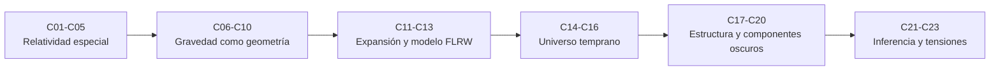

# B26 — Relatividad y cosmología

> **Bloque ampliado (`0.2.0`).** Además de las 20 clases de la malla base, el bloque tiene 3 clases programadas por la ampliación (`B26-C21` a `B26-C23`), listadas en el tramo 7. Ver el [programa completo](../../PROGRAMA_ACADEMICO_COMPLETO.md).

**Programa:** Programa Integral de Astronomía, Astrofísica, Ciencias Espaciales e Ingeniería Aeroespacial
**Área:** A03 — Astrofísica y ciencias fundamentales del universo
**Nivel:** N3 (fundamentos disciplinares) · **Clases:** 20 + 3 de la ampliación · **Carga:** por calibrar con el uso
**Estado:** guía pedagógica del bloque (resumen de qué se aprende en cada clase). Las clases enlazadas en la tabla ya están redactadas; todas conservan el estado E0 en el catálogo hasta registrar revisión disciplinar.

## 🎯 Propósito del bloque

Enseña **cómo el espacio, el tiempo y la gravedad dan forma al universo**, desde los dos postulados de la relatividad especial hasta el modelo cosmológico estándar y sus tensiones. Cada clase cierra con un cálculo verificable contra un caso analítico o una referencia independiente; las cifras observadas se citan con fuente y se distinguen de los datos sintéticos o ilustrativos.

## 📚 Al terminar el bloque podrás

1. Aplicar los postulados de la relatividad especial: composición de velocidades, transformaciones de Lorentz, dilatación del tiempo y contracción de longitudes.
2. Usar el intervalo de Minkowski para decidir causalidad y calcular tiempos propios, y relacionar masa y energía.
3. Explicar el principio de equivalencia, las métricas, las geodésicas y sus predicciones (corrimiento al rojo gravitacional, deflexión de la luz, precesión del perihelio).
4. Describir la expansión del universo, la ley de Hubble–Lemaître y la escalera de distancias con su incertidumbre.
5. Calcular con el modelo FLRW la edad, la evolución térmica, la radiación de fondo y la nucleosíntesis primordial.
6. Explicar las evidencias de materia y energía oscuras y el crecimiento de estructuras.
7. Combinar restricciones observacionales, analizar degeneraciones y evaluar las tensiones de Hubble y de `S₈`.

## 🧭 Secuencia del bloque

**Descripción textual.** Seis tramos encadenados: relatividad especial (C01–C05), relatividad general introductoria (C06–C10), expansión y modelo de Friedmann (C11–C13), universo temprano (C14–C16), estructura y componentes oscuros (C17–C20) y la ampliación con verosimilitudes, degeneraciones y tensiones (C21–C23).

## 🗂️ Las 23 clases en resumen (20 de la malla base + 3 de la ampliación)

**Navegación:** cada clase desarrollada enlaza a la anterior, a la siguiente y a este bloque; mientras una clase siga solo programada, su enlace lleva a su fila en esta tabla.

La columna «Evidencia» indica el producto que demostrará el aprendizaje. Los laboratorios usan datos **sintéticos** o **ilustrativos** (rotulados) o valores publicados con fuente y fecha.

### Tramo 1 · Relatividad especial

| ID | Clase | Qué se aprende | Evidencia |
|---|---|---|---|
| [B26-C01](../clases/B26/B26-C01-postulados-de-relatividad-especial/CLASE.md) | Postulados de relatividad especial | Constancia de `c`, composición de velocidades y rapidez. | Hoja de composición de velocidades |
| [B26-C02](../clases/B26/B26-C02-transformaciones-de-lorentz/CLASE.md) | Transformaciones de Lorentz | Boost, invariante del intervalo y composición de boosts. | Hoja de transformaciones verificadas |
| [B26-C03](../clases/B26/B26-C03-dilatacion-temporal-y-contraccion/CLASE.md) | Dilatación temporal y contracción | Tiempo propio y longitud propia aplicados a la supervivencia de muones. | Tabla de supervivencia de muones |
| [B26-C04](../clases/B26/B26-C04-espacio-tiempo-de-minkowski/CLASE.md) | Espacio-tiempo de Minkowski | Géneros del intervalo, conos de luz, causalidad y tiempo propio. | Ficha de causalidad y tiempo propio |
| B26-C05 | Equivalencia entre masa y energía | `E² = (pc)² + (mc²)²`, límite clásico y balances energéticos. | Balance de energía relativista |

### Tramo 2 · Gravedad como geometría

| ID | Clase | Qué se aprende | Evidencia |
|---|---|---|---|
| B26-C06 | Principio de equivalencia | Aceleración y gravedad localmente indistinguibles; corrimiento por aceleración. | Ficha de corrimiento por aceleración |
| B26-C07 | Curvatura y métricas | Métrica, radio de Schwarzschild y distancia propia. | Ficha de métrica y distancia propia |
| B26-C08 | Geodésicas gravitacionales | Geodésicas sobre superficies y precesión del perihelio. | Verificación de la precesión |
| B26-C09 | Relatividad general introductoria | Campo débil, ecuación de Einstein cualitativa y deflexión de la luz. | Cálculo de la deflexión solar |
| B26-C10 | Desplazamiento gravitacional al rojo | Corrimiento exacto y de campo débil, y contraste con la prueba de Galileo. | Tabla de corrimientos |

### Tramo 3 · Expansión y modelo FLRW

| ID | Clase | Qué se aprende | Evidencia |
|---|---|---|---|
| B26-C11 | Expansión cósmica y ley de Hubble-Lemaître | Ley de Hubble, ajuste con dispersión y tiempo de Hubble. | Ajuste de la ley con su incertidumbre |
| B26-C12 | Escalas de distancia cosmológicas | Escalera de distancias y propagación de errores. | Presupuesto de la escalera |
| B26-C13 | Modelo FLRW — Relatividad y cosmología | Ecuación de Friedmann y edad del universo. | Cálculo de la edad |

### Tramo 4 · Universo temprano

| ID | Clase | Qué se aprende | Evidencia |
|---|---|---|---|
| B26-C14 | Evolución térmica del universo | `T(z)`, densidad de radiación e igualdad materia–radiación. | Línea de tiempo térmica |
| B26-C15 | Radiación cósmica de fondo | Cuerpo negro cósmico, densidad de fotones y máximo espectral. | Ficha del cuerpo negro cósmico |
| B26-C16 | Nucleosíntesis primordial | Razón neutrón/protón y fracción de helio. | Cálculo de la fracción de helio |

### Tramo 5 · Estructura y componentes oscuros

| ID | Clase | Qué se aprende | Evidencia |
|---|---|---|---|
| B26-C17 | Estructura cosmológica | Crecimiento lineal de perturbaciones y escala BAO. | Curva de crecimiento |
| B26-C18 | Materia oscura y evidencias | Curvas de rotación, halo y lentes gravitacionales. | Curva de rotación con halo |
| B26-C19 | Energía oscura y parámetros | Distancia de luminosidad y aceleración cósmica. | Tabla de distancias de luminosidad |
| B26-C20 | Límites observacionales de modelos cosmológicos | Ajuste por `χ²` y regiones de confianza. | Ajuste de `Ω_m` con su incertidumbre |

### Tramo 6 · Ampliación `0.2.0`: inferencia y tensiones

| ID | Clase | Qué se aprende | Evidencia |
|---|---|---|---|
| B26-C21 | Verosimilitud cosmológica con datos combinados | Combinación de restricciones gaussianas y consistencia. | Combinación de restricciones de `Ω_m` |
| B26-C22 | Degeneraciones de parámetros cosmológicos | Matriz de Fisher, correlación y ruptura de degeneraciones. | Elipse de Fisher antes y después |
| B26-C23 | Tensiones observacionales: constante de Hubble y S8 | Significancia estadística de discrepancias. | Informe de significancia de dos tensiones |

## 🧵 Hilos que atraviesan el bloque

- **Invariantes:** el intervalo (C02, C04) y la energía–momento (C05) son lo que no cambia entre observadores.
- **Escalas de tiempo y distancia:** C03, C10 y C11–C13 convierten teoría en números medibles.
- **Verificación independiente:** cada laboratorio contrasta con un caso analítico o una referencia.
- **Datos observados frente a modelos:** C11–C23 distinguen lo medido, lo ajustado y lo supuesto.

## 📝 Evaluación del bloque (propuesta, por calibrar)

- Fichas y ejercicios por clase, con retroalimentación y recuperación con evidencia distinta.
- Portafolio: la combinación de restricciones y el análisis de tensiones (C21–C23).
- Las condiciones críticas (rotular lo sintético y lo ilustrativo, no presentar un ajuste como medida y citar solo lo consultado) no se compensan con promedio.

## ⚠️ Seguridad y límites

El bloque es educativo. Los modelos son simplificados (marcos planos, métricas sencillas, ΛCDM plano) y no sustituyen la literatura primaria ni los códigos de análisis cosmológico. Las cifras publicadas se citan con fecha de consulta y estado; en esta primera redacción de la mayoría de artículos solo se consultó el resumen.

## Fuentes de orientación preliminar

- **[NASA-DATA]** [NASA Science Data](https://science.data.nasa.gov/) — Portal general de datos y servicios científicos.
- **[ESA-SCIENCE]** [European Space Agency Science](https://www.esa.int/Science_Exploration/Space_Science) — Misiones, descubrimientos y material científico institucional.
- **[LIGO]** [LIGO Scientific Collaboration](https://www.ligo.org/) — Observaciones y métodos de ondas gravitacionales.
- **[ADS]** [NASA Astrophysics Data System](https://ui.adsabs.harvard.edu/) — Índice bibliográfico de literatura astronómica y física.

> La asociación de estas fuentes es orientativa por bloque. Las fuentes realmente consultadas para cada afirmación se registran en la sección 11 de cada clase.

[🏠 Volver al programa](../../README.md) · [➡️ B27 — Objetos compactos y altas energías](./B27-objetos-compactos-y-altas-energias.md)
