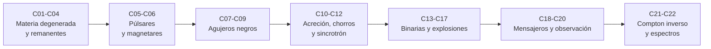

# B27 — Objetos compactos y altas energías

> **Bloque ampliado (`0.2.0`).** Además de las 20 clases de la malla base, el bloque tiene 2 clases programadas por la ampliación (`B27-C21` a `B27-C22`), listadas en el tramo 7. Ver el [programa completo](../../PROGRAMA_ACADEMICO_COMPLETO.md).

**Programa:** Programa Integral de Astronomía, Astrofísica, Ciencias Espaciales e Ingeniería Aeroespacial
**Área:** A03 — Astrofísica y ciencias fundamentales del universo
**Nivel:** N3 (fundamentos disciplinares) · **Clases:** 20 + 2 de la ampliación · **Carga:** por calibrar con el uso
**Estado:** guía pedagógica del bloque (resumen de qué se aprende en cada clase). Las clases enlazadas en la tabla ya están redactadas; todas conservan el estado E0 en el catálogo hasta registrar revisión disciplinar.

## 🎯 Propósito del bloque

Enseña **cómo son y cómo se observan los objetos más densos y energéticos del universo**: enanas blancas, estrellas de neutrones, púlsares, magnetares, agujeros negros, sus discos y chorros, las binarias compactas y las explosiones que los forman o los alimentan, y los instrumentos y mensajeros con que se estudian. Cada clase cierra con un cálculo verificable contra un caso analítico o una referencia independiente; las cifras observadas se citan con fuente y se distinguen de lo sintético.

## 📚 Al terminar el bloque podrás

1. Calcular la presión de un gas degenerado y la estructura de enanas blancas y estrellas de neutrones, con sus límites de masa.
2. Relacionar una ecuación de estado con masas y radios medidos y con la causalidad.
3. Interpretar púlsares y magnetares como relojes y campos extremos.
4. Calcular horizontes, órbitas y eficiencias radiativas en campos fuertes.
5. Describir discos de acreción, chorros relativistas y sus procesos de emisión (sincrotrón y Compton inverso).
6. Evaluar la evolución de binarias compactas y los balances de energía de supernovas, disrupciones por marea y explosiones de rayos gamma.
7. Planificar y analizar observaciones multibanda y multimensajero, incluido el ajuste de espectros con respuesta instrumental.

## 🧭 Secuencia del bloque

**Descripción textual.** Siete tramos encadenados: materia degenerada (C01–C04), púlsares y magnetares (C05–C06), agujeros negros (C07–C09), acreción y emisión (C10–C12), binarias y explosiones (C13–C17), mensajeros y observatorios (C18–C20) y la ampliación con Compton inverso y análisis espectral (C21–C22).

## 🗂️ Las 22 clases en resumen (20 de la malla base + 2 de la ampliación)

**Navegación:** cada clase desarrollada enlaza a la anterior, a la siguiente y a este bloque; mientras una clase siga solo programada, su enlace lleva a su fila en esta tabla.

La columna «Evidencia» indica el producto que demostrará el aprendizaje. Los laboratorios usan datos **sintéticos** o **ilustrativos** (rotulados) o valores publicados con fuente y fecha.

### Tramo 1 · Materia degenerada y remanentes

| ID | Clase | Qué se aprende | Evidencia |
|---|---|---|---|
| [B27-C01](../clases/B27/B27-C01-presion-de-degeneracion/CLASE.md) | Presión de degeneración | Presión de Fermi exacta y límites no relativista y ultrarrelativista. | Ficha de presión degenerada |
| [B27-C02](../clases/B27/B27-C02-enanas-blancas-y-limite-de-chandrasekhar/CLASE.md) | Enanas blancas y límite de Chandrasekhar | Relación masa–radio por integración del equilibrio. | Tabla masa–radio de enanas blancas |
| [B27-C03](../clases/B27/B27-C03-estrellas-de-neutrones/CLASE.md) | Estrellas de neutrones | Ecuación TOV, masa máxima y compacidad. | Ficha de una familia de estrellas de neutrones |
| [B27-C04](../clases/B27/B27-C04-ecuacion-de-estado-nuclear/CLASE.md) | Ecuación de estado nuclear | EOS por tramos frente a restricciones de masa y radio. | Tabla de EOS frente a restricciones |

### Tramo 2 · Púlsares y magnetares

| ID | Clase | Qué se aprende | Evidencia |
|---|---|---|---|
| [B27-C05](../clases/B27/B27-C05-pulsares-y-relojes-naturales/CLASE.md) | Púlsares y relojes naturales | Frenado magnético, campo y edad característica; tiempos de llegada. | Ficha de un púlsar |
| [B27-C06](../clases/B27/B27-C06-magnetares-y-campos-extremos/CLASE.md) | Magnetares y campos extremos | Campo crítico cuántico, energía magnética y ciclotrón. | Ficha de campo magnético extremo |

### Tramo 3 · Agujeros negros

| ID | Clase | Qué se aprende | Evidencia |
|---|---|---|---|
| [B27-C07](../clases/B27/B27-C07-metricas-de-agujeros-negros/CLASE.md) | Métricas de agujeros negros | Horizontes de Kerr, órbita estable más interna y eficiencia. | Ficha de una métrica de Kerr |
| [B27-C08](../clases/B27/B27-C08-horizonte-de-sucesos/CLASE.md) | Horizonte de sucesos | Caída libre: tiempo propio finito y tiempo coordenado divergente. | Ficha de caída al horizonte |
| [B27-C09](../clases/B27/B27-C09-orbitas-en-campos-fuertes/CLASE.md) | Órbitas en campos fuertes | Esfera de fotones, órbitas ligadas y precesión fuerte. | Ficha de órbitas en campo fuerte |

### Tramo 4 · Acreción, chorros y sincrotrón

| ID | Clase | Qué se aprende | Evidencia |
|---|---|---|---|
| [B27-C10](../clases/B27/B27-C10-discos-de-acrecion/CLASE.md) | Discos de acreción | Perfil de temperatura de un disco delgado y luminosidad. | Perfil de temperatura de un disco |
| [B27-C11](../clases/B27/B27-C11-chorros-relativistas/CLASE.md) | Chorros relativistas | Aberración, movimiento superlumínico aparente y amplificación Doppler. | Ficha de un chorro relativista |
| [B27-C12](../clases/B27/B27-C12-radiacion-sincrotron/CLASE.md) | Radiación sincrotrón | Potencia, frecuencia crítica y espectro de una población de electrones. | Ficha de radiación sincrotrón |

### Tramo 5 · Binarias y explosiones

| ID | Clase | Qué se aprende | Evidencia |
|---|---|---|---|
| [B27-C13](../clases/B27/B27-C13-binarias-compactas/CLASE.md) | Binarias compactas | Pérdida de energía por ondas gravitacionales y tiempo hasta la fusión. | Ficha de una binaria compacta |
| [B27-C14](../clases/B27/B27-C14-supernovas-termonucleares/CLASE.md) | Supernovas termonucleares | Cadena radiactiva y curva de luz tardía. | Curva de luz radiactiva de una SN Ia |
| [B27-C15](../clases/B27/B27-C15-supernovas-de-colapso/CLASE.md) | Supernovas de colapso | Balance de energía y escala de tiempo del colapso. | Balance energético de un colapso |
| [B27-C16](../clases/B27/B27-C16-eventos-de-disrupcion-por-marea/CLASE.md) | Eventos de disrupción por marea | Radio de marea, masa de Hills y tasa de caída de masa. | Ficha de un evento de disrupción |
| [B27-C17](../clases/B27/B27-C17-explosiones-de-rayos-gamma/CLASE.md) | Explosiones de rayos gamma | Factor de Lorentz, colimación y retardo de llegada. | Ficha energética de una explosión de rayos gamma |

### Tramo 6 · Mensajeros y observación

| ID | Clase | Qué se aprende | Evidencia |
|---|---|---|---|
| [B27-C18](../clases/B27/B27-C18-neutrinos-de-supernova/CLASE.md) | Neutrinos de supernova | Número de neutrinos, sucesos esperados y retraso por masa. | Ficha de neutrinos de supernova |
| [B27-C19](../clases/B27/B27-C19-observatorios-de-rayos-x-y-gamma/CLASE.md) | Observatorios de rayos X y gamma | Estadística de conteos, significancia y sensibilidad. | Ficha de sensibilidad de un observatorio |
| [B27-C20](../clases/B27/B27-C20-analisis-multibanda-de-evento-extremo/CLASE.md) | Análisis multibanda de evento extremo | Distribución espectral de energía y retardos entre bandas. | Análisis multibanda de un evento |

### Tramo 7 · Ampliación `0.2.0`: emisión de alta energía y espectros

| ID | Clase | Qué se aprende | Evidencia |
|---|---|---|---|
| [B27-C21](../clases/B27/B27-C21-dispersion-compton-inversa-y-emision-de-alta-energia/CLASE.md) | Dispersión Compton inversa y emisión de alta energía | Energía de fotones dispersados, régimen de Klein–Nishina y razón sincrotrón/Compton. | Ficha de dispersión Compton inversa |
| [B27-C22](../clases/B27/B27-C22-analisis-espectral-de-rayos-x-y-gamma/CLASE.md) | Análisis espectral de rayos X y gamma: ajuste con respuesta instrumental | Ajuste con matriz de respuesta y estadística de conteos. | Ajuste espectral con respuesta |

## 🧵 Hilos que atraviesan el bloque

- **Presión de degeneración y relatividad:** C01–C04 (materia) y C07–C09 (campos fuertes) se apoyan en B26.
- **Energía y escalas:** C05, C10, C13–C17 comparan energías y tiempos característicos de cada fenómeno.
- **Procesos radiativos:** C12 y C21 (sincrotrón y Compton inverso) conectan con C10–C11 y C19–C22.
- **Verificación independiente:** cada laboratorio contrasta con un caso analítico o una referencia.
- **Observado frente a modelado:** las cifras publicadas se distinguen de lo sintético en cada clase.

## 📝 Evaluación del bloque (propuesta, por calibrar)

- Fichas y ejercicios por clase, con retroalimentación y recuperación con evidencia distinta.
- Portafolio: análisis multibanda (C20) y ajuste espectral con respuesta (C22).
- Las condiciones críticas (rotular lo sintético, no presentar un modelo ilustrativo como física real y citar solo lo consultado) no se compensan con promedio.

## ⚠️ Seguridad y límites

El bloque es educativo. Los modelos son simplificados (esferas estáticas, ecuaciones de estado ilustrativas, discos delgados) y no sustituyen la literatura primaria ni los códigos de análisis de datos. Las cifras publicadas se citan con fecha de consulta; en esta primera redacción de la mayoría de artículos solo se consultó el resumen.

## Fuentes de orientación preliminar

- **[NASA-DATA]** [NASA Science Data](https://science.data.nasa.gov/) — Portal general de datos y servicios científicos.
- **[ESA-SCIENCE]** [European Space Agency Science](https://www.esa.int/Science_Exploration/Space_Science) — Misiones, descubrimientos y material científico institucional.
- **[LIGO]** [LIGO Scientific Collaboration](https://www.ligo.org/) — Observaciones y métodos de ondas gravitacionales.
- **[ADS]** [NASA Astrophysics Data System](https://ui.adsabs.harvard.edu/) — Índice bibliográfico de literatura astronómica y física.

> La asociación de estas fuentes es orientativa por bloque. Las fuentes realmente consultadas para cada afirmación se registran en la sección 11 de cada clase.

[🏠 Volver al programa](../../README.md) · [➡️ B28 — Astronomía multimensajero](./B28-astronomia-multimensajero.md)
