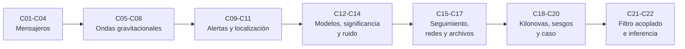

# B28 — Astronomía multimensajero

> **Bloque ampliado (`0.2.0`).** Además de las 20 clases de la malla base, el bloque tiene 2 clases programadas por la ampliación (`B28-C21` a `B28-C22`), listadas en el último tramo. Ver el [programa completo](../../PROGRAMA_ACADEMICO_COMPLETO.md).

**Programa:** Programa Integral de Astronomía, Astrofísica, Ciencias Espaciales e Ingeniería Aeroespacial
**Área:** A03 — Astrofísica y ciencias fundamentales del universo
**Nivel:** N3 (fundamentos disciplinares) · **Clases:** 20 + 2 de la ampliación · **Carga:** por calibrar con el uso
**Estado:** guía pedagógica del bloque (resumen de qué se aprende en cada clase). Las clases enlazadas en la tabla ya están redactadas; todas conservan el estado E0 en el catálogo hasta registrar revisión disciplinar.

## 🎯 Propósito del bloque

Enseña **cómo se combinan los cuatro mensajeros del universo —luz, neutrinos, rayos cósmicos y ondas gravitacionales— para estudiar un mismo evento**: qué trae cada uno, cómo se detecta, cómo se localiza en el cielo, cómo se decide que dos señales vienen de la misma fuente y cómo se interpretan juntas. Cada clase cierra con un cálculo verificable contra un caso analítico, una simulación con semilla fija o un valor publicado con fuente y fecha, y distingue siempre lo observado de lo ilustrativo.

## 📚 Al terminar el bloque podrás

1. Comparar los cuatro mensajeros por carga, interacción y retardo, y calcular deflexiones y dispersiones.
2. Convertir y comparar fotones de radio a gamma, y relacionar temperatura y banda.
3. Interpretar oscilaciones de neutrinos, energías máximas de rayos cósmicos y anisotropías.
4. Calcular la amplitud y la frecuencia de ondas gravitacionales y el ruido de un interferómetro.
5. Evaluar alertas, localizaciones y coincidencias entre observatorios con estadística correcta.
6. Modelar la emisión conjunta de un evento, interpretar kilonovas y reconocer sesgos de selección.
7. Aplicar filtro acoplado e inferencia bayesiana conjunta a señales multimensajero.

## 🧭 Secuencia del bloque

**Descripción textual.** Siete tramos encadenados: los cuatro mensajeros (C01–C04), las ondas gravitacionales y sus fuentes (C05–C08), alertas, localización y coincidencias (C09–C11), modelos y estadística (C12–C14), seguimiento, redes y archivos (C15–C17), interpretación y un caso integrado (C18–C20) y la ampliación con filtro acoplado e inferencia conjunta (C21–C22).

## 🗂️ Las 22 clases en resumen (20 de la malla base + 2 de la ampliación)

**Navegación:** cada clase desarrollada enlaza a la anterior, a la siguiente y a este bloque; mientras una clase siga solo programada, su enlace lleva a su fila en esta tabla.

La columna «Evidencia» indica el producto que demostrará el aprendizaje. Los laboratorios usan datos **sintéticos** o **ilustrativos** (rotulados) o valores publicados con fuente y fecha.

### Tramo 1 · Los cuatro mensajeros

| ID | Clase | Qué se aprende | Evidencia |
|---|---|---|---|
| [B28-C01](../clases/B28/B28-C01-fundamentos-de-mensajeros-astronomicos/CLASE.md) | Fundamentos de mensajeros astronómicos | Radio de Larmor, dispersión del plasma y retardo de un neutrino con masa. | Ficha de comparación de mensajeros |
| [B28-C02](../clases/B28/B28-C02-fotones-en-multiples-longitudes-de-onda/CLASE.md) | Fotones en múltiples longitudes de onda | Conversión de magnitudes, ley de Planck y desplazamientos de Wien. | Ficha de bandas y temperaturas |
| [B28-C03](../clases/B28/B28-C03-neutrinos-astrofisicos/CLASE.md) | Neutrinos astrofísicos | Oscilaciones, matriz de mezcla y razón de sabores en la Tierra. | Ficha de sabores de neutrinos |
| [B28-C04](../clases/B28/B28-C04-rayos-cosmicos-de-alta-energia/CLASE.md) | Rayos cósmicos de alta energía | Criterio de Hillas, espectro con rodilla y recuperación de un dipolo. | Ficha de energía y anisotropía de rayos cósmicos |

### Tramo 2 · Ondas gravitacionales y sus fuentes

| ID | Clase | Qué se aprende | Evidencia |
|---|---|---|---|
| B28-C05 | Ondas gravitacionales | Amplitud, energía transportada y desplazamiento de una onda de una binaria. | Ficha de una onda gravitacional |
| B28-C06 | Interferómetros gravitacionales | Respuesta de un interferómetro y límite del ruido de disparo. | Ficha de sensibilidad de un interferómetro |
| B28-C07 | Fuentes compactas binarias | Frecuencia de última órbita, distancia de horizonte y número de eventos. | Ficha de fuentes y alcance de detección |
| B28-C08 | Señales transitorias | Ajuste de curvas de luz y probabilidad de detección según la cadencia. | Ficha de un transitorio y su cadencia |

### Tramo 3 · Alertas, localización y coincidencias

| ID | Clase | Qué se aprende | Evidencia |
|---|---|---|---|
| B28-C09 | Alertas científicas en tiempo real | Presupuesto de latencia y tasa de falsas alarmas con múltiples pruebas. | Ficha de una alerta con su latencia |
| B28-C10 | Localización probabilística de eventos | Triangulación por tiempos de llegada y región creíble sobre la esfera. | Mapa de probabilidad y área creíble |
| B28-C11 | Coincidencias entre observatorios | Probabilidad de coincidencia fortuita en tiempo y cielo. | Ficha de una coincidencia con su probabilidad fortuita |

### Tramo 4 · Modelos y estadística

| ID | Clase | Qué se aprende | Evidencia |
|---|---|---|---|
| B28-C12 | Modelos de emisión conjunta | Chorro estructurado y brillo según el ángulo de visión. | Ficha de emisión conjunta según el ángulo |
| B28-C13 | Estadística de significancia | Valor p a sigma, factor de pruebas y combinación de valores p. | Ficha de significancia combinada |
| B28-C14 | Ruidos instrumentales | Ruido coloreado, espectro de potencia y filtro de blanqueo. | Ficha de ruido y blanqueo |

### Tramo 5 · Seguimiento, redes y archivos

| ID | Clase | Qué se aprende | Evidencia |
|---|---|---|---|
| B28-C15 | Búsqueda de contrapartidas ópticas | Teselado de una región de localización y probabilidad acumulada. | Plan de teselado con su cobertura |
| B28-C16 | Redes internacionales de alertas | Visibilidad desde una red de sitios y disponibilidad combinada. | Ficha de cobertura de una red |
| B28-C17 | Archivos de eventos multimensajero | Registro con identificador, versión y huella; validación y duplicados. | Archivo validado con informe de errores |

### Tramo 6 · Interpretación y caso integrado

| ID | Clase | Qué se aprende | Evidencia |
|---|---|---|---|
| B28-C18 | Interpretación de kilonovas | Calentamiento radiactivo, tiempo de difusión y luminosidad pico. | Ficha de una kilonova |
| B28-C19 | Limitaciones y sesgos de detección | Función de selección y sesgo de Malmquist por simulación. | Ficha de sesgos de selección |
| B28-C20 | Caso de estudio de evento combinado | Cronología y coherencia de un evento con varios mensajeros. | Dossier de un evento combinado |

### Tramo 7 · Ampliación `0.2.0`: filtro acoplado e inferencia conjunta

| ID | Clase | Qué se aprende | Evidencia |
|---|---|---|---|
| B28-C21 | Formas de onda gravitacionales y filtro acoplado | Plantilla de chirrido, relación señal-ruido y desajuste del banco. | Ficha de filtro acoplado |
| B28-C22 | Inferencia bayesiana conjunta de parámetros de fuente multimensajero | Verosimilitud conjunta, degeneración distancia–inclinación y propagación de incertidumbres. | Ficha de inferencia conjunta |

## 🧵 Hilos que atraviesan el bloque

- **Del mensajero al dato:** C01–C08 describen qué se mide y con qué instrumento; C09–C17 qué se hace con la alerta; C18–C22 cómo se interpreta.
- **Estadística honesta:** C09, C11, C13 y C19 tratan falsas alarmas, factor de pruebas y sesgos; ninguna cifra de significancia se da sin su definición.
- **Localización y seguimiento:** C10, C15 y C16 encadenan el mapa de probabilidad, el teselado y la red de sitios.
- **Verificación independiente:** cada laboratorio contrasta con un caso analítico o una simulación con semilla fija.
- **Observado frente a modelado:** las cifras publicadas (GW170817, IceCube-170922A, Auger) se distinguen de lo sintético en cada clase.

## 📝 Evaluación del bloque (propuesta, por calibrar)

- Fichas y ejercicios por clase, con retroalimentación y recuperación con evidencia distinta.
- Portafolio: caso de estudio de evento combinado (C20) e inferencia conjunta (C22).
- Las condiciones críticas (rotular lo sintético, no presentar un modelo ilustrativo como física real y citar solo lo consultado) no se compensan con promedio.

## ⚠️ Seguridad y límites

El bloque es educativo. Los modelos son simplificados (cuadrupolo, cielo plano o completo, ruido sintético) y no sustituyen la literatura primaria, los catálogos oficiales ni las canalizaciones de análisis de las colaboraciones. Las cifras publicadas se citan con fecha de consulta; el resto de los números son ilustrativos y se rotulan como tales.

## Fuentes de orientación preliminar

- **[NASA-DATA]** [NASA Science Data](https://science.data.nasa.gov/) — Portal general de datos y servicios científicos.
- **[ESA-SCIENCE]** [European Space Agency Science](https://www.esa.int/Science_Exploration/Space_Science) — Misiones, descubrimientos y material científico institucional.
- **[LIGO]** [LIGO Scientific Collaboration](https://www.ligo.org/) — Observaciones y métodos de ondas gravitacionales.
- **[ADS]** [NASA Astrophysics Data System](https://ui.adsabs.harvard.edu/) — Índice bibliográfico de literatura astronómica y física.

> La asociación de estas fuentes es orientativa por bloque. Las fuentes realmente consultadas para cada afirmación se registran en la sección 11 de cada clase.

[🏠 Volver al programa](../../README.md) · [➡️ B29 — Astronomía temporal y exoplanetas](./B29-astronomia-temporal-y-exoplanetas.md)
