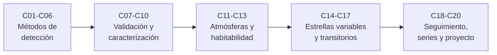

# B29 — Astronomía temporal y exoplanetas

> **Bloque de la estructura vigente.** Ver el [programa completo](../../PROGRAMA_ACADEMICO_COMPLETO.md).

**Programa:** Programa Integral de Astronomía, Astrofísica, Ciencias Espaciales e Ingeniería Aeroespacial
**Área:** A03 — Astrofísica y ciencias fundamentales del universo
**Nivel:** N3 (fundamentos disciplinares) · **Clases:** 20 · **Carga:** por calibrar con el uso
**Estado:** guía pedagógica del bloque (resumen de qué se aprende en cada clase). Las clases enlazadas en la tabla ya están redactadas; todas conservan el estado E0 en el catálogo hasta registrar revisión disciplinar.

## 🎯 Propósito del bloque

Enseña **cómo se detectan y caracterizan planetas alrededor de otras estrellas y cómo se estudian los fenómenos que cambian con el tiempo**: tránsitos, velocidad radial, astrometría, microlentes e imagen directa; validación y falsos positivos; órbitas, masas, radios y atmósferas; zonas de habitabilidad; estrellas variables, llamaradas, supernovas y transitorios rápidos; y las redes, series temporales y proyectos que lo hacen posible. Cada clase cierra con un cálculo verificable contra un caso analítico, una simulación con semilla fija o un valor publicado con fuente y fecha, y distingue siempre lo observado de lo ilustrativo.

## 📚 Al terminar el bloque podrás

1. Calcular profundidades, duraciones y curvas de luz de tránsitos y la precisión fotométrica necesaria.
2. Calcular semiamplitudes de velocidad radial, firmas astrométricas, escalas de microlentes y contrastes de imagen directa.
3. Evaluar probabilidades de falso positivo y pruebas de descarte con sus falsas alarmas y su potencia.
4. Derivar parámetros orbitales, masas, radios y densidades con sus incertidumbres.
5. Estimar señales de atmósferas y zonas de habitabilidad.
6. Analizar estrellas variables, llamaradas, supernovas y transitorios rápidos con series temporales regulares e irregulares.
7. Planificar un proyecto de detección con inyección y recuperación y una red de seguimiento.

## 🧭 Secuencia del bloque

**Descripción textual.** Cinco tramos encadenados: métodos de detección (C01–C06), validación y caracterización (C07–C10), atmósferas y habitabilidad (C11–C13), astronomía temporal (C14–C17) y seguimiento, series y proyecto (C18–C20).

## 🗂️ Las 20 clases en resumen

**Navegación:** cada clase desarrollada enlaza a la anterior, a la siguiente y a este bloque; mientras una clase siga solo programada, su enlace lleva a su fila en esta tabla.

La columna «Evidencia» indica el producto que demostrará el aprendizaje. Los laboratorios usan datos **sintéticos** o **ilustrativos** (rotulados) o valores publicados con fuente y fecha.

### Tramo 1 · Métodos de detección

| ID | Clase | Qué se aprende | Evidencia |
|---|---|---|---|
| [B29-C01](../clases/B29/B29-C01-transitos-planetarios/CLASE.md) | Tránsitos planetarios | Profundidad, duración y oscurecimiento al limbo. | Ficha de un tránsito |
| [B29-C02](../clases/B29/B29-C02-curvas-de-luz-fotometricas/CLASE.md) | Curvas de luz fotométricas | Ecuación del CCD, apertura óptima y error en magnitud. | Ficha de fotometría y apertura óptima |
| [B29-C03](../clases/B29/B29-C03-velocidad-radial-estelar/CLASE.md) | Velocidad radial estelar | Semiamplitud, ecuación de Kepler y ajuste con sesgo por excentricidad. | Ficha de velocidad radial |
| [B29-C04](../clases/B29/B29-C04-astrometria-de-exoplanetas/CLASE.md) | Astrometría de exoplanetas | Firma astrométrica y ajuste conjunto con paralaje y movimiento propio. | Ficha de firma astrométrica |
| [B29-C05](../clases/B29/B29-C05-microlentes-gravitacionales/CLASE.md) | Microlentes gravitacionales | Radio de Einstein, magnificación y ajuste de un evento. | Ficha de una microlente |
| [B29-C06](../clases/B29/B29-C06-imagen-directa-de-exoplanetas/CLASE.md) | Imagen directa de exoplanetas | Patrón de Airy, contraste reflejado y térmico. | Ficha de contraste y separación |

### Tramo 2 · Validación y caracterización

| ID | Clase | Qué se aprende | Evidencia |
|---|---|---|---|
| [B29-C07](../clases/B29/B29-C07-metodos-de-validacion-planetaria/CLASE.md) | Métodos de validación planetaria | Probabilidad bayesiana de falso positivo y su calibración. | Ficha de validación con su calibración |
| [B29-C08](../clases/B29/B29-C08-falsos-positivos-de-transito/CLASE.md) | Falsos positivos de tránsito | Dilución de una binaria, prueba par–impar y su potencia. | Ficha de una prueba par–impar |
| [B29-C09](../clases/B29/B29-C09-parametros-orbitales-exoplanetarios/CLASE.md) | Parámetros orbitales exoplanetarios | Semieje, excentricidad y ajuste orbital con incertidumbres. | Ficha de parámetros orbitales |
| [B29-C10](../clases/B29/B29-C10-masas-y-radios-planetarios/CLASE.md) | Masas y radios planetarios | Densidad, gravedad y propagación de incertidumbres. | Ficha de masa, radio y densidad |

### Tramo 3 · Atmósferas y habitabilidad

| ID | Clase | Qué se aprende | Evidencia |
|---|---|---|---|
| [B29-C11](../clases/B29/B29-C11-atmosferas-exoplanetarias/CLASE.md) | Atmósferas exoplanetarias | Altura de escala y amplitud de la señal de transmisión. | Ficha de una atmósfera |
| [B29-C12](../clases/B29/B29-C12-espectroscopia-de-transmision/CLASE.md) | Espectroscopía de transmisión | Espectro sintético, absorción y recuperación de una abundancia. | Ficha de un espectro de transmisión |
| [B29-C13](../clases/B29/B29-C13-zonas-de-habitabilidad/CLASE.md) | Zonas de habitabilidad | Temperatura de equilibrio y bordes de la zona habitable. | Ficha de habitabilidad |

### Tramo 4 · Astronomía temporal

| ID | Clase | Qué se aprende | Evidencia |
|---|---|---|---|
| [B29-C14](../clases/B29/B29-C14-estrellas-variables-periodicas/CLASE.md) | Estrellas variables periódicas | Período, plegado de fases y ajuste de armónicos. | Ficha de una variable periódica |
| [B29-C15](../clases/B29/B29-C15-eventos-eruptivos-estelares/CLASE.md) | Eventos eruptivos estelares | Modelo de llamarada, energía y distribución de energías. | Ficha de llamaradas estelares |
| [B29-C16](../clases/B29/B29-C16-supernovas-y-curvas-de-luz/CLASE.md) | Supernovas y curvas de luz | Plantilla, ajuste de estiramiento y tiempo del máximo. | Ficha de una curva de luz de supernova |
| [B29-C17](../clases/B29/B29-C17-fenomenos-transitorios-rapidos/CLASE.md) | Fenómenos transitorios rápidos | Dispersión, desdispersión y búsqueda de pulsos. | Ficha de un pulso desdispersado |

### Tramo 5 · Seguimiento, series y proyecto

| ID | Clase | Qué se aprende | Evidencia |
|---|---|---|---|
| [B29-C18](../clases/B29/B29-C18-redes-de-seguimiento-temporal/CLASE.md) | Redes de seguimiento temporal | Planificación voraz y completitud de una red. | Ficha de planificación de seguimiento |
| [B29-C19](../clases/B29/B29-C19-analisis-de-series-temporales-irregularmente-muestreadas/CLASE.md) | Análisis de series temporales irregularmente muestreadas | Periodograma de Lomb–Scargle, ventana y alias. | Ficha de un periodograma irregular |
| [B29-C20](../clases/B29/B29-C20-proyecto-de-deteccion-exoplanetaria/CLASE.md) | Proyecto de detección exoplanetaria | Búsqueda por cajas e inyección–recuperación. | Informe de detección con completitud |

## 🧵 Hilos que atraviesan el bloque

- **De la señal al planeta:** C01–C06 describen la señal de cada método; C07–C10 qué se hace para confirmarla y medirla.
- **Estadística honesta:** C07, C08, C14, C19 y C20 tratan falsas alarmas, potencia, calibración y completitud.
- **Series temporales:** C02, C14, C19 y C20 comparten la mirada espectral y de ajuste.
- **Verificación independiente:** cada laboratorio contrasta con un caso analítico o una simulación con semilla fija.
- **Observado frente a modelado:** las cifras publicadas se distinguen de lo sintético en cada clase.

## 📝 Evaluación del bloque (propuesta, por calibrar)

- Fichas y ejercicios por clase, con retroalimentación y recuperación con evidencia distinta.
- Portafolio: informe de detección con completitud (C20) y ficha de habitabilidad (C13).
- Las condiciones críticas (rotular lo sintético, no presentar un modelo ilustrativo como física real y citar solo lo consultado) no se compensan con promedio.

## ⚠️ Seguridad y límites

El bloque es educativo. Los modelos son simplificados (órbitas circulares o keplerianas, ruido gaussiano, atmósferas isotermas) y no sustituyen la literatura primaria, los catálogos oficiales ni las canalizaciones de análisis de las misiones. Las cifras publicadas se citan con fecha de consulta; el resto de los números son ilustrativos y se rotulan como tales.

## Fuentes de orientación preliminar

- **[NASA-DATA]** [NASA Science Data](https://science.data.nasa.gov/) — Portal general de datos y servicios científicos.
- **[ESA-SCIENCE]** [European Space Agency Science](https://www.esa.int/Science_Exploration/Space_Science) — Misiones, descubrimientos y material científico institucional.
- **[LIGO]** [LIGO Scientific Collaboration](https://www.ligo.org/) — Observaciones y métodos de ondas gravitacionales.
- **[ADS]** [NASA Astrophysics Data System](https://ui.adsabs.harvard.edu/) — Índice bibliográfico de literatura astronómica y física.

> La asociación de estas fuentes es orientativa por bloque. Las fuentes realmente consultadas para cada afirmación se registran en la sección 11 de cada clase.

[🏠 Volver al programa](../../README.md) · [➡️ B30 — Heliofísica y física de plasmas](./B30-heliofisica-y-fisica-de-plasmas.md)
