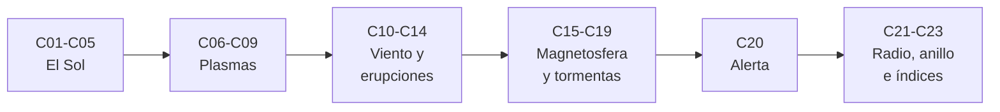

# B30 — Heliofísica y física de plasmas

> **Bloque ampliado (`0.2.0`).** Además de las 20 clases de la malla base, el bloque tiene 3 clases programadas por la ampliación (`B30-C21` a `B30-C23`), listadas en el último tramo. Ver el [programa completo](../../PROGRAMA_ACADEMICO_COMPLETO.md).

**Programa:** Programa Integral de Astronomía, Astrofísica, Ciencias Espaciales e Ingeniería Aeroespacial
**Área:** A03 — Astrofísica y ciencias fundamentales del universo
**Nivel:** N3 (fundamentos disciplinares) · **Clases:** 20 + 3 de la ampliación · **Carga:** por calibrar con el uso
**Estado:** guía pedagógica del bloque (resumen de qué se aprende en cada clase). Las clases enlazadas en la tabla ya están redactadas; todas conservan el estado E0 en el catálogo hasta registrar revisión disciplinar.

## 🎯 Propósito del bloque

Enseña **cómo funciona el Sol como estrella magnética, cómo se comporta un plasma y cómo la actividad solar llega a la Tierra**: la estructura solar y su ciclo, los campos y las partículas, las ondas y la magnetohidrodinámica, el viento solar, la reconexión, las erupciones y las eyecciones de masa, la magnetosfera, los cinturones de radiación, las tormentas geomagnéticas y los impactos y alertas del clima espacial. Cada clase cierra con un cálculo verificable contra un caso analítico, una simulación con semilla fija o un valor publicado con fuente y fecha, y distingue siempre lo observado de lo ilustrativo.

## 📚 Al terminar el bloque podrás

1. Estimar la estructura del Sol, las escalas de altura y la actividad magnética del ciclo y las manchas.
2. Calcular parámetros de un plasma: longitud de Debye, frecuencias, beta y velocidad de Alfvén.
3. Simular el movimiento de partículas cargadas y la propagación de ondas MHD.
4. Resolver el viento solar de Parker y estimar tiempos de tránsito de eyecciones de masa.
5. Describir reconexión, aceleración en choques y el balance de energía de una erupción.
6. Relacionar magnetosfera, anillo de corriente, tormentas, auroras y los índices Kp y Dst.
7. Convertir mediciones en alertas con las escalas oficiales de clima espacial.

## 🧭 Secuencia del bloque

**Descripción textual.** Seis tramos encadenados: el Sol (C01–C05), física de plasmas (C06–C09), viento, reconexión y erupciones (C10–C14), magnetosfera, tormentas e impactos (C15–C19), una alerta real (C20) y la ampliación con radioemisión, anillo de corriente e índices (C21–C23).

## 🗂️ Las 23 clases en resumen (20 de la malla base + 3 de la ampliación)

**Navegación:** cada clase desarrollada enlaza a la anterior, a la siguiente y a este bloque; mientras una clase siga solo programada, su enlace lleva a su fila en esta tabla.

La columna «Evidencia» indica el producto que demostrará el aprendizaje. Los laboratorios usan datos **sintéticos** o **ilustrativos** (rotulados) o valores publicados con fuente y fecha.

### Tramo 1 · El Sol

| ID | Clase | Qué se aprende | Evidencia |
|---|---|---|---|
| [B30-C01](../clases/B30/B30-C01-estructura-interna-del-sol/CLASE.md) | Estructura interna del Sol | Politropo, temperatura central y tiempo de difusión de fotones. | Ficha de la estructura solar |
| [B30-C02](../clases/B30/B30-C02-fotosfera-cromosfera-y-corona/CLASE.md) | Fotosfera, cromosfera y corona | Gravedad, alturas de escala y radio sónico. | Ficha de las capas solares |
| [B30-C03](../clases/B30/B30-C03-ciclo-de-actividad-solar/CLASE.md) | Ciclo de actividad solar | Serie sintética de manchas y recuperación del periodo. | Ficha del ciclo solar |
| [B30-C04](../clases/B30/B30-C04-manchas-solares/CLASE.md) | Manchas solares | Equilibrio de presiones, contraste y flujo magnético. | Ficha de una mancha |
| [B30-C05](../clases/B30/B30-C05-campos-magneticos-solares/CLASE.md) | Campos magnéticos solares | Beta del plasma, velocidad de Alfvén y conservación del flujo. | Ficha de los campos solares |

### Tramo 2 · Física de plasmas

| ID | Clase | Qué se aprende | Evidencia |
|---|---|---|---|
| [B30-C06](../clases/B30/B30-C06-particulas-cargadas-y-movimientos/CLASE.md) | Partículas cargadas y movimientos | Integrador de Boris, deriva E×B y espejo magnético. | Ficha del movimiento de una partícula |
| [B30-C07](../clases/B30/B30-C07-longitud-de-debye-y-plasma/CLASE.md) | Longitud de Debye y plasma | Apantallamiento y parámetro de plasma. | Ficha de la longitud de Debye |
| [B30-C08](../clases/B30/B30-C08-frecuencias-y-ondas-de-plasma/CLASE.md) | Frecuencias y ondas de plasma | Frecuencia de plasma, dispersión y retardo de grupo. | Ficha de ondas de plasma |
| [B30-C09](../clases/B30/B30-C09-magnetohidrodinamica/CLASE.md) | Magnetohidrodinámica | Ondas de Alfvén en diferencias finitas. | Ficha de una onda de Alfvén |

### Tramo 3 · Viento, reconexión y erupciones

| ID | Clase | Qué se aprende | Evidencia |
|---|---|---|---|
| [B30-C10](../clases/B30/B30-C10-viento-solar-y-heliosfera/CLASE.md) | Viento solar y heliosfera | Solución transónica de Parker y espiral magnética. | Ficha del viento solar |
| B30-C11 | Reconexión magnética | Difusión resistiva, tasa de Sweet–Parker y energía liberada. | Ficha de reconexión |
| B30-C12 | Erupciones y fulguraciones solares | Clases de rayos X, ley de potencias y efecto Neupert. | Ficha de fulguraciones |
| B30-C13 | Eyecciones de masa coronal | Modelo de arrastre y tiempo de tránsito a 1 au. | Ficha de una eyección de masa coronal |
| B30-C14 | Choques y aceleración de partículas | Saltos de Rankine–Hugoniot y aceleración difusiva. | Ficha de un choque |

### Tramo 4 · Magnetosfera, tormentas e impactos

| ID | Clase | Qué se aprende | Evidencia |
|---|---|---|---|
| B30-C15 | Magnetosfera terrestre | Distancia de la magnetopausa y órbita geoestacionaria. | Ficha de la magnetosfera |
| B30-C16 | Cinturones de Van Allen | Latitud de espejo, periodo de rebote y radio de giro. | Ficha de partículas atrapadas |
| B30-C17 | Auroras y corrientes ionosféricas | Capa de Chapman y energía de las líneas auroral. | Ficha de la ionosfera y las auroras |
| B30-C18 | Tormentas geomagnéticas | Ecuación de Burton e integración de una tormenta. | Ficha de una tormenta |
| B30-C19 | Impactos del clima espacial | Corrientes inducidas y niveles de retorno. | Ficha de impactos |

### Tramo 5 · Alerta real

| ID | Clase | Qué se aprende | Evidencia |
|---|---|---|---|
| B30-C20 | Análisis de alerta solar real | Escalas oficiales G, S y R y clasificación de series. | Informe de alerta |

### Tramo 6 · Ampliación `0.2.0`: radio, anillo de corriente e índices

| ID | Clase | Qué se aprende | Evidencia |
|---|---|---|---|
| B30-C21 | Radioemisión solar: estallidos de radio y su observación | Espectro dinámico, deriva de un estallido tipo III y velocidad del haz. | Ficha de un estallido de radio |
| B30-C22 | Anillo de corriente y corrientes magnetosféricas | Energía del dipolo y relación de Dessler–Parker–Sckopke. | Ficha del anillo de corriente |
| B30-C23 | Índices geomagnéticos Kp y Dst | Escala Kp de 28 valores y construcción del Dst. | Ficha de índices geomagnéticos |

## 🧵 Hilos que atraviesan el bloque

- **Del Sol a la Tierra:** C01–C05 describen el Sol; C10–C14 lo que expulsa; C15–C19 lo que recibe la Tierra; C20 la alerta resultante.
- **Plasma básico:** C06–C09 sostienen todo el resto con escalas, frecuencias y ondas.
- **Energía y escalas:** C04, C11, C12, C22 comparan energías magnéticas, cinéticas y térmicas.
- **Verificación independiente:** cada laboratorio contrasta con un caso analítico o una simulación con semilla fija.
- **Observado frente a modelado:** las cifras publicadas y oficiales (escalas de NOAA) se distinguen de lo sintético en cada clase.

## 📝 Evaluación del bloque (propuesta, por calibrar)

- Fichas y ejercicios por clase, con retroalimentación y recuperación con evidencia distinta.
- Portafolio: informe de alerta (C20) y ficha del anillo de corriente (C22).
- Las condiciones críticas (rotular lo sintético, no presentar un modelo ilustrativo como física real y citar solo lo consultado) no se compensan con promedio.

## ⚠️ Seguridad y límites

El bloque es educativo. Los modelos son simplificados (politropos, plasmas isotermos, dipolos, ecuaciones empíricas) y no sustituyen la literatura primaria, los productos operativos ni los avisos oficiales de clima espacial. Las cifras publicadas y las escalas oficiales se citan con fecha de consulta; el resto de los números son ilustrativos y se rotulan como tales.

## Fuentes de orientación preliminar

- **[NASA-DATA]** [NASA Science Data](https://science.data.nasa.gov/) — Portal general de datos y servicios científicos.
- **[ESA-SCIENCE]** [European Space Agency Science](https://www.esa.int/Science_Exploration/Space_Science) — Misiones, descubrimientos y material científico institucional.
- **[LIGO]** [LIGO Scientific Collaboration](https://www.ligo.org/) — Observaciones y métodos de ondas gravitacionales.
- **[ADS]** [NASA Astrophysics Data System](https://ui.adsabs.harvard.edu/) — Índice bibliográfico de literatura astronómica y física.

> La asociación de estas fuentes es orientativa por bloque. Las fuentes realmente consultadas para cada afirmación se registran en la sección 11 de cada clase.

[🏠 Volver al programa](../../README.md) · [➡️ B31 — Física cuántica, nuclear y astropartículas](./B31-fisica-cuantica-nuclear-y-astroparticulas.md)
