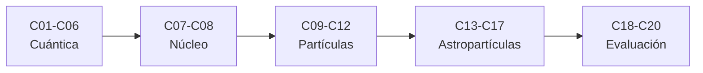

# B31 — Física cuántica, nuclear y astropartículas

> **Bloque de la malla `0.2.0`.** Ver el [programa completo](../../PROGRAMA_ACADEMICO_COMPLETO.md).

**Programa:** Programa Integral de Astronomía, Astrofísica, Ciencias Espaciales e Ingeniería Aeroespacial
**Área:** A03 — Astrofísica y ciencias fundamentales del universo
**Nivel:** N3 (fundamentos disciplinares) · **Clases:** 20 · **Carga:** por calibrar con el uso
**Estado:** guía pedagógica del bloque (resumen de qué se aprende en cada clase). Las clases enlazadas en la tabla ya están redactadas; todas conservan el estado E0 en el catálogo hasta registrar revisión disciplinar.

## 🎯 Propósito del bloque

Enseña **las bases cuánticas, nucleares y de partículas que sostienen la astrofísica**: la dualidad y la ecuación de Schrödinger, los estados, la incertidumbre y el espín, las estadísticas cuánticas, la estructura y el decaimiento del núcleo, las interacciones y el modelo estándar, los neutrinos y la antimateria, los rayos cósmicos y sus detectores, los aceleradores, las astropartículas de alta energía, los candidatos a materia oscura, la forma de acotar teorías con datos y la evaluación crítica de afirmaciones extraordinarias. Cada clase cierra con un cálculo verificable contra un caso analítico, un valor de las constantes de NIST consultadas o una simulación con semilla fija, y distingue siempre lo consultado de lo ilustrativo.

## 📚 Al terminar el bloque podrás

1. Calcular longitudes de onda de de Broglie, niveles de energía y relaciones de incertidumbre con métodos numéricos comprobados.
2. Describir estados de espín, observables y las estadísticas de Bose–Einstein y Fermi–Dirac, y verificar constantes de la radiación de cuerpo negro.
3. Calcular energías de ligadura, leyes de decaimiento y cadenas radiactivas.
4. Aplicar leyes de conservación a reacciones y calcular umbrales cinemáticos con cuadrivectores.
5. Calcular la probabilidad de oscilación de neutrinos y la energía de aniquilación de la antimateria.
6. Relacionar rayos cósmicos, cascadas, detectores y aceleradores con modelos simples verificados.
7. Acotar teorías con límites estadísticos y evaluar de forma crítica afirmaciones extraordinarias.

## 🧭 Secuencia del bloque

**Descripción textual.** Cinco tramos encadenados: los fundamentos cuánticos (C01–C06), la física nuclear (C07–C08), las partículas y sus interacciones (C09–C12), las astropartículas y su detección (C13–C17) y la evaluación crítica de teorías y afirmaciones (C18–C20).

## 🗂️ Las 20 clases en resumen

**Navegación:** cada clase desarrollada enlaza a la anterior, a la siguiente y a este bloque; mientras una clase siga solo programada, su enlace lleva a su fila en esta tabla.

La columna «Evidencia» indica el producto que demostrará el aprendizaje. Los laboratorios usan datos **sintéticos** o **ilustrativos** (rotulados) o valores publicados con fuente y fecha.

### Tramo 1 · Fundamentos cuánticos

| ID | Clase | Qué se aprende | Evidencia |
|---|---|---|---|
| [B31-C01](../clases/B31/B31-C01-dualidad-onda-particula/CLASE.md) | Dualidad onda-partícula | Longitud de onda de de Broglie y patrón de doble rendija. | Ficha de la dualidad |
| [B31-C02](../clases/B31/B31-C02-ecuacion-de-schrodinger/CLASE.md) | Ecuación de Schrödinger | Niveles de energía por diferencias finitas frente a los analíticos. | Ficha de los niveles de energía |
| [B31-C03](../clases/B31/B31-C03-estados-y-observables-cuanticos/CLASE.md) | Estados y observables cuánticos | Matrices de Pauli, regla de Born y oscilación de Rabi. | Ficha de un sistema de dos niveles |
| [B31-C04](../clases/B31/B31-C04-principio-de-incertidumbre/CLASE.md) | Principio de incertidumbre | Producto de incertidumbres de un paquete gaussiano y de una caja. | Ficha de la incertidumbre |
| [B31-C05](../clases/B31/B31-C05-espin-y-momento-angular/CLASE.md) | Espín y momento angular | Probabilidades de espín, suma de momentos y desdoblamiento Zeeman. | Ficha del espín |
| [B31-C06](../clases/B31/B31-C06-estadisticas-cuanticas/CLASE.md) | Estadísticas cuánticas | Distribuciones de Bose–Einstein y Fermi–Dirac y constantes del cuerpo negro. | Ficha de las estadísticas cuánticas |

### Tramo 2 · Física nuclear

| ID | Clase | Qué se aprende | Evidencia |
|---|---|---|---|
| B31-C07 | Estructura nuclear | Energías de ligadura de núcleos ligeros a partir de masas de NIST. | Ficha de la energía de ligadura |
| B31-C08 | Decaimiento radiactivo | Ley exponencial, Monte Carlo y cadenas de Bateman. | Ficha del decaimiento |

### Tramo 3 · Partículas e interacciones

| ID | Clase | Qué se aprende | Evidencia |
|---|---|---|---|
| B31-C09 | Interacciones fundamentales | Constante de estructura fina, razón eléctrica-gravitatoria y alcance de Yukawa. | Ficha de las interacciones |
| B31-C10 | Modelo estándar de partículas | Leyes de conservación aplicadas a reacciones. | Ficha de las reglas de conservación |
| B31-C11 | Neutrinos y oscilaciones | Probabilidad de oscilación de dos sabores y longitud de oscilación. | Ficha de la oscilación |
| B31-C12 | Antimateria y aniquilación | Umbrales cinemáticos con cuadrivectores y energía de aniquilación. | Ficha de la aniquilación |

### Tramo 4 · Astropartículas y detección

| ID | Clase | Qué se aprende | Evidencia |
|---|---|---|---|
| B31-C13 | Rayos cósmicos y cascadas | Modelo de Heitler, espectro de potencias y umbral GZK. | Ficha de los rayos cósmicos |
| B31-C14 | Detectores de partículas | Umbral y ángulo de Cherenkov, rendimiento de fotones y resolución. | Ficha de un detector |
| B31-C15 | Física de aceleradores | Rigidez magnética, energía de un anillo y pérdidas por sincrotrón. | Ficha de un acelerador |
| B31-C16 | Astropartículas de alta energía | Criterio de Hillas, neutrinos de decaimiento de piones y número de eventos. | Ficha de una fuente de alta energía |
| B31-C17 | Materias oscuras candidatas | Curvas de rotación, longitud de onda de de Broglie y retroceso nuclear. | Ficha de un candidato a materia oscura |

### Tramo 5 · Evaluación crítica

| ID | Clase | Qué se aprende | Evidencia |
|---|---|---|---|
| B31-C18 | Restricciones experimentales de teorías | Límites superiores de Poisson con fondo y cobertura. | Ficha de un límite experimental |
| B31-C19 | Vacío cuántico y límites conceptuales | Fuerza de Casimir y regularización de sumas divergentes. | Ficha del vacío cuántico |
| B31-C20 | Evaluación crítica de afirmaciones extraordinarias | Significancia, efecto de mirar en otros lugares y actualización bayesiana. | Ficha de evaluación de una afirmación |

## 🧵 Hilos que atraviesan el bloque

- **De la onda a la partícula:** C01–C06 construyen las herramientas cuánticas que usan el resto de las clases.
- **Escalas de energía:** C07, C08, C12, C13 y C15 comparan eV, keV, MeV, GeV y energías extremas.
- **Conservación y cinemática:** C09–C12 y C13 aplican leyes de conservación y cuadrivectores.
- **Verificación contra constantes publicadas:** los laboratorios contrastan con los valores de NIST CODATA 2022 consultados el 2026-11-09 o con casos analíticos.
- **Del dato a la afirmación:** C18–C20 enseñan a acotar, a descontar el efecto de mirar en muchos lugares y a actualizar creencias.

## 📝 Evaluación del bloque (propuesta, por calibrar)

- Fichas y ejercicios por clase, con retroalimentación y recuperación con evidencia distinta.
- Portafolio: ficha de un límite experimental (C18) y ficha de evaluación de una afirmación (C20).
- Las condiciones críticas (rotular lo ilustrativo, no atribuir a la naturaleza un valor del modelo y citar solo lo consultado) no se compensan con promedio.

## ⚠️ Seguridad y límites

El bloque es educativo. Los modelos son simplificados y no sustituyen la literatura primaria, los datos de colaboraciones ni las tablas de partículas; no se manipulan fuentes radiactivas ni se dan instrucciones de laboratorio. Los valores publicados (constantes de NIST) se citan con fecha de consulta y el resto de los números son ilustrativos y se rotulan como tales.

## Fuentes de orientación preliminar

- **[NASA-DATA]** [NASA Science Data](https://science.data.nasa.gov/) — Portal general de datos y servicios científicos.
- **[ESA-SCIENCE]** [European Space Agency Science](https://www.esa.int/Science_Exploration/Space_Science) — Misiones, descubrimientos y material científico institucional.
- **[LIGO]** [LIGO Scientific Collaboration](https://www.ligo.org/) — Observaciones y métodos de ondas gravitacionales.
- **[ADS]** [NASA Astrophysics Data System](https://ui.adsabs.harvard.edu/) — Índice bibliográfico de literatura astronómica y física.

> La asociación de estas fuentes es orientativa por bloque. Las fuentes realmente consultadas para cada afirmación se registran en la sección 11 de cada clase.

[🏠 Volver al programa](../../README.md) · [➡️ B32 — Atmósferas estelares y espectroscopía estelar cuantitativa](./B32-atmosferas-estelares-y-espectroscopia-estelar-cuantitativa.md)
