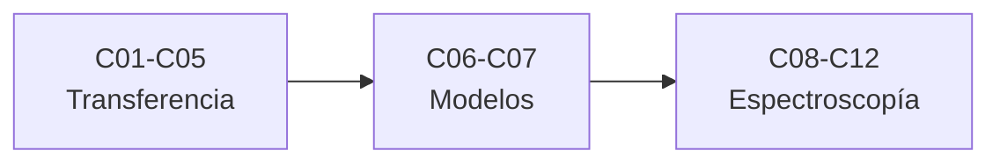

# B32 — Atmósferas estelares y espectroscopía estelar cuantitativa

> **Bloque de la malla `0.2.0`.** Ver el [programa completo](../../PROGRAMA_ACADEMICO_COMPLETO.md).

**Programa:** Programa Integral de Astronomía, Astrofísica, Ciencias Espaciales e Ingeniería Aeroespacial
**Área:** A03 — Astrofísica y ciencias fundamentales del universo
**Nivel:** N3 (fundamentos disciplinares) · **Clases:** 12 · **Carga:** por calibrar con el uso
**Estado:** guía pedagógica del bloque (resumen de qué se aprende en cada clase). Las clases enlazadas en la tabla ya están redactadas; todas conservan el estado E0 en el catálogo hasta registrar revisión disciplinar.

## 🎯 Propósito del bloque

Enseña **cómo se forma la luz de una estrella y cómo se mide con precisión**: la transferencia radiativa, el equilibrio termodinámico local, las opacidades continua y de líneas, la estructura térmica de la fotosfera, la turbulencia, los modelos de atmósfera, la síntesis y la inversión de espectros, el ancho equivalente, la normalización del continuo, la rotación y los campos magnéticos. Cada clase cierra con un cálculo verificable contra un caso analítico, una constante de NIST o una simulación con semilla fija, y distingue lo consultado de lo ilustrativo.

## 📚 Al terminar el bloque podrás

1. Resolver la ecuación formal de transferencia y obtener el limbo y el flujo de una atmósfera gris.
2. Calcular poblaciones y ionización con Boltzmann y Saha.
3. Calcular opacidades medias y perfiles de Voigt.
4. Evaluar la estructura térmica y el sesgo de las fluctuaciones.
5. Sintetizar e invertir perfiles de línea con incertidumbres.
6. Medir anchos equivalentes y normalizar el continuo.
7. Separar rotación, turbulencia y campos magnéticos en el ancho de una línea.

## 🧭 Secuencia del bloque

**Descripción textual.** Tres tramos encadenados: la transferencia y la opacidad (C01–C05), los movimientos y los modelos de atmósfera (C06–C07) y la espectroscopía cuantitativa (C08–C12).

## 🗂️ Las 12 clases en resumen

**Navegación:** cada clase desarrollada enlaza a la anterior, a la siguiente y a este bloque; mientras una clase siga solo programada, su enlace lleva a su fila en esta tabla.

La columna «Evidencia» indica el producto que demostrará el aprendizaje. Los laboratorios usan datos **sintéticos** o **ilustrativos** (rotulados) o valores publicados con fuente y fecha.

### Tramo 1 · Transferencia y opacidad

| ID | Clase | Qué se aprende | Evidencia |
|---|---|---|---|
| B32-C01 | Ecuación de transferencia radiativa en atmósferas estelares | Intensidad emergente, limbo y flujo. | Ficha de la transferencia radiativa |
| B32-C02 | Equilibrio termodinámico local y desviaciones no LTE | Boltzmann, Saha y fracción ionizada. | Ficha del equilibrio local |
| B32-C03 | Opacidad continua: ligado-libre, libre-libre y H- | Umbral del H⁻, Kramers y media de Rosseland. | Ficha de la opacidad continua |
| B32-C04 | Opacidad de líneas: ensanchamiento y perfil de Voigt | Perfil de Voigt y ancho Doppler. | Ficha del perfil de Voigt |
| B32-C05 | Relación T-τ y estructura térmica de la fotosfera | Relación de Eddington y flujo. | Ficha de la estructura térmica |

### Tramo 2 · Movimientos y modelos

| ID | Clase | Qué se aprende | Evidencia |
|---|---|---|---|
| B32-C06 | Micro y macroturbulencia y granulación estelar | Ensanchamiento térmico y turbulento. | Ficha del ensanchamiento por turbulencia |
| B32-C07 | Modelos de atmósferas estelares 1D y 3D hidrodinámicos | Modelo 1D y sesgo de las fluctuaciones. | Ficha de los modelos de atmósfera |

### Tramo 3 · Espectroscopía cuantitativa

| ID | Clase | Qué se aprende | Evidencia |
|---|---|---|---|
| B32-C08 | Síntesis espectral e inversión de perfiles | Milne–Eddington e inversión con errores. | Ficha de la inversión de perfiles |
| B32-C09 | Medición de perfiles de línea: ancho equivalente y ajuste | Ancho equivalente y curva de crecimiento. | Ficha de la curva de crecimiento |
| B32-C10 | Normalización y modelado del continuo espectral | Ajuste polinómico con recortes. | Ficha de la normalización del continuo |
| B32-C11 | Ensanchamiento rotacional y v sin i | Kernel rotacional y recuperación de v sin i. | Ficha del ensanchamiento rotacional |
| B32-C12 | Efecto Zeeman y diagnóstico de campos magnéticos estelares | Desdoblamiento y polarización de campo débil. | Ficha del efecto Zeeman estelar |

## 🧵 Hilos que atraviesan el bloque

- **De la capa a la línea:** C01–C05 construyen la atmósfera; C08–C12 miden el espectro que sale de ella.
- **Anchos de línea:** C04, C06, C11 y C12 separan los ensanchamientos térmico, turbulento, rotacional y magnético.
- **Verificación independiente:** cada laboratorio contrasta con un caso analítico, una constante de NIST o una simulación con semilla fija.
- **Observado frente a ilustrativo:** los modelos y espectros son sintéticos y se rotulan como tales.

## 📝 Evaluación del bloque (propuesta, por calibrar)

- Fichas y ejercicios por clase, con retroalimentación y recuperación con evidencia distinta.
- Portafolio: ficha de la inversión de perfiles (C08) y ficha del ensanchamiento rotacional (C11).
- Las condiciones críticas (rotular lo sintético, no presentar un modelo ilustrativo como una estrella real y citar solo lo consultado) no se compensan con promedio.

## ⚠️ Seguridad y límites

El bloque es educativo. Los modelos son simplificados (atmósferas grises, perfiles gaussianos) y no sustituyen la literatura primaria ni los códigos de atmósferas publicados. Los valores publicados (constantes de NIST, valores nominales de la UAI) se citan con fecha de consulta y el resto de los números son ilustrativos y se rotulan como tales.

## Roles que lo usan

- [Astrofísica estelar y galáctica](../../rutas/astrofisica-estelar-y-galactica.md)

[🏠 Volver al programa](../../README.md) · [➡️ B33 — Clima espacial: impactos, pronóstico y riesgo](./B33-clima-espacial-impactos-pronostico-y-riesgo.md)

## Fuentes de orientación preliminar

- **[NIST-CODATA]** [NIST Fundamental Physical Constants (CODATA 2022)](https://physics.nist.gov/cuu/Constants/Table/allascii.txt) — Constantes físicas fundamentales.
- **[IAU-B3]** [UAI, Resolución B3 de 2015](https://arxiv.org/abs/1510.07674) — Valores nominales solares y planetarios.
- **[ADS]** [NASA Astrophysics Data System](https://ui.adsabs.harvard.edu/) — Índice bibliográfico de literatura astronómica y física.

> La asociación de estas fuentes es orientativa por bloque. Las fuentes realmente consultadas para cada afirmación se registran en la sección 11 de cada clase.

[🏠 Volver al programa](../../README.md) · [➡️ B33 — Clima espacial: impactos, pronóstico y riesgo](./B33-clima-espacial-impactos-pronostico-y-riesgo.md)
