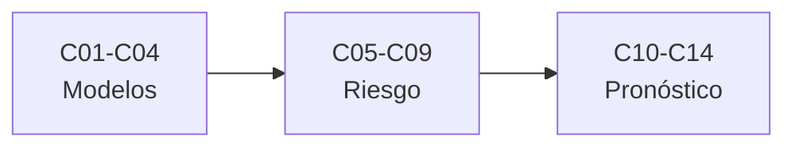

# B33 — Clima espacial: impactos, pronóstico y riesgo

> **Bloque de la estructura vigente.** Ver el [programa completo](../../PROGRAMA_ACADEMICO_COMPLETO.md).

**Programa:** Programa Integral de Astronomía, Astrofísica, Ciencias Espaciales e Ingeniería Aeroespacial
**Área:** A03 — Astrofísica y ciencias fundamentales del universo
**Nivel:** N3 (fundamentos disciplinares) · **Clases:** 14 · **Carga:** por calibrar con el uso
**Estado:** guía pedagógica del bloque (resumen de qué se aprende en cada clase). Las clases enlazadas en la tabla ya están redactadas; todas conservan el estado E0 en el catálogo hasta registrar revisión disciplinar.

## 🎯 Propósito del bloque

Enseña **cómo se valida, se pronostica y se comunica el clima espacial y su riesgo**: la validación de modelos, la propagación de eyecciones de masa, los eventos extremos, las escalas de severidad, la comunicación de riesgo, las corrientes inducidas y su efecto en las redes, la radiación en aviación, la continuidad de servicios, los modelos de viento solar, los pronósticos empíricos y de persistencia, el pronóstico de llegada y de actividad geomagnética y la verificación de alertas. Cada clase cierra con un cálculo verificable contra un caso analítico o una simulación con semilla fija, y distingue lo consultado de lo ilustrativo.

## 📚 Al terminar el bloque podrás

1. Validar un modelo con sesgo, RMSE, correlación y destreza.
2. Propagar la incertidumbre del tiempo de llegada de una CME.
3. Estimar niveles de retorno de eventos extremos con su incertidumbre.
4. Interpretar las escalas de severidad G, S y R.
5. Decidir una alerta con el modelo de costo–pérdida y medir su calibración.
6. Calcular campos geoeléctricos y repartir corrientes en una red.
7. Verificar alertas con tablas de contingencia y curvas ROC.

## 🧭 Secuencia del bloque

**Descripción textual.** Tres tramos encadenados: modelos y eventos (C01–C04), riesgo e impactos (C05–C09) y pronóstico y verificación (C10–C14).

## 🗂️ Las 14 clases en resumen

**Navegación:** cada clase desarrollada enlaza a la anterior, a la siguiente y a este bloque; mientras una clase siga solo programada, su enlace lleva a su fila en esta tabla.

La columna «Evidencia» indica el producto que demostrará el aprendizaje. Los laboratorios usan datos **sintéticos** o **ilustrativos** (rotulados) o valores publicados con fuente y fecha.

### Tramo 1 · Modelos y eventos

| ID | Clase | Qué se aprende | Evidencia |
|---|---|---|---|
| [B33-C01](../clases/B33/B33-C01-validacion-de-modelos-mhd-con-eventos-solares-documentados/CLASE.md) | Validación de modelos MHD con eventos solares documentados | Sesgo, RMSE, destreza y desfase. | Ficha de validación de un modelo |
| [B33-C02](../clases/B33/B33-C02-modelos-de-propagacion-de-cme/CLASE.md) | Modelos de propagación de CME | Conjunto y propagación lineal de errores. | Ficha de la propagación de una CME |
| [B33-C03](../clases/B33/B33-C03-eventos-extremos-historicos-de-clima-espacial/CLASE.md) | Eventos extremos históricos de clima espacial | Gumbel y niveles de retorno. | Ficha de eventos extremos |
| [B33-C04](../clases/B33/B33-C04-escalas-de-severidad-de-clima-espacial/CLASE.md) | Escalas de severidad de clima espacial | Escalas G, S y R y conteos por nivel. | Ficha de las escalas de severidad |

### Tramo 2 · Riesgo e impactos

| ID | Clase | Qué se aprende | Evidencia |
|---|---|---|---|
| [B33-C05](../clases/B33/B33-C05-comunicacion-de-riesgo-y-alertas-de-clima-espacial/CLASE.md) | Comunicación de riesgo y alertas de clima espacial | Costo–pérdida, Brier y fiabilidad. | Ficha del riesgo y las alertas |
| [B33-C06](../clases/B33/B33-C06-corrientes-geomagneticas-inducidas-gic/CLASE.md) | Corrientes geomagnéticas inducidas (GIC) | Campo geoeléctrico y corriente en una línea. | Ficha de las corrientes inducidas |
| [B33-C07](../clases/B33/B33-C07-impactos-del-clima-espacial-en-redes-electricas/CLASE.md) | Impactos del clima espacial en redes eléctricas | Análisis nodal de corrientes de tierra. | Ficha de la red eléctrica |
| [B33-C08](../clases/B33/B33-C08-dosis-de-radiacion-en-aviacion/CLASE.md) | Dosis de radiación en aviación | Profundidad atmosférica y atenuación de juguete. | Ficha de la radiación en aviación |
| [B33-C09](../clases/B33/B33-C09-planes-de-continuidad-ante-eventos-de-clima-espacial/CLASE.md) | Planes de continuidad ante eventos de clima espacial | Redundancia, causa común y disponibilidad. | Ficha de la continuidad |

### Tramo 3 · Pronóstico y verificación

| ID | Clase | Qué se aprende | Evidencia |
|---|---|---|---|
| [B33-C10](../clases/B33/B33-C10-modelos-de-viento-solar-para-pronostico-parker-y-wsa/CLASE.md) | Modelos de viento solar para pronóstico (Parker y WSA) | Relación empírica de prueba y Parker. | Ficha del viento solar para pronóstico |
| [B33-C11](../clases/B33/B33-C11-modelos-empiricos-y-de-persistencia-en-clima-espacial/CLASE.md) | Modelos empíricos y de persistencia en clima espacial | Persistencia y recurrencia de 27 días. | Ficha de la persistencia |
| [B33-C12](../clases/B33/B33-C12-pronostico-de-llegada-y-severidad-de-cme/CLASE.md) | Pronóstico de llegada y severidad de CME | Error de llegada con arrastre mal especificado. | Ficha del pronóstico de llegada |
| [B33-C13](../clases/B33/B33-C13-pronostico-de-actividad-geomagnetica/CLASE.md) | Pronóstico de actividad geomagnética | Regresión y pronóstico por umbral. | Ficha del pronóstico geomagnético |
| [B33-C14](../clases/B33/B33-C14-verificacion-de-alertas-con-tablas-de-contingencia/CLASE.md) | Verificación de alertas con tablas de contingencia | Tabla, ROC y AUC por dos vías. | Ficha de la verificación de alertas |

## 🧵 Hilos que atraviesan el bloque

- **Del dato a la decisión:** C01–C04 caracterizan; C05–C09 evalúan el riesgo; C10–C14 pronostican y verifican.
- **Incertidumbre:** C02, C03 y C05 la cuantifican con conjuntos, intervalos y probabilidades.
- **Verificación independiente:** cada laboratorio contrasta con un caso analítico, dos vías de cálculo o una simulación con semilla fija.
- **Observado frente a ilustrativo:** las escalas de NOAA se citan con fecha; los demás números son sintéticos y se rotulan.

## 📝 Evaluación del bloque (propuesta, por calibrar)

- Fichas y ejercicios por clase, con retroalimentación y recuperación con evidencia distinta.
- Portafolio: ficha del riesgo y las alertas (C05) y ficha de la verificación de alertas (C14).
- Las condiciones críticas (rotular lo sintético, no emitir pronósticos ni estimar riesgos reales y citar solo lo consultado) no se compensan con promedio.

## ⚠️ Seguridad y límites

El bloque es educativo. Los modelos son simplificados y no sustituyen los productos operativos ni los avisos oficiales de clima espacial; no se estiman costos, dosis ni riesgos de ninguna red, vuelo o servicio real. Las escalas oficiales se citan con fecha de consulta y el resto de los números son ilustrativos y se rotulan como tales.

## Roles que lo usan

- [Heliofísica y climatología espacial](../../rutas/heliofisica-y-climatologia-espacial.md)

## Fuentes de orientación preliminar

- **[NIST-CODATA]** [NIST Fundamental Physical Constants (CODATA 2022)](https://physics.nist.gov/cuu/Constants/Table/allascii.txt) — Constantes físicas fundamentales.
- **[IAU-B3]** [UAI, Resolución B3 de 2015](https://arxiv.org/abs/1510.07674) — Valores nominales solares y planetarios.
- **[ADS]** [NASA Astrophysics Data System](https://ui.adsabs.harvard.edu/) — Índice bibliográfico de literatura astronómica y física.

> La asociación de estas fuentes es orientativa por bloque. Las fuentes realmente consultadas para cada afirmación se registran en la sección 11 de cada clase.

[🏠 Volver al programa](../../README.md) · [➡️ B34 — Corona solar y erupciones: diagnóstico y modelos](./B34-corona-solar-y-erupciones-diagnostico-y-modelos.md)
