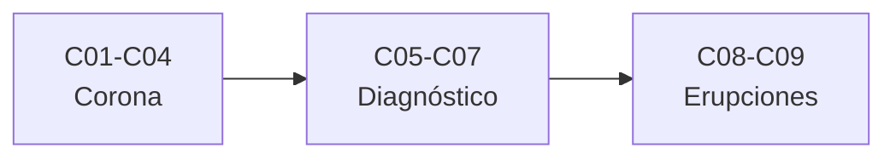

# B34 — Corona solar y erupciones: diagnóstico y modelos

> **Bloque de la estructura vigente.** Ver el [programa completo](../../PROGRAMA_ACADEMICO_COMPLETO.md).

**Programa:** Programa Integral de Astronomía, Astrofísica, Ciencias Espaciales e Ingeniería Aeroespacial
**Área:** A03 — Astrofísica y ciencias fundamentales del universo
**Nivel:** N3 (fundamentos disciplinares) · **Clases:** 9 · **Carga:** por calibrar con el uso
**Estado:** guía pedagógica del bloque (resumen de qué se aprende en cada clase). Las clases enlazadas en la tabla ya están redactadas; todas conservan el estado E0 en el catálogo hasta registrar revisión disciplinar.

## 🎯 Propósito del bloque

Enseña **cómo se diagnostica y se modela la corona solar y sus erupciones**: el calentamiento coronal, la emisión EUV y de rayos X, los bucles magnéticos, la sismología coronal, el diagnóstico de densidad, la tomografía, la comparación de modelos con observaciones, las erupciones de filamentos y la integración de datos de varios instrumentos. Cada clase cierra con un cálculo verificable contra un caso analítico, una constante de NIST o una simulación con semilla fija, y distingue lo consultado de lo ilustrativo.

## 📚 Al terminar el bloque podrás

1. Comparar la energía conductiva, radiativa y la liberada por eventos pequeños de un bucle.
2. Relacionar temperatura, longitud de onda y medida de emisión.
3. Calcular la estratificación hidrostática de un bucle.
4. Inferir el campo magnético de un bucle desde su período con su incertidumbre.
5. Invertir un diagnóstico de densidad y reconstruir una emisividad por tomografía.
6. Comparar mapas modelados y observados con métricas calibradas.
7. Evaluar la altura crítica de una erupción y alinear datos de varios instrumentos.

## 🧭 Secuencia del bloque

**Descripción textual.** Tres tramos encadenados: calentamiento, emisión y estructura (C01–C04), diagnóstico y modelos (C05–C07) y erupciones y datos (C08–C09).

## 🗂️ Las 9 clases en resumen

**Navegación:** cada clase desarrollada enlaza a la anterior, a la siguiente y a este bloque; mientras una clase siga solo programada, su enlace lleva a su fila en esta tabla.

La columna «Evidencia» indica el producto que demostrará el aprendizaje. Los laboratorios usan datos **sintéticos** o **ilustrativos** (rotulados) o valores publicados con fuente y fecha.

### Tramo 1 · Calentamiento, emisión y estructura

| ID | Clase | Qué se aprende | Evidencia |
|---|---|---|---|
| [B34-C01](../clases/B34/B34-C01-calentamiento-coronal-mecanismos-y-evidencias/CLASE.md) | Calentamiento coronal: mecanismos y evidencias | Balance conductivo y radiativo y energía de eventos pequeños. | Ficha del calentamiento coronal |
| [B34-C02](../clases/B34/B34-C02-emision-euv-y-rayos-x-de-la-corona/CLASE.md) | Emisión EUV y rayos X de la corona | Máximo de Wien, medida de emisión y potencia radiada. | Ficha de la emisión EUV y de rayos X |
| [B34-C03](../clases/B34/B34-C03-bucles-magneticos-coronales/CLASE.md) | Bucles magnéticos coronales | Estratificación hidrostática de un bucle semicircular. | Ficha de un bucle coronal |
| [B34-C04](../clases/B34/B34-C04-ondas-y-oscilaciones-coronales-como-sismologia-solar/CLASE.md) | Ondas y oscilaciones coronales como sismología solar | Modo kink, período y campo inferido con su incertidumbre. | Ficha de la sismología coronal |

### Tramo 2 · Diagnóstico y modelos

| ID | Clase | Qué se aprende | Evidencia |
|---|---|---|---|
| [B34-C05](../clases/B34/B34-C05-diagnostico-de-densidad-electronica-coronal/CLASE.md) | Diagnóstico de densidad electrónica coronal | Inversión de un cociente de líneas y propagación del error. | Ficha del diagnóstico de densidad |
| [B34-C06](../clases/B34/B34-C06-tomografia-coronal/CLASE.md) | Tomografía coronal | Reconstrucción ART de una emisividad 2D. | Ficha de la tomografía coronal |
| [B34-C07](../clases/B34/B34-C07-comparacion-de-modelos-coronales-con-observaciones/CLASE.md) | Comparación de modelos coronales con observaciones | Correlación, razón y prueba de Kolmogorov–Smirnov. | Ficha de la comparación modelo–observación |

### Tramo 3 · Erupciones y datos

| ID | Clase | Qué se aprende | Evidencia |
|---|---|---|---|
| [B34-C08](../clases/B34/B34-C08-erupciones-de-filamentos-y-prominencias/CLASE.md) | Erupciones de filamentos y prominencias | Índice de decaimiento, altura crítica y energía. | Ficha de la erupción de un filamento |
| [B34-C09](../clases/B34/B34-C09-integracion-multiinstrumento-de-datos-heliofisicos/CLASE.md) | Integración multiinstrumento de datos heliofísicos | Alineación temporal de curvas de luz por correlación cruzada. | Ficha de la integración multiinstrumento |

## 🧵 Hilos que atraviesan el bloque

- **De la física a la imagen:** C01–C04 construyen la corona; C05–C07 la miden y la comparan.
- **Incertidumbre:** C04, C05 y C09 propagan errores con Monte Carlo y derivadas.
- **Verificación independiente:** cada laboratorio contrasta con un caso analítico, una constante de NIST o una simulación con semilla fija.
- **Observado frente a ilustrativo:** los modelos y mapas son sintéticos y se rotulan como tales.

## 📝 Evaluación del bloque (propuesta, por calibrar)

- Fichas y ejercicios por clase, con retroalimentación y recuperación con evidencia distinta.
- Portafolio: ficha de la sismología coronal (C04) y ficha de la integración multiinstrumento (C09).
- Las condiciones críticas (rotular lo sintético, no presentar un modelo ilustrativo como la corona real y citar solo lo consultado) no se compensan con promedio.

## ⚠️ Seguridad y límites

El bloque es educativo. Los modelos son simplificados y no sustituyen la literatura primaria ni los productos de los instrumentos. Los valores publicados (constantes de NIST, valores nominales de la UAI) se citan con fecha de consulta y el resto de los números son ilustrativos y se rotulan como tales.

## Roles que lo usan

- [Heliofísica y climatología espacial](../../rutas/heliofisica-y-climatologia-espacial.md)

## Fuentes de orientación preliminar

- **[NIST-CODATA]** [NIST Fundamental Physical Constants (CODATA 2022)](https://physics.nist.gov/cuu/Constants/Table/allascii.txt) — Constantes físicas fundamentales.
- **[IAU-B3]** [UAI, Resolución B3 de 2015](https://arxiv.org/abs/1510.07674) — Valores nominales solares y planetarios.
- **[ADS]** [NASA Astrophysics Data System](https://ui.adsabs.harvard.edu/) — Índice bibliográfico de literatura astronómica y física.

> La asociación de estas fuentes es orientativa por bloque. Las fuentes realmente consultadas para cada afirmación se registran en la sección 11 de cada clase.

[🏠 Volver al programa](../../README.md) · [➡️ B35 — Física avanzada de plasmas y MHD espacial](./B35-fisica-avanzada-de-plasmas-y-mhd-espacial.md)
