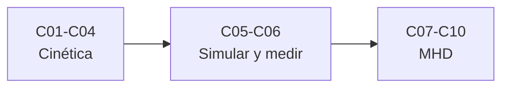

# B35 — Física avanzada de plasmas y MHD espacial

> **Bloque de la estructura vigente.** Ver el [programa completo](../../PROGRAMA_ACADEMICO_COMPLETO.md).

**Programa:** Programa Integral de Astronomía, Astrofísica, Ciencias Espaciales e Ingeniería Aeroespacial
**Área:** A03 — Astrofísica y ciencias fundamentales del universo
**Nivel:** N3 (fundamentos disciplinares) · **Clases:** 10 · **Carga:** por calibrar con el uso
**Estado:** guía pedagógica del bloque (resumen de qué se aprende en cada clase). Las clases enlazadas en la tabla ya están redactadas; todas conservan el estado E0 en el catálogo hasta registrar revisión disciplinar.

## 🎯 Propósito del bloque

Enseña **cómo se describen y se simulan los plasmas espaciales más allá del fluido simple**: las funciones de distribución de velocidades, las ondas de Alfvén y magnetosónicas, las inestabilidades, el régimen cinético y la ecuación de Vlasov, la simulación por partículas, la interpretación de mediciones in situ, el flujo congelado y sus conservaciones, los flujos estacionarios y el balance de presiones, la turbulencia y las condiciones de frontera de los modelos MHD. Cada clase cierra con un cálculo verificable contra un caso analítico, dos vías independientes o una simulación con semilla fija, y distingue lo consultado de lo ilustrativo.

## 📚 Al terminar el bloque podrás

1. Comparar distribuciones maxwelliana y kappa y calcular sus momentos.
2. Calcular velocidades de fase de las ondas MHD y verificarlas con una simulación.
3. Obtener tasas de crecimiento de inestabilidades de dos haces y de Kelvin–Helmholtz.
4. Decidir cuándo un plasma es no colisional y reproducir el amortiguamiento de Landau.
5. Escribir y validar un código de partículas unidimensional.
6. Estimar momentos y sus incertidumbres desde cuentas de un instrumento.
7. Reconocer la conservación del flujo, el balance de presiones, los espectros turbulentos y las fronteras no reflectantes.

## 🧭 Secuencia del bloque

**Descripción textual.** Tres tramos encadenados: descripción cinética y ondas (C01–C04), simulación y medición (C05–C06) y MHD, turbulencia y fronteras (C07–C10).

## 🗂️ Las 10 clases en resumen

**Navegación:** cada clase desarrollada enlaza a la anterior, a la siguiente y a este bloque; mientras una clase siga solo programada, su enlace lleva a su fila en esta tabla.

La columna «Evidencia» indica el producto que demostrará el aprendizaje. Los laboratorios usan datos **sintéticos** o **ilustrativos** (rotulados) o valores publicados con fuente y fecha.

### Tramo 1 · Descripción cinética y ondas

| ID | Clase | Qué se aprende | Evidencia |
|---|---|---|---|
| [B35-C01](../clases/B35/B35-C01-funciones-de-distribucion-de-velocidades-en-plasmas/CLASE.md) | Funciones de distribución de velocidades en plasmas | Maxwell, kappa y sus momentos. | Ficha de las distribuciones de velocidad |
| [B35-C02](../clases/B35/B35-C02-ondas-de-alfven-y-ondas-magnetosonicas/CLASE.md) | Ondas de Alfvén y ondas magnetosónicas | Velocidades de fase y simulación de una onda. | Ficha de las ondas MHD |
| [B35-C03](../clases/B35/B35-C03-inestabilidades-de-plasma-cineticas-y-de-fluido/CLASE.md) | Inestabilidades de plasma: cinéticas y de fluido | Dos haces y Kelvin–Helmholtz. | Ficha de las inestabilidades |
| [B35-C04](../clases/B35/B35-C04-colisiones-regimen-cinetico-y-ecuacion-de-vlasov/CLASE.md) | Colisiones, régimen cinético y ecuación de Vlasov | Longitud de Debye, camino libre y amortiguamiento de Landau. | Ficha del régimen cinético |

### Tramo 2 · Simulación y medición

| ID | Clase | Qué se aprende | Evidencia |
|---|---|---|---|
| [B35-C05](../clases/B35/B35-C05-simulacion-de-plasmas-por-particulas-pic/CLASE.md) | Simulación de plasmas por partículas (PIC) | PIC 1D: oscilación y dos haces. | Ficha de la simulación PIC |
| [B35-C06](../clases/B35/B35-C06-mediciones-in-situ-de-plasmas-espaciales/CLASE.md) | Mediciones in situ de plasmas espaciales | Momentos desde cuentas con ruido y truncamiento. | Ficha de las mediciones in situ |

### Tramo 3 · MHD, turbulencia y fronteras

| ID | Clase | Qué se aprende | Evidencia |
|---|---|---|---|
| [B35-C07](../clases/B35/B35-C07-congelamiento-del-flujo-magnetico-y-conservacion-en-mhd-ideal/CLASE.md) | Congelamiento del flujo magnético y conservación en MHD ideal | Flujo, difusión y enlace magnético. | Ficha del flujo congelado |
| [B35-C08](../clases/B35/B35-C08-flujos-de-plasma-estacionarios-y-balance-de-presiones/CLASE.md) | Flujos de plasma estacionarios y balance de presiones | Lámina de Harris, tobera isoterma y magnetopausa. | Ficha del balance de presiones |
| [B35-C09](../clases/B35/B35-C09-turbulencia-en-plasmas-y-mhd/CLASE.md) | Turbulencia en plasmas y MHD | Espectros, estructura e intermitencia. | Ficha de la turbulencia |
| [B35-C10](../clases/B35/B35-C10-condiciones-de-frontera-en-modelos-mhd/CLASE.md) | Condiciones de frontera en modelos MHD | Reflexión en fronteras de una onda de Alfvén. | Ficha de las fronteras MHD |

## 🧵 Hilos que atraviesan el bloque

- **De la partícula al fluido:** C01 y C04 establecen cuándo basta el fluido; C07 y C08 desarrollan el fluido ideal.
- **Ondas e inestabilidades:** C02 y C03 comparten la relación de dispersión; C05 reproduce la inestabilidad de C03 con partículas.
- **Verificación independiente:** cada laboratorio contrasta con un caso analítico, dos vías de cálculo o una simulación con semilla fija.
- **Observado frente a ilustrativo:** solo las constantes de NIST y los resúmenes de arXiv se citan con fecha; los demás números son sintéticos y se rotulan.

## 📝 Evaluación del bloque (propuesta, por calibrar)

- Fichas y ejercicios por clase, con retroalimentación y recuperación con evidencia distinta.
- Portafolio: ficha del régimen cinético (C04) y ficha de la simulación PIC (C05).
- Las condiciones críticas (rotular lo sintético, no presentar un modelo como dato de una nave y citar solo lo consultado) no se compensan con promedio.

## ⚠️ Seguridad y límites

El bloque es educativo. Los modelos son simplificados y no sustituyen a los códigos de investigación ni a los datos de misiones; los parámetros del viento solar y de la magnetosfera son ilustrativos y no se presentan como mediciones. Solo las constantes de NIST CODATA 2022 y los resúmenes de arXiv citados se consultaron; el resto se rotula como ilustrativo o sintético.

## Roles que lo usan

- [Heliofísica y climatología espacial](../../rutas/heliofisica-y-climatologia-espacial.md)

## Fuentes de orientación preliminar

- **[NIST-CODATA]** [NIST Fundamental Physical Constants (CODATA 2022)](https://physics.nist.gov/cuu/Constants/Table/allascii.txt) — Constantes físicas fundamentales.
- **[IAU-B3]** [UAI, Resolución B3 de 2015](https://arxiv.org/abs/1510.07674) — Valores nominales solares y planetarios.
- **[ADS]** [NASA Astrophysics Data System](https://ui.adsabs.harvard.edu/) — Índice bibliográfico de literatura astronómica y física.

> La asociación de estas fuentes es orientativa por bloque. Las fuentes realmente consultadas para cada afirmación se registran en la sección 11 de cada clase.

[🏠 Volver al programa](../../README.md) · [➡️ B36 — Formación de estructuras cósmicas y materia oscura](./B36-formacion-de-estructuras-cosmicas-y-materia-oscura.md)
