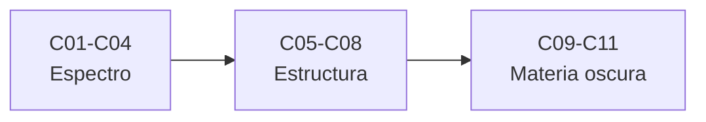

# B36 — Formación de estructuras cósmicas y materia oscura

> **Bloque de la estructura vigente.** Ver el [programa completo](../../PROGRAMA_ACADEMICO_COMPLETO.md).

**Programa:** Programa Integral de Astronomía, Astrofísica, Ciencias Espaciales e Ingeniería Aeroespacial
**Área:** A03 — Astrofísica y ciencias fundamentales del universo
**Nivel:** N3 (fundamentos disciplinares) · **Clases:** 11 · **Carga:** por calibrar con el uso
**Estado:** guía pedagógica del bloque (resumen de qué se aprende en cada clase). Las clases enlazadas en la tabla ya están redactadas; todas conservan el estado E0 en el catálogo hasta registrar revisión disciplinar.

## 🎯 Propósito del bloque

Enseña **cómo crecen las estructuras cósmicas y qué se sabe de la materia oscura**: el crecimiento lineal de las perturbaciones, la función de transferencia y el espectro de potencia, la función de correlación, las simulaciones de N cuerpos, los halos y su función de masa, las oscilaciones acústicas bariónicas, el sesgo de las galaxias, los cúmulos en colisión, la detección directa y las alternativas de gravedad modificada. Cada clase cierra con un cálculo verificable contra un caso analítico, dos vías independientes o una simulación con semilla fija, y distingue lo consultado de lo ilustrativo.

## 📚 Al terminar el bloque podrás

1. Resolver el crecimiento lineal y el factor de tasa f en un universo con Λ.
2. Dar forma al espectro de potencia con una función de transferencia y normalizarlo con σ8.
3. Estimar ξ(r) y P(k) con sus incertidumbres y verificarlas con casos analíticos.
4. Evolucionar un conjunto de láminas en una caja periódica y compararlo con la aproximación de Zel'dovich.
5. Calcular δc y la función de masa de Press–Schechter por dos vías.
6. Calcular el horizonte sonoro y usarlo como regla estándar.
7. Contrastar materia oscura y gravedad modificada con datos de cúmulos, detectores y curvas de rotación.

## 🧭 Secuencia del bloque

**Descripción textual.** Tres tramos encadenados: crecimiento y espectro (C01–C04), estructura no lineal (C05–C08) y materia oscura y alternativas (C09–C11).

## 🗂️ Las 11 clases en resumen

**Navegación:** cada clase desarrollada enlaza a la anterior, a la siguiente y a este bloque; mientras una clase siga solo programada, su enlace lleva a su fila en esta tabla.

La columna «Evidencia» indica el producto que demostrará el aprendizaje. Los laboratorios usan datos **sintéticos** o **ilustrativos** (rotulados) o valores publicados con fuente y fecha.

### Tramo 1 · Crecimiento y espectro

| ID | Clase | Qué se aprende | Evidencia |
|---|---|---|---|
| [B36-C01](../clases/B36/B36-C01-crecimiento-lineal-de-perturbaciones-de-densidad/CLASE.md) | Crecimiento lineal de perturbaciones de densidad | Ecuación de crecimiento y factor f. | Ficha del crecimiento lineal |
| [B36-C02](../clases/B36/B36-C02-funcion-de-transferencia-y-espectro-de-materia/CLASE.md) | Función de transferencia y espectro de materia | Forma de la función de transferencia y normalización σ8. | Ficha de la función de transferencia |
| [B36-C03](../clases/B36/B36-C03-funciones-de-correlacion-de-galaxias/CLASE.md) | Funciones de correlación de galaxias | Estimador de Landy–Szalay frente a ξ analítica. | Ficha de la función de correlación |
| [B36-C04](../clases/B36/B36-C04-espectro-de-potencia-de-materia/CLASE.md) | Espectro de potencia de materia | Estimación de P(k) en una rejilla y su varianza. | Ficha del espectro de potencia |

### Tramo 2 · Estructura no lineal

| ID | Clase | Qué se aprende | Evidencia |
|---|---|---|---|
| [B36-C05](../clases/B36/B36-C05-simulaciones-cosmologicas-de-n-cuerpos-condiciones-iniciales-y-caja-periodica/CLASE.md) | Simulaciones cosmológicas de N cuerpos: condiciones iniciales y caja periódica | Condiciones de Zel'dovich y fuerza en caja periódica. | Ficha de la simulación de N cuerpos |
| [B36-C06](../clases/B36/B36-C06-formacion-de-halos-y-funcion-de-masa/CLASE.md) | Formación de halos y función de masa | Colapso esférico, δc y función de masa. | Ficha de halos y función de masa |
| [B36-C07](../clases/B36/B36-C07-oscilaciones-acusticas-barionicas-como-regla-estandar/CLASE.md) | Oscilaciones acústicas bariónicas como regla estándar | Horizonte sonoro y regla estándar. | Ficha de las oscilaciones acústicas |
| [B36-C08](../clases/B36/B36-C08-sesgo-de-galaxias-y-trazadores-de-la-materia/CLASE.md) | Sesgo de galaxias y trazadores de la materia | Sesgo lineal por umbral y por separación pico-fondo. | Ficha del sesgo |

### Tramo 3 · Materia oscura y alternativas

| ID | Clase | Qué se aprende | Evidencia |
|---|---|---|---|
| [B36-C09](../clases/B36/B36-C09-cumulos-en-colision-como-prueba-de-materia-oscura/CLASE.md) | Cúmulos en colisión como prueba de materia oscura | Desplazamiento masa-gas y lente de esfera isoterma. | Ficha del cúmulo en colisión |
| [B36-C10](../clases/B36/B36-C10-busqueda-directa-de-materia-oscura-en-laboratorio/CLASE.md) | Búsqueda directa de materia oscura en laboratorio | Tasa de retroceso, modulación y límite sin fondo. | Ficha de la detección directa |
| [B36-C11](../clases/B36/B36-C11-gravedad-modificada-mond-y-relativistas-frente-a-materia-oscura/CLASE.md) | Gravedad modificada (MOND y relativistas) frente a materia oscura | Relación de aceleración y curva plana frente a halo. | Ficha de la gravedad modificada |

## 🧵 Hilos que atraviesan el bloque

- **De lo lineal a lo no lineal:** C01–C04 describen las perturbaciones pequeñas; C05–C08 las llevan a halos y trazadores.
- **Materia oscura:** C09–C11 confrontan el modelo con cúmulos, detectores y alternativas de gravedad.
- **Verificación independiente:** cada laboratorio contrasta con un caso analítico, dos vías de cálculo o una simulación con semilla fija.
- **Observado frente a ilustrativo:** los valores de Planck 2018, XENON1T, Clowe et al. y Randall et al. se citan como resumen consultado el 2026-11-09; los demás números son ilustrativos y se rotulan.

## 📝 Evaluación del bloque (propuesta, por calibrar)

- Fichas y ejercicios por clase, con retroalimentación y recuperación con evidencia distinta.
- Portafolio: ficha de halos y función de masa (C06) y ficha del cúmulo en colisión (C09).
- Las condiciones críticas (rotular lo ilustrativo, no presentar un modelo simplificado como resultado cosmológico y citar solo lo consultado) no se compensan con promedio.

## ⚠️ Seguridad y límites

El bloque es educativo. Los modelos son simplificados y no sustituyen el análisis de datos cosmológicos reales ni las colaboraciones que los producen. Los resultados de Planck, XENON1T, Clowe et al. y Randall et al. se citan solo a partir de sus resúmenes, con fecha de consulta; el resto de los números es ilustrativo y se rotula como tal.

## Roles que lo usan

- [Cosmología y astrofísica extrema](../../rutas/cosmologia-y-astrofisica-extrema.md)

## Fuentes de orientación preliminar

- **[NIST-CODATA]** [NIST Fundamental Physical Constants (CODATA 2022)](https://physics.nist.gov/cuu/Constants/Table/allascii.txt) — Constantes físicas fundamentales.
- **[IAU-B3]** [UAI, Resolución B3 de 2015](https://arxiv.org/abs/1510.07674) — Valores nominales solares y planetarios.
- **[ADS]** [NASA Astrophysics Data System](https://ui.adsabs.harvard.edu/) — Índice bibliográfico de literatura astronómica y física.

> La asociación de estas fuentes es orientativa por bloque. Las fuentes realmente consultadas para cada afirmación se registran en la sección 11 de cada clase.

[🏠 Volver al programa](../../README.md) · [➡️ B37 — Interiores estelares y asterosismología](./B37-interiores-estelares-y-asterosismologia.md)
