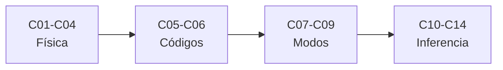

# B37 — Interiores estelares y asterosismología

> **Bloque de la malla `0.2.0`.** Ver el [programa completo](../../PROGRAMA_ACADEMICO_COMPLETO.md).

**Programa:** Programa Integral de Astronomía, Astrofísica, Ciencias Espaciales e Ingeniería Aeroespacial
**Área:** A03 — Astrofísica y ciencias fundamentales del universo
**Nivel:** N3 (fundamentos disciplinares) · **Clases:** 14 · **Carga:** por calibrar con el uso
**Estado:** guía pedagógica del bloque (resumen de qué se aprende en cada clase). Las clases enlazadas en la tabla ya están redactadas; todas conservan el estado E0 en el catálogo hasta registrar revisión disciplinar.

## 🎯 Propósito del bloque

Enseña **cómo se modela el interior de una estrella y cómo se lo sondea con sus oscilaciones**: la convección, la ecuación de estado, la opacidad y las condiciones de frontera que cierran la estructura estelar, la verificación y calibración de los códigos evolutivos, y la asterosismología —modos radiales y no radiales, frecuencias características, inversiones, rotación interna, gigantes rojas, series fotométricas espaciales y ajuste de modelos a frecuencias—. Cada clase cierra con un cálculo verificable contra un caso analítico, dos vías independientes o una simulación con semilla fija, y distingue lo consultado de lo ilustrativo.

## 📚 Al terminar el bloque podrás

1. Aplicar los criterios de Schwarzschild y Ledoux y resolver una convección de longitud de mezcla simplificada.
2. Calcular las presiones de gas, de radiación y de electrones degenerados de un plasma.
3. Obtener una media de Rosseland y usar una tabla de opacidad interpolada.
4. Cerrar un modelo estructural con condiciones centrales y de superficie.
5. Verificar un código por su orden de convergencia y calibrar parámetros libres con restricciones.
6. Calcular modos radiales y no radiales y extraer Δν, νmax y espaciados de período.
7. Plantear una inversión regularizada y un ajuste de frecuencias con efecto de superficie.

## 🧭 Secuencia del bloque

**Descripción textual.** Cuatro tramos encadenados: física del modelo estelar (C01–C04), códigos y calibración (C05–C06), oscilaciones y observables (C07–C09) e inversión, rotación y datos (C10–C14).

## 🗂️ Las 14 clases en resumen

**Navegación:** cada clase desarrollada enlaza a la anterior, a la siguiente y a este bloque; mientras una clase siga solo programada, su enlace lleva a su fila en esta tabla.

La columna «Evidencia» indica el producto que demostrará el aprendizaje. Los laboratorios usan datos **sintéticos** o **ilustrativos** (rotulados) o valores publicados con fuente y fecha.

### Tramo 1 · Física del modelo estelar

| ID | Clase | Qué se aprende | Evidencia |
|---|---|---|---|
| [B37-C01](../clases/B37/B37-C01-conveccion-longitud-de-mezcla-y-criterios-de-schwarzschild-y-ledoux/CLASE.md) | Convección: longitud de mezcla y criterios de Schwarzschild y Ledoux | Gradientes, criterios y flujo convectivo. | Ficha de la convección |
| [B37-C02](../clases/B37/B37-C02-ecuaciones-de-estado-estelares-gas-ideal-radiacion-y-degeneracion/CLASE.md) | Ecuaciones de estado estelares: gas ideal, radiación y degeneración | Presión de gas, de radiación y degeneración. | Ficha de la ecuación de estado |
| [B37-C03](../clases/B37/B37-C03-opacidad-media-de-rosseland-y-tablas-de-opacidad-en-interiores/CLASE.md) | Opacidad media de Rosseland y tablas de opacidad en interiores | Media de Rosseland e interpolación de tablas. | Ficha de la opacidad media |
| [B37-C04](../clases/B37/B37-C04-condiciones-de-frontera-centrales-y-superficiales-en-modelos-estelares/CLASE.md) | Condiciones de frontera centrales y superficiales en modelos estelares | Series centrales y atmósfera gris. | Ficha de las condiciones de frontera |

### Tramo 2 · Códigos y calibración

| ID | Clase | Qué se aprende | Evidencia |
|---|---|---|---|
| [B37-C05](../clases/B37/B37-C05-codigos-de-evolucion-estelar-configuracion-verificacion-y-limites/CLASE.md) | Códigos de evolución estelar: configuración, verificación y límites | Convergencia, orden y paso de tiempo. | Ficha de verificación de un código |
| [B37-C06](../clases/B37/B37-C06-calibracion-de-modelos-estelares-con-el-sol-y-binarias/CLASE.md) | Calibración de modelos estelares con el Sol y binarias | Resolución de parámetros libres y masas de binarias. | Ficha de calibración |

### Tramo 3 · Oscilaciones y observables

| ID | Clase | Qué se aprende | Evidencia |
|---|---|---|---|
| [B37-C07](../clases/B37/B37-C07-oscilaciones-radiales-y-relacion-periodo-densidad-media/CLASE.md) | Oscilaciones radiales y relación período-densidad media | Modo fundamental y relación período-densidad. | Ficha de oscilaciones radiales |
| [B37-C08](../clases/B37/B37-C08-oscilaciones-no-radiales-modos-p-g-y-mixtos/CLASE.md) | Oscilaciones no radiales: modos p, g y mixtos | Armónicos, diagrama de propagación y cavidades. | Ficha de modos no radiales |
| [B37-C09](../clases/B37/B37-C09-frecuencias-caracteristicas-max-y-espaciado-de-periodos/CLASE.md) | Frecuencias características: Δν, νmax y espaciado de períodos | Relaciones de escala y espaciados. | Ficha de observables sísmicos |

### Tramo 4 · Inversión, rotación y datos

| ID | Clase | Qué se aprende | Evidencia |
|---|---|---|---|
| B37-C10 | Inversión asterosísmica de perfiles internos | Problema inverso regularizado. | Ficha de la inversión |
| B37-C11 | Rotación interna a partir del desdoblamiento de frecuencias | Desdoblamiento y rotación de núcleo y envoltura. | Ficha de la rotación interna |
| B37-C12 | Gigantes rojas oscilantes y modos mixtos | Acoplamiento de modos p y g. | Ficha de modos mixtos |
| B37-C13 | Series fotométricas de Kepler, TESS y PLATO para asterosismología | Cadencia, huecos y periodograma. | Ficha de la serie fotométrica |
| B37-C14 | Ajuste de modelos estelares a frecuencias sísmicas | Rejilla, ji cuadrado y efecto de superficie. | Ficha del ajuste sísmico |

## 🧵 Hilos que atraviesan el bloque

- **Del interior a la señal:** C01–C06 construyen y verifican el modelo; C07–C09 predicen sus frecuencias; C10–C14 las usan para inferir el interior.
- **Verificación independiente:** cada laboratorio contrasta con un caso analítico, dos vías de cálculo o una simulación con semilla fija.
- **Incertidumbre:** C06, C10, C11 y C14 propagan o estiman incertidumbres con covarianzas o remuestreo.
- **Observado frente a ilustrativo:** las constantes de NIST y los valores nominales de la UAI se citan con fecha; los perfiles, las rejillas y las series son sintéticos o ilustrativos y se rotulan.

## 📝 Evaluación del bloque (propuesta, por calibrar)

- Fichas y ejercicios por clase, con retroalimentación y recuperación con evidencia distinta.
- Portafolio: ficha de verificación de un código (C05) y ficha del ajuste sísmico (C14).
- Las condiciones críticas (rotular lo sintético, no presentar un modelo de juguete como una estrella real y citar solo lo consultado) no se compensan con promedio.

## ⚠️ Seguridad y límites

El bloque es educativo. Los modelos son simplificados (politropos, opacidades de juguete, rejillas sintéticas) y no sustituyen a un código evolutivo ni a un análisis sísmico publicado; no se infieren masas, edades ni rotaciones de ninguna estrella real. Las constantes se citan con fecha de consulta y el resto de los números son ilustrativos y se rotulan como tales.

## Roles que lo usan

- [Astrofísica estelar y galáctica](../../rutas/astrofisica-estelar-y-galactica.md)

## Fuentes de orientación preliminar

- **[NIST-CODATA]** [NIST Fundamental Physical Constants (CODATA 2022)](https://physics.nist.gov/cuu/Constants/Table/allascii.txt) — Constantes físicas fundamentales.
- **[IAU-B3]** [UAI, Resolución B3 de 2015](https://arxiv.org/abs/1510.07674) — Valores nominales solares y planetarios.
- **[ADS]** [NASA Astrophysics Data System](https://ui.adsabs.harvard.edu/) — Índice bibliográfico de literatura astronómica y física.

> La asociación de estas fuentes es orientativa por bloque. Las fuentes realmente consultadas para cada afirmación se registran en la sección 11 de cada clase.

[🏠 Volver al programa](../../README.md) · [➡️ B38 — Poblaciones estelares y simulación de galaxias](./B38-poblaciones-estelares-y-simulacion-de-galaxias.md)
