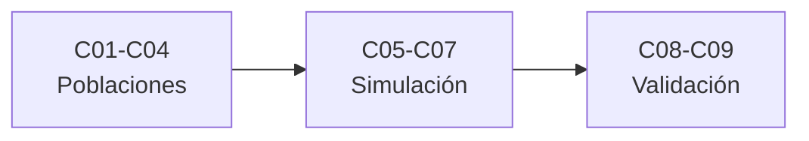

# B38 — Poblaciones estelares y simulación de galaxias

> **Bloque de la malla `0.2.0`.** Ver el [programa completo](../../PROGRAMA_ACADEMICO_COMPLETO.md).

**Programa:** Programa Integral de Astronomía, Astrofísica, Ciencias Espaciales e Ingeniería Aeroespacial
**Área:** A03 — Astrofísica y ciencias fundamentales del universo
**Nivel:** N3 (fundamentos disciplinares) · **Clases:** 9 · **Carga:** por calibrar con el uso
**Estado:** guía pedagógica del bloque (resumen de qué se aprende en cada clase). Las clases enlazadas en la tabla ya están redactadas; todas conservan el estado E0 en el catálogo hasta registrar revisión disciplinar.

## 🎯 Propósito del bloque

Enseña **cómo se estudian las poblaciones de estrellas de una galaxia y cómo se simula y se valida una galaxia**: las funciones de luminosidad, la función inicial de masa, la cinemática con movimientos propios, la historia de formación estelar, los potenciales galácticos, la hidrodinámica con partículas y con malla, los modelos submalla de formación estelar y retroalimentación, las observaciones sintéticas y la validación frente a observaciones. Cada clase cierra con un cálculo verificable contra un caso analítico, dos vías independientes o una simulación con semilla fija, y distingue lo consultado de lo ilustrativo.

## 📚 Al terminar el bloque podrás

1. Estimar una función de luminosidad corrigiendo el sesgo de muestras limitadas en magnitud.
2. Calcular momentos y fracciones de una función inicial de masa y estimar su pendiente con incertidumbre.
3. Convertir movimientos propios, paralajes y velocidades radiales en velocidades espaciales con su error.
4. Recuperar una historia de formación estelar por dos vías independientes.
5. Calcular velocidades circulares, masas encerradas y órbitas en potenciales de Plummer, Miyamoto-Nagai y NFW.
6. Comparar un método de partículas y uno de malla con la solución exacta de un tubo de choque.
7. Contrastar una galaxia simulada con una muestra de referencia mediante residuos, chi cuadrado y la prueba de Kolmogórov-Smirnov.

## 🧭 Secuencia del bloque

**Descripción textual.** Tres tramos encadenados: poblaciones estelares (C01–C04), simulación de galaxias (C05–C07) y observación sintética y validación (C08–C09).

## 🗂️ Las 9 clases en resumen

**Navegación:** cada clase desarrollada enlaza a la anterior, a la siguiente y a este bloque; mientras una clase siga solo programada, su enlace lleva a su fila en esta tabla.

La columna «Evidencia» indica el producto que demostrará el aprendizaje. Los laboratorios usan datos **sintéticos** o **ilustrativos** (rotulados) o valores publicados con fuente y fecha.

### Tramo 1 · Poblaciones estelares

| ID | Clase | Qué se aprende | Evidencia |
|---|---|---|---|
| B38-C01 | Funciones de luminosidad estelar | Función de luminosidad y estimador 1/Vmax. | Ficha de la función de luminosidad |
| B38-C02 | Función inicial de masa y su universalidad | Momentos de la IMF y dispersión de Poisson de la pendiente. | Ficha de la función inicial de masa |
| B38-C03 | Cinemática estelar con Gaia: movimientos propios y espacio de fase | De movimientos propios a velocidades y elipsoide de velocidades. | Ficha de la cinemática estelar |
| B38-C04 | Historia de formación estelar a partir de poblaciones resueltas | Inversión de conteos por edad con dos vías. | Ficha de la historia de formación estelar |

### Tramo 2 · Simulación de galaxias

| ID | Clase | Qué se aprende | Evidencia |
|---|---|---|---|
| B38-C05 | Potenciales galácticos: Plummer, Miyamoto-Nagai y NFW | Velocidad circular, masa encerrada y órbitas. | Ficha de los potenciales galácticos |
| B38-C06 | Hidrodinámica en simulaciones: SPH y métodos de malla | Tubo de choque con SPH, malla y solución exacta. | Ficha de la hidrodinámica numérica |
| B38-C07 | Modelos submalla de formación estelar y retroalimentación | Ley de formación, carga de masa y equilibrio de una zona. | Ficha de los modelos submalla |

### Tramo 3 · Observación sintética y validación

| ID | Clase | Qué se aprende | Evidencia |
|---|---|---|---|
| B38-C08 | Observaciones sintéticas de galaxias simuladas | Imagen, PSF, ruido y radio efectivo. | Ficha de la observación sintética |
| B38-C09 | Validación de galaxias simuladas frente a observaciones | Residuos en dex, chi cuadrado y prueba KS. | Ficha de la validación de galaxias simuladas |

## 🧵 Hilos que atraviesan el bloque

- **De las estrellas a la galaxia:** C01–C04 describen las poblaciones; C05–C07 construyen el modelo; C08–C09 lo comparan con las observaciones.
- **Sesgos de observación:** C01, C02 y C03 muestran cómo la selección y el error de medida deforman lo que se mide.
- **Verificación independiente:** cada laboratorio contrasta con un caso analítico, dos vías de cálculo o una simulación con semilla fija.
- **Observado frente a ilustrativo:** las constantes se citan con fecha; las galaxias, muestras y parámetros son sintéticos y se rotulan.

## 📝 Evaluación del bloque (propuesta, por calibrar)

- Fichas y ejercicios por clase, con retroalimentación y recuperación con evidencia distinta.
- Portafolio: ficha de la historia de formación estelar (C04) y ficha de la validación de galaxias simuladas (C09).
- Las condiciones críticas (rotular lo sintético, no presentar un modelo ilustrativo como datos reales y citar solo lo consultado) no se compensan con promedio.

## ⚠️ Seguridad y límites

El bloque es educativo. Los modelos son simplificados y no reproducen ninguna galaxia, catálogo ni simulación real; los números no son resultados de EAGLE, Gaia ni de ningún otro proyecto. Las constantes se citan con fecha de consulta y el resto de los números son ilustrativos y se rotulan como tales.

## Roles que lo usan

- [Astrofísica estelar y galáctica](../../rutas/astrofisica-estelar-y-galactica.md)

## Fuentes de orientación preliminar

- **[NIST-CODATA]** [NIST Fundamental Physical Constants (CODATA 2022)](https://physics.nist.gov/cuu/Constants/Table/allascii.txt) — Constantes físicas fundamentales.
- **[IAU-B3]** [UAI, Resolución B3 de 2015](https://arxiv.org/abs/1510.07674) — Valores nominales solares y planetarios.
- **[ADS]** [NASA Astrophysics Data System](https://ui.adsabs.harvard.edu/) — Índice bibliográfico de literatura astronómica y física.

> La asociación de estas fuentes es orientativa por bloque. Las fuentes realmente consultadas para cada afirmación se registran en la sección 11 de cada clase.

[🏠 Volver al programa](../../README.md) · [➡️ B39 — Relatividad general avanzada](./B39-relatividad-general-avanzada.md)
