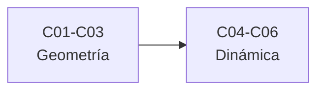

# B39 — Relatividad general avanzada

> **Bloque de la estructura vigente.** Ver el [programa completo](../../PROGRAMA_ACADEMICO_COMPLETO.md).

**Programa:** Programa Integral de Astronomía, Astrofísica, Ciencias Espaciales e Ingeniería Aeroespacial
**Área:** A03 — Astrofísica y ciencias fundamentales del universo
**Nivel:** N3 (fundamentos disciplinares) · **Clases:** 6 · **Carga:** por calibrar con el uso
**Estado:** guía pedagógica del bloque (resumen de qué se aprende en cada clase). Las clases enlazadas en la tabla ya están redactadas; todas conservan el estado E0 en el catálogo hasta registrar revisión disciplinar.

## 🎯 Propósito del bloque

Enseña **el aparato matemático de la relatividad general y cómo se verifica con cálculo**: la métrica sobre una variedad, la conexión de Levi-Civita y los símbolos de Christoffel, los tensores de Riemann y Ricci y la curvatura escalar, el tensor de energía-momento de un fluido perfecto, las ecuaciones de campo de Einstein con su límite newtoniano y la descomposición 3+1 que usa la relatividad numérica. Cada clase cierra con un laboratorio que contrasta un resultado conocido con un cálculo numérico independiente (diferencias finitas, identidades de Bianchi, solución analítica).

## 📚 Al terminar el bloque podrás

1. Calcular longitudes, ángulos y áreas con una métrica sobre una variedad.
2. Obtener los símbolos de Christoffel de una métrica y comprobar la simetría y la compatibilidad métrica.
3. Calcular el tensor de Riemann, el de Ricci y la curvatura escalar de una métrica dada.
4. Construir el tensor de energía-momento de un fluido perfecto y comprobar su conservación.
5. Recuperar el límite newtoniano de las ecuaciones de Einstein y la relación de Poisson.
6. Identificar lapso, desplazamiento y métrica espacial en la descomposición 3+1.
7. Evolucionar numéricamente una ecuación de onda con una cuenta de error y de convergencia.

## 🧭 Secuencia del bloque

**Descripción textual.** Dos tramos encadenados: geometría de la curvatura (C01–C03) y dinámica y evolución (C04–C06).

## 🗂️ Las 6 clases en resumen

**Navegación:** cada clase desarrollada enlaza a la anterior, a la siguiente y a este bloque; mientras una clase siga solo programada, su enlace lleva a su fila en esta tabla.

La columna «Evidencia» indica el producto que demostrará el aprendizaje. Los laboratorios usan datos **sintéticos** o **ilustrativos** (rotulados) o valores publicados con fuente y fecha.

### Tramo 1 · Geometría de la curvatura

| ID | Clase | Qué se aprende | Evidencia |
|---|---|---|---|
| [B39-C01](../clases/B39/B39-C01-variedades-tensor-metrico-y-geometria-diferencial/CLASE.md) | Variedades, tensor métrico y geometría diferencial | Métrica, longitudes y cambio de coordenadas. | Ficha de la métrica |
| [B39-C02](../clases/B39/B39-C02-conexion-afin-y-simbolos-de-christoffel/CLASE.md) | Conexión afín y símbolos de Christoffel | Christoffel, geodésicas y compatibilidad métrica. | Ficha de la conexión |
| [B39-C03](../clases/B39/B39-C03-tensor-de-riemann-ricci-y-curvatura-escalar/CLASE.md) | Tensor de Riemann, Ricci y curvatura escalar | Riemann, Ricci y curvatura escalar de la 2-esfera y de Schwarzschild. | Ficha de la curvatura |

### Tramo 2 · Dinámica y evolución

| ID | Clase | Qué se aprende | Evidencia |
|---|---|---|---|
| [B39-C04](../clases/B39/B39-C04-tensor-de-energia-momento-y-fuentes-de-curvatura/CLASE.md) | Tensor de energía-momento y fuentes de curvatura | Fluido perfecto y condiciones de energía. | Ficha del tensor de energía-momento |
| [B39-C05](../clases/B39/B39-C05-ecuaciones-de-campo-de-einstein-y-limite-newtoniano/CLASE.md) | Ecuaciones de campo de Einstein y límite newtoniano | Tensor de Einstein, Bianchi y límite de campo débil. | Ficha de las ecuaciones de campo |
| [B39-C06](../clases/B39/B39-C06-introduccion-a-la-relatividad-numerica-formalismo-3-1/CLASE.md) | Introducción a la relatividad numérica: formalismo 3+1 | Lapso, desplazamiento y evolución con convergencia. | Ficha del formalismo 3+1 |

## 🧵 Hilos que atraviesan el bloque

- **De la métrica a la curvatura:** C01 define la métrica, C02 la conexión y C03 la curvatura que se deriva de ellas.
- **De la curvatura a la materia:** C04 y C05 conectan la curvatura con el tensor de energía-momento y recuperan la gravedad newtoniana.
- **De la ecuación a la simulación:** C06 descompone el espacio-tiempo en capas para evolucionarlo numéricamente.
- **Verificación independiente:** cada laboratorio contrasta un resultado conocido con diferencias finitas, identidades o una solución analítica.

## 📝 Evaluación del bloque (propuesta, por calibrar)

- Fichas y ejercicios por clase, con retroalimentación y recuperación con evidencia distinta.
- Portafolio: ficha de la curvatura (C03) y ficha de las ecuaciones de campo (C05).
- Las condiciones críticas (rotular lo sintético, no presentar un resultado de prueba como solución de un sistema real y citar solo lo consultado) no se compensan con promedio.

## ⚠️ Seguridad y límites

El bloque es educativo y matemático. Los cálculos son de prueba, con métricas y fluidos de ejemplo, y no sustituyen a un código de relatividad numérica validado ni a un tratado; no se simula ningún sistema astrofísico real. Las constantes se citan con fecha de consulta y el resto de los números son ilustrativos y se rotulan como tales.

## Roles que lo usan

- [Cosmología y astrofísica extrema](../../rutas/cosmologia-y-astrofisica-extrema.md)

## Fuentes de orientación preliminar

- **[NIST-CODATA]** [NIST Fundamental Physical Constants (CODATA 2022)](https://physics.nist.gov/cuu/Constants/Table/allascii.txt) — Constantes físicas fundamentales.
- **[IAU-B3]** [UAI, Resolución B3 de 2015](https://arxiv.org/abs/1510.07674) — Valores nominales solares y planetarios.
- **[ADS]** [NASA Astrophysics Data System](https://ui.adsabs.harvard.edu/) — Índice bibliográfico de literatura astronómica y física.

> La asociación de estas fuentes es orientativa por bloque. Las fuentes realmente consultadas para cada afirmación se registran en la sección 11 de cada clase.

[🏠 Volver al programa](../../README.md) · [➡️ B40 — Universo temprano y radiación cósmica de fondo](./B40-universo-temprano-y-radiacion-cosmica-de-fondo.md)
