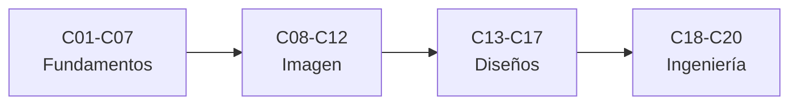

# B41 — Óptica geométrica y diseño de telescopios

> **Bloque de la malla `0.2.0`.** Ver el [programa completo](../../PROGRAMA_ACADEMICO_COMPLETO.md).

**Programa:** Programa Integral de Astronomía, Astrofísica, Ciencias Espaciales e Ingeniería Aeroespacial
**Área:** A04 — Óptica, telescopios y observatorios científicos
**Nivel:** N3 (fundamentos disciplinares) · **Clases:** 20 · **Carga:** por calibrar con el uso
**Estado:** guía pedagógica del bloque (resumen de qué se aprende en cada clase). Las clases enlazadas en la tabla ya están redactadas; todas conservan el estado E0 en el catálogo hasta registrar revisión disciplinar.

## 🎯 Propósito del bloque

Enseña **cómo se diseña un telescopio con óptica geométrica**: la propagación de la luz y la ley de Snell, los espejos y las lentes, la formación de imagen y los aumentos, el trazado de rayos, las pupilas y la apertura, el campo y la escala de placa, el límite de difracción, las aberraciones, los refractores y los reflectores Newton y Cassegrain, las monturas, la colimación y un diseño preliminar integrado. Cada clase cierra con un cálculo verificable contra un caso analítico, dos vías independientes o una simulación con semilla fija, y distingue lo consultado de lo ilustrativo.

## 📚 Al terminar el bloque podrás

1. Aplicar la ley de Snell y las ecuaciones de espejos y lentes para ubicar imágenes.
2. Trazar rayos exactos y compararlos con la aproximación paraxial.
3. Calcular pupilas, relación focal, campo y escala de placa de un telescopio.
4. Estimar el límite de difracción y el criterio de Rayleigh.
5. Cuantificar aberración esférica, coma, cromática y astigmatismo.
6. Comparar diseños Newton, Cassegrain y refractor con cifras.
7. Integrar monturas, colimación y un presupuesto de diseño preliminar.

## 🧭 Secuencia del bloque

**Descripción textual.** Cuatro tramos encadenados: luz, espejos y lentes (C01–C07), rayos, pupilas y formación de imagen (C08–C12), aberraciones y diseños (C13–C17) y monturas, ajuste y diseño (C18–C20).

## 🗂️ Las 20 clases en resumen

**Navegación:** cada clase desarrollada enlaza a la anterior, a la siguiente y a este bloque; mientras una clase siga solo programada, su enlace lleva a su fila en esta tabla.

La columna «Evidencia» indica el producto que demostrará el aprendizaje. Los laboratorios usan datos **sintéticos** o **ilustrativos** (rotulados) o valores publicados con fuente y fecha.

### Tramo 1 · Luz, espejos y lentes

| ID | Clase | Qué se aprende | Evidencia |
|---|---|---|---|
| B41-C01 | Naturaleza y propagación de la luz | Velocidad de la luz en medios y camino óptico. | Ficha de la propagación de la luz |
| B41-C02 | Índice de refracción y ley de Snell | Ley de Snell, ángulo crítico y reflexión de Fresnel. | Ficha de la refracción |
| B41-C03 | Reflexión y espejos planos | Imagen virtual, desviación por espejo girado y reflexiones múltiples. | Ficha de los espejos planos |
| B41-C04 | Espejos esféricos y parabólicos | Foco de espejos, aberración esférica y paraboloide. | Ficha de espejos esféricos y parabólicos |
| B41-C05 | Lentes delgadas y gruesas | Ecuación del fabricante de lentes y matrices de rayos. | Ficha de lentes delgadas y gruesas |
| B41-C06 | Distancias focales y formación de imagen | Ecuación de imagen, aumento lateral y combinación de focales. | Ficha de distancias focales e imagen |
| B41-C07 | Aumentos y sistemas afocales | Aumento angular, pupila de salida y telescopio de Kepler. | Ficha de aumentos y sistemas afocales |

### Tramo 2 · Rayos, pupilas y formación de imagen

| ID | Clase | Qué se aprende | Evidencia |
|---|---|---|---|
| B41-C08 | Trazado de rayos para telescopios | Trazado exacto de rayos con la ley de Snell y comparación paraxial. | Ficha del trazado de rayos |
| B41-C09 | Pupilas y diafragmas ópticos | Pupila de entrada y salida, obstrucción y viñeteo. | Ficha de pupilas y diafragmas |
| B41-C10 | Apertura y relación focal | Relación focal, brillo superficial y número de la apertura. | Ficha de apertura y relación focal |
| B41-C11 | Campo visual y escala de placa | Escala de placa, campo en el sensor y muestreo de Nyquist. | Ficha de campo y escala de placa |
| B41-C12 | Difracción y límite de Rayleigh | Disco de Airy, criterio de Rayleigh y Dawes. | Ficha de difracción y límite de Rayleigh |

### Tramo 3 · Aberraciones y diseños

| ID | Clase | Qué se aprende | Evidencia |
|---|---|---|---|
| B41-C13 | Aberración esférica y coma | Aberración esférica longitudinal y coma de un paraboloide. | Ficha de aberración esférica y coma |
| B41-C14 | Aberración cromática y astigmatismo | Dispersión cromática y astigmatismo de un campo. | Ficha de aberración cromática y astigmatismo |
| B41-C15 | Refractores acromáticos y apocromáticos | Doblete acromático, espectro secundario y apocromático. | Ficha de refractores acromáticos |
| B41-C16 | Telescopios Newton y Dobson | Newton: obstrucción del secundario y Dobson: montura altazimutal. | Ficha de Newton y Dobson |
| B41-C17 | Telescopios Cassegrain y derivados | Cassegrain: aumento del secundario, focal efectiva y condición de Ritchey-Chrétien. | Ficha de Cassegrain y derivados |

### Tramo 4 · Monturas, ajuste y diseño

| ID | Clase | Qué se aprende | Evidencia |
|---|---|---|---|
| B41-C18 | Monturas y mecanismos de seguimiento | Rotación de campo, error periódico y tasas de seguimiento. | Ficha de monturas y seguimiento |
| B41-C19 | Colimación y prueba de enfoque | Colimación por desplazamiento de la sombra y prueba de Foucault. | Ficha de colimación y enfoque |
| B41-C20 | Diseño preliminar de un telescopio | Presupuesto de diseño integrado de un telescopio de aficionado. | Memoria de diseño preliminar |

## 🧵 Hilos que atraviesan el bloque

- **De la luz al telescopio:** C01–C07 fijan las leyes de la óptica geométrica; C08–C12 las convierten en imagen medible; C13–C17 cuantifican los defectos y los diseños; C18–C20 llevan todo a un instrumento.
- **Dos vías independientes:** cada laboratorio contrasta un trazado exacto con una fórmula analítica, una segunda forma de calcular o una simulación con semilla fija.
- **Diseño preliminar:** C20 reúne apertura, focal, campo, difracción y aberraciones en un presupuesto con tolerancias.
- **Observado frente a ilustrativo:** solo se citan con fecha las constantes de NIST y las páginas consultadas; los vidrios, instrumentos y números de los ejemplos son ilustrativos y se rotulan.

## 📝 Evaluación del bloque (propuesta, por calibrar)

- Fichas y ejercicios por clase, con retroalimentación y recuperación con evidencia distinta.
- Portafolio: ficha del trazado de rayos (C08) y memoria de diseño preliminar (C20).
- Las condiciones críticas (rotular lo ilustrativo, no presentar un diseño de juguete como un instrumento real y citar solo lo consultado) no se compensan con promedio.

## ⚠️ Seguridad y límites

El bloque es educativo. Los modelos son simplificados y no sustituyen a un programa de diseño óptico ni a las pruebas de un taller; los vidrios y datos de instrumentos son ilustrativos. Nunca se apunta un telescopio al Sol sin filtro solar certificado. Los valores publicados se citan con su fuente y fecha de consulta y el resto de los números son ilustrativos y se rotulan como tales.

## Fuentes de orientación preliminar

- **[ESO]** [European Southern Observatory](https://www.eso.org/) — Observatorios ópticos, instrumentación y astronomía profesional.
- **[ALMA]** [Atacama Large Millimeter/submillimeter Array](https://www.almaobservatory.org/) — Radioastronomía interferométrica de ALMA y sus productos de ciencia.
- **[NASA-SMALLSAT]** [NASA State-of-the-Art of Small Spacecraft Technology, edición 2026](https://www.nasa.gov/smallsat-institute/sst-soa/) — Referencia panorámica sobre plataformas y subsistemas de satélites pequeños.
- **[NASA-NTRS]** [NASA Technical Reports Server](https://ntrs.nasa.gov/) — Informes técnicos e investigación histórica y actual.

> La asociación de estas fuentes es orientativa por bloque. Las fuentes realmente consultadas para cada afirmación se registran en la sección 11 de cada clase.

[🏠 Volver al programa](../../README.md) · [➡️ B42 — Óptica física y óptica adaptativa](./B42-optica-fisica-y-optica-adaptativa.md)
