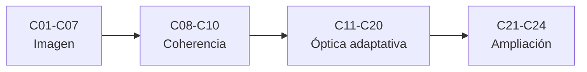

# B42 — Óptica física y óptica adaptativa

> **Bloque ampliado.** Además de las 20 clases de la línea base, el bloque tiene 4 clases programadas por la ampliación (`B42-C21` a `B42-C24`), listadas en el último tramo. Ver el [programa completo](../../PROGRAMA_ACADEMICO_COMPLETO.md).

**Programa:** Programa Integral de Astronomía, Astrofísica, Ciencias Espaciales e Ingeniería Aeroespacial
**Área:** A04 — Óptica, telescopios y observatorios científicos
**Nivel:** N3 (fundamentos disciplinares) · **Clases:** 20 + 4 de la ampliación · **Carga:** por calibrar con el uso
**Estado:** guía pedagógica del bloque (resumen de qué se aprende en cada clase). Las clases enlazadas en la tabla ya están redactadas; todas conservan el estado E0 en el catálogo hasta registrar revisión disciplinar.

## 🎯 Propósito del bloque

Enseña **cómo la luz forma imágenes y cómo la atmósfera las degrada y se corrige**: las ecuaciones de onda, el principio de Huygens-Fresnel, la coherencia, la difracción de aperturas y el patrón de Airy, la PSF y la OTF, la polarización, la interferometría de dos haces y de varios telescopios, la turbulencia de Kolmogorov y el parámetro de Fried, la medición del frente de onda con sensores Shack-Hartmann, los espejos deformables, el lazo de control, las estrellas guía, la óptica adaptativa multiconjugada, la reconstrucción de imágenes, la calibración y las métricas de desempeño. Cada clase cierra con un laboratorio en Python (solo biblioteca estándar) contrastado con un caso analítico, dos vías independientes o una simulación con semilla fija, y distingue lo consultado de lo ilustrativo.

## 📚 Al terminar el bloque podrás

1. Calcular el patrón de difracción de rendijas y aperturas circulares y compararlo con el de Airy.
2. Obtener la PSF y la OTF de una pupila y relacionarlas con el límite de difracción.
3. Describir estados de polarización con vectores de Jones y parámetros de Stokes.
4. Medir visibilidades de franjas y relacionarlas con la coherencia y la línea base.
5. Simular pantallas de fase de Kolmogorov y estimar r0 y el seeing.
6. Medir el frente de onda con un sensor Shack-Hartmann y reconstruirlo por métodos zonal y modal.
7. Cerrar un lazo de óptica adaptativa simulado y evaluarlo con el cociente de Strehl y la energía encerrada.

## 🧭 Secuencia del bloque

**Descripción textual.** Cuatro tramos encadenados: ondas, difracción y formación de imagen (C01–C07), polarización e interferometría (C08–C10), atmósfera y óptica adaptativa (C11–C20) y la ampliación con estrellas guía naturales, reconstructores, calibración y métricas (C21–C24).

## 🗂️ Las 24 clases en resumen (20 de la línea base + 4 de la ampliación)

**Navegación:** cada clase desarrollada enlaza a la anterior, a la siguiente y a este bloque; mientras una clase siga solo programada, su enlace lleva a su fila en esta tabla.

La columna «Evidencia» indica el producto que demostrará el aprendizaje. Los laboratorios usan datos **sintéticos** o **ilustrativos** (rotulados) o valores publicados con fuente y fecha.

### Tramo 1 · Ondas, difracción y formación de imagen

| ID | Clase | Qué se aprende | Evidencia |
|---|---|---|---|
| [B42-C01](../clases/B42/B42-C01-ecuaciones-de-onda-electromagnetica/CLASE.md) | Ecuaciones de onda electromagnética | Ecuación de onda, relación de dispersión y flujo de Poynting. | Ficha de la onda electromagnética |
| [B42-C02](../clases/B42/B42-C02-principio-de-huygens-fresnel/CLASE.md) | Principio de Huygens-Fresnel | Suma de ondas secundarias y límite de Fraunhofer. | Ficha de Huygens-Fresnel |
| [B42-C03](../clases/B42/B42-C03-interferencia-y-coherencia/CLASE.md) | Interferencia y coherencia | Visibilidad de franjas y longitud de coherencia. | Ficha de interferencia y coherencia |
| [B42-C04](../clases/B42/B42-C04-difraccion-de-aperturas/CLASE.md) | Difracción de aperturas | Difracción de rendijas y aperturas circulares por transformada de Fourier. | Ficha de la difracción de aperturas |
| [B42-C05](../clases/B42/B42-C05-patrones-de-airy/CLASE.md) | Patrones de Airy | Patrón de Airy, ceros de J1 y criterio de Rayleigh. | Ficha del patrón de Airy |
| [B42-C06](../clases/B42/B42-C06-funcion-de-dispersion-puntual/CLASE.md) | Función de dispersión puntual | PSF como potencia de la transformada de la pupila y sus muestras. | Ficha de la PSF |
| [B42-C07](../clases/B42/B42-C07-funcion-de-transferencia-optica/CLASE.md) | Función de transferencia óptica | OTF, MTF y corte a D/λ. | Ficha de la OTF |

### Tramo 2 · Polarización e interferometría

| ID | Clase | Qué se aprende | Evidencia |
|---|---|---|---|
| [B42-C08](../clases/B42/B42-C08-polarizacion-de-la-luz/CLASE.md) | Polarización de la luz | Vectores de Jones, ley de Malus y parámetros de Stokes. | Ficha de polarización |
| [B42-C09](../clases/B42/B42-C09-interferometria-de-dos-haces/CLASE.md) | Interferometría de dos haces | Interferómetro de Michelson, franjas y fase. | Ficha del interferómetro de dos haces |
| [B42-C10](../clases/B42/B42-C10-interferometria-de-multiples-telescopios/CLASE.md) | Interferometría de múltiples telescopios | Línea base, cobertura uv y síntesis de apertura. | Ficha de la interferometría multitelescopio |

### Tramo 3 · Atmósfera y óptica adaptativa

| ID | Clase | Qué se aprende | Evidencia |
|---|---|---|---|
| [B42-C11](../clases/B42/B42-C11-turbulencia-atmosferica/CLASE.md) | Turbulencia atmosférica | Espectro de Kolmogorov y pantallas de fase. | Ficha de la turbulencia |
| [B42-C12](../clases/B42/B42-C12-parametro-de-fried/CLASE.md) | Parámetro de Fried | r0, seeing y tiempo de coherencia. | Ficha del parámetro de Fried |
| [B42-C13](../clases/B42/B42-C13-medicion-de-frente-de-onda/CLASE.md) | Medición de frente de onda | Medición de pendientes y fase por interferometría. | Ficha de la medición de frente de onda |
| [B42-C14](../clases/B42/B42-C14-sensores-shack-hartmann/CLASE.md) | Sensores Shack-Hartmann | Centroides de microlentes y ruido de fotones. | Ficha del sensor Shack-Hartmann |
| [B42-C15](../clases/B42/B42-C15-espejos-deformables/CLASE.md) | Espejos deformables | Funciones de influencia, carrera y error de ajuste. | Ficha del espejo deformable |
| [B42-C16](../clases/B42/B42-C16-lazo-de-control-de-optica-adaptativa/CLASE.md) | Lazo de control de óptica adaptativa | Integrador, retardo y ancho de banda de rechazo. | Ficha del lazo de control |
| [B42-C17](../clases/B42/B42-C17-estrellas-guia-artificiales/CLASE.md) | Estrellas guía artificiales | Dispersión Rayleigh, sodio y efecto cono. | Ficha de la estrella guía artificial |
| [B42-C18](../clases/B42/B42-C18-optica-adaptativa-multiconjugada/CLASE.md) | Óptica adaptativa multiconjugada | Anisoplanatismo, capas y campo corregido. | Ficha de la MCAO |
| [B42-C19](../clases/B42/B42-C19-reconstruccion-de-imagenes/CLASE.md) | Reconstrucción de imágenes | Deconvolución, Wiener y Richardson-Lucy. | Ficha de la reconstrucción de imágenes |
| [B42-C20](../clases/B42/B42-C20-laboratorio-de-correccion-optica-simulada/CLASE.md) | Laboratorio de corrección óptica simulada | Lazo cerrado simulado con pantalla de fase y Strehl. | Informe del laboratorio de corrección |

### Tramo 4 · Ampliación: estrellas guía, reconstrucción, calibración y métricas

| ID | Clase | Qué se aprende | Evidencia |
|---|---|---|---|
| [B42-C21](../clases/B42/B42-C21-estrellas-guia-naturales-y-cobertura-de-cielo/CLASE.md) | Estrellas guía naturales y cobertura de cielo | Presupuesto de fotones, magnitud límite y cobertura de cielo. | Ficha de estrellas guía naturales |
| [B42-C22](../clases/B42/B42-C22-reconstructores-de-frente-de-onda-zonal-y-modal/CLASE.md) | Reconstructores de frente de onda: zonal y modal | Reconstructor zonal y modal a partir de pendientes. | Ficha de reconstructores |
| [B42-C23](../clases/B42/B42-C23-calibracion-de-la-matriz-de-interaccion-y-aberraciones-no-comunes/CLASE.md) | Calibración de la matriz de interacción y aberraciones no comunes | Matriz de interacción, modos de control y aberraciones no comunes. | Ficha de calibración |
| [B42-C24](../clases/B42/B42-C24-metricas-de-desempeno-de-optica-adaptativa-strehl-y-energia-encerrada/CLASE.md) | Métricas de desempeño de óptica adaptativa: Strehl y energía encerrada | Strehl, energía encerrada y relación con el error de fase. | Ficha de métricas de desempeño |

## 🧵 Hilos que atraviesan el bloque

- **De la onda a la imagen:** C01–C07 llevan la onda plana a la PSF y a la OTF de un telescopio ideal; C08–C10 añaden polarización y coherencia; C11–C20 agregan la atmósfera y su corrección.
- **Dos vías independientes:** cada laboratorio contrasta con un caso analítico (Airy, Kolmogorov, Fraunhofer), una segunda forma de calcular o una simulación con semilla fija 20261109.
- **Del frente de onda al error residual:** C13–C16 y C21–C23 miden, reconstruyen, controlan y calibran; C24 y C20 cuantifican el resultado con Strehl y energía encerrada.
- **Observado frente a ilustrativo:** solo se citan con fecha las constantes de NIST y los resúmenes de arXiv realmente leídos; los instrumentos, las pantallas de fase y los parámetros de los lazos son ilustrativos o sintéticos y se rotulan.

## 📝 Evaluación del bloque (propuesta, por calibrar)

- Fichas y ejercicios por clase, con retroalimentación y recuperación con evidencia distinta.
- Portafolio: ficha del patrón de Airy (C05), ficha del parámetro de Fried (C12) y el informe del laboratorio de corrección (C20).
- Las condiciones críticas (rotular lo sintético, no presentar un instrumento ilustrativo como medido y citar solo lo consultado) no se compensan con promedio.

## ⚠️ Seguridad y límites

El bloque es educativo. Los modelos son simplificados y no sustituyen a los códigos de simulación de óptica adaptativa ni a los datos de ningún observatorio; no se procesan datos reales. Las estrellas guía láser son un tema de seguridad real (control de tráfico aéreo, clasificación de láseres): la clase C17 solo trata su física y no es un procedimiento de operación. Las constantes se citan con su fuente y fecha de consulta y el resto de los números son ilustrativos y se rotulan como tales.

## Fuentes de orientación preliminar

- **[ESO]** [European Southern Observatory](https://www.eso.org/) — Observatorios ópticos, instrumentación y astronomía profesional.
- **[ALMA]** [Atacama Large Millimeter/submillimeter Array](https://www.almaobservatory.org/) — Radioastronomía interferométrica de ALMA y sus productos de ciencia.
- **[NASA-SMALLSAT]** [NASA State-of-the-Art of Small Spacecraft Technology, edición 2026](https://www.nasa.gov/smallsat-institute/sst-soa/) — Referencia panorámica sobre plataformas y subsistemas de satélites pequeños.
- **[NASA-NTRS]** [NASA Technical Reports Server](https://ntrs.nasa.gov/) — Informes técnicos e investigación histórica y actual.

> La asociación de estas fuentes es orientativa por bloque. Las fuentes realmente consultadas para cada afirmación se registran en la sección 11 de cada clase.

[🏠 Volver al programa](../../README.md) · [➡️ B43 — Construcción y mecánica de telescopios](./B43-construccion-y-mecanica-de-telescopios.md)
