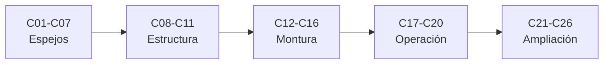

# B43 — Construcción y mecánica de telescopios

> **Bloque ampliado (`0.2.0`).** Además de las 20 clases de la malla base, el bloque tiene 6 clases programadas por la ampliación (`B43-C21` a `B43-C26`), listadas en el último tramo. Ver el [programa completo](../../PROGRAMA_ACADEMICO_COMPLETO.md).

**Programa:** Programa Integral de Astronomía, Astrofísica, Ciencias Espaciales e Ingeniería Aeroespacial
**Área:** A04 — Óptica, telescopios y observatorios científicos
**Nivel:** N3 (fundamentos disciplinares) · **Clases:** 20 + 6 de la ampliación · **Carga:** por calibrar con el uso
**Estado:** guía pedagógica del bloque (resumen de qué se aprende en cada clase). Las clases enlazadas en la tabla ya están redactadas; todas conservan el estado E0 en el catálogo hasta registrar revisión disciplinar.

## 🎯 Propósito del bloque

Enseña **cómo se construye y se sostiene un telescopio con el error óptico y mecánico que la ciencia tolera**: los requisitos y la geometría, los materiales y la fabricación del espejo (desbaste, pulido, pruebas de Foucault y Ronchi, aluminizado), el apoyo y la celda del primario, el tubo y la estabilidad térmica, las monturas ecuatorial y altacimutal con sus reductores, motores y codificadores, la alineación polar y la colimación, la seguridad y el proyecto completo; la ampliación añade la selección de vidrios, la interferometría de superficie, la rugosidad, los recubrimientos multicapa, los rodamientos de precisión y el modelo de apuntado. Cada clase cierra con un cálculo verificable contra un caso analítico, dos vías independientes o una simulación con semilla fija, y distingue lo consultado de lo ilustrativo.

## 📚 Al terminar el bloque podrás

1. Traducir un tamaño de apertura y una tolerancia de frente de onda en requisitos mecánicos medibles.
2. Calcular sagita, volumen de vidrio, tiempos de abrasión y la desviación entre esfera y paraboloide.
3. Interpretar pruebas de Foucault y Ronchi y mapas de interferometría de superficie.
4. Estimar flexión por peso propio, deriva térmica y deflexión de un tubo con cercha Serrurier.
5. Calcular velocidades de seguimiento, rotación de campo y error periódico de una montura.
6. Evaluar alineación polar y colimación con sus tolerancias.
7. Combinar los errores en un presupuesto con RSS y Monte Carlo y ajustar un modelo de apuntado.

## 🧭 Secuencia del bloque

**Descripción textual.** Cinco tramos encadenados: requisitos y espejos (C01–C07), soporte, tubo y estabilidad (C08–C11), monturas y accionamientos (C12–C16), alineación, operación y proyecto (C17–C20) y la ampliación de vidrio, forma y apoyos (C21–C26).

## 🗂️ Las 26 clases en resumen (20 de la malla base + 6 de la ampliación)

**Navegación:** cada clase desarrollada enlaza a la anterior, a la siguiente y a este bloque; mientras una clase siga solo programada, su enlace lleva a su fila en esta tabla.

La columna «Evidencia» indica el producto que demostrará el aprendizaje. Los laboratorios usan datos **sintéticos** o **ilustrativos** (rotulados) o valores publicados con fuente y fecha.

### Tramo 1 · Requisitos y espejos

| ID | Clase | Qué se aprende | Evidencia |
|---|---|---|---|
| [B43-C01](../clases/B43/B43-C01-requisitos-opticos-y-mecanicos/CLASE.md) | Requisitos ópticos y mecánicos | Del tamaño de la apertura y la tolerancia óptica a un cuaderno de requisitos. | Ficha de requisitos |
| [B43-C02](../clases/B43/B43-C02-seleccion-de-geometria-instrumental/CLASE.md) | Selección de geometría instrumental | Newton, Cassegrain y Ritchey-Chrétien frente al coma y el largo del tubo. | Ficha de geometría instrumental |
| [B43-C03](../clases/B43/B43-C03-materiales-para-espejos/CLASE.md) | Materiales para espejos | Rigidez específica, figura de mérito térmica y flexión por peso propio. | Ficha de materiales |
| [B43-C04](../clases/B43/B43-C04-fabricacion-y-desbaste-de-espejos/CLASE.md) | Fabricación y desbaste de espejos | Sagita, volumen de vidrio y etapas de abrasivo con la ley de Preston. | Ficha de desbaste |
| [B43-C05](../clases/B43/B43-C05-pulido-optico/CLASE.md) | Pulido óptico | Ley de Preston, tiempo de permanencia y paso de la esfera al paraboloide. | Ficha de pulido |
| [B43-C06](../clases/B43/B43-C06-pruebas-de-ronchi-y-foucault/CLASE.md) | Pruebas de Ronchi y Foucault | Lectura de zonas de Foucault por trazado de rayos y recuento de bandas de Ronchi. | Ficha de pruebas de Foucault y Ronchi |
| [B43-C07](../clases/B43/B43-C07-aluminizado-y-recubrimientos/CLASE.md) | Aluminizado y recubrimientos | Reflectancia del aluminio, espesor opaco y uniformidad de la evaporación. | Ficha de aluminizado |

### Tramo 2 · Soporte, tubo y estabilidad

| ID | Clase | Qué se aprende | Evidencia |
|---|---|---|---|
| [B43-C08](../clases/B43/B43-C08-montaje-de-espejo-primario/CLASE.md) | Montaje de espejo primario | Apoyo axial en anillo y flexión residual de un disco con el método de Ritz. | Ficha del apoyo del primario |
| [B43-C09](../clases/B43/B43-C09-celdas-y-soporte-de-espejos/CLASE.md) | Celdas y soporte de espejos | Equilibrio de una whiffletree y apoyo lateral con distribución de coseno. | Ficha de celda y soporte |
| [B43-C10](../clases/B43/B43-C10-estructura-de-tubo-optico/CLASE.md) | Estructura de tubo óptico | Flexión del tubo, cercha Serrurier e igualdad de flechas. | Ficha del tubo óptico |
| [B43-C11](../clases/B43/B43-C11-dilatacion-termica-y-estabilidad/CLASE.md) | Dilatación térmica y estabilidad | Dilatación, constante de tiempo térmica y compensación de foco. | Ficha de estabilidad térmica |

### Tramo 3 · Monturas y accionamientos

| ID | Clase | Qué se aprende | Evidencia |
|---|---|---|---|
| [B43-C12](../clases/B43/B43-C12-montura-ecuatorial/CLASE.md) | Montura ecuatorial | Velocidad sidérea, periodo del gusano y deriva por error periódico. | Ficha de la montura ecuatorial |
| [B43-C13](../clases/B43/B43-C13-montura-altacimutal/CLASE.md) | Montura altacimutal | Velocidades de acimut y altura, rotación de campo y cenit. | Ficha de la montura altacimutal |
| [B43-C14](../clases/B43/B43-C14-reductores-y-transmisiones/CLASE.md) | Reductores y transmisiones | Relación de transmisión, rendimiento del tornillo sin fin, holgura y resonancia. | Ficha del reductor |
| [B43-C15](../clases/B43/B43-C15-motores-paso-a-paso-y-servomotores/CLASE.md) | Motores paso a paso y servomotores | Resolución por micropaso y respuesta de un servo con control PD. | Ficha del accionamiento |
| [B43-C16](../clases/B43/B43-C16-encoders-y-medicion-angular/CLASE.md) | Encoders y medición angular | Cuantización, código Gray e interpolación seno-coseno. | Ficha del codificador |

### Tramo 4 · Alineación, operación y proyecto

| ID | Clase | Qué se aprende | Evidencia |
|---|---|---|---|
| [B43-C17](../clases/B43/B43-C17-alineacion-polar/CLASE.md) | Alineación polar | Deriva en declinación por error de alineación polar. | Ficha de la alineación polar |
| [B43-C18](../clases/B43/B43-C18-colimacion-instrumental/CLASE.md) | Colimación instrumental | Tolerancia de colimación con coma por inclinación del primario. | Ficha de colimación |
| [B43-C19](../clases/B43/B43-C19-seguridad-y-mantenimiento/CLASE.md) | Seguridad y mantenimiento | Concentración solar, equilibrio de balance y cobertura de polvo. | Ficha de seguridad y mantenimiento |
| [B43-C20](../clases/B43/B43-C20-proyecto-mecanico-completo-de-telescopio/CLASE.md) | Proyecto mecánico completo de telescopio | Presupuesto de error del frente de onda y del apuntado con RSS y Monte Carlo. | Dossier mecánico del telescopio |

### Tramo 5 · Ampliación: vidrio, forma y apoyos

| ID | Clase | Qué se aprende | Evidencia |
|---|---|---|---|
| [B43-C21](../clases/B43/B43-C21-seleccion-de-vidrios-opticos-catalogos-homogeneidad-y-diagramas/CLASE.md) | Selección de vidrios ópticos: catálogos, homogeneidad y diagramas | Sellmeier, número de Abbe, doblete acromático y homogeneidad. | Ficha de vidrios ópticos |
| [B43-C22](../clases/B43/B43-C22-interferometria-de-superficie-y-mapas-de-error-de-forma/CLASE.md) | Interferometría de superficie y mapas de error de forma | Interferometría de cuatro pasos, desenvolvimiento de fase y ajuste de modos. | Ficha de interferometría de superficie |
| [B43-C23](../clases/B43/B43-C23-medicion-de-rugosidad-y-su-efecto-en-la-luz-dispersa/CLASE.md) | Medición de rugosidad y su efecto en la luz dispersa | Rugosidad, densidad espectral de potencia y luz dispersa total. | Ficha de rugosidad y luz dispersa |
| [B43-C24](../clases/B43/B43-C24-recubrimientos-antirreflectantes-de-capas-multiples/CLASE.md) | Recubrimientos antirreflectantes de capas múltiples | Matrices de transferencia, capa de cuarto de onda y recubrimiento de banda ancha. | Ficha de recubrimiento antirreflectante |
| [B43-C25](../clases/B43/B43-C25-rodamientos-y-apoyos-de-precision-en-telescopios/CLASE.md) | Rodamientos y apoyos de precisión en telescopios | Contacto de Hertz, rigidez y reparto de carga entre bolas. | Ficha de rodamientos de precisión |
| [B43-C26](../clases/B43/B43-C26-modelo-de-flexiones-y-de-apuntado-de-una-montura/CLASE.md) | Modelo de flexiones y de apuntado de una montura | Ajuste por mínimos cuadrados de los términos de un modelo de apuntado. | Ficha del modelo de apuntado |

## 🧵 Hilos que atraviesan el bloque

- **Del requisito a la pieza:** C01–C02 fijan qué tolerancia se pide; C03–C07 y C21–C24 la cumplen en el espejo; C08–C11 y C25 la sostienen; C12–C16 y C26 la apuntan; C17–C20 la ajustan y la integran.
- **Dos vías independientes:** cada laboratorio contrasta con un caso analítico, una segunda forma de calcular o una simulación con semilla fija 20261109.
- **Presupuesto de error:** C01, C20 y C26 reúnen errores independientes en una raíz de suma de cuadrados y la comprueban con Monte Carlo.
- **Observado frente a ilustrativo:** solo se citan con fecha las constantes de NIST y las páginas realmente leídas; los telescopios, materiales, gradientes y errores de los laboratorios son ilustrativos o sintéticos y se rotulan.

## 📝 Evaluación del bloque (propuesta, por calibrar)

- Fichas y ejercicios por clase, con retroalimentación y recuperación con evidencia distinta.
- Portafolio: ficha de requisitos (C01), ficha de pruebas de Foucault y Ronchi (C06) y dossier mecánico del telescopio (C20).
- Las condiciones críticas (rotular lo sintético, no presentar un telescopio ilustrativo como medido y citar solo lo consultado) no se compensan con promedio.

## ⚠️ Seguridad y límites

El bloque es educativo. Los modelos son simplificados y no sustituyen al análisis por elementos finitos ni a las especificaciones de un fabricante; los valores de materiales son ilustrativos de orden de magnitud. La clase C19 trata riesgos reales (observación solar, cargas pesadas, vidrio, abrasivos, recubrimientos al vacío) solo desde la física y la prevención general, no como procedimiento de taller: antes de trabajar vidrio, aluminizar o mirar al Sol hay que seguir las normas de seguridad vigentes y la supervisión de personal competente.

## Fuentes de orientación preliminar

- **[ESO]** [European Southern Observatory](https://www.eso.org/) — Observatorios ópticos, instrumentación y astronomía profesional.
- **[ALMA]** [Atacama Large Millimeter/submillimeter Array](https://www.almaobservatory.org/) — Radioastronomía interferométrica de ALMA y sus productos de ciencia.
- **[NASA-SMALLSAT]** [NASA State-of-the-Art of Small Spacecraft Technology, edición 2026](https://www.nasa.gov/smallsat-institute/sst-soa/) — Referencia panorámica sobre plataformas y subsistemas de satélites pequeños.
- **[NASA-NTRS]** [NASA Technical Reports Server](https://ntrs.nasa.gov/) — Informes técnicos e investigación histórica y actual.

> La asociación de estas fuentes es orientativa por bloque. Las fuentes realmente consultadas para cada afirmación se registran en la sección 11 de cada clase.

[🏠 Volver al programa](../../README.md) · [➡️ B44 — Detectores y adquisición astronómica](./B44-detectores-y-adquisicion-astronomica.md)
