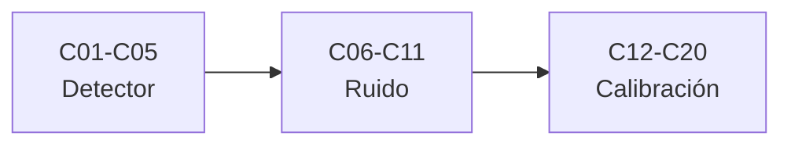

# B44 — Detectores y adquisición astronómica

> **Bloque de la estructura vigente.** Ver el [programa completo](../../PROGRAMA_ACADEMICO_COMPLETO.md).

**Programa:** Programa Integral de Astronomía, Astrofísica, Ciencias Espaciales e Ingeniería Aeroespacial
**Área:** A04 — Óptica, telescopios y observatorios científicos
**Nivel:** N3 (fundamentos disciplinares) · **Clases:** 20 · **Carga:** por calibrar con el uso
**Estado:** guía pedagógica del bloque (resumen de qué se aprende en cada clase). Las clases enlazadas en la tabla ya están redactadas; todas conservan el estado E0 en el catálogo hasta registrar revisión disciplinar.

## 🎯 Propósito del bloque

Enseña **cómo un detector convierte luz en números y cómo se calibran esos números**: los principios fotoeléctricos, los sensores CCD y CMOS, la eficiencia cuántica, el pozo lleno y el rango dinámico, el ruido de lectura, la corriente oscura y el enfriamiento, la ganancia electrónica, la no linealidad, el tiempo de exposición, la calibración con bias, dark y flat, los píxeles defectuosos, los rayos cósmicos, la escala y el muestreo, el control de la cámara, el formato FITS y un pipeline inicial. Cada clase cierra con un laboratorio en Python que contrasta con un caso analítico, dos vías de cálculo o una simulación con semilla fija, y distingue lo consultado de lo ilustrativo.

## 📚 Al terminar el bloque podrás

1. Calcular la energía del fotón, la longitud de corte y la estadística de los fotones detectados.
2. Relacionar eficiencia cuántica, pozo lleno, ruido de lectura y rango dinámico con la señal medible.
3. Medir ruido de lectura y ganancia desde cuadros de calibración.
4. Modelar la corriente oscura y el efecto del enfriamiento.
5. Elegir un tiempo de exposición con criterios de ruido y saturación.
6. Construir cuadros maestros de bias, dark y flat y propagar su ruido.
7. Ejecutar un pipeline inicial y verificar el flujo recuperado contra el inyectado.

## 🧭 Secuencia del bloque

**Descripción textual.** Tres tramos encadenados: fundamentos del detector (C01–C05), ruido y características (C06–C11) y calibración y adquisición (C12–C20).

## 🗂️ Las 20 clases en resumen

**Navegación:** cada clase desarrollada enlaza a la anterior, a la siguiente y a este bloque; mientras una clase siga solo programada, su enlace lleva a su fila en esta tabla.

La columna «Evidencia» indica el producto que demostrará el aprendizaje. Los laboratorios usan datos **sintéticos** o **ilustrativos** (rotulados) o valores publicados con fuente y fecha.

### Tramo 1 · Fundamentos del detector

| ID | Clase | Qué se aprende | Evidencia |
|---|---|---|---|
| [B44-C01](../clases/B44/B44-C01-principios-fotoelectricos/CLASE.md) | Principios fotoeléctricos | Energía del fotón, longitud de corte y estadística de Poisson. | Ficha de los principios fotoeléctricos |
| [B44-C02](../clases/B44/B44-C02-sensores-ccd/CLASE.md) | Sensores CCD | Transferencia de carga, eficiencia de transferencia y pérdida acumulada. | Ficha del sensor CCD |
| [B44-C03](../clases/B44/B44-C03-sensores-cmos/CLASE.md) | Sensores CMOS | Ruido kTC, muestreo doble correlacionado y obturador rodante. | Ficha del sensor CMOS |
| [B44-C04](../clases/B44/B44-C04-eficiencia-cuantica-espectral/CLASE.md) | Eficiencia cuántica espectral | Eficiencia cuántica efectiva integrada sobre una banda. | Ficha de la eficiencia cuántica |
| [B44-C05](../clases/B44/B44-C05-pozo-lleno-y-rango-dinamico/CLASE.md) | Pozo lleno y rango dinámico | Rango dinámico, SNR y saturación del pozo. | Ficha del pozo lleno y el rango dinámico |

### Tramo 2 · Ruido y características

| ID | Clase | Qué se aprende | Evidencia |
|---|---|---|---|
| [B44-C06](../clases/B44/B44-C06-ruido-de-lectura/CLASE.md) | Ruido de lectura | Ruido de lectura por diferencia de dos cuadros de bias. | Ficha del ruido de lectura |
| [B44-C07](../clases/B44/B44-C07-corriente-oscura/CLASE.md) | Corriente oscura | Ley térmica de la corriente oscura y ajuste lineal con la exposición. | Ficha de la corriente oscura |
| [B44-C08](../clases/B44/B44-C08-enfriamiento-de-detectores/CLASE.md) | Enfriamiento de detectores | Enfriamiento de primer orden y su efecto en la corriente oscura. | Ficha del enfriamiento |
| [B44-C09](../clases/B44/B44-C09-ganancia-electronica/CLASE.md) | Ganancia electrónica | Ganancia por cascada y factor de ruido en exceso. | Ficha de la ganancia electrónica |
| [B44-C10](../clases/B44/B44-C10-no-linealidad-y-saturacion/CLASE.md) | No linealidad y saturación | Ajuste cuadrático, desviación de la linealidad y umbral de saturación. | Ficha de la linealidad y la saturación |
| [B44-C11](../clases/B44/B44-C11-tiempo-de-exposicion/CLASE.md) | Tiempo de exposición | SNR frente a la exposición y exposición mínima limitada por el cielo. | Ficha del tiempo de exposición |

### Tramo 3 · Calibración y adquisición

| ID | Clase | Qué se aprende | Evidencia |
|---|---|---|---|
| [B44-C12](../clases/B44/B44-C12-calibracion-con-bias/CLASE.md) | Calibración con bias | Cuadro maestro de bias y propagación de ruido. | Ficha de la calibración con bias |
| [B44-C13](../clases/B44/B44-C13-calibracion-con-dark/CLASE.md) | Calibración con dark | Cuadro maestro de dark y reescalado por exposición. | Ficha de la calibración con dark |
| [B44-C14](../clases/B44/B44-C14-calibracion-con-flat/CLASE.md) | Calibración con flat | Cuadro maestro de flat y no uniformidad residual. | Ficha de la calibración con flat |
| [B44-C15](../clases/B44/B44-C15-pixeles-defectuosos/CLASE.md) | Píxeles defectuosos | Detección robusta con MAD, reemplazo por mediana y máscara. | Ficha de los píxeles defectuosos |
| [B44-C16](../clases/B44/B44-C16-ruido-cosmico-e-identificacion/CLASE.md) | Ruido cósmico e identificación | Rechazo de rayos cósmicos con pila de cuadros y probabilidad de coincidencia. | Ficha de los rayos cósmicos |
| [B44-C17](../clases/B44/B44-C17-escala-de-imagen-y-muestreo/CLASE.md) | Escala de imagen y muestreo | Escala de placa, Airy y muestreo de Nyquist. | Ficha de la escala y el muestreo |
| [B44-C18](../clases/B44/B44-C18-control-electronico-de-camaras/CLASE.md) | Control electrónico de cámaras | Tiempo de lectura, tiempo muerto, cuantización y binning. | Ficha de la electrónica de la cámara |
| [B44-C19](../clases/B44/B44-C19-formato-fits-y-metadatos/CLASE.md) | Formato FITS y metadatos | Cabecera FITS mínima escrita y leída por dos vías. | Ficha del formato FITS |
| [B44-C20](../clases/B44/B44-C20-pipeline-inicial-de-calibracion-de-imagenes/CLASE.md) | Pipeline inicial de calibración de imágenes | Cadena completa bias, dark, flat y fotometría de apertura. | Ficha del pipeline de calibración |

## 🧵 Hilos que atraviesan el bloque

- **De la luz al número:** C01–C05 describen el detector; C06–C11 sus ruidos y límites; C12–C20 la calibración.
- **Presupuesto de ruido:** C05, C06, C07 y C11 combinan fotones, lectura y oscuridad en una sola relación señal-ruido.
- **Verificación independiente:** cada laboratorio contrasta con un caso analítico, dos vías de cálculo o una simulación con semilla fija.
- **Observado frente a ilustrativo:** las constantes de NIST y las referencias de FITS y ccdproc se citan con fecha; los parámetros de cámara son ilustrativos y no describen ningún instrumento real.

## 📝 Evaluación del bloque (propuesta, por calibrar)

- Fichas y ejercicios por clase, con retroalimentación y recuperación con evidencia distinta.
- Portafolio: ficha del ruido de lectura (C06) y ficha del pipeline de calibración (C20).
- Las condiciones críticas (rotular lo sintético, no presentar una cámara ilustrativa como un instrumento real y citar solo lo consultado) no se compensan con promedio.

## ⚠️ Seguridad y límites

El bloque es educativo. Las cámaras, los ruidos y los cuadros son sintéticos o ilustrativos y no describen ningún sensor, telescopio ni observatorio real. Las constantes se citan de NIST con fecha de consulta; el estándar FITS y la documentación de ccdproc se citan solo en lo que se consultó. No se reproduce documentación protegida.

## Fuentes de orientación preliminar

- **[ESO]** [European Southern Observatory](https://www.eso.org/) — Observatorios ópticos, instrumentación y astronomía profesional.
- **[ALMA]** [Atacama Large Millimeter/submillimeter Array](https://www.almaobservatory.org/) — Radioastronomía interferométrica de ALMA y sus productos de ciencia.
- **[NASA-SMALLSAT]** [NASA State-of-the-Art of Small Spacecraft Technology, edición 2026](https://www.nasa.gov/smallsat-institute/sst-soa/) — Referencia panorámica sobre plataformas y subsistemas de satélites pequeños.
- **[NASA-NTRS]** [NASA Technical Reports Server](https://ntrs.nasa.gov/) — Informes técnicos e investigación histórica y actual.

> La asociación de estas fuentes es orientativa por bloque. Las fuentes realmente consultadas para cada afirmación se registran en la sección 11 de cada clase.

[🏠 Volver al programa](../../README.md) · [➡️ B45 — Espectroscopía, fotometría y polarimetría](./B45-espectroscopia-fotometria-y-polarimetria.md)
