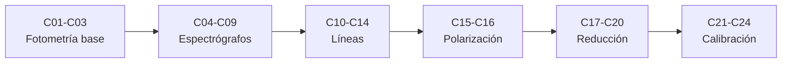

# B45 — Espectroscopía, fotometría y polarimetría

> **Bloque ampliado (`0.2.0`).** Además de las 20 clases de la malla base, el bloque tiene 4 clases programadas por la ampliación (`B45-C21` a `B45-C24`), listadas en el último tramo. Ver el [programa completo](../../PROGRAMA_ACADEMICO_COMPLETO.md).

**Programa:** Programa Integral de Astronomía, Astrofísica, Ciencias Espaciales e Ingeniería Aeroespacial
**Área:** A04 — Óptica, telescopios y observatorios científicos
**Nivel:** N3 (fundamentos disciplinares) · **Clases:** 20 + 4 de la ampliación · **Carga:** por calibrar con el uso
**Estado:** guía pedagógica del bloque (resumen de qué se aprende en cada clase). Las clases enlazadas en la tabla ya están redactadas; todas conservan el estado E0 en el catálogo hasta registrar revisión disciplinar.

## 🎯 Propósito del bloque

Enseña **cómo se mide la luz de un astro y qué se aprende de ella**: radiometría, magnitudes y filtros, dispersión con redes y prismas, diseño y calibración de espectrógrafos, líneas de emisión y absorción, velocidad radial, temperatura y composición, polarimetría, fotometría diferencial, de apertura y por ajuste de PSF, extracción de espectros, extinción atmosférica, estándares y planificación de una campaña. Cada clase cierra con un laboratorio en Python que contrasta con un caso analítico, dos vías independientes o una simulación con semilla fija, y distingue lo consultado de lo ilustrativo.

## 📚 Al terminar el bloque podrás

1. Pasar de radiancia a flujo, fotones y magnitudes con unidades correctas.
2. Combinar curvas de transmisión y calcular longitudes de onda efectivas.
3. Dimensionar una red o un prisma y predecir resolución y dispersión.
4. Diseñar y calibrar en longitud de onda y en respuesta un espectrógrafo sencillo.
5. Medir velocidad, temperatura y abundancias a partir de líneas y continuo.
6. Describir y medir la polarización con Stokes, Mueller y un polarímetro rotante.
7. Reducir fotometría y espectros con su incertidumbre, extinción y calibración, y planificar una campaña.

## 🧭 Secuencia del bloque

**Descripción textual.** Seis tramos encadenados: fotometría base (C01–C03), espectrógrafos (C04–C09), líneas (C10–C14), polarización (C15–C16), reducción y campaña (C17–C20) y calibración fotométrica avanzada (C21–C24, clases programadas).

## 🗂️ Las 24 clases en resumen (20 de la malla base + 4 de la ampliación)

**Navegación:** cada clase desarrollada enlaza a la anterior, a la siguiente y a este bloque; mientras una clase siga solo programada, su enlace lleva a su fila en esta tabla.

La columna «Evidencia» indica el producto que demostrará el aprendizaje. Los laboratorios usan datos **sintéticos** o **ilustrativos** (rotulados) o valores publicados con fuente y fecha.

### Tramo 1 · Luz, magnitudes y filtros

| ID | Clase | Qué se aprende | Evidencia |
|---|---|---|---|
| [B45-C01](../clases/B45/B45-C01-radiometria-y-fotometria/CLASE.md) | Radiometría y fotometría | Magnitudes radiométricas y fotométricas: de la radiancia al flujo y a los fotones. | Ficha radiométrica |
| [B45-C02](../clases/B45/B45-C02-magnitudes-y-sistemas-de-filtros/CLASE.md) | Magnitudes y sistemas de filtros | Magnitud de Pogson, color, sistema Vega y AB, y fotometría sintética. | Ficha de magnitudes |
| [B45-C03](../clases/B45/B45-C03-curvas-de-transmision/CLASE.md) | Curvas de transmisión | Producto de curvas, longitud de onda efectiva, ancho equivalente y fugas. | Ficha de la curva de transmisión |

### Tramo 2 · Dispersión e instrumentos

| ID | Clase | Qué se aprende | Evidencia |
|---|---|---|---|
| [B45-C04](../clases/B45/B45-C04-redes-de-difraccion/CLASE.md) | Redes de difracción | Ecuación de la red, dispersión, poder de resolución R = mN y criterio de Rayleigh. | Ficha de la red de difracción |
| [B45-C05](../clases/B45/B45-C05-prismas-y-dispersion/CLASE.md) | Prismas y dispersión | Índice de Sellmeier, desviación mínima y dispersión angular del prisma. | Ficha del prisma |
| [B45-C06](../clases/B45/B45-C06-diseno-de-espectrografos/CLASE.md) | Diseño de espectrógrafos | Cadena rendija–colimador–red–cámara y muestreo en el detector. | Ficha del espectrógrafo |
| [B45-C07](../clases/B45/B45-C07-resolucion-espectral/CLASE.md) | Resolución espectral | Perfil instrumental, R, muestreo y separación de un doblete. | Ficha de resolución espectral |
| [B45-C08](../clases/B45/B45-C08-calibracion-en-longitud-de-onda/CLASE.md) | Calibración en longitud de onda | Ajuste polinómico de líneas de lámpara, residuos y validación cruzada. | Ficha de calibración en longitud de onda |
| [B45-C09](../clases/B45/B45-C09-calibracion-de-respuesta-instrumental/CLASE.md) | Calibración de respuesta instrumental | Respuesta de un estándar, planos y corrección de blaze. | Ficha de respuesta instrumental |

### Tramo 3 · Líneas y física del espectro

| ID | Clase | Qué se aprende | Evidencia |
|---|---|---|---|
| [B45-C10](../clases/B45/B45-C10-lineas-de-emision/CLASE.md) | Líneas de emisión | Serie de Balmer con la constante de Rydberg, masa reducida y centroide de línea. | Ficha de líneas de emisión |
| [B45-C11](../clases/B45/B45-C11-lineas-de-absorcion/CLASE.md) | Líneas de absorción | Profundidad óptica, ancho equivalente y curva de crecimiento. | Ficha de líneas de absorción |
| [B45-C12](../clases/B45/B45-C12-efecto-doppler-en-espectros/CLASE.md) | Efecto Doppler en espectros | Doppler clásico y relativista, correlación cruzada y corrección baricéntrica. | Ficha de velocidad radial |
| [B45-C13](../clases/B45/B45-C13-temperatura-y-espectro-de-cuerpo-negro/CLASE.md) | Temperatura y espectro de cuerpo negro | Planck, desplazamiento de Wien y ajuste de temperatura a flujos con ruido. | Ficha de temperatura de cuerpo negro |
| [B45-C14](../clases/B45/B45-C14-composicion-quimica-por-espectros/CLASE.md) | Composición química por espectros | Boltzmann y Saha, población de n = 2 y abundancia con líneas débiles. | Ficha de excitación e ionización |

### Tramo 4 · Polarimetría

| ID | Clase | Qué se aprende | Evidencia |
|---|---|---|---|
| [B45-C15](../clases/B45/B45-C15-polarizacion-lineal-y-circular/CLASE.md) | Polarización lineal y circular | Vectores de Stokes, matrices de Mueller, ley de Malus y láminas de onda. | Ficha de polarización |
| [B45-C16](../clases/B45/B45-C16-polarimetros-astronomicos/CLASE.md) | Polarímetros astronómicos | Placa de media onda rotante, demodulación y sesgo de la polarización. | Ficha del polarímetro |

### Tramo 5 · Reducción y campaña

| ID | Clase | Qué se aprende | Evidencia |
|---|---|---|---|
| [B45-C17](../clases/B45/B45-C17-fotometria-diferencial/CLASE.md) | Fotometría diferencial | Curva de luz diferencial, estrellas de comparación y profundidad de tránsito. | Ficha de fotometría diferencial |
| [B45-C18](../clases/B45/B45-C18-extraccion-de-espectros/CLASE.md) | Extracción de espectros | Suma simple frente a extracción óptima y varianza. | Ficha de extracción |
| [B45-C19](../clases/B45/B45-C19-reduccion-e-incertidumbre-instrumental/CLASE.md) | Reducción e incertidumbre instrumental | Ecuación del CCD, sesgo, oscuro, plano y curva de transferencia de fotones. | Ficha de reducción e incertidumbre |
| [B45-C20](../clases/B45/B45-C20-campana-fotometrica-o-espectroscopica/CLASE.md) | Campaña fotométrica o espectroscópica | Tiempo de exposición, masa de aire, ventana de observación y presupuesto de S/N. | Plan de campaña |

### Tramo 6 · Calibración fotométrica avanzada

| ID | Clase | Qué se aprende | Evidencia |
|---|---|---|---|
| [B45-C21](../clases/B45/B45-C21-estandares-fotometricos-y-sistemas-de-referencia/CLASE.md) | Estándares fotométricos y sistemas de referencia | Ajuste de punto cero y término de color con estándares sintéticos. | Ficha de transformación al sistema estándar |
| [B45-C22](../clases/B45/B45-C22-extincion-atmosferica-masa-de-aire-y-coeficientes-de-color/CLASE.md) | Extinción atmosférica, masa de aire y coeficientes de color | Ley de Bouguer, gráfico de Langley y fórmulas de masa de aire. | Ficha de extinción atmosférica |
| [B45-C23](../clases/B45/B45-C23-fotometria-de-apertura-y-estimacion-del-cielo/CLASE.md) | Fotometría de apertura y estimación del cielo | Fracción encerrada, relación S/N frente a radio y cielo en anillo. | Ficha de fotometría de apertura |
| [B45-C24](../clases/B45/B45-C24-fotometria-por-ajuste-de-psf/CLASE.md) | Fotometría por ajuste de PSF | Ajuste lineal de flujos con PSF gaussiana, mezcla y covarianza. | Ficha de fotometría PSF |

## 🧵 Hilos que atraviesan el bloque

- **De la luz a la medida:** C01–C03 fijan las magnitudes; C04–C09 las separan en longitud de onda; C10–C14 las interpretan; C15–C16 añaden la polarización; C17–C24 las reducen y calibran.
- **Dos vías independientes:** cada laboratorio contrasta con un caso analítico, una segunda forma de calcular o una simulación con semilla fija 20261109.
- **Incertidumbre:** C07, C08, C16, C19, C22 y C24 propagan ruido a la medida; C20 la convierte en un plan.
- **Observado frente a ilustrativo:** solo se citan con fecha las constantes de NIST, dos páginas de referencia y extractos de arXiv; los instrumentos, filtros y datos son ilustrativos o sintéticos y se rotulan.

## 📝 Evaluación del bloque (propuesta, por calibrar)

- Fichas y ejercicios por clase, con retroalimentación y recuperación con evidencia distinta.
- Portafolio: ficha del espectrógrafo (C06) y plan de campaña (C20).
- Las condiciones críticas (rotular lo sintético, no presentar un modelo ilustrativo como dato de un instrumento real y citar solo lo consultado) no se compensan con promedio.

## ⚠️ Seguridad y límites

El bloque es educativo. Los instrumentos, filtros y espectros son ilustrativos o sintéticos y no sustituyen a las calibraciones de un observatorio; no se descargan ni procesan datos reales. Los valores publicados se citan con su fuente y fecha de consulta y el resto de los números se rotulan como ilustrativos.

## Fuentes de orientación preliminar

- **[ESO]** [European Southern Observatory](https://www.eso.org/) — Observatorios ópticos, instrumentación y astronomía profesional.
- **[ALMA]** [Atacama Large Millimeter/submillimeter Array](https://www.almaobservatory.org/) — Radioastronomía interferométrica de ALMA y sus productos de ciencia.
- **[NASA-SMALLSAT]** [NASA State-of-the-Art of Small Spacecraft Technology, edición 2026](https://www.nasa.gov/smallsat-institute/sst-soa/) — Referencia panorámica sobre plataformas y subsistemas de satélites pequeños.
- **[NASA-NTRS]** [NASA Technical Reports Server](https://ntrs.nasa.gov/) — Informes técnicos e investigación histórica y actual.

> La asociación de estas fuentes es orientativa por bloque. Las fuentes realmente consultadas para cada afirmación se registran en la sección 11 de cada clase.

[🏠 Volver al programa](../../README.md) · [➡️ B46 — Radioastronomía e interferometría](./B46-radioastronomia-e-interferometria.md)
