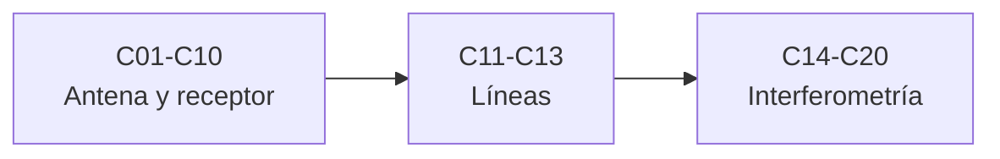

# B46 — Radioastronomía e interferometría

> **Bloque de la estructura vigente.** Ver el [programa completo](../../PROGRAMA_ACADEMICO_COMPLETO.md).

**Programa:** Programa Integral de Astronomía, Astrofísica, Ciencias Espaciales e Ingeniería Aeroespacial
**Área:** A04 — Óptica, telescopios y observatorios científicos
**Nivel:** N3 (fundamentos disciplinares) · **Clases:** 20 · **Carga:** por calibrar con el uso
**Estado:** guía pedagógica del bloque (resumen de qué se aprende en cada clase). Las clases enlazadas en la tabla ya están redactadas; todas conservan el estado E0 en el catálogo hasta registrar revisión disciplinar.

## 🎯 Propósito del bloque

Enseña **cómo se observa el cielo en radio y cómo se combinan antenas para ver más fino**: el espectro y la temperatura de brillo, la propagación, las antenas y sus diagramas, la ganancia y el ruido, el receptor, el oscilador y la digitalización, dos observaciones espectroscópicas (HI y moléculas), la polarización y, por último, la interferometría: líneas de base, correlación, síntesis de apertura, calibración, VLBI, CLEAN y un proyecto de observación. Cada clase cierra con un cálculo verificable contra un caso analítico, dos vías independientes, una constante de NIST o una simulación con semilla fija, y distingue lo consultado de lo ilustrativo.

## 📚 Al terminar el bloque podrás

1. Relacionar flujo, brillo y temperatura de brillo con Planck y Rayleigh–Jeans.
2. Calcular directividad, ancho de haz, área efectiva y K/Jy de una antena.
3. Presupuestar el ruido de un receptor y la sensibilidad del radiómetro.
4. Explicar la mezcla, la frecuencia imagen, la estabilidad de un oscilador y la digitalización.
5. Interpretar un espectro de HI y una escalera molecular.
6. Calcular visibilidades, cobertura uv y haz sucio de un interferómetro.
7. Calibrar fases, estimar retardos de VLBI, deconvolucionar con CLEAN y planificar una observación.

## 🧭 Secuencia del bloque

**Descripción textual.** Tres tramos encadenados: señal, antena y receptor (C01–C10), espectroscopía y polarización (C11–C13) e interferometría y proyecto (C14–C20).

## 🗂️ Las 20 clases en resumen

**Navegación:** cada clase desarrollada enlaza a la anterior, a la siguiente y a este bloque; mientras una clase siga solo programada, su enlace lleva a su fila en esta tabla.

La columna «Evidencia» indica el producto que demostrará el aprendizaje. Los laboratorios usan datos **sintéticos** o **ilustrativos** (rotulados) o valores publicados con fuente y fecha.

### Tramo 1 · Señal, antena y receptor

| ID | Clase | Qué se aprende | Evidencia |
|---|---|---|---|
| [B46-C01](../clases/B46/B46-C01-espectro-radioastronomico/CLASE.md) | Espectro radioastronómico | Planck, Rayleigh–Jeans y temperatura de brillo. | Ficha del espectro radioastronómico |
| [B46-C02](../clases/B46/B46-C02-propagacion-de-ondas-de-radio/CLASE.md) | Propagación de ondas de radio | Frecuencia de plasma y retardo por dispersión. | Ficha de la propagación de radio |
| [B46-C03](../clases/B46/B46-C03-antenas-parabolicas/CLASE.md) | Antenas parabólicas | Geometría, directividad y haz de Airy. | Ficha de la antena parabólica |
| [B46-C04](../clases/B46/B46-C04-diagramas-de-radiacion/CLASE.md) | Diagramas de radiación | Iluminación, lóbulos laterales y ancho del haz. | Ficha del diagrama de radiación |
| [B46-C05](../clases/B46/B46-C05-ganancia-y-temperatura-de-antena/CLASE.md) | Ganancia y temperatura de antena | Área efectiva, K/Jy y dilución del haz. | Ficha de la ganancia y la temperatura de antena |
| [B46-C06](../clases/B46/B46-C06-ruido-de-sistema-y-radiometria/CLASE.md) | Ruido de sistema y radiometría | Ecuación del radiómetro y cascada de Friis. | Ficha del ruido y el radiómetro |
| [B46-C07](../clases/B46/B46-C07-receptores-superheterodinos/CLASE.md) | Receptores superheterodinos | Mezcla, frecuencia imagen y rechazo de imagen. | Ficha del receptor superheterodino |
| [B46-C08](../clases/B46/B46-C08-osciladores-y-estabilidad/CLASE.md) | Osciladores y estabilidad | Varianza de Allan por dos vías. | Ficha de la estabilidad del oscilador |
| [B46-C09](../clases/B46/B46-C09-conversion-analogica-digital/CLASE.md) | Conversión analógica digital | Cuantización y corrección de Van Vleck. | Ficha de la digitalización |
| [B46-C10](../clases/B46/B46-C10-radioastronomia-mediante-sdr/CLASE.md) | Radioastronomía mediante SDR | Espectro promediado y ancho de banda de ruido. | Ficha del espectrómetro SDR |

### Tramo 2 · Espectroscopía y polarización

| ID | Clase | Qué se aprende | Evidencia |
|---|---|---|---|
| [B46-C11](../clases/B46/B46-C11-observacion-de-hidrogeno-a-21-centimetros/CLASE.md) | Observación de hidrógeno a 21 centímetros | Velocidad terminal y densidad de columna. | Ficha de la observación de HI |
| [B46-C12](../clases/B46/B46-C12-emisiones-moleculares/CLASE.md) | Emisiones moleculares | Escalera rotacional y poblaciones en ETL. | Ficha de las emisiones moleculares |
| [B46-C13](../clases/B46/B46-C13-polarimetria-de-radio/CLASE.md) | Polarimetría de radio | Parámetros de Stokes y síntesis de RM. | Ficha de la polarimetría |

### Tramo 3 · Interferometría y proyecto

| ID | Clase | Qué se aprende | Evidencia |
|---|---|---|---|
| [B46-C14](../clases/B46/B46-C14-lineas-de-base-interferometricas/CLASE.md) | Líneas de base interferométricas | Coordenadas (u, v, w) y retardo geométrico. | Ficha de la línea de base |
| [B46-C15](../clases/B46/B46-C15-correladores-y-visibilidades/CLASE.md) | Correladores y visibilidades | Correlación cruzada y equivalencia FX–XF. | Ficha del correlador |
| [B46-C16](../clases/B46/B46-C16-sintesis-de-apertura/CLASE.md) | Síntesis de apertura | Cobertura uv y haz sucio. | Ficha de la síntesis de apertura |
| [B46-C17](../clases/B46/B46-C17-calibracion-de-fase/CLASE.md) | Calibración de fase | Cierre de fase y solución de ganancias. | Ficha de la calibración de fase |
| [B46-C18](../clases/B46/B46-C18-vlbi-y-geodesia/CLASE.md) | VLBI y geodesia | Retardo, precisión y longitud de línea de base. | Ficha del retardo VLBI |
| [B46-C19](../clases/B46/B46-C19-imagenes-de-radio-y-clean/CLASE.md) | Imágenes de radio y CLEAN | Imagen sucia y deconvolución de Högbom. | Ficha de la imagen CLEAN |
| [B46-C20](../clases/B46/B46-C20-proyecto-de-observacion-radioastronomica/CLASE.md) | Proyecto de observación radioastronómica | Presupuesto de sensibilidad y tiempo. | Ficha del proyecto de observación |

## 🧵 Hilos que atraviesan el bloque

- **De la antena al píxel:** C01–C10 miden una señal; C11–C13 la interpretan; C14–C19 la convierten en imagen; C20 planifica.
- **Ruido y sensibilidad:** C05, C06, C09, C10 y C20 comparten la ecuación del radiómetro.
- **Verificación independiente:** cada laboratorio contrasta con un caso analítico, dos vías de cálculo o una simulación con semilla fija.
- **Observado frente a ilustrativo:** las constantes de NIST y unos pocos valores de referencia se citan con fecha; los instrumentos, antenas, fuentes y niveles de ruido son sintéticos y se rotulan.

## 📝 Evaluación del bloque (propuesta, por calibrar)

- Fichas y ejercicios por clase, con retroalimentación y recuperación con evidencia distinta.
- Portafolio: ficha del ruido y el radiómetro (C06), ficha de la síntesis de apertura (C16) y ficha del proyecto de observación (C20).
- Las condiciones críticas (rotular lo sintético, no presentar un instrumento real como medido y citar solo lo consultado) no se compensan con promedio.

## ⚠️ Seguridad y límites

El bloque es educativo. Los modelos son simplificados y no sustituyen el software de reducción de datos ni los procedimientos de un observatorio; los instrumentos y fuentes de los laboratorios son ilustrativos. Una antena transmisora o un receptor real exigen respetar las normas de espectro y de seguridad eléctrica del lugar.

## Fuentes de orientación preliminar

- **[ESO]** [European Southern Observatory](https://www.eso.org/) — Observatorios ópticos, instrumentación y astronomía profesional.
- **[ALMA]** [Atacama Large Millimeter/submillimeter Array](https://www.almaobservatory.org/) — Radioastronomía interferométrica de ALMA y sus productos de ciencia.
- **[NASA-SMALLSAT]** [NASA State-of-the-Art of Small Spacecraft Technology, edición 2026](https://www.nasa.gov/smallsat-institute/sst-soa/) — Referencia panorámica sobre plataformas y subsistemas de satélites pequeños.
- **[NASA-NTRS]** [NASA Technical Reports Server](https://ntrs.nasa.gov/) — Informes técnicos e investigación histórica y actual.

> La asociación de estas fuentes es orientativa por bloque. Las fuentes realmente consultadas para cada afirmación se registran en la sección 11 de cada clase.

[🏠 Volver al programa](../../README.md) · [➡️ B47 — Instrumentación y observatorios espaciales](./B47-instrumentacion-y-observatorios-espaciales.md)
