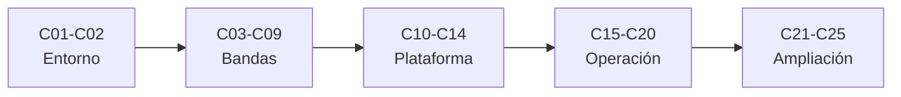

# B47 — Instrumentación y observatorios espaciales

> **Bloque ampliado (`0.2.0`).** Además de las 20 clases de la malla base, el bloque tiene 5 clases programadas por la ampliación (`B47-C21` a `B47-C25`), listadas en el último tramo. Ver el [programa completo](../../PROGRAMA_ACADEMICO_COMPLETO.md).

**Programa:** Programa Integral de Astronomía, Astrofísica, Ciencias Espaciales e Ingeniería Aeroespacial
**Área:** A04 — Óptica, telescopios y observatorios científicos
**Nivel:** N3 (fundamentos disciplinares) · **Clases:** 20 + 5 de la ampliación · **Carga:** por calibrar con el uso
**Estado:** guía pedagógica del bloque (resumen de qué se aprende en cada clase). Las clases enlazadas en la tabla ya están redactadas; todas conservan el estado E0 en el catálogo hasta registrar revisión disciplinar.

## 🎯 Propósito del bloque

Enseña **cómo se diseña, se protege y se opera un instrumento científico fuera de la atmósfera**: por qué observar desde el espacio, cómo se traducen los objetivos científicos en requisitos, cómo funcionan los telescopios ultravioleta, infrarrojos, de rayos X y gamma, los coronógrafos, los espectrómetros de masas y los detectores de partículas, y qué exige la plataforma (apuntamiento, vibraciones, vacío, criogenia, radiación). Sigue con la calibración, la compresión y el enlace de datos, la planificación y la vida útil, un caso comparativo y, en la ampliación, la instrumentación heliofísica (magnetógrafos, misiones solares, sondas, plasma in situ) y las cargas útiles educativas. Cada clase cierra con un cálculo verificable contra un caso analítico, dos vías independientes o una simulación con semilla fija, y distingue lo consultado de lo ilustrativo.

## 📚 Al terminar el bloque podrás

1. Justificar con números qué se gana y qué se paga al observar desde el espacio.
2. Derivar requisitos de apertura, órbita, apuntamiento y datos a partir de un objetivo científico.
3. Calcular la respuesta de un telescopio en ultravioleta, infrarrojo, rayos X y rayos gamma con modelos verificables.
4. Dimensionar un coronógrafo, un espectrómetro de masas y un detector de partículas con sus resoluciones.
5. Evaluar apuntamiento, aislamiento vibracional, vacío, criogenia y radiación como restricciones de diseño.
6. Calibrar, comprimir, transmitir y planificar: del fotón al archivo en tierra, con presupuestos de enlace y de oclusión.
7. Aplicar los mismos métodos a instrumentos heliofísicos, in situ y a una carga útil educativa, declarando qué es ilustrativo.

## 🧭 Secuencia del bloque

**Descripción textual.** Cinco tramos encadenados: entorno y requisitos (C01–C02), telescopios y detectores por banda (C03–C09), plataforma, vacío y criogenia (C10–C14), operación, datos y vida útil (C15–C20) y la ampliación de heliofísica, instrumentos in situ y cargas educativas (C21–C25).

## 🗂️ Las 25 clases en resumen (20 de la malla base + 5 de la ampliación)

**Navegación:** cada clase desarrollada enlaza a la anterior, a la siguiente y a este bloque; mientras una clase siga solo programada, su enlace lleva a su fila en esta tabla.

La columna «Evidencia» indica el producto que demostrará el aprendizaje. Los laboratorios usan datos **sintéticos** o **ilustrativos** (rotulados) o valores publicados con fuente y fecha.

### Tramo 1 · Entorno espacial y requisitos

| ID | Clase | Qué se aprende | Evidencia |
|---|---|---|---|
| [B47-C01](../clases/B47/B47-C01-ventajas-de-observacion-fuera-de-atmosfera/CLASE.md) | Ventajas de observación fuera de atmósfera | Transmisión atmosférica, resolución de Airy frente a seeing y columna de aire. | Ficha de las ventajas orbitales |
| [B47-C02](../clases/B47/B47-C02-requisitos-de-instrumentos-orbitales/CLASE.md) | Requisitos de instrumentos orbitales | Derivar requisitos desde la ciencia: apertura, período orbital y presupuesto de masa. | Ficha de requisitos del instrumento |

### Tramo 2 · Telescopios y detectores por banda

| ID | Clase | Qué se aprende | Evidencia |
|---|---|---|---|
| [B47-C03](../clases/B47/B47-C03-telescopios-ultravioleta/CLASE.md) | Telescopios ultravioleta | Serie de Lyman desde la constante de Rydberg y cuentas fotónicas con estadística de Poisson. | Ficha del telescopio ultravioleta |
| [B47-C04](../clases/B47/B47-C04-telescopios-infrarrojos/CLASE.md) | Telescopios infrarrojos | Ley de Planck, fondo térmico del telescopio y temperatura de operación. | Ficha del telescopio infrarrojo |
| [B47-C05](../clases/B47/B47-C05-instrumentos-de-rayos-x/CLASE.md) | Instrumentos de rayos X | Ángulo crítico de reflexión rasante, geometría Wolter I y área efectiva. | Ficha del telescopio de rayos X |
| [B47-C06](../clases/B47/B47-C06-instrumentos-de-rayos-gamma/CLASE.md) | Instrumentos de rayos gamma | Klein-Nishina, umbral de pares y cinemática del telescopio Compton. | Ficha del instrumento de rayos gamma |
| [B47-C07](../clases/B47/B47-C07-coronografos-espaciales/CLASE.md) | Coronógrafos espaciales | Supresión de difracción, punto de Poisson y contraste del coronógrafo. | Ficha del coronógrafo |
| [B47-C08](../clases/B47/B47-C08-espectrometros-de-masas-orbitales/CLASE.md) | Espectrómetros de masas orbitales | Tiempo de vuelo, resolución de masa y resolución de pares isobáricos. | Ficha del espectrómetro de masas |
| [B47-C09](../clases/B47/B47-C09-detectores-de-particulas-instrumentacion-y-observatorios-espaciales/CLASE.md) | Detectores de partículas — Instrumentación y observatorios espaciales | Bethe-Bloch, alcance de protones y escalado de partículas alfa. | Ficha del detector de partículas |

### Tramo 3 · Plataforma, vacío y criogenia

| ID | Clase | Qué se aprende | Evidencia |
|---|---|---|---|
| [B47-C10](../clases/B47/B47-C10-estabilidad-de-apuntamiento/CLASE.md) | Estabilidad de apuntamiento | Densidad espectral de actitud, RMS de jitter y su efecto en la imagen. | Ficha de estabilidad de apuntamiento |
| [B47-C11](../clases/B47/B47-C11-aislamiento-vibracional/CLASE.md) | Aislamiento vibracional | Transmisibilidad de un aislador y contraste con la integración temporal. | Ficha del aislador vibracional |
| [B47-C12](../clases/B47/B47-C12-optica-en-ambientes-de-vacio/CLASE.md) | Óptica en ambientes de vacío | Camino libre medio, tiempo de monocapa y película delgada en un espejo. | Ficha de la óptica en vacío |
| [B47-C13](../clases/B47/B47-C13-criogenia-instrumental/CLASE.md) | Criogenia instrumental | Escudos radiativos, conducción en soportes y vida de un criógeno. | Ficha de la criogenia instrumental |
| [B47-C14](../clases/B47/B47-C14-radiacion-y-degradacion/CLASE.md) | Radiación y degradación | Dosis ionizante con blindaje y tasa de eventos por partícula simple. | Ficha de radiación y degradación |

### Tramo 4 · Operación, datos y vida útil

| ID | Clase | Qué se aprende | Evidencia |
|---|---|---|---|
| [B47-C15](../clases/B47/B47-C15-calibracion-a-bordo/CLASE.md) | Calibración a bordo | Curva de transferencia de fotones, ganancia y ruido de lectura. | Ficha de calibración a bordo |
| [B47-C16](../clases/B47/B47-C16-compresion-de-datos-cientificos/CLASE.md) | Compresión de datos científicos | Entropía, código de Rice y razón de compresión. | Ficha de compresión de datos |
| [B47-C17](../clases/B47/B47-C17-planificacion-de-observaciones/CLASE.md) | Planificación de observaciones | Fracción de oclusión terrestre y planificación frente al óptimo exacto. | Ficha de planificación de observaciones |
| [B47-C18](../clases/B47/B47-C18-downlink-de-instrumentos-cientificos/CLASE.md) | Downlink de instrumentos científicos | Presupuesto de enlace, capacidad de Shannon y duración del paso. | Ficha del enlace de bajada |
| [B47-C19](../clases/B47/B47-C19-mantenimiento-y-vida-util/CLASE.md) | Mantenimiento y vida útil | Confiabilidad con redundancia, consumibles y vida útil. | Ficha de vida útil |
| [B47-C20](../clases/B47/B47-C20-caso-comparativo-de-observatorios-espaciales/CLASE.md) | Caso comparativo de observatorios espaciales | Métricas físicas y matriz de decisión con análisis de sensibilidad. | Ficha comparativa de observatorios |

### Tramo 5 · Heliofísica, in situ y cargas educativas

| ID | Clase | Qué se aprende | Evidencia |
|---|---|---|---|
| [B47-C21](../clases/B47/B47-C21-magnetografos-y-medicion-de-campos-solares/CLASE.md) | Magnetógrafos y medición de campos solares | Efecto Zeeman, Stokes V y recuperación del campo longitudinal. | Ficha del magnetógrafo |
| [B47-C22](../clases/B47/B47-C22-misiones-de-fisica-solar-soho-sdo-y-solar-orbiter/CLASE.md) | Misiones de física solar: SOHO, SDO y Solar Orbiter | Punto L1, órbita geosíncrona y flujo en perihelio. | Ficha de misiones de física solar |
| [B47-C23](../clases/B47/B47-C23-sondas-heliosfericas-parker-solar-probe-y-voyager/CLASE.md) | Sondas heliosféricas: Parker Solar Probe y Voyager | Velocidad en perihelio, equilibrio térmico del escudo y decaimiento de un RTG. | Ficha de sondas heliosféricas |
| [B47-C24](../clases/B47/B47-C24-instrumentos-de-plasma-y-campos-in-situ/CLASE.md) | Instrumentos de plasma y campos in situ | Analizador electrostático, momentos de la distribución y longitud de Debye. | Ficha del instrumento de plasma |
| [B47-C25](../clases/B47/B47-C25-diseno-de-cargas-utiles-educativas/CLASE.md) | Diseño de cargas útiles educativas | Resolución en tierra, balance de potencia y verificación de requisitos de un CubeSat. | Ficha de la carga útil educativa |

## 🧵 Hilos que atraviesan el bloque

- **De la ciencia al requisito:** C01–C02 fijan por qué ir al espacio y qué se exige; C03–C09 aplican la física de cada banda; C10–C14 traducen el entorno en restricciones de plataforma.
- **Del fotón al archivo:** C15–C18 siguen la señal por la calibración, la compresión y el enlace de bajada; C17 y C19 añaden el tiempo disponible y la vida útil.
- **Dos vías independientes:** cada laboratorio contrasta con un caso analítico, una segunda forma de calcular o una simulación con semilla fija (20261109).
- **Observado frente a ilustrativo:** solo se citan con fecha las constantes de NIST, los valores solares y planetarios de la UAI y los resúmenes realmente leídos; los parámetros de instrumentos y misiones de los laboratorios son ilustrativos y se rotulan, nunca se presentan como datos medidos de una misión.

## 📝 Evaluación del bloque (propuesta, por calibrar)

- Fichas y ejercicios por clase, con retroalimentación y recuperación con evidencia distinta.
- Portafolio: ficha de requisitos del instrumento (C02), ficha de estabilidad de apuntamiento (C10) y ficha de la carga útil educativa (C25).
- Las condiciones críticas (rotular lo ilustrativo, no presentar un modelo de juguete como diseño de una misión real y citar solo lo consultado) no se compensan con promedio.

## ⚠️ Seguridad y límites

El bloque es educativo. Los modelos son simplificados y no sustituyen a la ingeniería de sistemas, a la verificación ni a la calificación espacial de ninguna misión; las cifras de los laboratorios son ilustrativas salvo las constantes de NIST y de la UAI citadas con fecha. No se reproducen documentos de misión protegidos ni se presentan especificaciones de instrumentos reales como medidas aquí.

## Fuentes de orientación preliminar

- **[ESO]** [European Southern Observatory](https://www.eso.org/) — Observatorios ópticos, instrumentación y astronomía profesional.
- **[ALMA]** [Atacama Large Millimeter/submillimeter Array](https://www.almaobservatory.org/) — Radioastronomía interferométrica de ALMA y sus productos de ciencia.
- **[NASA-SMALLSAT]** [NASA State-of-the-Art of Small Spacecraft Technology, edición 2026](https://www.nasa.gov/smallsat-institute/sst-soa/) — Referencia panorámica sobre plataformas y subsistemas de satélites pequeños.
- **[NASA-NTRS]** [NASA Technical Reports Server](https://ntrs.nasa.gov/) — Informes técnicos e investigación histórica y actual.

> La asociación de estas fuentes es orientativa por bloque. Las fuentes realmente consultadas para cada afirmación se registran en la sección 11 de cada clase.

[🏠 Volver al programa](../../README.md) · [➡️ B48 — Operaciones de observatorios científicos](./B48-operaciones-de-observatorios-cientificos.md)
