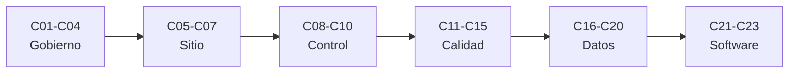

# B48 — Operaciones de observatorios científicos

> **Bloque ampliado.** Además de las 20 clases de la línea base, el bloque tiene 3 clases programadas por la ampliación (`B48-C21` a `B48-C23`), listadas en el último tramo. Ver el [programa completo](../../PROGRAMA_ACADEMICO_COMPLETO.md).

**Programa:** Programa Integral de Astronomía, Astrofísica, Ciencias Espaciales e Ingeniería Aeroespacial
**Área:** A04 — Óptica, telescopios y observatorios científicos
**Nivel:** N3 (fundamentos disciplinares) · **Clases:** 20 + 3 de la ampliación · **Carga:** por calibrar con el uso
**Estado:** guía pedagógica del bloque (resumen de qué se aprende en cada clase). Las clases enlazadas en la tabla ya están redactadas; todas conservan el estado E0 en el catálogo hasta registrar revisión disciplinar.

## 🎯 Propósito del bloque

Enseña **cómo se opera un observatorio científico con criterio cuantitativo**: el observatorio como sistema, la concesión de tiempo y la evaluación de propuestas, la planificación por visibilidad, las ventanas atmosféricas y la meteorología del sitio, la seguridad y el control remoto, la automatización de cúpulas, la sincronización de instrumentos, la calidad de los datos y el seeing, las calibraciones, el mantenimiento y las fallas, el procesamiento en línea y el archivo, el cielo oscuro y la ciencia ciudadana, el diseño de una campaña, los protocolos de control instrumental, el autoenfoque y la observabilidad del software. Cada clase cierra con un cálculo verificable contra un caso analítico, dos vías independientes o una simulación con semilla fija, y distingue lo consultado de lo ilustrativo.

## 📚 Al terminar el bloque podrás

1. Calcular la eficiencia global de un observatorio como producto de factores y verificarla por simulación.
2. Repartir tiempo de telescopio con cuotas y estimar las horas efectivas tras el clima.
3. Planificar una observación con altitud, masa de aire y horas de visibilidad.
4. Estimar extinción, punto de rocío, viento y reglas de cierre con histéresis.
5. Dimensionar respaldos, latencias, vigilancia y sincronización de reloj de una instalación remota.
6. Evaluar calidad de datos, seeing y calibraciones con incertidumbre.
7. Diseñar una campaña con probabilidad de completarse, mantenimiento, archivo y alertas del software.

## 🧭 Secuencia del bloque

**Descripción textual.** Seis tramos encadenados: gobierno y planificación (C01–C04), sitio y entorno (C05–C07), telescopio automatizado (C08–C10), calidad y calibración (C11–C15), datos y sociedad (C16–C20) y software de observatorio (C21–C23).

## 🗂️ Las 23 clases en resumen (20 de la línea base + 3 de la ampliación)

**Navegación:** cada clase desarrollada enlaza a la anterior, a la siguiente y a este bloque; mientras una clase siga solo programada, su enlace lleva a su fila en esta tabla.

La columna «Evidencia» indica el producto que demostrará el aprendizaje. Los laboratorios usan datos **sintéticos** o **ilustrativos** (rotulados) o valores publicados con fuente y fecha.

### Tramo 1 · Gobierno y planificación

| ID | Clase | Qué se aprende | Evidencia |
|---|---|---|---|
| [B48-C01](../clases/B48/B48-C01-observatorio-como-sistema-socio-tecnico/CLASE.md) | Observatorio como sistema socio-técnico | Eficiencia global como producto de factores y su verificación. | Ficha del observatorio como sistema |
| [B48-C02](../clases/B48/B48-C02-concesion-de-tiempo-de-observacion/CLASE.md) | Concesión de tiempo de observación | Reparto de horas por cuotas con dos métodos y horas efectivas por clima. | Ficha de la concesión de tiempo |
| [B48-C03](../clases/B48/B48-C03-propuestas-cientificas-y-criterios/CLASE.md) | Propuestas científicas y criterios | Revisores ruidosos y correlación con el mérito verdadero. | Ficha de propuestas y criterios |
| [B48-C04](../clases/B48/B48-C04-planificacion-por-visibilidad/CLASE.md) | Planificación por visibilidad | Altitud, masa de aire y horas de visibilidad por dos vías. | Ficha de planificación por visibilidad |

### Tramo 2 · Sitio y entorno

| ID | Clase | Qué se aprende | Evidencia |
|---|---|---|---|
| [B48-C05](../clases/B48/B48-C05-ventanas-atmosfericas/CLASE.md) | Ventanas atmosféricas | Recta de Bouguer, extinción y fracción de banda útil. | Ficha de las ventanas atmosféricas |
| [B48-C06](../clases/B48/B48-C06-meteorologia-de-observatorios/CLASE.md) | Meteorología de observatorios | Punto de rocío, viento de Ornstein-Uhlenbeck y cierre con histéresis. | Ficha de meteorología del observatorio |
| [B48-C07](../clases/B48/B48-C07-seguridad-en-instalaciones-remotas/CLASE.md) | Seguridad en instalaciones remotas | Autonomía de respaldo y probabilidad de corte más largo. | Ficha de seguridad en instalaciones remotas |

### Tramo 3 · Telescopio automatizado

| ID | Clase | Qué se aprende | Evidencia |
|---|---|---|---|
| [B48-C08](../clases/B48/B48-C08-automatizacion-de-cupulas/CLASE.md) | Automatización de cúpulas | Azimut de cúpula por cuadrática y por bisección con descentrado. | Ficha de la automatización de cúpulas |
| [B48-C09](../clases/B48/B48-C09-control-remoto-de-telescopios/CLASE.md) | Control remoto de telescopios | Retardo de propagación, latencia y falsos disparos de vigilancia. | Ficha del control remoto |
| [B48-C10](../clases/B48/B48-C10-redes-de-instrumentos/CLASE.md) | Redes de instrumentos | Estimación de desfase de reloj con rutas asimétricas. | Ficha de la red de instrumentos |

### Tramo 4 · Calidad y calibración

| ID | Clase | Qué se aprende | Evidencia |
|---|---|---|---|
| [B48-C11](../clases/B48/B48-C11-calidad-y-clasificacion-de-datos/CLASE.md) | Calidad y clasificación de datos | Fracción de noches por clase de calidad, analítica y simulada. | Ficha de calidad y clasificación de datos |
| [B48-C12](../clases/B48/B48-C12-monitorizacion-de-seeing/CLASE.md) | Monitorización de seeing | Varianza de movimiento diferencial y r0 con su incertidumbre. | Ficha de la monitorización de seeing |
| [B48-C13](../clases/B48/B48-C13-calibraciones-nocturnas/CLASE.md) | Calibraciones nocturnas | Curva de transferencia de fotones: ganancia y ruido de lectura. | Ficha de calibraciones nocturnas |
| [B48-C14](../clases/B48/B48-C14-mantenimiento-preventivo/CLASE.md) | Mantenimiento preventivo | Costo por unidad de tiempo y reemplazo preventivo óptimo. | Ficha de mantenimiento preventivo |
| [B48-C15](../clases/B48/B48-C15-gestion-de-fallas-de-instrumentos/CLASE.md) | Gestión de fallas de instrumentos | Disponibilidad MTBF/MTTR y redundancia 1 de 2. | Ficha de gestión de fallas |

### Tramo 5 · Datos y sociedad

| ID | Clase | Qué se aprende | Evidencia |
|---|---|---|---|
| [B48-C16](../clases/B48/B48-C16-procesamiento-de-datos-en-linea/CLASE.md) | Procesamiento de datos en línea | Cola M/D/1 y tasa de datos de la reducción en línea. | Ficha del procesamiento en línea |
| [B48-C17](../clases/B48/B48-C17-gestion-de-archivos-observacionales/CLASE.md) | Gestión de archivos observacionales | SHA-256, CRC y probabilidad de colisión. | Ficha de la gestión de archivos |
| [B48-C18](../clases/B48/B48-C18-proteccion-del-cielo-oscuro/CLASE.md) | Protección del cielo oscuro | Suma de brillos en magnitudes y tiempo de exposición limitado por cielo. | Ficha del cielo oscuro |
| [B48-C19](../clases/B48/B48-C19-divulgacion-y-ciencia-ciudadana/CLASE.md) | Divulgación y ciencia ciudadana | Voto mayoritario y ponderado de voluntarios. | Ficha de ciencia ciudadana |
| [B48-C20](../clases/B48/B48-C20-diseno-de-una-campana-observacional-profesional/CLASE.md) | Diseño de una campaña observacional profesional | Probabilidad de completar una campaña con noches despejadas. | Ficha de la campaña observacional |

### Tramo 6 · Software de observatorio

| ID | Clase | Qué se aprende | Evidencia |
|---|---|---|---|
| [B48-C21](../clases/B48/B48-C21-protocolos-estandar-de-control-instrumental-ascom-e-indi/CLASE.md) | Protocolos estándar de control instrumental (ASCOM e INDI) | Adaptador común sobre dos protocolos y latencia de sondeo. | Ficha de protocolos de control instrumental |
| [B48-C22](../clases/B48/B48-C22-control-automatico-del-enfocador-y-autoenfoque/CLASE.md) | Control automático del enfocador y autoenfoque | Curva en V, ajuste cuadrático y mínimo de enfoque. | Ficha del autoenfoque |
| [B48-C23](../clases/B48/B48-C23-observabilidad-del-software-de-observatorio-registros-metricas-y-alertas/CLASE.md) | Observabilidad del software de observatorio: registros, métricas y alertas | Falsas alarmas k de m y retardo de detección. | Ficha de observabilidad del software |

## 🧵 Hilos que atraviesan el bloque

- **De la propuesta al dato archivado:** C01–C04 asignan y planifican; C05–C10 operan en el sitio; C11–C15 garantizan calidad; C16–C20 procesan, archivan y comunican; C21–C23 sostienen el software.
- **Probabilidad en operaciones:** C01, C02, C07, C14, C15, C20 y C23 usan probabilidades de eventos independientes, colas y renovación, siempre contrastadas con simulación de semilla fija.
- **Dos vías independientes:** cada laboratorio contrasta con un caso analítico, una segunda forma de calcular o una simulación con semilla 20261109.
- **Observado frente a ilustrativo:** ningún dato de un observatorio real se presenta como medido; las constantes de NIST y las páginas oficiales realmente leídas se citan con fecha y el resto de los números son ilustrativos o sintéticos y se rotulan.

## 📝 Evaluación del bloque (propuesta, por calibrar)

- Fichas y ejercicios por clase, con retroalimentación y recuperación con evidencia distinta.
- Portafolio: ficha de planificación por visibilidad (C04) y ficha de la campaña observacional (C20).
- Las condiciones críticas (rotular lo sintético, no presentar un modelo de juguete como práctica de un observatorio real y citar solo lo consultado) no se compensan con promedio.

## ⚠️ Seguridad y límites

El bloque es educativo. Los modelos son simplificados y no sustituyen los procedimientos, las normas de seguridad ni los reglamentos de ningún observatorio; no se dan umbrales operativos reales de cierre, de seguridad eléctrica ni de protección de personas. Las cifras de sitio, de instrumentos y de fallas son ilustrativas o sintéticas y se rotulan como tales.

## Fuentes de orientación preliminar

- **[ESO]** [European Southern Observatory](https://www.eso.org/) — Observatorios ópticos, instrumentación y astronomía profesional.
- **[ALMA]** [Atacama Large Millimeter/submillimeter Array](https://www.almaobservatory.org/) — Radioastronomía interferométrica de ALMA y sus productos de ciencia.
- **[NASA-SMALLSAT]** [NASA State-of-the-Art of Small Spacecraft Technology, edición 2026](https://www.nasa.gov/smallsat-institute/sst-soa/) — Referencia panorámica sobre plataformas y subsistemas de satélites pequeños.
- **[NASA-NTRS]** [NASA Technical Reports Server](https://ntrs.nasa.gov/) — Informes técnicos e investigación histórica y actual.

> La asociación de estas fuentes es orientativa por bloque. Las fuentes realmente consultadas para cada afirmación se registran en la sección 11 de cada clase.

[🏠 Volver al programa](../../README.md) · [➡️ B49 — Antenas y receptores de radioastronomía](./B49-antenas-y-receptores-de-radioastronomia.md)
