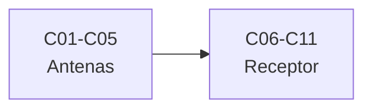

# B49 — Antenas y receptores de radioastronomía

> **Bloque de la malla `0.2.0`.** Ver el [programa completo](../../PROGRAMA_ACADEMICO_COMPLETO.md).

**Programa:** Programa Integral de Astronomía, Astrofísica, Ciencias Espaciales e Ingeniería Aeroespacial
**Área:** A04 — Óptica, telescopios y observatorios científicos
**Nivel:** N3 (fundamentos disciplinares) · **Clases:** 11 · **Carga:** por calibrar con el uso
**Estado:** guía pedagógica del bloque (resumen de qué se aprende en cada clase). Las clases enlazadas en la tabla ya están redactadas; todas conservan el estado E0 en el catálogo hasta registrar revisión disciplinar.

## 🎯 Propósito del bloque

Enseña **cómo se capta y se acondiciona la señal de radio de un radiotelescopio**: las antenas de hilo y su impedancia de radiación, la adaptación de impedancias y las líneas de transmisión, el apuntamiento y el seguimiento de antenas grandes, los arreglos y la formación de haz, la medición de patrones de antena, el amplificador de bajo ruido, la criogenia del receptor, la estabilidad de ganancia, la linealidad, el filtrado y la mezcla de frecuencias. Cada clase cierra con un cálculo verificable contra un caso analítico, dos vías independientes o una simulación con semilla fija, y distingue lo consultado de lo ilustrativo.

## 📚 Al terminar el bloque podrás

1. Calcular la resistencia de radiación y la longitud resonante de un dipolo y de un monopolo.
2. Evaluar el coeficiente de reflexión, la ROE y el transformador de cuarto de onda de una línea.
3. Ajustar un modelo de apuntado de una antena grande y cuantificar su error residual.
4. Calcular el factor de arreglo, sus nulos y sus lóbulos laterales para distintos pesos.
5. Combinar las temperaturas de ruido de una cadena de receptor y el efecto de enfriarla.
6. Estimar la estabilidad de ganancia con la varianza de Allan y la conmutación tipo Dicke.
7. Calcular el rango dinámico, el rechazo de la banda imagen y los espurios de un mezclador.

## 🧭 Secuencia del bloque

**Descripción textual.** Dos tramos encadenados: las antenas (C01–C05) y el receptor con su cadena de radiofrecuencia (C06–C11).

## 🗂️ Las 11 clases en resumen

**Navegación:** cada clase desarrollada enlaza a la anterior, a la siguiente y a este bloque; mientras una clase siga solo programada, su enlace lleva a su fila en esta tabla.

La columna «Evidencia» indica el producto que demostrará el aprendizaje. Los laboratorios usan datos **sintéticos** o **ilustrativos** (rotulados) o valores publicados con fuente y fecha.

### Tramo 1 · Antenas

| ID | Clase | Qué se aprende | Evidencia |
|---|---|---|---|
| B49-C01 | Antenas de hilo: dipolo, monopolo e impedancia de radiación | Resistencia de radiación del dipolo y del monopolo, longitud resonante. | Ficha de las antenas de hilo |
| B49-C02 | Adaptación de impedancias y líneas de transmisión en antenas | Coeficiente de reflexión, ROE, transformador de cuarto de onda y carta de Smith numérica. | Ficha de la adaptación de impedancias |
| B49-C03 | Apuntamiento y seguimiento de radiotelescopios: modelos de apuntado y errores | Modelo de apuntado con armónicos, ajuste por mínimos cuadrados y error residual. | Ficha del modelo de apuntado |
| B49-C04 | Arreglos de antenas: factor de arreglo y formación de haz | Factor de arreglo, nulos, lóbulos laterales y pesos de Taylor o Hann. | Ficha del factor de arreglo |
| B49-C05 | Medición y calibración de patrones de antena | Pérdida por error de apuntado, cociente de patrones y nulo del patrón medido. | Ficha del patrón de antena medido |

### Tramo 2 · Receptor y cadena de radiofrecuencia

| ID | Clase | Qué se aprende | Evidencia |
|---|---|---|---|
| B49-C06 | Amplificadores de bajo ruido (LNA): tecnología, ganancia y adaptación | Fórmula de Friis, temperatura de ruido de la cascada y desadaptación. | Ficha del amplificador de bajo ruido |
| B49-C07 | Criogenia y refrigeración de receptores de radio | Ruido de Johnson, temperatura de ruido de la cascada fría y potencia de enfriamiento. | Ficha de la criogenia del receptor |
| B49-C08 | Estabilidad de ganancia de receptores y variaciones de ganancia | Sensibilidad del radiómetro, varianza de Allan y conmutación tipo Dicke. | Ficha de la estabilidad de ganancia |
| B49-C09 | Linealidad, compresión e intermodulación de receptores de RF | Punto de compresión, punto de intercepción de tercer orden y rango libre de espurios. | Ficha de la linealidad del receptor |
| B49-C10 | Filtros de radiofrecuencia pasabanda y rechazo de banda imagen | Respuesta de Butterworth, rechazo de la banda imagen y pérdida de inserción. | Ficha del filtro pasabanda |
| B49-C11 | Mezcladores de frecuencia: pérdida de conversión y productos espurios | Frecuencias de productos de mezcla, pérdida de conversión y espurios de orden bajo. | Ficha del mezclador de frecuencia |

## 🧵 Hilos que atraviesan el bloque

- **De la antena al detector:** C01–C05 describen cómo la antena recoge la señal y la entrega a la línea; C06–C11 la amplifican, la filtran y la convierten sin degradarla.
- **Ruido y ganancia:** C02, C06, C07 y C08 enlazan adaptación, temperatura de ruido, criogenia y estabilidad en una sola contabilidad de la sensibilidad.
- **Dos vías independientes:** cada laboratorio contrasta con un caso analítico, una segunda forma de calcular, una constante de NIST o una simulación con semilla fija.
- **Observado frente a ilustrativo:** solo se citan con fecha las constantes de NIST y los resúmenes realmente leídos; los valores de antenas, amplificadores y filtros son ilustrativos y se rotulan.

## 📝 Evaluación del bloque (propuesta, por calibrar)

- Fichas y ejercicios por clase, con retroalimentación y recuperación con evidencia distinta.
- Portafolio: ficha de la adaptación de impedancias (C02) y ficha del amplificador de bajo ruido (C06).
- Las condiciones críticas (rotular lo ilustrativo, no presentar un componente de juguete como un instrumento real y citar solo lo consultado) no se compensan con promedio.

## ⚠️ Seguridad y límites

El bloque es educativo. Los modelos son simplificados (antenas ideales, componentes lineales o con no linealidad polinómica, filtros de prototipo) y no sustituyen las hojas de datos, la simulación electromagnética ni la medición de un instrumento real. Las constantes de NIST se citan con fecha de consulta y el resto de los números son ilustrativos y se rotulan como tales. No se usan datos de instrumentos reales como si fueran medidos.

## Roles que lo usan

- [Radioastronomía e interferometría](../../rutas/radioastronomia-e-interferometria.md)

## Fuentes de orientación preliminar

- **[NIST-CODATA]** [NIST Fundamental Physical Constants (CODATA 2022)](https://physics.nist.gov/cuu/Constants/Table/allascii.txt) — Constantes físicas fundamentales.
- **[IAU-B3]** [UAI, Resolución B3 de 2015](https://arxiv.org/abs/1510.07674) — Valores nominales solares y planetarios.
- **[ADS]** [NASA Astrophysics Data System](https://ui.adsabs.harvard.edu/) — Índice bibliográfico de literatura astronómica y física.

> La asociación de estas fuentes es orientativa por bloque. Las fuentes realmente consultadas para cada afirmación se registran en la sección 11 de cada clase.

[🏠 Volver al programa](../../README.md) · [➡️ B50 — Diseño óptico computacional y tolerancias](./B50-diseno-optico-computacional-y-tolerancias.md)
