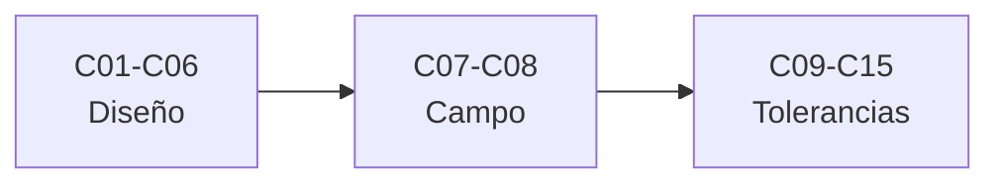

# B50 — Diseño óptico computacional y tolerancias

> **Bloque de la malla `0.2.0`.** Ver el [programa completo](../../PROGRAMA_ACADEMICO_COMPLETO.md).

**Programa:** Programa Integral de Astronomía, Astrofísica, Ciencias Espaciales e Ingeniería Aeroespacial
**Área:** A04 — Óptica, telescopios y observatorios científicos
**Nivel:** N3 (fundamentos disciplinares) · **Clases:** 15 · **Carga:** por calibrar con el uso
**Estado:** guía pedagógica del bloque (resumen de qué se aprende en cada clase). Las clases enlazadas en la tabla ya están redactadas; todas conservan el estado E0 en el catálogo hasta registrar revisión disciplinar.

## 🎯 Propósito del bloque

Enseña **cómo se diseña un sistema óptico con cálculo y cómo se decide cuánto error admite**: el trazado exacto de rayos y sus aberraciones de orden superior, la optimización con función de mérito y restricciones, los sistemas catadióptricos de Schmidt y Maksutov, la telecentricidad y el viñeteo, la luz parásita, los modelos de diseño reproducibles, la curvatura de campo y los aplanadores, la distorsión y su calibración, y después las tolerancias: su asignación, los errores de centrado e inclinación, la sensibilidad térmica, el análisis Monte Carlo, los criterios de aceptación y el presupuesto de error de frente de onda. Cada clase cierra con un laboratorio en Python que contrasta con un caso analítico, dos vías independientes o una simulación con semilla fija, y distingue lo consultado de lo ilustrativo.

## 📚 Al terminar el bloque podrás

1. Trazar rayos exactos a través de superficies cónicas y medir aberraciones frente a la teoría de tercer orden.
2. Definir una función de mérito con restricciones y optimizar parámetros de diseño con mínimos cuadrados amortiguados.
3. Explicar y calcular el efecto del diafragma en sistemas catadióptricos, la telecentricidad, el viñeteo y la curvatura de campo.
4. Estimar fantasmas, luz parásita y distorsión, y calibrar la distorsión con un ajuste.
5. Mantener un modelo óptico reproducible, con huella y regresión analítica.
6. Asignar tolerancias de centrado, inclinación y temperatura y verificar la asignación con Monte Carlo.
7. Traducir el frente de onda en Strehl y especificaciones y repartir un presupuesto de error de frente de onda.

## 🧭 Secuencia del bloque

**Descripción textual.** Tres tramos encadenados: diseño y trazado (C01–C06), aberraciones de campo y distorsión (C07–C08) y tolerancias y desempeño (C09–C15).

## 🗂️ Las 15 clases en resumen

**Navegación:** cada clase desarrollada enlaza a la anterior, a la siguiente y a este bloque; mientras una clase siga solo programada, su enlace lleva a su fila en esta tabla.

La columna «Evidencia» indica el producto que demostrará el aprendizaje. Los laboratorios usan datos **sintéticos** o **ilustrativos** (rotulados) o valores publicados con fuente y fecha.

### Tramo 1 · Diseño y trazado

| ID | Clase | Qué se aprende | Evidencia |
|---|---|---|---|
| [B50-C01](../clases/B50/B50-C01-trazado-exacto-de-rayos-y-aberraciones-de-orden-superior/CLASE.md) | Trazado exacto de rayos y aberraciones de orden superior | Trazado exacto frente a paraxial y serie de la aberración esférica. | Ficha del trazado exacto |
| [B50-C02](../clases/B50/B50-C02-optimizacion-de-superficies-funcion-de-merito-y-restricciones/CLASE.md) | Optimización de superficies: función de mérito y restricciones | Mínimos cuadrados amortiguados con restricción de focal. | Ficha de la optimización de superficies |
| [B50-C03](../clases/B50/B50-C03-sistemas-catadioptricos-schmidt-y-maksutov/CLASE.md) | Sistemas catadióptricos: Schmidt y Maksutov | Corrector de Schmidt, menisco de Maksutov y campo con diafragma en el centro. | Ficha de los sistemas catadióptricos |
| [B50-C04](../clases/B50/B50-C04-telecentricidad-vineteo-y-diseno-del-campo/CLASE.md) | Telecentricidad, viñeteo y diseño del campo | Ángulo del rayo principal, apertura telecéntrica y viñeteo por dos círculos. | Ficha de telecentricidad y viñeteo |
| [B50-C05](../clases/B50/B50-C05-luz-parasita-y-analisis-de-rayos-dispersos/CLASE.md) | Luz parásita y análisis de rayos dispersos | Fantasmas de Fresnel, desenfoque del fantasma y factor de vista. | Ficha de la luz parásita |
| [B50-C06](../clases/B50/B50-C06-software-de-diseno-optico-modelos-reproducibles-y-verificacion/CLASE.md) | Software de diseño óptico: modelos reproducibles y verificación | Modelo en JSON, huella y regresión analítica. | Ficha de un modelo reproducible |

### Tramo 2 · Aberraciones de campo y distorsión

| ID | Clase | Qué se aprende | Evidencia |
|---|---|---|---|
| [B50-C07](../clases/B50/B50-C07-curvatura-de-campo-y-aplanadores/CLASE.md) | Curvatura de campo y aplanadores | Superficie de Petzval, esfera concéntrica con el diafragma y aplanador. | Ficha de la curvatura de campo |
| [B50-C08](../clases/B50/B50-C08-distorsion-geometrica-y-su-calibracion/CLASE.md) | Distorsión geométrica y su calibración | Mapas f·tanθ y f·θ y ajuste polinómico de la distorsión. | Ficha de la distorsión y su calibración |

### Tramo 3 · Tolerancias y desempeño

| ID | Clase | Qué se aprende | Evidencia |
|---|---|---|---|
| [B50-C09](../clases/B50/B50-C09-asignacion-y-balance-de-tolerancias-opticas/CLASE.md) | Asignación y balance de tolerancias ópticas | Multiplicadores de Lagrange frente a asignación igual. | Ficha de la asignación de tolerancias |
| [B50-C10](../clases/B50/B50-C10-errores-de-centrado-y-su-efecto-en-el-desempeno/CLASE.md) | Errores de centrado y su efecto en el desempeño | Coma por descentramiento: linealidad y simetría. | Ficha del descentramiento |
| [B50-C11](../clases/B50/B50-C11-errores-de-inclinacion-de-elementos-y-superficies/CLASE.md) | Errores de inclinación de elementos y superficies | Espejo plano a 2α y punto de pivote libre de coma. | Ficha de la inclinación |
| [B50-C12](../clases/B50/B50-C12-sensibilidad-termica-del-desempeno-optico-y-atermalizacion/CLASE.md) | Sensibilidad térmica del desempeño óptico y atermalización | Desplazamiento del foco: fórmula frente a trazado y CTE de la carcasa atérmica. | Ficha de la sensibilidad térmica |
| [B50-C13](../clases/B50/B50-C13-analisis-monte-carlo-de-tolerancias-opticas/CLASE.md) | Análisis Monte Carlo de tolerancias ópticas | Media del cuadrado del error frente a suma cuadrática y rendimiento. | Ficha del Monte Carlo de tolerancias |
| [B50-C14](../clases/B50/B50-C14-criterios-de-aceptacion-strehl-error-de-frente-de-onda-y-especificaciones/CLASE.md) | Criterios de aceptación: Strehl, error de frente de onda y especificaciones | Strehl exacto frente a Maréchal y banda de guarda. | Ficha de los criterios de aceptación |
| [B50-C15](../clases/B50/B50-C15-presupuesto-de-error-de-frente-de-onda-de-un-instrumento/CLASE.md) | Presupuesto de error de frente de onda de un instrumento | Superficie a frente de onda, suma cuadrática y Strehl del instrumento. | Ficha del presupuesto de frente de onda |

## 🧵 Hilos que atraviesan el bloque

- **Del diseño a la tolerancia:** C01–C08 construyen y evalúan un diseño nominal; C09–C15 preguntan cuánto error admite y cómo se verifica.
- **Un mismo trazador:** los laboratorios reutilizan un trazador de rayos exacto para superficies cónicas con descentramiento e inclinación, y lo contrastan con una solución analítica en cada clase.
- **Incertidumbre:** C13 y C15 propagan tolerancias a la distribución del frente de onda y al presupuesto; C14 traduce la medida en una decisión de aceptación.
- **Observado frente a ilustrativo:** ningún instrumento real se modela; los valores de materiales, tolerancias y presupuestos son ilustrativos y se rotulan, y solo se citan con fecha las páginas realmente consultadas.

## 📝 Evaluación del bloque (propuesta, por calibrar)

- Fichas y ejercicios por clase, con retroalimentación y recuperación con evidencia distinta.
- Portafolio: ficha de la asignación de tolerancias (C09) y ficha del presupuesto de frente de onda (C15).
- Las condiciones críticas (rotular lo ilustrativo, no presentar un diseño de juguete como el de un instrumento real y citar solo lo consultado) no se compensan con promedio.

## ⚠️ Seguridad y límites

El bloque es educativo. Los modelos son simplificados y no sustituyen a un programa de diseño óptico comercial ni a la verificación de un instrumento real; no se diseña, tolera ni acepta ningún instrumento concreto. Los materiales, tolerancias y presupuestos son ilustrativos y se rotulan como tales.

## Roles que lo usan

- [Ingeniería óptica y telescopios profesionales](../../rutas/ingenieria-optica-y-telescopios-profesionales.md)

## Fuentes de orientación preliminar

- **[NIST-CODATA]** [NIST Fundamental Physical Constants (CODATA 2022)](https://physics.nist.gov/cuu/Constants/Table/allascii.txt) — Constantes físicas fundamentales.
- **[ADS]** [NASA Astrophysics Data System](https://ui.adsabs.harvard.edu/) — Índice bibliográfico de literatura astronómica y óptica.
- **[Strehl]** [Wikipedia, Strehl ratio](https://en.wikipedia.org/wiki/Strehl_ratio) — Definición de la razón de Strehl y la aproximación de Maréchal.
- **[Schmidt]** [Wikipedia, Schmidt camera](https://en.wikipedia.org/wiki/Schmidt_camera) — Cámara de Schmidt y su placa correctora.

> La asociación de estas fuentes es orientativa por bloque. Las fuentes realmente consultadas para cada afirmación se registran en la sección 11 de cada clase.

[🏠 Volver al programa](../../README.md) · [➡️ B51 — Interferometría avanzada y reducción de datos de radio](./B51-interferometria-avanzada-y-reduccion-de-datos-de-radio.md)
