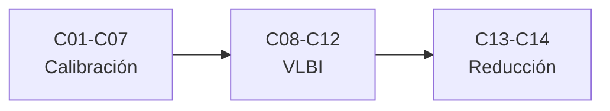

# B51 — Interferometría avanzada y reducción de datos de radio

> **Bloque de la malla `0.2.0`.** Ver el [programa completo](../../PROGRAMA_ACADEMICO_COMPLETO.md).

**Programa:** Programa Integral de Astronomía, Astrofísica, Ciencias Espaciales e Ingeniería Aeroespacial
**Área:** A04 — Óptica, telescopios y observatorios científicos
**Nivel:** N3 (fundamentos disciplinares) · **Clases:** 14 · **Carga:** por calibrar con el uso
**Estado:** guía pedagógica del bloque (resumen de qué se aprende en cada clase). Las clases enlazadas en la tabla ya están redactadas; todas conservan el estado E0 en el catálogo hasta registrar revisión disciplinar.

## 🎯 Propósito del bloque

Enseña **cómo se calibra, se corrige y se reduce un conjunto de datos de interferometría de radio**: la escala de flujo, las cantidades de cierre, las ganancias complejas por antena, la respuesta de banda, los efectos de la ionosfera, la autocalibración, el diagnóstico de residuos, la compensación de retardo, el fringe stopping, los retardos atmosféricos en VLBI, la búsqueda de franjas, los formatos de datos, el marcado de interferencia y la calibración de banda en síntesis. Cada clase cierra con un cálculo verificable contra un caso analítico, dos vías independientes o una simulación con semilla fija, y distingue lo consultado de lo ilustrativo.

## 📚 Al terminar el bloque podrás

1. Fijar una escala de flujo y propagarla por bootstrap a una fuente secundaria.
2. Construir cantidades de cierre y comprobar su invariancia frente a errores de antena.
3. Resolver ganancias complejas por antena con dos métodos independientes.
4. Modelar retardos, ondulaciones y ruido de la respuesta de banda.
5. Calcular retardo ionosférico y rotación de Faraday y corregirlos con dos frecuencias.
6. Iterar una autocalibración y diagnosticar su calidad con los residuos.
7. Buscar franjas de retardo y tasa, compensar retardos y marcar interferencia con umbrales robustos.

## 🧭 Secuencia del bloque

**Descripción textual.** Tres tramos encadenados: calibración y cierres (C01–C07), VLBI y retardos (C08–C12) y reducción de datos (C13–C14).

## 🗂️ Las 14 clases en resumen

**Navegación:** cada clase desarrollada enlaza a la anterior, a la siguiente y a este bloque; mientras una clase siga solo programada, su enlace lleva a su fila en esta tabla.

La columna «Evidencia» indica el producto que demostrará el aprendizaje. Los laboratorios usan datos **sintéticos** o **ilustrativos** (rotulados) o valores publicados con fuente y fecha.

### Tramo 1 · Calibración y cierres

| ID | Clase | Qué se aprende | Evidencia |
|---|---|---|---|
| [B51-C01](../clases/B51/B51-C01-calibracion-de-amplitud-y-escala-de-flujo-con-calibradores-primarios/CLASE.md) | Calibración de amplitud y escala de flujo con calibradores primarios | Escala de flujo, bootstrap y ganancias de amplitud. | Ficha de la escala de flujo |
| [B51-C02](../clases/B51/B51-C02-cantidades-de-cierre-fase-y-amplitud-de-cierre/CLASE.md) | Cantidades de cierre: fase y amplitud de cierre | Invariancia de los cierres y su ruido. | Ficha de las cantidades de cierre |
| [B51-C03](../clases/B51/B51-C03-ganancias-complejas-por-antena-y-soluciones-de-calibracion/CLASE.md) | Ganancias complejas por antena y soluciones de calibración | Ecuación de medida y ganancias complejas por antena. | Ficha de las ganancias complejas |
| [B51-C04](../clases/B51/B51-C04-respuesta-de-banda-y-errores-dependientes-de-la-frecuencia/CLASE.md) | Respuesta de banda y errores dependientes de la frecuencia | Retardo, ondulación y ruido de la respuesta de banda. | Ficha de la respuesta de banda |
| [B51-C05](../clases/B51/B51-C05-efectos-ionosfericos-en-radioastronomia-retardo-rotacion-de-faraday-y-su-correccion/CLASE.md) | Efectos ionosféricos en radioastronomía: retardo, rotación de Faraday y su corrección | Retardo dispersivo, TEC y rotación de Faraday. | Ficha de los efectos ionosféricos |
| [B51-C06](../clases/B51/B51-C06-autocalibracion-iterativa-con-modelo-de-cielo/CLASE.md) | Autocalibración iterativa con modelo de cielo | Iteración imagen–modelo–ganancias y sesgo. | Ficha de la autocalibración |
| [B51-C07](../clases/B51/B51-C07-evaluacion-de-residuos-y-diagnostico-de-calidad-de-calibracion/CLASE.md) | Evaluación de residuos y diagnóstico de calidad de calibración | Chi cuadrado reducido, residuos normalizados y valores atípicos. | Ficha de los residuos de calibración |

### Tramo 2 · VLBI y retardos

| ID | Clase | Qué se aprende | Evidencia |
|---|---|---|---|
| [B51-C08](../clases/B51/B51-C08-compensacion-de-retardo-y-alineacion-temporal-de-flujos-de-antenas/CLASE.md) | Compensación de retardo y alineación temporal de flujos de antenas | Retardo entero y fraccionario por correlación cruzada. | Ficha del retardo y la alineación |
| [B51-C09](../clases/B51/B51-C09-fringe-stopping-y-rotacion-de-fase-por-retardo-geometrico/CLASE.md) | Fringe stopping y rotación de fase por retardo geométrico | Retardo geométrico, tasa de franjas y pérdida por promediado. | Ficha del fringe stopping |
| [B51-C10](../clases/B51/B51-C10-retardo-troposferico-e-ionosferico-en-vlbi-y-su-modelado/CLASE.md) | Retardo troposférico e ionosférico en VLBI y su modelado | Función de mapeo y combinación libre de ionosfera. | Ficha de los retardos atmosféricos en VLBI |
| [B51-C11](../clases/B51/B51-C11-busqueda-de-franjas-vlbi-ajuste-de-retardo-y-tasa/CLASE.md) | Búsqueda de franjas VLBI: ajuste de retardo y tasa | Pico de retardo y tasa, SNR y falsas detecciones. | Ficha de la búsqueda de franjas |
| [B51-C12](../clases/B51/B51-C12-formatos-de-datos-vlbi-y-geodesicos/CLASE.md) | Formatos de datos VLBI y geodésicos | Cuantización, empaquetado y tasa de datos. | Ficha de los formatos de datos |

### Tramo 3 · Reducción de datos

| ID | Clase | Qué se aprende | Evidencia |
|---|---|---|---|
| [B51-C13](../clases/B51/B51-C13-marcado-de-datos-espurios-e-interferencia-en-visibilidades/CLASE.md) | Marcado de datos espurios e interferencia en visibilidades | Umbrales robustos, tasa de falsas alarmas y SumThreshold. | Ficha del marcado de datos |
| [B51-C14](../clases/B51/B51-C14-calibracion-de-banda-en-la-reduccion-de-datos-de-sintesis/CLASE.md) | Calibración de banda en la reducción de datos de síntesis | Ruido de la solución de banda y sustracción del continuo. | Ficha de la calibración de banda en síntesis |

## 🧵 Hilos que atraviesan el bloque

- **Del dato crudo al dato calibrado:** C01–C07 resuelven amplitud, fase, banda y atmósfera; C08–C12 alinean y detectan señales en VLBI; C13–C14 limpian y reducen.
- **Dos vías independientes:** cada laboratorio contrasta con un caso analítico, una segunda forma de calcular o una simulación con semilla fija.
- **Incertidumbre:** C01, C02, C04, C11 y C14 propagan el ruido a la calibración y a la detección.
- **Observado frente a ilustrativo:** solo se citan con fecha los resúmenes de arXiv realmente leídos y las constantes de NIST; todos los datos de visibilidades son sintéticos y se rotulan.

## 📝 Evaluación del bloque (propuesta, por calibrar)

- Fichas y ejercicios por clase, con retroalimentación y recuperación con evidencia distinta.
- Portafolio: ficha de las ganancias complejas (C03) y ficha de la búsqueda de franjas (C11).
- Las condiciones críticas (rotular lo sintético, no presentar una simulación como reducción de datos reales y citar solo lo consultado) no se compensan con promedio.

## ⚠️ Seguridad y límites

El bloque es educativo. Los modelos son simplificados y no sustituyen a CASA, AIPS, las cadenas de las colaboraciones ni a la correlación VLBI real; no se descargan ni procesan datos de ningún observatorio. Los valores publicados se citan con su fuente y fecha de consulta (solo resúmenes) y el resto de los números son sintéticos o ilustrativos.

## Roles que lo usan

- [Radioastronomía e interferometría](../../rutas/radioastronomia-e-interferometria.md)

## Fuentes de orientación preliminar

- **[NIST-CODATA]** [NIST Fundamental Physical Constants (CODATA 2022)](https://physics.nist.gov/cuu/Constants/Table/allascii.txt) — Constantes físicas fundamentales.
- **[IAU-B3]** [UAI, Resolución B3 de 2015](https://arxiv.org/abs/1510.07674) — Valores nominales solares y planetarios.
- **[ADS]** [NASA Astrophysics Data System](https://ui.adsabs.harvard.edu/) — Índice bibliográfico de literatura astronómica y física.

> La asociación de estas fuentes es orientativa por bloque. Las fuentes realmente consultadas para cada afirmación se registran en la sección 11 de cada clase.

[🏠 Volver al programa](../../README.md) · [➡️ B52 — Formación y dinámica de sistemas planetarios](./B52-formacion-y-dinamica-de-sistemas-planetarios.md)
