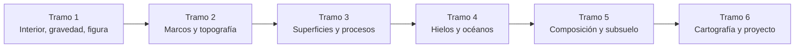

# B53 — Astrogeología y geodesia planetaria

> **Bloque ampliado (`0.2.0`).** Tiene 30 clases: las 20 de la línea base (`B53-C01` a `B53-C20`) y 10 programadas en la ampliación (`B53-C21` a `B53-C30`). Ver el [programa completo](../../PROGRAMA_ACADEMICO_COMPLETO.md).

**Programa:** Programa Integral de Astronomía, Astrofísica, Ciencias Espaciales e Ingeniería Aeroespacial
**Área:** A05 — Ciencias planetarias, astroquímica y habitabilidad
**Nivel:** N3 (fundamentos disciplinares) · **Clases:** 30 · **Carga:** por calibrar con el uso
**Estado:** guía pedagógica del bloque (resumen de qué se aprende en cada clase). Las clases enlazadas en la tabla están redactadas; todas conservan el estado E0 en el catálogo hasta registrar revisión disciplinar.

## 🎯 Propósito del bloque

Enseña **cómo se conoce y se mide la forma, el interior y la superficie de un cuerpo rocoso o helado**: el interior de capas y su presión, la sismología y la gravedad, la figura de referencia (geoide, elipsoide) y los marcos de coordenadas de la Luna y de Marte, la topografía por altimetría, el conteo de cráteres, la estratigrafía y la geología de impacto, el vulcanismo y la tectónica, la mecánica del hielo y los mundos oceánicos (Europa y Encélado), las superficies de asteroides, la mineralogía espectral y el radar de subsuelo, y por último la cartografía digital con su incertidumbre y su publicación. Cada clase cierra con un laboratorio en Python que contrasta con un caso analítico, dos vías independientes o una simulación con semilla fija, y distingue lo consultado de lo sintético.

## 📚 Al terminar el bloque podrás

1. Construir y verificar un modelo de capas de un planeta y relacionar sus observables (masa, inercia, sismos, gravedad) con su estructura.
2. Distinguir marco, figura de referencia y convención de coordenadas en la Luna y en Marte, y transformar entre ellos.
3. Estimar topografía, pendientes y errores de órbita con altimetría y modelos digitales de elevación.
4. Contar cráteres con un estimador con incertidumbre y ordenar unidades con estratigrafía.
5. Aplicar leyes de escala de impactos, flujo de lava, flexión de la litosfera y reología del hielo.
6. Explicar la evidencia de océanos subsuperficiales (Europa, Encélado) y los límites de cada método.
7. Producir y publicar un mapa geológico digital con metadatos, leyenda accesible e incertidumbre declarada.

## 🧭 Secuencia del bloque

**Descripción textual.** Seis tramos encadenados: interior, gravedad y figura (C01–C04, C28); marcos de referencia y topografía (C05–C07, C21, C25); superficies, impactos y procesos (C08–C12, C16, C22); hielos y mundos oceánicos (C13–C15, C23, C24, C27); composición y subsuelo (C17, C29, C30); y cartografía y proyecto (C18–C20, C26). Los IDs conservan el orden del catálogo; la lectura sigue los tramos.

## 🗂️ Las 30 clases en resumen

**Navegación:** cada clase enlaza a la anterior, a la siguiente y a este bloque, en el orden numérico del catálogo.

La columna «Evidencia» indica el producto que demostrará el aprendizaje. Los laboratorios usan datos **sintéticos** o **ilustrativos** (rotulados) o valores publicados con fuente y fecha.

### Tramo 1 · Interior, gravedad y figura

| ID | Clase | Qué se aprende | Evidencia |
|---|---|---|---|
| [B53-C01](../clases/B53/B53-C01-interior-de-planetas-rocosos/CLASE.md) | Interior de planetas rocosos | Masa, presión e inercia de un modelo de dos capas. | Ficha del interior de un planeta sintético |
| [B53-C02](../clases/B53/B53-C02-sismologia-planetaria/CLASE.md) | Sismología planetaria | Rayo sísmico, tiempo de viaje y distancia por S−P con su error. | Ficha de la distancia sísmica y su incertidumbre |
| [B53-C03](../clases/B53/B53-C03-campo-gravitatorio-planetario/CLASE.md) | Campo gravitatorio planetario | Potencial con J2 frente a la suma directa; el error cae como (a/r)⁴. | Ficha del campo gravitatorio de un cuerpo sintético |
| [B53-C04](../clases/B53/B53-C04-geoides-y-elipsoides/CLASE.md) | Geoides y elipsoides | Esferoide de Maclaurin, achatamiento y ondulación del geoide. | Ficha de la figura de equilibrio y su ondulación |
| B53-C28 | Inversión gravimétrica y modelos de densidad | Anomalía de una esfera enterrada, ajuste de profundidad y no unicidad. | Ficha de la inversión gravimétrica |

### Tramo 2 · Marcos de referencia y topografía

| ID | Clase | Qué se aprende | Evidencia |
|---|---|---|---|
| [B53-C05](../clases/B53/B53-C05-sistemas-de-coordenadas-lunares/CLASE.md) | Sistemas de coordenadas lunares | Conversión lat/lon, rotación entre marcos y proyección polar. | Ficha del sistema de coordenadas lunar |
| [B53-C06](../clases/B53/B53-C06-geodesia-de-marte/CLASE.md) | Geodesia de Marte | Latitud planetocéntrica y planetográfica y altura elipsoidal. | Ficha de la geodesia sobre un elipsoide |
| B53-C21 | Rotación y orientación de cuerpos planetarios: polos y meridiano origen | Polo, meridiano origen y matriz de rotación de un cuerpo. | Ficha de orientación de un cuerpo |
| [B53-C07](../clases/B53/B53-C07-topografia-por-altimetria/CLASE.md) | Topografía por altimetría | Cruces de pasadas y estimación de sesgos de órbita. | Ficha del ajuste por cruces de pasadas |
| B53-C25 | Corrección geométrica y ortorrectificación de imágenes planetarias | Desplazamiento por relieve y corrección con un MDE. | Ficha de la ortorrectificación |

### Tramo 3 · Superficies, impactos y procesos

| ID | Clase | Qué se aprende | Evidencia |
|---|---|---|---|
| [B53-C08](../clases/B53/B53-C08-cartografia-de-crateres/CLASE.md) | Cartografía de cráteres | Estimación de la pendiente de la distribución de tamaños de cráteres. | Ficha de la distribución de tamaños de cráteres |
| [B53-C09](../clases/B53/B53-C09-estratigrafia-planetaria/CLASE.md) | Estratigrafía planetaria | Orden topológico, contradicciones y densidad de cráteres. | Ficha de la secuencia estratigráfica |
| [B53-C10](../clases/B53/B53-C10-geologia-de-impacto/CLASE.md) | Geología de impacto | Escalamiento del cráter con la gravedad y presión de choque. | Ficha del escalamiento de un impacto |
| B53-C22 | Meteorización espacial: micrometeoritos, viento solar y maduración del regolito | Enrojecimiento por maduración y mezcla por micrometeoritos. | Ficha de maduración del regolito |
| [B53-C11](../clases/B53/B53-C11-vulcanismo-extraterrestre/CLASE.md) | Vulcanismo extraterrestre | Perfil de velocidad de una lámina de lava, gravedad y espesor máximo. | Ficha del flujo de lava y la gravedad |
| [B53-C12](../clases/B53/B53-C12-tectonica-planetaria/CLASE.md) | Tectónica planetaria | Flexión de una placa elástica y contracción global. | Ficha de la flexión de la litosfera y la contracción |
| [B53-C16](../clases/B53/B53-C16-superficies-de-asteroides/CLASE.md) | Superficies de asteroides | Gravedad efectiva con rotación, período límite y velocidad de escape. | Ficha de la gravedad en un asteroide |

### Tramo 4 · Hielos y mundos oceánicos

| ID | Clase | Qué se aprende | Evidencia |
|---|---|---|---|
| [B53-C13](../clases/B53/B53-C13-geomorfologia-de-hielos/CLASE.md) | Geomorfología de hielos | Presión de vapor del hielo, sublimación y trampas frías. | Ficha de la estabilidad del hielo superficial |
| B53-C23 | Mecánica de hielo: reología, fracturas y deformación | Ley de Glen, dependencia con la temperatura y profundidad de grietas. | Ficha de la reología del hielo |
| [B53-C14](../clases/B53/B53-C14-geologia-de-europa/CLASE.md) | Geología de Europa | Espesor de la capa de hielo por flujo de calor y número de Rayleigh. | Ficha del espesor de la capa de hielo |
| [B53-C15](../clases/B53/B53-C15-geologia-de-encelado/CLASE.md) | Geología de Encélado | Velocidad de escape, fracción de granos que escapa y alturas balísticas. | Ficha de la dinámica de un penacho |
| B53-C27 | Detección remota de océanos subsuperficiales: inducción magnética, libración y radar | Profundidad de penetración magnética y libración de la capa de hielo. | Ficha de la evidencia de un océano |
| B53-C24 | Sondeo radar de penetración de hielo | Retraso, resolución y compresión de pulso en hielo. | Ficha del sondeo de hielo |

### Tramo 5 · Composición y subsuelo

| ID | Clase | Qué se aprende | Evidencia |
|---|---|---|---|
| [B53-C17](../clases/B53/B53-C17-mineralogia-espectral/CLASE.md) | Mineralogía espectral | Remoción del continuo, profundidad y centro de banda. | Ficha de una banda de absorción |
| B53-C29 | Imágenes hiperespectrales de superficies planetarias | Mezcla lineal, desmezclado y ángulo espectral. | Ficha del desmezclado espectral |
| B53-C30 | Radar de penetración subsuperficial en cuerpos planetarios | Coeficiente de reflexión, hipérbola de difracción y ajuste de velocidad. | Ficha del radar de subsuelo |

### Tramo 6 · Cartografía y proyecto

| ID | Clase | Qué se aprende | Evidencia |
|---|---|---|---|
| [B53-C18](../clases/B53/B53-C18-cartografia-geologica-digital/CLASE.md) | Cartografía geológica digital | Áreas en proyecciones y topología de polígonos. | Ficha del mapa geológico digital |
| B53-C26 | Publicación de mapas geológicos planetarios: estándares y leyendas | Escala, unidad mínima cartografiable, contraste de leyenda y metadatos. | Ficha de publicación del mapa |
| [B53-C19](../clases/B53/B53-C19-incertidumbre-en-mapas-planetarios/CLASE.md) | Incertidumbre en mapas planetarios | Propagación de errores de posición y de medición a diámetro y área. | Ficha de incertidumbre de un mapa |
| [B53-C20](../clases/B53/B53-C20-proyecto-sig-de-terreno-extraterrestre/CLASE.md) | Proyecto SIG de terreno extraterrestre | Pendiente de un MDE, sombreado y máscara de transitabilidad. | Ficha del proyecto SIG de terreno |

## 🧵 Hilos que atraviesan el bloque

- **De la observación a la inferencia:** masa, tiempos de llegada, alturas y espectros son datos; capas, océanos y edades son inferencias con incertidumbre. Cada clase separa ambos niveles.
- **Marco y convención:** latitud, longitud, altura y escala siempre se declaran con su marco y su figura de referencia (C04–C06, C21, C25, C26).
- **Ley de potencias y escala:** los cráteres (C08, C10), la reología del hielo (C23) y la flexión (C12) se entienden con exponentes y escalas.
- **Incertidumbre:** C07, C08, C19 y C28 propagan o estiman errores; C26 obliga a declararlos al publicar.
- **Observado frente a sintético:** los laboratorios usan modelos y datos sintéticos rotulados; nada simulado se presenta como observado.

## 📝 Evaluación del bloque (propuesta, por calibrar)

- Fichas y ejercicios por clase, con retroalimentación y recuperación con evidencia distinta.
- Portafolio: ficha del sistema de coordenadas (C05), ficha de la distribución de tamaños de cráteres (C08) y ficha del proyecto SIG de terreno (C20).
- Las condiciones críticas (rotular lo sintético e ilustrativo, declarar marco y convención, no presentar un modelo como un cuerpo real y citar solo lo consultado) no se compensan con promedio.

## ⚠️ Seguridad y límites

El bloque es educativo. Los modelos son simplificados (capas homogéneas, placas elásticas, leyes de escala ilustrativas) y no sustituyen a los productos de una misión, a los modelos geodésicos oficiales ni a la literatura primaria. Los coeficientes y parámetros ilustrativos no son valores publicados. El bloque no entrega ni valida mapas para planificar operaciones reales.

## 📖 Fuentes consultadas en el bloque (resumen)

Las clases citan, con localizador, qué respalda cada fuente, fecha de consulta (2026-11-09) y estado. Se consultaron páginas institucionales: NIST (constante gravitatoria, CODATA 2022), el nodo de Geociencias del PDS (página de datos de MOLA), el Astrogeology Science Center del USGS y páginas de NASA Science sobre Cassini (Encélado), InSight, OSIRIS-REx, Lunar Reconnaissance Orbiter, Europa Clipper (instrumentos) y Mars Reconnaissance Orbiter. Son páginas de contexto: no dan valores numéricos que el bloque use salvo `G`. El informe del grupo de trabajo de la IAU sobre coordenadas cartográficas y elementos de rotación **no se consultó** (la página redirige a un inicio de sesión), así que ningún valor de rotación o de radio del bloque procede de él. Los radios, gravedades, coeficientes de escala y propiedades de materiales son sintéticos o ilustrativos y están rotulados en cada clase.

## Fuentes de orientación preliminar

- **[NASA-PDS]** [NASA Planetary Data System](https://pds.nasa.gov/) — Archivo de datos de misiones y ciencias planetarias.
- **[USGS]** [USGS Astrogeology Science Center](https://www.usgs.gov/centers/astrogeology-science-center) — Cartografía, geología y sistemas de referencia de superficies planetarias.
- **[COSPAR]** [Committee on Space Research](https://cosparhq.cnes.fr/) — Protección planetaria y cooperación en investigación espacial.
- **[NASA-EO]** [NASA Earthdata](https://www.earthdata.nasa.gov/) — Datos abiertos de observación de la Tierra.

> La asociación de estas fuentes es orientativa por bloque. Las fuentes realmente consultadas para cada afirmación se registran en la sección 11 de cada clase.

[🏠 Volver al programa](../../README.md) · [➡️ B54 — Atmósferas y climatología planetaria](./B54-atmosferas-y-climatologia-planetaria.md)
