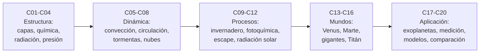

# B54 — Atmósferas y climatología planetaria

**Programa:** Programa Integral de Astronomía, Astrofísica, Ciencias Espaciales e Ingeniería Aeroespacial
**Área:** A05 — Ciencias planetarias, astroquímica y habitabilidad
**Nivel:** N3 (fundamentos disciplinares) · **Clases:** 20 · **Carga:** por calibrar con el uso
**Estado:** guía pedagógica del bloque (resumen de qué se aprende en cada clase). Las clases enlazadas en la tabla están redactadas; todas conservan el estado E0 en el catálogo hasta registrar revisión disciplinar.

## 🎯 Propósito del bloque

Enseña **cómo una atmósfera planetaria se organiza y cómo se calcula su clima**: cómo cambian la presión, la temperatura y la composición con la altura; qué fija la temperatura de un mundo (balance de energía, efecto invernadero, convección, circulación, nubes, química y escape); y cómo se aplican esas ideas a Venus, Marte, los planetas gigantes, Titán y los exoplanetas, y a las observaciones remotas y los modelos con que se estudian. Cada clase cierra con un cálculo que se verifica contra un caso analítico o contra una ficha publicada, con fuente y fecha de consulta.

## 📚 Al terminar el bloque podrás

1. Describir la estructura vertical de una atmósfera con el equilibrio hidrostático y calcular altura de escala, presión y densidad.
2. Obtener la masa molar media de una atmósfera y la temperatura de equilibrio radiativo de un planeta, y medir cuánto la supera la temperatura superficial.
3. Distinguir cuándo manda la radiación y cuándo la convección, con el gradiente adiabático y el criterio de estabilidad.
4. Estimar los efectos de la rotación (Coriolis, Rossby), la energía de una tormenta convectiva y la sedimentación de partículas.
5. Modelar el efecto invernadero con una atmósfera gris y la capa de producción fotoquímica de Chapman.
6. Calcular la velocidad de escape y el parámetro de Jeans, y la insolación de un planeta.
7. Comparar con cálculos propios las atmósferas de Venus, Marte, Júpiter y Titán.
8. Plantear el clima de un exoplaneta, una medición remota (funciones de peso, ocultación) y un modelo de balance de energía con retroalimentación hielo–albedo.
9. Comparar condiciones climáticas de varios mundos sin confundir una condición necesaria con la habitabilidad.

## 🧭 Secuencia del bloque

**Descripción textual.** Cinco tramos encadenados: la estructura de una atmósfera (C01–C04), el transporte y los movimientos que la agitan (C05–C08), los procesos de radiación, química y escape que fijan temperatura y composición (C09–C12), cuatro casos de estudio de mundos distintos (C13–C16) y la aplicación a exoplanetas, a la medición remota, a los modelos climáticos y a una comparación final (C17–C20).

## 🗂️ Las 20 clases en resumen

**Navegación:** cada clase desarrollada enlaza a la anterior, a la siguiente y a este bloque; mientras una clase siga solo programada, su enlace lleva a su fila en esta tabla.

La columna «Evidencia» indica el producto que demostrará el aprendizaje. Los laboratorios usan datos **sintéticos** o **ilustrativos** (rotulados) o valores publicados con fuente y fecha de consulta.

### Tramo 1 · Estructura de una atmósfera

| ID | Clase | Qué se aprende | Evidencia |
|---|---|---|---|
| B54-C01 | Estructura vertical de atmósferas | Equilibrio hidrostático por capas, gradientes de temperatura, tropopausa y mesopausa. | Perfil de presión y temperatura por capas |
| B54-C02 | Composición química atmosférica | Masa molar media, fracciones por volumen y altura de escala de cinco atmósferas. | Tabla de composición y altura de escala |
| B54-C03 | Equilibrio radiativo | Temperatura de equilibrio, albedo de Bond y exceso de la temperatura observada. | Tabla de equilibrio de cuatro planetas |
| B54-C04 | Presión y densidad | Gas ideal, columna de masa, atmósfera isoterma y su integración numérica. | Ficha de presión y densidad |

### Tramo 2 · Dinámica y agitación de la atmósfera

| ID | Clase | Qué se aprende | Evidencia |
|---|---|---|---|
| B54-C05 | Transporte convectivo | Gradiente adiabático, criterio de estabilidad y frecuencia de flotabilidad. | Informe de estabilidad de una capa |
| B54-C06 | Circulación general planetaria | Coriolis, balance geostrófico, número de Rossby y escala de la celda de Hadley. | Ficha de rotación y circulación |
| B54-C07 | Dinámica de tormentas | CAPE, velocidad máxima de una corriente ascendente y su límite. | Ficha de energía convectiva de un sondeo sintético |
| B54-C08 | Nubes y aerosoles | Clausius–Clapeyron, nivel de condensación y sedimentación de Stokes. | Ficha de condensación y sedimentación |

### Tramo 3 · Procesos que fijan temperatura y composición

| ID | Clase | Qué se aprende | Evidencia |
|---|---|---|---|
| B54-C09 | Efecto invernadero | Atmósfera gris, profundidad óptica equivalente y capa absorbente. | Tabla de invernadero de tres planetas |
| B54-C10 | Fotoquímica atmosférica | Capa de Chapman, tasa de fotólisis, vida fotoquímica y equilibrio. | Ficha de una capa fotoquímica sintética |
| B54-C11 | Escape atmosférico | Velocidad de escape, parámetro de Jeans y escape térmico relativo. | Tabla de escape por especie |
| B54-C12 | Interacción con radiación solar | Inverso del cuadrado, insolación diaria, Beer–Lambert y seguridad al observar el Sol. | Ficha de insolación y atenuación |

### Tramo 4 · Cuatro mundos

| ID | Clase | Qué se aprende | Evidencia |
|---|---|---|---|
| B54-C13 | Atmósfera de Venus | Adiabata de CO₂, estructura hasta 1 bar y masa atmosférica. | Ficha de la atmósfera de Venus |
| B54-C14 | Atmósfera de Marte | Masa, ciclo estacional del CO₂ y temperatura de escarcha. | Ficha de la atmósfera de Marte |
| B54-C15 | Atmósferas de gigantes gaseosos | Altura de escala de H₂/He, balance de Júpiter y adiabata profunda. | Ficha de la atmósfera de Júpiter |
| B54-C16 | Atmósferas de Titán | Gravedad, altura de escala, columna y balance de una atmósfera de N₂ y CH₄. | Ficha de la atmósfera de Titán |

### Tramo 5 · Aplicación

| ID | Clase | Qué se aprende | Evidencia |
|---|---|---|---|
| B54-C17 | Clima exoplanetario | Instalación estelar, temperatura de equilibrio y redistribución de calor. | Ficha climática de un exoplaneta sintético |
| B54-C18 | Medición remota atmosférica | Funciones de peso, sondeo en el nadir y ocultación con ruido. | Informe de un sondeo sintético |
| B54-C19 | Modelos climáticos planetarios | Balance de energía de dimensión cero, retroalimentación hielo–albedo e histéresis. | Modelo de balance de energía validado |
| B54-C20 | Comparación de habitabilidad climática | Condiciones necesarias para agua líquida y comparación de cuatro mundos. | Tabla comparativa de condiciones climáticas |

## 🧵 Hilos que atraviesan el bloque

- **Balance de energía:** C03 lo plantea, C09 lo corrige con el invernadero, C12 lo alimenta con la insolación, C17 lo traslada a otras estrellas y C19 lo convierte en un modelo.
- **Equilibrio hidrostático y altura de escala:** C01, C02 y C04 lo establecen; reaparece en cada mundo (C13–C16) y en la medición remota (C18).
- **Fichas publicadas como referencia independiente:** las fichas de la NASA sirven de contraste en cada laboratorio; cuando no coinciden, el desacuerdo se discute (por ejemplo, el albedo implícito de la Tierra en C03).
- **Lo condicional:** las cifras sintéticas o ilustrativas se rotulan como tales; ningún modelo del bloque predice el clima de un planeta real.

## 📝 Evaluación del bloque (propuesta, por calibrar)

- Fichas y ejercicios por clase, con retroalimentación y recuperación con evidencia distinta.
- Portafolio: el modelo de balance de energía validado (C19) y la tabla comparativa final (C20), cada uno con sus supuestos y límites.
- Las condiciones críticas (rotular lo ilustrativo y sintético, no presentar un resultado de modelo como medición y citar solo lo consultado) no se compensan con promedio.

## ⚠️ Seguridad y límites

El bloque es educativo. Los modelos son simplificados (columnas uniformes, gas ideal, sin nubes ni transporte salvo donde se indique) y no sustituyen a los modelos de circulación general ni a la literatura primaria. Las clases no predicen el tiempo ni el clima de ningún lugar, y la comparación de habitabilidad solo ordena condiciones necesarias: no afirma que algún mundo sea o no habitable. En observación solar (C12) nunca se mira el Sol sin filtro certificado.

## 📖 Fuentes consultadas en el bloque (resumen)

Las clases citan, con localizador, qué respalda cada fuente, fecha de consulta (2026-11-09) y estado. Se consultaron las fichas de datos de la NASA/NSSDC para Venus, Marte, la Tierra, Júpiter y los satélites de Saturno (Titán), la página de hechos de Titán de NASA Science, las constantes k, N_A, G y σ de NIST (CODATA 2022), el resumen de Kopparapu et al. (2013, arXiv:1301.6674) y el resumen de la U.S. Standard Atmosphere, 1976 en NTRS. No se consultaron el texto completo de la atmósfera estándar (sus gradientes se usan solo como parámetros del modelo), los artículos de Huygens y de forzamiento radiativo (acceso denegado o redirigido) ni los valores estándar de calores latentes, calores específicos y masas atómicas, que se rotulan «no consultado» donde aparecen. Las cifras sintéticas o ilustrativas están rotuladas como tales en cada clase.

## Fuentes de orientación preliminar

- **[NASA-PDS]** [NASA Planetary Data System](https://pds.nasa.gov/) — Archivo de datos de misiones y ciencias planetarias.
- **[USGS]** [USGS Astrogeology Science Center](https://www.usgs.gov/centers/astrogeology-science-center) — Cartografía, geología y sistemas de referencia de superficies planetarias.
- **[COSPAR]** [Committee on Space Research](https://cosparhq.cnes.fr/) — Protección planetaria y cooperación en investigación espacial.
- **[NASA-EO]** [NASA Earthdata](https://www.earthdata.nasa.gov/) — Datos abiertos de observación de la Tierra.

> La asociación de estas fuentes es orientativa por bloque. No significa que cada afirmación de una futura clase esté respaldada todavía. Comprobar documentos, versiones y licencias antes de desarrollar contenido.

[🏠 Volver al programa](../../README.md) · [⬅️ B53 — Astrogeología y geodesia planetaria](./B53-astrogeologia-y-geodesia-planetaria.md) · [➡️ B55 — Astroquímica y geoquímica extraterrestre](./B55-astroquimica-y-geoquimica-extraterrestre.md)
