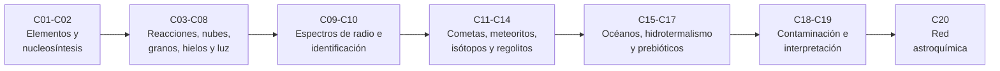

# B55 — Astroquímica y geoquímica extraterrestre

**Programa:** Programa Integral de Astronomía, Astrofísica, Ciencias Espaciales e Ingeniería Aeroespacial
**Área:** A05 — Ciencias planetarias, astroquímica y habitabilidad
**Nivel:** N3 (fundamentos disciplinares) · **Clases:** 20 · **Carga:** por calibrar con el uso
**Estado:** guía pedagógica del bloque (resumen de qué se aprende en cada clase). Las clases enlazadas en la tabla están redactadas; todas conservan el estado E0 en el catálogo hasta registrar revisión disciplinar.

## 🎯 Propósito del bloque

Enseña **cómo se lee la química del cosmos**: de qué elementos está hecho el universo y cómo se forjaron, qué reacciones ocurren entre estrellas (en gas, sobre granos de polvo y en hielos, bajo luz ultravioleta), cómo se identifican las moléculas por sus líneas de radio y cómo esa misma química se reencuentra en cometas, meteoritos, regolitos y océanos bajo el hielo. Cierra con la pregunta delicada: qué puede y qué no puede concluirse de una firma química, y cómo evitar que la contaminación de una muestra la falsee. Cada clase termina con un cálculo verificable contra un caso analítico o una referencia independiente.

## 📚 Al terminar el bloque podrás

1. Convertir abundancias logarítmicas en fracciones en número y en masa, y calcular energías de enlace y balances de reacción nuclear.
2. Plantear velocidades de reacción en el medio interestelar y resolver redes pequeñas hasta su estado estacionario.
3. Explicar el papel de los granos, los hielos y la catálisis en superficie, y la fotodisociación con apantallamiento.
4. Predecir frecuencias de rotación de moléculas lineales y emparejar líneas observadas con un catálogo, estimando coincidencias por azar.
5. Aplicar modelos sencillos de coma cometaria, de normalización y mezcla de meteoritos, de trazadores isotópicos y de jardinería del regolito.
6. Plantear el equilibrio ácido–base de un océano interno, el balance de la serpentinización y la supervivencia de compuestos prebióticos a la radiación.
7. Cuantificar la contaminación de una muestra y razonar con probabilidades sobre una firma química.
8. Construir y verificar una red astroquímica mínima que conserva los elementos.

## 🧭 Secuencia del bloque

**Descripción textual.** Siete tramos encadenados: el inventario de elementos y su origen (C01–C02); la química del medio interestelar, desde las reacciones hasta la luz ultravioleta (C03–C08); la lectura de esa química con radiotelescopios (C09–C10); los materiales del Sistema Solar que la conservan (C11–C14); los mundos con agua líquida interna y los compuestos prebióticos (C15–C17); la prudencia metodológica sobre contaminación e interpretación (C18–C19); y un modelo integrador (C20).

## 🗂️ Las 20 clases en resumen

**Navegación:** cada clase desarrollada enlaza a la anterior, a la siguiente y a este bloque; mientras una clase siga solo programada, su enlace lleva a su fila en esta tabla.

La columna «Evidencia» indica el producto que demostrará el aprendizaje. Los laboratorios usan datos **sintéticos** o **ilustrativos** (rotulados), o valores publicados con fuente y fecha (catálogo JPL de líneas espectrales, constantes y composiciones isotópicas del NIST).

### Tramo 1 · Elementos y su origen

| ID | Clase | Qué se aprende | Evidencia |
|---|---|---|---|
| [B55-C01](../clases/B55/B55-C01-abundancia-quimica-cosmica/CLASE.md) | Abundancia química cósmica | Escala logarítmica `log ε`, fracciones en número y en masa (`X`, `Y`, `Z`). | Ficha de composición de una mezcla |
| [B55-C02](../clases/B55/B55-C02-nucleosintesis-y-elementos/CLASE.md) | Nucleosíntesis y elementos | Energía de enlace por nucleón, pico del hierro y energía de reacciones de quemado. | Tabla de energía de enlace y reacciones |

### Tramo 2 · Química del medio interestelar

| ID | Clase | Qué se aprende | Evidencia |
|---|---|---|---|
| [B55-C03](../clases/B55/B55-C03-reacciones-en-medio-interestelar/CLASE.md) | Reacciones en medio interestelar | Coeficientes de tipo Arrhenius, reacciones ion–molécula y escalas de tiempo. | Ficha de una reacción con su escala de tiempo |
| [B55-C04](../clases/B55/B55-C04-quimica-de-nubes-moleculares/CLASE.md) | Química de nubes moleculares | Ionización por rayos cósmicos y estado estacionario de `H3+`. | Estacionario de una mini-nube |
| [B55-C05](../clases/B55/B55-C05-granos-de-polvo-interestelar/CLASE.md) | Granos de polvo interestelar | Distribución de tamaños en ley de potencias, superficie y sección eficaz por hidrógeno. | Ficha de la población de granos |
| [B55-C06](../clases/B55/B55-C06-hielos-astrofisicos/CLASE.md) | Hielos astrofísicos | Densidad de columna a partir de una banda infrarroja de absorción. | Densidad de columna de una banda sintética |
| [B55-C07](../clases/B55/B55-C07-catalisis-en-superficies/CLASE.md) | Catálisis en superficies | Salto térmico, difusión sobre el grano y ventana de temperatura para `H2`. | Ventana de formación de `H2` |
| [B55-C08](../clases/B55/B55-C08-fotoquimica-cosmica/CLASE.md) | Fotoquímica cósmica | Fotodisociación, extinción y apantallamiento por polvo. | Perfil de tasa frente a `A_V` |

### Tramo 3 · Leer la química con radio

| ID | Clase | Qué se aprende | Evidencia |
|---|---|---|---|
| [B55-C09](../clases/B55/B55-C09-espectros-moleculares-de-radio/CLASE.md) | Espectros moleculares de radio | Rotor rígido, frecuencias de CO y HCN y velocidad Doppler. | Comparación rotor rígido–catálogo |
| [B55-C10](../clases/B55/B55-C10-identificacion-de-moleculas-organicas/CLASE.md) | Identificación de moléculas orgánicas | Emparejado de líneas con catálogo y coincidencias por azar. | Informe de asignación con tasa de falsos positivos |

### Tramo 4 · Cometas, meteoritos, isótopos y regolitos

| ID | Clase | Qué se aprende | Evidencia |
|---|---|---|---|
| [B55-C11](../clases/B55/B55-C11-quimica-en-cometas/CLASE.md) | Química en cometas | Modelo de Haser para padres e hijos en la coma. | Perfil de densidad de columna de una coma sintética |
| [B55-C12](../clases/B55/B55-C12-geoquimica-de-meteoritos/CLASE.md) | Geoquímica de meteoritos | Normalización, cocientes y norma mineral por mínimos cuadrados. | Norma mineral de un meteorito sintético |
| [B55-C13](../clases/B55/B55-C13-isotopos-como-trazadores/CLASE.md) | Isótopos como trazadores | Notación `δ`, mezcla de reservorios y fraccionamiento dependiente de la masa. | Ficha isotópica de una mezcla |
| [B55-C14](../clases/B55/B55-C14-quimica-de-regolitos/CLASE.md) | Química de regolitos | Jardinería por impactos y mezcla de componentes. | Perfil de volteo de un regolito sintético |

### Tramo 5 · Océanos internos y compuestos prebióticos

| ID | Clase | Qué se aprende | Evidencia |
|---|---|---|---|
| [B55-C15](../clases/B55/B55-C15-quimica-de-oceanos-internos/CLASE.md) | Química de océanos internos | Equilibrio carbonato–pH con balance de carga. | pH de un océano sintético |
| B55-C16 | Procesos hidrotermales extraterrestres | Estequiometría de la serpentinización y energía disponible. | Balance de `H2` de una roca sintética |
| B55-C17 | Compuestos prebióticos | Supervivencia a la radiólisis y exceso enantiomérico con incertidumbre. | Ficha de supervivencia de un aminoácido |

### Tramo 6 · Contaminación e interpretación

| ID | Clase | Qué se aprende | Evidencia |
|---|---|---|---|
| B55-C18 | Contaminación de muestras | Sustracción de blanco, límite de detección y propagación de incertidumbre. | Informe de blanco y límite de detección |
| B55-C19 | Interpretación de firmas químicas | Razonamiento bayesiano, verosimilitud y sensibilidad al prior. | Ficha de interpretación con prior explícito |

### Tramo 7 · Modelo integrador

| ID | Clase | Qué se aprende | Evidencia |
|---|---|---|---|
| B55-C20 | Modelo simplificado de red astroquímica | Red mínima con conservación de elementos y comprobación del estacionario. | Red astroquímica verificada |

## 🧵 Hilos que atraviesan el bloque

- **Escalas de tiempo:** C03, C04, C07, C08 y C17 comparan tiempos de reacción, difusión, destrucción por luz y radiólisis con la vida de una nube o de un cuerpo.
- **De la reacción al espectro:** C03–C08 producen moléculas; C09–C10 explican cómo se detectan.
- **Del medio interestelar al Sistema Solar:** C11–C14 retoman los materiales que conservan esa química, con los isótopos (C13) como trazador común.
- **Prudencia metodológica:** C10, C18 y C19 insisten en probabilidades de falso positivo, blancos y priores explícitos.
- **Verificación independiente:** cada laboratorio contrasta con un caso analítico o una referencia, y detiene la ejecución si falla.

## 📝 Evaluación del bloque (propuesta, por calibrar)

- Fichas y ejercicios por clase, con retroalimentación y recuperación con evidencia distinta.
- Portafolio: la red astroquímica verificada (C20) con su comprobación de conservación y de estado estacionario.
- Las condiciones críticas (rotular lo sintético, ilustrativo y simulado; no presentar un resultado de modelo como observado; citar solo lo consultado; no afirmar vida a partir de una firma química) no se compensan con promedio.

## ⚠️ Seguridad y límites

El bloque es educativo. Las redes y los modelos son mínimos y sus coeficientes, salvo los marcados, son **ilustrativos**: no sustituyen a las bases de datos cinéticas ni a la literatura primaria. Ninguna clase afirma haber detectado una molécula, un compuesto prebiótico ni vida: los espectros y las muestras de los laboratorios son sintéticos, y las frecuencias de referencia proceden del catálogo JPL. La manipulación real de muestras extraterrestres y la protección planetaria se rigen por la política vigente del COSPAR y la normativa de cada agencia, no por estas clases.

## 📖 Fuentes consultadas en el bloque (resumen)

Las clases citan, con localizador, qué respalda cada fuente, fecha de consulta (2026-11-09) y estado. Se consultaron de verdad: las constantes y composiciones isotópicas del NIST (CODATA 2022); los archivos de líneas y la documentación del catálogo JPL de líneas espectrales para CO, HCN, HCO+ y H2CO; la política de protección planetaria del COSPAR (página institucional, sin el texto completo de las categorías); y los resúmenes (vía la API de arXiv o PubMed) de Asplund et al. 2009, McGuire 2021, Cowan et al. 2021, Kobayashi et al. 2020, McElroy et al. 2013 (UMIST), Heays et al. 2017, Draine 2003, Boogert et al. 2015, Rubin et al. 2019, Zhao et al. 2022, Waite et al. 2017 y Hsu et al. 2015 (estos dos últimos con el resumen truncado). No se consultaron, por error de acceso del servidor, Alexander et al. 2012, Altwegg et al. 2015 ni la publicación de nucleobases en meteoritos de Callahan et al. 2011: no se citan como fuente. Los coeficientes cinéticos, las energías de enlace de superficie y demás parámetros de modelo son ilustrativos y están rotulados en cada clase.

## Fuentes de orientación preliminar

- **[NASA-PDS]** [NASA Planetary Data System](https://pds.nasa.gov/) — Archivo de datos de misiones y ciencias planetarias.
- **[USGS]** [USGS Astrogeology Science Center](https://www.usgs.gov/centers/astrogeology-science-center) — Cartografía, geología y sistemas de referencia de superficies planetarias.
- **[COSPAR]** [Committee on Space Research](https://cosparhq.cnes.fr/) — Protección planetaria y cooperación en investigación espacial.
- **[NASA-EO]** [NASA Earthdata](https://www.earthdata.nasa.gov/) — Datos abiertos de observación de la Tierra.

> La asociación de estas fuentes es orientativa por bloque. Las fuentes realmente consultadas para cada afirmación se registran en la sección 11 de cada clase.

[🏠 Volver al programa](../../README.md) · [➡️ B56 — Astrobiología y vida extraterrestre](./B56-astrobiologia-y-vida-extraterrestre.md)
