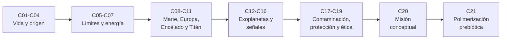

# B56 — Astrobiología y vida extraterrestre

> **Bloque ampliado (`0.2.0`).** Además de las 20 clases de la malla base, el bloque tiene 1 clase programada por la ampliación (`B56-C21`), redactada y listada en el tramo 7. Ver el [programa completo](../../PROGRAMA_ACADEMICO_COMPLETO.md).

**Programa:** Programa Integral de Astronomía, Astrofísica, Ciencias Espaciales e Ingeniería Aeroespacial
**Área:** A05 — Ciencias planetarias, astroquímica y habitabilidad
**Nivel:** N3 (fundamentos disciplinares) · **Clases:** 20 + 1 de la ampliación · **Carga:** por calibrar con el uso
**Estado:** guía pedagógica del bloque (resumen de qué se aprende en cada clase). Las clases enlazadas en la tabla ya están redactadas; todas conservan el estado E0 en el catálogo hasta registrar revisión disciplinar. La clase `B56-C21` (ampliación `0.2.0`) también está redactada y conserva el mismo estado.

## 🎯 Propósito del bloque

Enseña **cómo se plantea científicamente la pregunta «¿hay vida fuera de la Tierra?»**: qué se entiende por vida de forma operativa, qué química y qué energía necesita, cómo se originó (según las hipótesis), dónde podría existir en el Sistema Solar y en otros sistemas, qué señales podrían delatarla, cómo se evita confundirlas con procesos sin vida y cómo se protege tanto a los otros mundos como a la Tierra. Cada clase cierra con un cálculo verificable contra una forma cerrada o una segunda vía independiente, con datos publicados citados con fecha o con datos sintéticos rotulados como tales.

## 📚 Al terminar el bloque podrás

1. Aplicar una definición operativa de vida a casos límite y decir qué criterio decide cada caso.
2. Balancear reacciones metabólicas y calcular su energía libre a partir de concentraciones.
3. Estimar cuánta información puede mantener una molécula que se copia con errores y cuánto espacio de secuencias puede explorar un mundo.
4. Contrastar las condiciones de un ambiente con los límites de replicación de microorganismos terrestres y con las fases del agua.
5. Calcular gravedad, velocidad de escape, escalas de altura y volúmenes de océanos de Marte, Europa, Encélado y Titán a partir de masa y radio publicados.
6. Calcular el borde de la zona habitable y la señal de una atmósfera en tránsito.
7. Razonar con probabilidades sobre un falso positivo, y con cantidades de esfuerzo sobre tecnofirmas.
8. Clasificar una misión en las categorías de protección planetaria y comprobar sus presupuestos de carga biológica.
9. Acumular evidencia de forma explícita, y esbozar el presupuesto de una misión astrobiológica conceptual.

## 🧭 Secuencia del bloque

**Descripción textual.** Siete tramos encadenados: qué es la vida y cómo pudo empezar (C01–C04), qué límites y qué energía impone la química (C05–C07), los mundos del Sistema Solar con interés astrobiológico (C08–C11), la búsqueda de señales en exoplanetas y de tecnología (C12–C16), el control de contaminación, la protección planetaria y la ética (C17–C19), el diseño conceptual de una misión (C20) y la ampliación `0.2.0` sobre polimerización prebiótica experimental (C21).

## 🗂️ Las 21 clases en resumen (20 de la malla base + 1 de la ampliación)

**Navegación:** cada clase desarrollada enlaza a la anterior, a la siguiente y a este bloque.

La columna «Evidencia» indica el producto que demostrará el aprendizaje. Los laboratorios usan datos **sintéticos** o **ilustrativos** (rotulados) o valores publicados con fuente y fecha.

### Tramo 1 · Qué es la vida y cómo pudo empezar

| ID | Clase | Qué se aprende | Evidencia |
|---|---|---|---|
| [B56-C01](../clases/B56/B56-C01-definiciones-operativas-de-vida/CLASE.md) | Definiciones operativas de vida | Aplicar criterios (metabolismo, evolución darwiniana, límite) a casos límite y medir cuánto coinciden dos definiciones. | Matriz de casos límite |
| [B56-C02](../clases/B56/B56-C02-bioquimica-y-metabolismo-terrestre/CLASE.md) | Bioquímica y metabolismo terrestre | Composición elemental, balance atómico de la fotosíntesis y la respiración y su energía libre. | Ficha metabólica |
| [B56-C03](../clases/B56/B56-C03-origen-de-moleculas-autorreplicantes/CLASE.md) | Origen de moléculas autorreplicantes | Umbral de error de Eigen y longitud máxima de una molécula que se copia con errores. | Umbral de error de un replicador |
| [B56-C04](../clases/B56/B56-C04-hipotesis-de-abiogenesis/CLASE.md) | Hipótesis de abiogénesis | Tamaño del espacio de secuencias y fracción que explora un ambiente en un tiempo dado. | Comparación de hipótesis con cantidades |

### Tramo 2 · Límites ambientales y energía

| ID | Clase | Qué se aprende | Evidencia |
|---|---|---|---|
| [B56-C05](../clases/B56/B56-C05-extremofilos-y-limites-ambientales/CLASE.md) | Extremófilos y límites ambientales | Modelo de temperatura cardinal y límites de actividad del agua y temperatura de COSPAR. | Ficha de un ambiente frente a los límites |
| B56-C06 | Agua líquida y solventes alternativos | Diagrama de fases, Clausius–Clapeyron y cuándo el agua puede ser líquida. | Decisión de fase en cuatro ambientes |
| B56-C07 | Energía química para la vida | Energía libre de reacción con concentraciones y energía disponible por célula. | Presupuesto energético de un metabolismo |

### Tramo 3 · Mundos del Sistema Solar

| ID | Clase | Qué se aprende | Evidencia |
|---|---|---|---|
| B56-C08 | Habitabilidad de Marte | Gravedad, escape y temperaturas de Marte frente a los límites de replicación. | Ficha de habitabilidad de Marte |
| B56-C09 | Océanos de Europa | Profundidad de un océano a partir de su volumen y presión en el fondo. | Ficha del océano de Europa |
| B56-C10 | Océanos de Encélado | Velocidad de escape, balística de las partículas del penacho y destino del material. | Ficha del penacho de Encélado |
| B56-C11 | Atmósfera y superficie de Titán | Altura de escala, presión hidrostática y retención de gases por el parámetro de Jeans. | Ficha atmosférica de Titán |

### Tramo 4 · Exoplanetas, biofirmas y tecnofirmas

| ID | Clase | Qué se aprende | Evidencia |
|---|---|---|---|
| B56-C12 | Exoplanetas potencialmente habitables | Flujo estelar y borde interno y externo de la zona habitable. | Ficha de habitabilidad de un exoplaneta sintético |
| B56-C13 | Biofirmas químicas | Desequilibrio químico atmosférico como energía libre. | Medida de desequilibrio de una atmósfera |
| B56-C14 | Biofirmas espectrales | Profundidad de tránsito, señal atmosférica y número de tránsitos necesarios. | Presupuesto de señal a ruido |
| B56-C15 | Falsos positivos de biofirmas | Probabilidad posterior de vida dada una detección con falsos positivos. | Tabla de probabilidad posterior |
| B56-C16 | Tecnofirmas y búsqueda SETI | Ecuación del radiómetro, flujo detectable y alcance de una búsqueda de radio. | Ficha de alcance de una búsqueda |

### Tramo 5 · Contaminación, protección planetaria y ética

| ID | Clase | Qué se aprende | Evidencia |
|---|---|---|---|
| B56-C17 | Control de contaminación biológica | Reducción logarítmica de esporas y presupuesto de carga biológica. | Presupuesto de carga biológica |
| B56-C18 | Protección planetaria COSPAR | Categorías I–V, objetivos y probabilidades límite de la política vigente. | Clasificación de misiones |
| B56-C19 | Ética del descubrimiento de vida | Acumulación de evidencia en log-odds y criterios para anunciar o contener. | Protocolo de comunicación de un candidato |

### Tramo 6 · Integración

| ID | Clase | Qué se aprende | Evidencia |
|---|---|---|---|
| B56-C20 | Diseño de misión astrobiológica conceptual | Requisitos, Δv de transferencia, masa de propelente y verificación contra una integración numérica. | Esbozo de misión con presupuesto |

### Tramo 7 · Ampliación `0.2.0`: polimerización prebiótica

| ID | Clase | Qué se aprende | Evidencia |
|---|---|---|---|
| B56-C21 | Polimerización prebiótica experimental: oligómeros y condiciones de laboratorio | Distribución de longitudes de oligómeros (Flory) y efecto de los ciclos húmedo–seco. | Distribución de oligómeros de un experimento sintético |

## 🧵 Hilos que atraviesan el bloque

- **Qué cuenta como vida:** C01 define el criterio; C13–C15 y C19 lo usan para decidir cuándo una señal «cuenta».
- **Energía y agua:** C06 y C07 fijan las condiciones; C08–C11 las aplican a cuatro mundos.
- **Del origen a la química:** C03, C04 y C21 acotan, con cantidades, qué puede lograr una química sin vida.
- **Falsos positivos:** C01, C13, C15, C16 y C19 insisten en que una señal necesita descartar procesos sin vida.
- **Protección:** C05, C17 y C18 relacionan los límites de replicación con la política que protege otros mundos.
- **Verificación independiente:** cada laboratorio contrasta con una forma cerrada, una segunda vía de cálculo o una simulación con semilla fija.

## 📝 Evaluación del bloque (propuesta, por calibrar)

- Fichas y ejercicios por clase, con retroalimentación y recuperación con evidencia distinta.
- Portafolio: la clasificación de misiones (C18) y el esbozo de misión con presupuesto (C20).
- Las condiciones críticas (rotular lo sintético e ilustrativo, no presentar una simulación como observación, no afirmar que existe o no vida en un mundo y citar solo lo consultado) no se compensan con promedio.

## ⚠️ Seguridad y límites

El bloque es educativo. No se afirma que haya o no haya vida en ningún cuerpo; las cifras de los mundos proceden de hojas de datos de la NASA con fecha, y todo lo demás es ilustrativo o sintético. Los modelos son simplificados y no sustituyen a la política vigente de protección planetaria ni a la literatura primaria. Ninguna clase da instrucciones de cultivo de microorganismos ni de manipulación de agentes biológicos.

## 📖 Fuentes consultadas en el bloque (resumen)

Fecha de consulta: 2026-11-09. Se consultó el texto completo (PDF extraído con PyMuPDF) de la *COSPAR Policy on Planetary Protection* (Space Research Today n.º 224, enero de 2026), las constantes de NIST (CODATA 2022), el texto de la Resolución B3 de la IAU 2015 (arXiv:1510.07674) para los valores nominales solares, las hojas de datos planetarios de la NASA/NSSDC (Marte, satélites galileanos y saturninos), las páginas de la NASA sobre astrobiología, Europa, Encélado y Titán, y los resúmenes de Kopparapu et al. (2013), Schwieterman et al. (2018), Meadows et al. (2018), Wright et al. (2014), Alejandre et al. (2025), Simonis et al. (2026), MacKenzie et al. (2022) y Schwander et al. (2023). No se consultaron: Takai et al. (2008), Waite et al. (2017), los valores termodinámicos de tablas ni los coeficientes completos de Kopparapu; esas cifras se rotulan «no consultado» o «ilustrativo» en las clases.

## Fuentes de orientación preliminar

- **[NASA-PDS]** [NASA Planetary Data System](https://pds.nasa.gov/) — Archivo de datos de misiones y ciencias planetarias.
- **[USGS]** [USGS Astrogeology Science Center](https://www.usgs.gov/centers/astrogeology-science-center) — Cartografía, geología y sistemas de referencia de superficies planetarias.
- **[COSPAR]** [Committee on Space Research](https://cosparhq.cnes.fr/) — Protección planetaria y cooperación en investigación espacial.
- **[NASA-EO]** [NASA Earthdata](https://www.earthdata.nasa.gov/) — Datos abiertos de observación de la Tierra.

> La asociación de estas fuentes es orientativa por bloque. Las fuentes realmente consultadas para cada afirmación se registran en la sección 11 de cada clase.

[🏠 Volver al programa](../../README.md) · [➡️ B57 — Observación terrestre y geociencias orbitales](./B57-observacion-terrestre-y-geociencias-orbitales.md)
