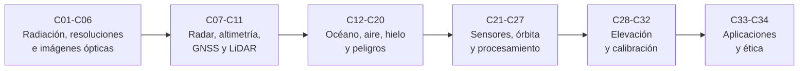

# B57 — Observación terrestre y geociencias orbitales

> **Bloque ampliado (`0.2.0`).** Además de las 20 clases de la malla base, el bloque tiene 14 clases programadas por la ampliación (`B57-C21` a `B57-C34`), redactadas y listadas en los tramos 4 a 6. Ver el [programa completo](../../PROGRAMA_ACADEMICO_COMPLETO.md).

**Programa:** Programa Integral de Astronomía, Astrofísica, Ciencias Espaciales e Ingeniería Aeroespacial
**Área:** A05 — Ciencias planetarias, astroquímica y habitabilidad
**Nivel:** N3 (fundamentos disciplinares) · **Clases:** 20 + 14 de la ampliación · **Carga:** por calibrar con el uso
**Estado:** guía pedagógica del bloque (resumen de qué se aprende en cada clase). Las clases enlazadas en la tabla ya están redactadas; todas conservan el estado E0 en el catálogo hasta registrar revisión disciplinar.

## 🎯 Propósito del bloque

Enseña **cómo se mide la Tierra desde la órbita y qué se puede concluir de esas mediciones**: qué radiación llega a un sensor, cómo se definen sus resoluciones, cómo se leen imágenes ópticas, índices y radar, cómo se obtienen alturas, posiciones y desplazamientos (altimetría, GNSS, LiDAR, InSAR) y cómo se aplican esos datos a océanos, atmósfera, hielo, sequías, incendios, terremotos y volcanes. La ampliación agrega los sensores térmicos e hiperespectrales, el diseño de órbita y de carga útil, la corrección atmosférica, la detección de cambios, los modelos de elevación y su validación, la calibración con sitios terrestres, la deforestación y la ética de las alertas. Cada clase cierra con un laboratorio en Python que contrasta con un caso analítico, dos vías independientes o una simulación con semilla fija, y distingue lo consultado de lo ilustrativo y de lo sintético.

## 📚 Al terminar el bloque podrás

1. Calcular la radiancia que llega a un sensor y la relación entre GSD, barrido, bits y bandas.
2. Elegir bandas e índices según el fenómeno y comprobar su comportamiento con datos sintéticos.
3. Explicar y calcular las resoluciones y la señal de un sistema SAR, de un altímetro, de GNSS y de un LiDAR de fotones.
4. Convertir fase InSAR, altura del mar, masa de hielo o momento sísmico en magnitudes físicas con unidades y límites.
5. Diseñar de forma simplificada una órbita de observación y una carga útil a partir de requisitos.
6. Corregir, calibrar y validar un producto (reflectancia, retardo atmosférico, modelo de elevación) y declarar su error.
7. Detectar cambios y estimar áreas con incertidumbre, y combinar capas en un análisis de riesgo.
8. Argumentar, con criterios éticos, cuándo y cómo se emite una alerta temprana.

## 🧭 Secuencia del bloque

**Descripción textual.** Seis tramos encadenados: fundamentos y sensores ópticos (C01–C06), radar, altimetría, geodesia y LiDAR (C07–C11), aplicaciones a océano, atmósfera, criósfera y peligros naturales con el caso de Chile (C12–C20), la ampliación sobre sensores térmicos e hiperespectrales, órbita, carga útil y procesamiento (C21–C27), modelos de elevación y calibración (C28–C32) y las aplicaciones de deforestación y ética de alertas (C33–C34).

## 🗂️ Las 34 clases en resumen (20 de la malla base + 14 de la ampliación)

**Navegación:** cada clase desarrollada enlaza a la anterior, a la siguiente y a este bloque; mientras una clase siga solo programada, su enlace lleva a su fila en esta tabla.

La columna «Evidencia» indica el producto que demostrará el aprendizaje. Los laboratorios usan datos **sintéticos** o **ilustrativos** (rotulados) o valores publicados con fuente y fecha.

### Tramo 1 · Fundamentos de la teledetección y sensores ópticos

| ID | Clase | Qué se aprende | Evidencia |
|---|---|---|---|
| [B57-C01](../clases/B57/B57-C01-fundamentos-de-teledeteccion/CLASE.md) | Fundamentos de teledetección | Radiación solar reflejada y emitida por la Tierra, ley de Planck y radiancia en el sensor. | Ficha de la radiación que ve un sensor |
| [B57-C02](../clases/B57/B57-C02-resolucion-espacial-y-temporal/CLASE.md) | Resolución espacial y temporal | Tamaño de muestreo en el suelo (GSD), ancho de barrido, píxeles por línea y aliasing. | Ficha de resoluciones espacial y temporal |
| [B57-C03](../clases/B57/B57-C03-resolucion-radiometrica-y-espectral/CLASE.md) | Resolución radiométrica y espectral | Cuantización en bits, relación señal–ruido de cuantización y respuesta de una banda espectral. | Ficha de resoluciones radiométrica y espectral |
| [B57-C04](../clases/B57/B57-C04-satelites-opticos-de-observacion/CLASE.md) | Satélites ópticos de observación | Geometría de visión, límite de difracción y ruido de fotones de un sensor óptico. | Ficha de un sensor óptico espacial |
| [B57-C05](../clases/B57/B57-C05-imagenes-multiespectrales/CLASE.md) | Imágenes multiespectrales | Composición de bandas, razones entre bandas y fusión con la pancromática. | Ficha de una imagen multiespectral |
| [B57-C06](../clases/B57/B57-C06-indices-de-vegetacion/CLASE.md) | Índices de vegetación | NDVI y su comportamiento: saturación, suelo de fondo y comparación con SAVI. | Ficha de índices de vegetación |

### Tramo 2 · Radar, altimetría, geodesia y LiDAR

| ID | Clase | Qué se aprende | Evidencia |
|---|---|---|---|
| [B57-C07](../clases/B57/B57-C07-sistemas-radar-sar/CLASE.md) | Sistemas radar SAR | Resolución en distancia por compresión de pulso, resolución en acimut y geometría oblicua. | Ficha de un sistema SAR |
| [B57-C08](../clases/B57/B57-C08-interferometria-radar-insar/CLASE.md) | Interferometría radar InSAR | Relación entre fase y desplazamiento en la línea de visión, franjas y desenrollado. | Ficha de una medición InSAR |
| [B57-C09](../clases/B57/B57-C09-altimetria-satelital/CLASE.md) | Altimetría satelital | Distancia por tiempo de ida y vuelta, altura de la superficie del mar y precisión temporal. | Ficha de altimetría satelital |
| [B57-C10](../clases/B57/B57-C10-geodesia-mediante-gnss/CLASE.md) | Geodesia mediante GNSS | Posición por pseudodistancias, sesgo de reloj y geometría de satélites (DOP). | Ficha de geodesia con GNSS |
| [B57-C11](../clases/B57/B57-C11-lidar-satelital/CLASE.md) | LiDAR satelital | Altímetro láser de fotones: tasa de pulsos, espaciado a lo largo de la traza y búsqueda de la superficie. | Ficha de LiDAR satelital |

### Tramo 3 · Océano, atmósfera, criósfera y peligros

| ID | Clase | Qué se aprende | Evidencia |
|---|---|---|---|
| [B57-C12](../clases/B57/B57-C12-oceanografia-desde-orbita/CLASE.md) | Oceanografía desde órbita | Velocidad geostrófica desde la altura del mar y tendencia del nivel del mar. | Ficha de oceanografía desde órbita |
| [B57-C13](../clases/B57/B57-C13-atmosfera-y-aerosoles/CLASE.md) | Atmósfera y aerosoles | Espesor óptico de aerosoles, exponente de Ångström y transmitancia de Beer–Lambert. | Ficha de aerosoles |
| [B57-C14](../clases/B57/B57-C14-glaciares-y-criosfera/CLASE.md) | Glaciares y criósfera | Cambio de masa de hielo, equivalente en nivel del mar y conversión de altura a masa. | Ficha del balance de hielo |
| [B57-C15](../clases/B57/B57-C15-sequias-e-inundaciones/CLASE.md) | Sequías e inundaciones | Máscara de agua con umbral de Otsu, cambio de área inundada e índice de anomalía de lluvia. | Ficha de sequía e inundación |
| [B57-C16](../clases/B57/B57-C16-incendios-forestales/CLASE.md) | Incendios forestales | Detección de fuego en dos bandas, fracción de píxel en llamas y tamaño mínimo detectable. | Ficha de detección de incendios |
| [B57-C17](../clases/B57/B57-C17-terremotos-y-deformacion/CLASE.md) | Terremotos y deformación | Momento sísmico, magnitud, deformación de falla y proyección a la línea de visión. | Ficha de deformación sísmica |
| [B57-C18](../clases/B57/B57-C18-volcanismo-y-monitoreo/CLASE.md) | Volcanismo y monitoreo | Fuente de Mogi, perfil de deformación e inversión de profundidad y volumen. | Ficha de deformación volcánica |
| [B57-C19](../clases/B57/B57-C19-sig-y-analisis-de-riesgo/CLASE.md) | SIG y análisis de riesgo | Riesgo como amenaza × exposición × vulnerabilidad, superposición de capas y pesos AHP. | Ficha de análisis de riesgo |
| [B57-C20](../clases/B57/B57-C20-caso-de-estudio-climatico-o-geologico-de-chile/CLASE.md) | Caso de estudio climático o geológico de Chile | Caso geológico de Chile: terremoto de Maule 2010, momento sísmico y déficit de deslizamiento. | Ficha del caso de Chile |

### Tramo 4 · Ampliación: sensores, órbita y procesamiento

| ID | Clase | Qué se aprende | Evidencia |
|---|---|---|---|
| B57-C21 | Sensores infrarrojos térmicos para observación terrestre | Inversión de Planck, emisividad y temperatura de superficie con ventana dividida. | Ficha de temperatura de superficie |
| B57-C22 | Espectrómetros de imagen e hiperespectrales | Ángulo espectral, desmezclado lineal y flujo de datos de un espectrómetro de imagen. | Ficha de espectrometría de imagen |
| B57-C23 | Diseño de órbita y revisita para observación terrestre | Órbita heliosíncrona, período, trazas repetidas y revisita según el barrido. | Ficha del diseño de órbita |
| B57-C24 | Diseño de una carga útil de observación terrestre | Cadena de requisitos: GSD, barrido, tasa de líneas, tasa de datos y apertura. | Ficha de una carga útil |
| B57-C25 | Selección de bandas espectrales según el fenómeno | Separabilidad entre clases según el subconjunto de bandas y selección exhaustiva o voraz. | Ficha de selección de bandas |
| B57-C26 | Corrección atmosférica de imágenes | Inversión de reflectancia en el tope de la atmósfera, objeto oscuro y transmitancia. | Ficha de corrección atmosférica |
| B57-C27 | Detección de cambios en series de imágenes | Diferencia de imágenes, umbral, falsas alarmas y ajuste armónico de una serie. | Ficha de detección de cambios |

### Tramo 5 · Ampliación: elevación, nubes de puntos y calibración

| ID | Clase | Qué se aprende | Evidencia |
|---|---|---|---|
| B57-C28 | Modelos digitales de elevación | Modelo de superficie frente a modelo de terreno, pendiente y orientación por diferencias finitas. | Ficha de un modelo digital de elevación |
| B57-C29 | Correcciones atmosféricas en altimetría | Retardo troposférico seco y retardo ionosférico por dos frecuencias en altimetría. | Ficha de correcciones atmosféricas |
| B57-C30 | Nubes de puntos tridimensionales | Nube de puntos, filtro de suelo, plano por RANSAC y densidad de puntos. | Ficha de una nube de puntos |
| B57-C31 | Errores y validación de modelos de elevación | RMSE, NMAD y error lineal al 90 % frente a puntos de control. | Ficha de validación de un modelo de elevación |
| B57-C32 | Sitios de calibración terrestres | Calibración vicaria con un sitio estable: ganancia, desfase e incertidumbre. | Ficha de calibración con un sitio terrestre |

### Tramo 6 · Ampliación: aplicaciones y ética del monitoreo

| ID | Clase | Qué se aprende | Evidencia |
|---|---|---|---|
| B57-C33 | Deforestación y cambio de uso del suelo | Matriz de cambio de cobertura y estimación de área con muestreo estratificado. | Ficha de deforestación |
| B57-C34 | Alertas tempranas y ética en el monitoreo de desastres | Umbral de alerta con costos de falsa alarma y omisión, tiempo de aviso y criterios éticos. | Ficha de alertas y ética |

## 🧵 Hilos que atraviesan el bloque

- **De la señal a la magnitud física:** cada clase parte de lo que mide el sensor (fotones, eco, fase, tiempo, pseudodistancia) y llega a una magnitud con unidades y una incertidumbre.
- **Resolución, revisita y cobertura:** C02, C23 y C24 conectan lo que se ve, con qué detalle y con qué frecuencia; los demás temas usan esas cifras.
- **Corrección y validación:** C26, C29, C31 y C32 enseñan que un producto sin corrección, calibración y error conocido no es una medición.
- **Observado frente a sintético:** los laboratorios usan datos sintéticos con semilla fija o parámetros ilustrativos; las cifras de misiones solo se citan si se consultó la página oficial con fecha. Nada simulado se presenta como observado.
- **Chile como contexto:** C17, C18 y C20 usan el terremoto de Maule de 2010 y la deformación de la zona de subducción como ejemplo; no se predice ningún evento.

## 📝 Evaluación del bloque (propuesta, por calibrar)

- Fichas y ejercicios por clase, con retroalimentación y recuperación con evidencia distinta.
- Portafolio: ficha del sensor óptico (C04), ficha de la medición InSAR (C08), ficha del análisis de riesgo (C19) y ficha de la carga útil (C24).
- Las condiciones críticas (rotular lo sintético, no presentar lo simulado como observado y citar solo lo consultado) no se compensan con promedio.

## ⚠️ Seguridad y límites

El bloque es educativo. Los modelos son simplificados y no sustituyen a un procesador de datos de misión, a un servicio operativo de alertas ni a la evaluación de un peligro por una institución competente; no se emite ninguna alerta ni se evalúa el riesgo de un lugar concreto. Los datos de los laboratorios son sintéticos o ilustrativos y se rotulan como tales.

## Roles que lo usan

- [Observación terrestre y geointeligencia científica](../../rutas/observacion-terrestre-y-geointeligencia-cientifica.md)
- [Ciencias planetarias y astrogeología](../../rutas/ciencias-planetarias-y-astrogeologia.md)

## Fuentes consultadas

Páginas realmente abiertas el **2026-11-09** (lo no listado aquí se rotula «no consultado» en la sección 11 de cada clase):

- **[USGS-L8]** [USGS, Landsat 8](https://www.usgs.gov/landsat-missions/landsat-8) — bandas OLI/TIRS, resoluciones, barrido, órbita (se leyeron los primeros 100.000 caracteres).
- **[USGS-SR]** [USGS, Landsat Surface Reflectance](https://www.usgs.gov/landsat-missions/landsat-surface-reflectance) — definición de reflectancia de superficie.
- **[S2]** [Copernicus Sentinel Online (SentiWiki), Sentinel-2 mission](https://sentiwiki.copernicus.eu/web/s2-mission) — bandas, resoluciones, barrido, revisita.
- **[S1]** [Copernicus SentiWiki, Sentinel-1 mission](https://sentiwiki.copernicus.eu/web/s1-mission) — banda C, modos, órbita, ciclo de repetición.
- **[NDVI]** [NASA Earth Observatory, Measuring Vegetation (NDVI & EVI)](https://science.nasa.gov/earth/earth-observatory/measuring-vegetation-ndvi-evi) — definición y rangos del NDVI.
- **[ICESat-2]** [NASA ICESat-2](https://icesat-2.gsfc.nasa.gov/) — tasa de pulsos y seis haces (solo esos dos datos figuraban en la página).
- **[GRACE-FO]** [NASA JPL, GRACE-FO](https://grace.jpl.nasa.gov/mission/grace-fo/) — altitud, separación y principio de medición.
- **[FIRMS]** [NASA Earthdata, FIRMS](https://www.earthdata.nasa.gov/data/tools/firms) — pixeles de 1 km (MODIS) y 375 m (VIIRS), latencia.
- **[ECOSTRESS]** [NASA JPL, ECOSTRESS](https://ecostress.jpl.nasa.gov/) — resolución de 70 m y variables medidas.
- **[EMIT]** [NASA JPL, EMIT](https://earth.jpl.nasa.gov/emit/) — espectrómetro de imagen en la ISS, campo de 72 km.
- **[COP-DEM]** [Copernicus Data Space, Copernicus DEM](https://dataspace.copernicus.eu/explore-data/data-collections/copernicus-contributing-missions/collections-description/COP-DEM) — resolución, exactitud vertical, modelo de superficie.
- **[USGS-Maule]** [USGS, servicio de eventos (evento del 2010-02-27, Maule)](https://earthquake.usgs.gov/fdsnws/event/1/query?eventid=official20100227063411530_30&format=geojson) — magnitud 8,8, hora y profundidad de origen.

> Las fuentes orientativas del borrador (NASA-PDS, USGS, COSPAR, NASA-EO) no se tomaron como pruebas. Las páginas de NASA ICESat-2 (misión), Sentinel-6, el evento de Maule en USGS y la página de InSAR de la ESA no abrieron o no traían datos; sus cifras figuran como «no consultado» donde se mencionan.

[🏠 Volver al programa](../../README.md) · [⬅️ B56 — Astrobiología y vida extraterrestre](./B56-astrobiologia-y-vida-extraterrestre.md) · [➡️ B58 — Asteroides, cometas y defensa planetaria](./B58-asteroides-cometas-y-defensa-planetaria.md)

