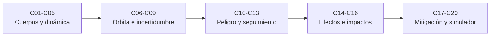

# B58 — Asteroides, cometas y defensa planetaria

> **Bloque de la estructura vigente.** Ver el [programa completo](../../PROGRAMA_ACADEMICO_COMPLETO.md).

**Programa:** Programa Integral de Astronomía, Astrofísica, Ciencias Espaciales e Ingeniería Aeroespacial
**Área:** A05 — Ciencias planetarias, astroquímica y habitabilidad
**Nivel:** N3 (fundamentos disciplinares) · **Clases:** 20 · **Carga:** por calibrar con el uso
**Estado:** guía pedagógica del bloque (resumen de qué se aprende en cada clase). Las clases enlazadas en la tabla están redactadas; todas conservan el estado E0 en el catálogo hasta registrar revisión disciplinar.

## 🎯 Propósito del bloque

Enseña **cómo se conoce, se vigila y se evalúa el riesgo de los cuerpos menores del Sistema Solar**: cómo se clasifican asteroides y cometas, qué dinámica y composición tienen, cómo se miden sus posiciones y se calcula una órbita con su incertidumbre, cómo esa incertidumbre se traduce en una probabilidad de impacto y en una escala de peligrosidad, qué aportan el seguimiento óptico, el radar y las curvas de luz, qué efectos térmicos desvían un asteroide, qué consecuencias físicas tendría un impacto, cómo funciona una desviación por impactador cinético, cuál es el marco internacional de alerta y cómo se comunica un riesgo sin alarmar ni minimizar. Cada clase cierra con un laboratorio en Python que se contrasta con un caso analítico o con una segunda vía independiente, y distingue lo consultado de lo ilustrativo.

## 📚 Al terminar el bloque podrás

1. Clasificar un cuerpo menor por sus elementos orbitales y estimar su tamaño a partir de la magnitud absoluta y el albedo.
2. Explicar la dinámica de un asteroide (Kepler, resonancias, MOID) y la de la cola de un cometa (equilibrio térmico, presión de radiación).
3. Ajustar una órbita a observaciones astrométricas sintéticas y propagar su covarianza.
4. Calcular una probabilidad de impacto en el plano B y una puntuación de Palermo, y describir la escala de Torino.
5. Planificar el seguimiento óptico y leer el aporte del radar y de la curva de luz.
6. Estimar la deriva de Yarkovsky, la energía y el cráter de un impacto, y sus consecuencias sísmicas y de onda de choque.
7. Calcular el Δv de una desviación cinética y el efecto del tiempo de aviso.
8. Aplicar el umbral de notificación internacional y comunicar una probabilidad en frecuencias naturales.
9. Armar un simulador sencillo de riesgo con un catálogo **sintético** y declarar sus límites.

## 🧭 Secuencia del bloque

**Descripción textual.** Cinco tramos encadenados: los cuerpos y su dinámica (C01–C05), la órbita con su incertidumbre y la probabilidad de impacto (C06–C09), las escalas, el seguimiento, el radar y la rotación (C10–C13), los efectos térmicos y de impacto (C14–C16) y la mitigación, el marco internacional, la comunicación y el simulador (C17–C20).

## 🗂️ Las 20 clases en resumen

**Navegación:** cada clase desarrollada enlaza a la anterior, a la siguiente y a este bloque.

La columna «Evidencia» indica el producto que demostrará el aprendizaje. Los laboratorios usan datos **sintéticos** (rotulados) o valores publicados con fuente y fecha; ningún resultado simulado se presenta como observado.

### Tramo 1 · Cuerpos menores y su dinámica

| ID | Clase | Qué se aprende | Evidencia |
|---|---|---|---|
| [B58-C01](../clases/B58/B58-C01-clasificacion-de-cuerpos-menores/CLASE.md) | Clasificación de cuerpos menores | Grupos Atira, Aten, Apollo y Amor, parámetro de Tisserand y diámetro a partir de H y albedo. | Ficha de clasificación |
| [B58-C02](../clases/B58/B58-C02-dinamica-de-asteroides/CLASE.md) | Dinámica de asteroides | Integrador de dos cuerpos frente a la tercera ley de Kepler y posición de las resonancias con Júpiter. | Ficha de dinámica orbital |
| [B58-C03](../clases/B58/B58-C03-composicion-de-asteroides/CLASE.md) | Composición de asteroides | Densidad de grano, porosidad y masa, y la ambigüedad albedo–diámetro. | Ficha de densidad y porosidad |
| [B58-C04](../clases/B58/B58-C04-nucleos-y-colas-cometarias/CLASE.md) | Núcleos y colas cometarias | Temperatura de equilibrio, relación β de presión de radiación y desplazamiento del polvo. | Ficha de la cola cometaria |
| [B58-C05](../clases/B58/B58-C05-orbitas-cercanas-a-la-tierra/CLASE.md) | Órbitas cercanas a la Tierra | Distancia mínima de intersección orbital (MOID) numérica frente al caso coplanar analítico. | Ficha de MOID |

### Tramo 2 · Órbitas, astrometría e incertidumbre

| ID | Clase | Qué se aprende | Evidencia |
|---|---|---|---|
| [B58-C06](../clases/B58/B58-C06-astrometria-de-objetos-menores/CLASE.md) | Astrometría de objetos menores | Proyección gnomónica, ajuste de constantes de placa y residuos. | Ficha de astrometría |
| [B58-C07](../clases/B58/B58-C07-determinacion-de-orbitas/CLASE.md) | Determinación de órbitas | Ajuste de elementos por mínimos cuadrados (Gauss–Newton) a observaciones sintéticas. | Ficha de la determinación orbital |
| [B58-C08](../clases/B58/B58-C08-propagacion-de-incertidumbre-orbital/CLASE.md) | Propagación de incertidumbre orbital | Covarianza de los elementos, propagación lineal y comparación con Monte Carlo. | Ficha de la incertidumbre |
| [B58-C09](../clases/B58/B58-C09-probabilidades-de-impacto/CLASE.md) | Probabilidades de impacto | Probabilidad en el plano B: integral gaussiana, aproximación y Monte Carlo. | Ficha de probabilidad de impacto |

### Tramo 3 · Peligro, seguimiento y caracterización

| ID | Clase | Qué se aprende | Evidencia |
|---|---|---|---|
| [B58-C10](../clases/B58/B58-C10-escalas-de-peligrosidad/CLASE.md) | Escalas de peligrosidad | Escala de Palermo calculada y escala de Torino descrita, con la energía cinética. | Ficha de escalas de peligro |
| [B58-C11](../clases/B58/B58-C11-observaciones-de-seguimiento/CLASE.md) | Observaciones de seguimiento | Crecimiento de la incertidumbre de predicción y probabilidad de recuperar el objeto en el campo. | Ficha de seguimiento |
| [B58-C12](../clases/B58/B58-C12-radar-planetario/CLASE.md) | Radar planetario | Ancho Doppler, resolución en distancia y ley 1/R⁴ de la ecuación del radar. | Ficha del radar |
| [B58-C13](../clases/B58/B58-C13-caracterizacion-de-rotacion/CLASE.md) | Caracterización de rotación | Periodograma de Lomb–Scargle y la ambigüedad del doble pico. | Ficha de la curva de luz |

### Tramo 4 · Efectos físicos e impactos

| ID | Clase | Qué se aprende | Evidencia |
|---|---|---|---|
| [B58-C14](../clases/B58/B58-C14-efectos-yarkovsky-y-yorp/CLASE.md) | Efectos Yarkovsky y YORP | Deriva del semieje por empuje térmico, desplazamiento a lo largo de la órbita y barrera de rotación. | Ficha de Yarkovsky y YORP |
| [B58-C15](../clases/B58/B58-C15-modelos-de-impacto-planetario/CLASE.md) | Modelos de impacto planetario | Energía cinética, escalamiento del cráter transitorio y sensibilidad a la velocidad y al ángulo. | Ficha del modelo de impacto |
| [B58-C16](../clases/B58/B58-C16-consecuencias-geofisicas-de-impactos/CLASE.md) | Consecuencias geofísicas de impactos | Magnitud sísmica equivalente y radio de la onda de choque (Sedov–Taylor). | Ficha de consecuencias |

### Tramo 5 · Mitigación, marco internacional y simulador

| ID | Clase | Qué se aprende | Evidencia |
|---|---|---|---|
| [B58-C17](../clases/B58/B58-C17-principios-de-mitigacion-y-desviacion/CLASE.md) | Principios de mitigación y desviación | Impactador cinético: Δv, cambio de período y desplazamiento acumulado frente a integración. | Ficha de la desviación |
| [B58-C18](../clases/B58/B58-C18-marco-internacional-de-defensa-planetaria/CLASE.md) | Marco internacional de defensa planetaria | Umbral de notificación de IAWN aplicado a un catálogo sintético y Δv exigido según el aviso. | Ficha del marco internacional |
| [B58-C19](../clases/B58/B58-C19-comunicacion-publica-del-riesgo/CLASE.md) | Comunicación pública del riesgo | Frecuencias naturales y comportamiento de la probabilidad de impacto al llegar nuevas observaciones. | Ficha de comunicación del riesgo |
| [B58-C20](../clases/B58/B58-C20-simulador-de-riesgo-de-impacto-basado-en-datos/CLASE.md) | Simulador de riesgo de impacto basado en datos | Catálogo sintético con campos tipo SBDB, riesgo por Palermo y frecuencia de impactos por Poisson. | Ficha del simulador |

## 🧵 Hilos que atraviesan el bloque

- **De la observación a la probabilidad:** C06 mide posiciones, C07 ajusta la órbita, C08 propaga la covarianza y C09 la convierte en probabilidad; C10 la pone en una escala y C11 explica cómo se reduce con nuevas observaciones.
- **Un mismo código orbital:** los laboratorios de C05, C07, C08 y C09 comparten un propagador kepleriano de dos cuerpos, escrito en la biblioteca estándar y contrastado con el caso analítico.
- **Del peligro a la decisión:** C15–C16 estiman consecuencias, C17 la desviación posible, C18 el marco que activa la alerta y C19 cómo se comunica.
- **Observado frente a sintético:** los catálogos, observaciones y objetos de los laboratorios son sintéticos y se rotulan; solo se citan con fecha las páginas realmente consultadas (sección de fuentes).

## 📝 Evaluación del bloque (propuesta, por calibrar)

- Fichas y ejercicios por clase, con retroalimentación y recuperación con evidencia distinta.
- Portafolio: ficha de probabilidad de impacto (C09) y ficha del simulador (C20).
- Las condiciones críticas (rotular lo sintético, no presentar un cálculo del curso como evaluación de riesgo de un objeto real y citar solo lo consultado) no se compensan con promedio.

## ⚠️ Seguridad y límites

El bloque es educativo. Los modelos son simplificados (dos cuerpos, planos B gaussianos, escalamientos de orden de magnitud) y **no** sustituyen a los sistemas oficiales de monitoreo (Sentry, NEODyS, Scout), a las evaluaciones del Minor Planet Center ni a los avisos de las autoridades. Ningún laboratorio evalúa un objeto real ni emite una alerta; los objetos, las observaciones y los catálogos son sintéticos. No se presenta lo simulado como observado. Cualquier notificación de un riesgo real corresponde a los canales oficiales.

## 📖 Fuentes consultadas en el bloque (resumen)

Consultadas el 2026-11-09 mediante lectura de las páginas oficiales (resumen extraído de cada una): **CNEOS/JPL** (escala de Torino, escala de Palermo, grupos de objetos cercanos a la Tierra, ejercicio de la Conferencia de Defensa Planetaria 2023), **API de la base de datos de cuerpos menores del JPL** (documentación), **NASA** (página de DART) e **IAWN** (acerca de). No abrieron o no se consultaron: la página de radar de CNEOS (404), el formato de observaciones ópticas del MPC (403), la página de SMPAG de UNOOSA (404) y el artículo de Collins et al. (2005) en ADS (405); las relaciones que dependen de ellos se declaran «no consultado» en cada clase y se verifican solo con casos analíticos propios.

## Fuentes de orientación preliminar

- **[NASA-PDS]** [NASA Planetary Data System](https://pds.nasa.gov/) — Archivo de datos de misiones y ciencias planetarias.
- **[USGS]** [USGS Astrogeology Science Center](https://www.usgs.gov/centers/astrogeology-science-center) — Cartografía, geología y sistemas de referencia de superficies planetarias.
- **[COSPAR]** [Committee on Space Research](https://cosparhq.cnes.fr/) — Protección planetaria y cooperación en investigación espacial.
- **[NASA-EO]** [NASA Earthdata](https://www.earthdata.nasa.gov/) — Datos abiertos de observación de la Tierra.

> La asociación de estas fuentes es orientativa por bloque. Las fuentes realmente consultadas para cada afirmación se registran en la sección 11 de cada clase.

[🏠 Volver al programa](../../README.md) · [➡️ B59 — Recursos in situ y sostenibilidad extraterrestre](./B59-recursos-in-situ-y-sostenibilidad-extraterrestre.md)
