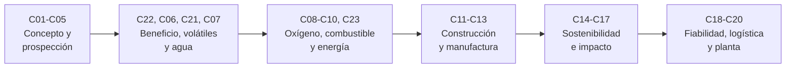

# B59 — Recursos in situ y sostenibilidad extraterrestre

> **Bloque ampliado.** Además de las 20 clases de la línea base, el bloque tiene 3 clases programadas por la ampliación (`B59-C21` a `B59-C23`), redactadas y listadas en los tramos 2 y 3. Ver el [programa completo](../../PROGRAMA_ACADEMICO_COMPLETO.md).

**Programa:** Programa Integral de Astronomía, Astrofísica, Ciencias Espaciales e Ingeniería Aeroespacial
**Área:** A05 — Ciencias planetarias, astroquímica y habitabilidad
**Nivel:** N3 (fundamentos disciplinares) · **Clases:** 20 + 3 de la ampliación · **Carga:** por calibrar con el uso
**Estado:** guía pedagógica del bloque (resumen de qué se aprende en cada clase). Las clases enlazadas en la tabla ya están redactadas; todas conservan el estado E0 en el catálogo hasta registrar revisión disciplinar. Las clases `B59-C21` a `B59-C23` (ampliación) también están redactadas y conservan el mismo estado.

## 🎯 Propósito del bloque

Enseña **cómo se decide si conviene fabricar en destino lo que de otro modo habría que lanzar desde la Tierra, y cómo se hace sin agotar ni contaminar el lugar**: el concepto de recursos in situ y su apalancamiento de masa, la prospección del hielo lunar y del agua en regolitos y minerales, la caracterización y el beneficio del regolito, la extracción y el almacenamiento de volátiles, la purificación del agua, la producción de oxígeno y de combustibles conceptuales con sus balances de energía, la construcción y la manufactura con regolito, el cultivo, el cierre de ciclos de materia, el reciclaje y los subproductos, el impacto ambiental, la fiabilidad de los equipos y la logística, hasta un diseño conceptual de planta de extremo a extremo. Cada clase cierra con un laboratorio en Python que contrasta con un caso analítico, dos vías independientes o una simulación con semilla fija, y distingue lo consultado de lo ilustrativo.

## 📚 Al terminar el bloque podrás

1. Cuantificar con la ecuación del cohete cuánta masa de lanzamiento ahorra producir un insumo en destino.
2. Estimar la abundancia de hielo o de agua ligada a partir de observaciones, con su incertidumbre, y distinguir hielo, hidratos e hidroxilo.
3. Describir un regolito con su distribución granulométrica y separar fracciones con una curva de partición.
4. Calcular la energía de extraer, purificar y almacenar agua, y la corriente y la energía de producir oxígeno e hidrógeno por electrólisis.
5. Cerrar el balance estequiométrico de combustibles, residuos y subproductos, con sus unidades.
6. Dimensionar estructuras de regolito, un proceso de sinterización y una cúpula impresa con criterios de comprobación.
7. Evaluar el cierre de un lazo de materia, el área de cultivo, el alcance de eyecta y las obligaciones de protección planetaria.
8. Estimar la fiabilidad de equipos mineros y el tiempo de amortización de una planta, y reunir todo en un diseño conceptual con sensibilidades.

## 🧭 Secuencia del bloque

**Descripción textual.** Seis tramos encadenados: concepto y prospección de recursos (C01–C05), beneficio, extracción, almacenamiento y purificación de volátiles (C22, C06, C21, C07), oxígeno, combustibles, electrólisis y subproductos (C08–C10, C23), construcción y manufactura con regolito (C11–C13), sostenibilidad, ciclos, residuos e impacto (C14–C17) y fiabilidad, logística y diseño de planta (C18–C20). Las clases de la ampliación (C21–C23) se leen donde el proceso las necesita, no al final.

## 🗂️ Las 23 clases en resumen (20 de la línea base + 3 de la ampliación)

**Navegación:** cada clase desarrollada enlaza a la anterior, a la siguiente y a este bloque; mientras una clase siga solo programada, su enlace lleva a su fila en esta tabla.

La columna «Evidencia» indica el producto que demostrará el aprendizaje. Los laboratorios usan datos **sintéticos** o **ilustrativos** (rotulados) o valores publicados con fuente y fecha.

### Tramo 1 · Marco y prospección de recursos

| ID | Clase | Qué se aprende | Evidencia |
|---|---|---|---|
| [B59-C01](../clases/B59/B59-C01-concepto-de-utilizacion-de-recursos-in-situ/CLASE.md) | Concepto de utilización de recursos in situ | Ecuación del cohete y masa de lanzamiento ahorrada al producir el oxidante en destino. | Ficha del concepto ISRU |
| [B59-C02](../clases/B59/B59-C02-prospeccion-de-hielo-lunar/CLASE.md) | Prospección de hielo lunar | Abundancia de hielo a partir de la masa de agua observada y propagación de su incertidumbre. | Ficha de la prospección de hielo |
| [B59-C03](../clases/B59/B59-C03-agua-en-regolito-y-minerales/CLASE.md) | Agua en regolito y minerales | Agua de hielo, de hidratos y de hidroxilo; pérdida de masa por etapas y fracción de agua. | Ficha del agua en regolito |
| [B59-C04](../clases/B59/B59-C04-caracterizacion-de-regolito-lunar/CLASE.md) | Caracterización de regolito lunar | Distribución granulométrica lognormal, percentiles D10/D50/D90 y porosidad. | Ficha de caracterización del regolito |
| [B59-C05](../clases/B59/B59-C05-minerales-marcianos/CLASE.md) | Minerales marcianos | Desmezcla lineal con mínimos cuadrados no negativos y rendimiento de agua de una mezcla. | Ficha de la mezcla mineral |

### Tramo 2 · Beneficio, extracción y almacenamiento de volátiles

| ID | Clase | Qué se aprende | Evidencia |
|---|---|---|---|
| [B59-C22](../clases/B59/B59-C22-beneficio-y-separacion-granulometrica-de-regolito/CLASE.md) | Beneficio y separación granulométrica de regolito | Curva de partición, tamaño de corte, recuperación y ley del concentrado. | Ficha del beneficio |
| [B59-C06](../clases/B59/B59-C06-extraccion-y-procesamiento-de-volatiles/CLASE.md) | Extracción y procesamiento de volátiles | Energía térmica por kilogramo de agua extraída de un regolito con hielo. | Ficha de la extracción térmica |
| [B59-C21](../clases/B59/B59-C21-almacenamiento-criogenico-y-aislado-de-volatiles-extraidos/CLASE.md) | Almacenamiento criogénico y aislado de volátiles extraídos | Fuga de calor, evaporación y potencia de un refrigerador de cero evaporación. | Ficha del almacenamiento criogénico |
| [B59-C07](../clases/B59/B59-C07-purificacion-de-agua/CLASE.md) | Purificación de agua | Destilación con recuperación de calor, balance de sales y límite de recuperación. | Ficha de la purificación |

### Tramo 3 · Oxígeno, combustibles y energía

| ID | Clase | Qué se aprende | Evidencia |
|---|---|---|---|
| [B59-C08](../clases/B59/B59-C08-produccion-de-oxigeno/CLASE.md) | Producción de oxígeno | Corriente de Faraday para una tasa de O₂ por electrólisis de CO₂ y balance de subproductos. | Ficha de la producción de oxígeno |
| [B59-C09](../clases/B59/B59-C09-fabricacion-de-combustibles-conceptuales/CLASE.md) | Fabricación de combustibles conceptuales | Reacción de Sabatier, balance de hidrógeno en lazo con electrólisis y mezcla O/F. | Ficha del combustible conceptual |
| [B59-C10](../clases/B59/B59-C10-electrolisis-y-balances-energeticos/CLASE.md) | Electrólisis y balances energéticos | Tensión termoneutra, energía por kilogramo de H₂ y calor a evacuar. | Ficha del balance de electrólisis |
| [B59-C23](../clases/B59/B59-C23-subproductos-y-flujos-residuales-de-procesos-isru/CLASE.md) | Subproductos y flujos residuales de procesos ISRU | Balance estequiométrico de subproductos (CO, metal, escoria) por kilogramo de producto. | Ficha de subproductos |

### Tramo 4 · Construcción y manufactura con regolito

| ID | Clase | Qué se aprende | Evidencia |
|---|---|---|---|
| [B59-C11](../clases/B59/B59-C11-construccion-con-regolito/CLASE.md) | Construcción con regolito | Sobrecarga de regolito, equilibrio con la presión interna y blindaje por espesor másico. | Ficha de la estructura de regolito |
| [B59-C12](../clases/B59/B59-C12-sinterizacion-de-materiales/CLASE.md) | Sinterización de materiales | Sinterización viscosa de Frenkel, ley de Arrhenius y ajuste de la energía de activación. | Ficha de la sinterización |
| [B59-C13](../clases/B59/B59-C13-impresion-3d-extraterrestre/CLASE.md) | Impresión 3D extraterrestre | Volumen, tiempo y convergencia de capas de una cúpula impresa. | Ficha de la cúpula impresa |

### Tramo 5 · Sostenibilidad: agricultura, ciclos, residuos e impacto

| ID | Clase | Qué se aprende | Evidencia |
|---|---|---|---|
| [B59-C14](../clases/B59/B59-C14-agricultura-y-sustratos-artificiales/CLASE.md) | Agricultura y sustratos artificiales | Área de cultivo limitada por luz, potencia de iluminación y humedad del sustrato. | Ficha del cultivo |
| [B59-C15](../clases/B59/B59-C15-ciclo-cerrado-de-materiales/CLASE.md) | Ciclo cerrado de materiales | Cierre de un lazo con fugas: reposición, serie geométrica e inventario. | Ficha del ciclo cerrado |
| [B59-C16](../clases/B59/B59-C16-desechos-y-reciclaje/CLASE.md) | Desechos y reciclaje | Balance elemental de la oxidación de residuos y oxígeno necesario. | Ficha del reciclaje de residuos |
| [B59-C17](../clases/B59/B59-C17-impacto-ambiental-extraterrestre/CLASE.md) | Impacto ambiental extraterrestre | Alcance balístico de eyecta en vacío, fracción que escapa y contexto de protección planetaria. | Ficha del impacto ambiental |

### Tramo 6 · Fiabilidad, logística y diseño de planta

| ID | Clase | Qué se aprende | Evidencia |
|---|---|---|---|
| [B59-C18](../clases/B59/B59-C18-fiabilidad-de-equipos-mineros/CLASE.md) | Fiabilidad de equipos mineros | Weibull, MTBF, disponibilidad y repuestos con Poisson. | Ficha de fiabilidad |
| [B59-C19](../clases/B59/B59-C19-evaluacion-logistica-de-una-instalacion/CLASE.md) | Evaluación logística de una instalación | Tiempo de amortización de la masa de la planta y efecto de las paradas. | Ficha logística |
| [B59-C20](../clases/B59/B59-C20-diseno-conceptual-de-planta-isru/CLASE.md) | Diseño conceptual de planta ISRU | Dimensionado de extremo a extremo con cierre de balances y sensibilidades. | Ficha del diseño de planta |

## 🧵 Hilos que atraviesan el bloque

- **Del recurso al producto:** C02–C05 y C22 dicen qué hay y cómo se prepara; C06–C10 lo convierten en agua, oxígeno y combustible; C11–C13 en estructuras; C20 lo integra.
- **Balances que deben cerrar:** toda clase de proceso (C06–C10, C16, C23) verifica la conservación de masa y de elementos y declara su energía; C20 los encadena.
- **Sostenibilidad:** C14–C17 preguntan qué parte del lazo se cierra, qué se desecha y qué efecto tiene en el lugar; C23 enlaza con ellas.
- **Incertidumbre y fiabilidad:** C02, C18 y C19 propagan incertidumbre y paradas; C20 muestra la sensibilidad del diseño.
- **Observado frente a ilustrativo:** los pocos datos observados (agua de LCROSS, tasas de MOXIE) se citan con fecha; todo lo demás es ilustrativo o sintético y se rotula. Ninguna planta real se modela.

## 📝 Evaluación del bloque (propuesta, por calibrar)

- Fichas y ejercicios por clase, con retroalimentación y recuperación con evidencia distinta.
- Portafolio: ficha del concepto ISRU (C01) y ficha del diseño conceptual de planta (C20), con balances cerrados y sensibilidades.
- Las condiciones críticas (rotular lo ilustrativo y sintético, no presentar una planta de juguete como una real y citar solo lo consultado) no se compensan con promedio.

## ⚠️ Seguridad y límites

El bloque es educativo. Los modelos son simplificados (balances de régimen estacionario, propiedades constantes o lineales, sin cinética real de reactores) y no sustituyen a la ingeniería de procesos ni a la literatura primaria. Los procesos con hidrógeno, oxígeno líquido, altas temperaturas y combustibles tienen peligros reales; la clase no es un procedimiento de operación. Las cifras observadas se citan con fecha de consulta; las no consultadas se rotulan así. La explotación de recursos está sujeta al derecho espacial y a la protección planetaria, que esta guía solo introduce.

## 📖 Fuentes consultadas en el bloque (resumen)

Las clases citan, con localizador, qué respalda cada fuente, fecha de consulta (2026-11-09) y estado. Se consultaron: las constantes de NIST (CODATA 2022: Faraday, gas molar, gravedad estándar); el NIST Chemistry WebBook (entalpías de formación y masas molares de H₂O, CO₂ y CH₄); la tabla de pesos atómicos de NIST; el resumen de Colaprete et al. (*Science*, 2010) sobre el agua de LCROSS en el repositorio de la Universidad de Arizona; la nota de NASA sobre las tasas de MOXIE (2022-12-22); la página de NASA sobre ISRU; y la página de COSPAR sobre protección planetaria. **No se consultaron** el texto del Tratado del Espacio Ultraterrestre (su página de UNOOSA no abrió), el artículo de Li et al. (2018, PNAS; acceso denegado), ni libros de referencia sobre el regolito: los valores de propiedades del regolito, de calores latentes y de gravedades se rotulan ilustrativos.

## Roles que lo usan

- [Arquitectura y hábitats extraterrestres](../../rutas/arquitectura-y-habitats-extraterrestres.md)
- [Astroquímica y astrobiología](../../rutas/astroquimica-y-astrobiologia.md)
- [Ciencias planetarias y astrogeología](../../rutas/ciencias-planetarias-y-astrogeologia.md)
- [Recursos extraterrestres y economía industrial espacial](../../rutas/recursos-extraterrestres-y-economia-industrial-espacial.md)

## Fuentes de orientación preliminar

- **[NASA-PDS]** [NASA Planetary Data System](https://pds.nasa.gov/) — Archivo de datos de misiones y ciencias planetarias.
- **[USGS]** [USGS Astrogeology Science Center](https://www.usgs.gov/centers/astrogeology-science-center) — Cartografía, geología y sistemas de referencia de superficies planetarias.
- **[COSPAR]** [Committee on Space Research](https://cosparhq.cnes.fr/) — Protección planetaria y cooperación en investigación espacial.
- **[NASA-EO]** [NASA Earthdata](https://www.earthdata.nasa.gov/) — Datos abiertos de observación de la Tierra.

> La asociación de estas fuentes es orientativa por bloque. Las fuentes realmente consultadas para cada afirmación se registran en la sección 11 de cada clase.

[🏠 Volver al programa](../../README.md) · [➡️ B60 — Cinética y modelado astroquímico](./B60-cinetica-y-modelado-astroquimico.md)
