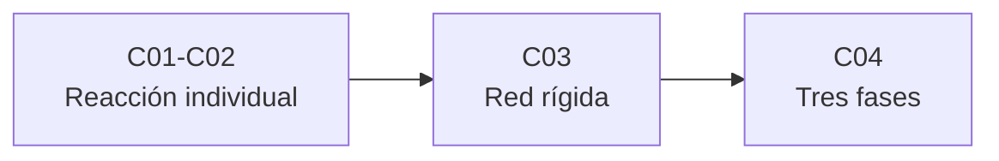

# B60 — Cinética y modelado astroquímico

> **Bloque de la malla `0.2.0`.** Ver el [programa completo](../../PROGRAMA_ACADEMICO_COMPLETO.md).

**Programa:** Programa Integral de Astronomía, Astrofísica, Ciencias Espaciales e Ingeniería Aeroespacial
**Área:** A05 — Ciencias planetarias, astroquímica y habitabilidad
**Nivel:** N3 (fundamentos disciplinares) · **Clases:** 4 · **Carga:** por calibrar con el uso
**Estado:** guía pedagógica del bloque (resumen de qué se aprende en cada clase). Las clases enlazadas en la tabla ya están redactadas; todas conservan el estado E0 en el catálogo hasta registrar revisión disciplinar.

## 🎯 Propósito del bloque

Enseña **cómo se pasa de una reacción individual a un modelo químico de una nube interestelar** y qué hay que vigilar en cada paso. Parte de la teoría de colisiones y de las secciones eficaces (por qué una reacción ion–molécula casi no depende de la temperatura y una con barrera sí), sigue con los coeficientes de velocidad tipo Arrhenius–Kooij y su uso en bases de datos como KIDA y UMIST, aborda la integración numérica de redes rígidas (por qué un integrador explícito falla y uno implícito no) y termina con el acople entre gas, superficie y manto de los modelos de tres fases. Cada clase cierra con un laboratorio en Python que contrasta con un caso analítico, dos vías independientes o una simulación con semilla fija, y distingue lo consultado de lo ilustrativo.

## 📚 Al terminar el bloque podrás

1. Calcular una constante de velocidad bimolecular a partir de una sección eficaz y una distribución de Maxwell–Boltzmann, y distinguir los regímenes de esfera dura y de Langevin.
2. Evaluar y ajustar coeficientes `α (T/300)^β exp(−γ/T)`, y reconocer los límites de validez de un ajuste al extrapolar.
3. Explicar por qué una red química es rígida y comparar un integrador explícito con uno implícito en estabilidad y coste, con tolerancias declaradas.
4. Plantear un balance gas–superficie–manto con acreción, desorción térmica e intercambio, verificando la conservación de la masa.
5. Rotular los parámetros ilustrativos y distinguirlos de los publicados en las bases de datos.

## 🧭 Secuencia del bloque

**Descripción textual.** Tres tramos encadenados: de la colisión a la constante de velocidad (C01–C02), de las constantes a la integración de la red (C03) y de la red en fase gaseosa al balance con los granos (C04).

## 🗂️ Las 4 clases en resumen

**Navegación:** cada clase desarrollada enlaza a la anterior, a la siguiente y a este bloque.

La columna «Evidencia» indica el producto que demostrará el aprendizaje. Los laboratorios usan datos **sintéticos** o **ilustrativos** (rotulados) o valores publicados con fuente y fecha.

### Tramo 1 · De la colisión a la constante de velocidad

| ID | Clase | Qué se aprende | Evidencia |
|---|---|---|---|
| [B60-C01](../clases/B60/B60-C01-colisiones-moleculares-y-secciones-eficaces-en-gas-interestelar/CLASE.md) | Colisiones moleculares y secciones eficaces en gas interestelar | Constante de velocidad como promedio de `σ·v`, esfera dura frente a Langevin. | Ficha de la teoría de colisiones |
| [B60-C02](../clases/B60/B60-C02-coeficientes-de-velocidad-dependientes-de-la-temperatura-y-bases-cineticas/CLASE.md) | Coeficientes de velocidad dependientes de la temperatura y bases cinéticas | Forma `α (T/300)^β exp(−γ/T)`, ajuste en `ln k` y límites de extrapolación. | Ficha del coeficiente de velocidad |

### Tramo 2 · Integración de la red

| ID | Clase | Qué se aprende | Evidencia |
|---|---|---|---|
| [B60-C03](../clases/B60/B60-C03-integracion-numerica-de-redes-quimicas-rigidas/CLASE.md) | Integración numérica de redes químicas rígidas | Rigidez, inestabilidad del método explícito y Euler implícito con control de paso. | Ficha de la integración rígida |

### Tramo 3 · Gas y granos

| ID | Clase | Qué se aprende | Evidencia |
|---|---|---|---|
| [B60-C04](../clases/B60/B60-C04-balance-quimico-gas-grano-modelos-de-tres-fases/CLASE.md) | Balance químico gas-grano: modelos de tres fases | Acreción, desorción térmica y manto; calentamiento en dos y en tres fases. | Ficha del balance de tres fases |

## 🧵 Hilos que atraviesan el bloque

- **De la microfísica al modelo:** C01 y C02 producen las constantes que C03 integra y que C04 completa con los procesos de superficie.
- **Un mismo cuidado numérico:** cada laboratorio declara unidades (cm³ s⁻¹, s⁻¹, cm⁻³), temperatura, tolerancia y semilla.
- **Observado frente a ilustrativo:** ningún laboratorio reproduce una red de KIDA o UMIST ni una abundancia observada; los parámetros de reacciones, de granos y de la nube son ilustrativos y se rotulan, y solo se citan con fecha las páginas realmente consultadas.

## 📝 Evaluación del bloque (propuesta, por calibrar)

- Fichas y ejercicios por clase, con retroalimentación y recuperación con evidencia distinta.
- Portafolio: ficha del coeficiente de velocidad (C02) y ficha del balance de tres fases (C04).
- Las condiciones críticas (rotular lo ilustrativo, no presentar lo simulado como observado y citar solo lo consultado) no se compensan con promedio.

## ⚠️ Seguridad y límites

El bloque es educativo. Los modelos son simplificados y no sustituyen a un código astroquímico (Nautilus, Nahoon u otro) ni a las bases de datos; no se predice la abundancia de ninguna molécula en ninguna fuente real. Los valores numéricos de reacciones y de granos son ilustrativos y se rotulan como tales.

## Roles que lo usan

- [Astroquímica y astrobiología](../../rutas/astroquimica-y-astrobiologia.md)

## Fuentes consultadas

Consultadas el 2026-11-09 (resumen de la página, no el texto completo):

- **[UMIST12]** McElroy, D. et al., [The UMIST database for astrochemistry 2012](https://arxiv.org/abs/1212.6362) (arXiv:1212.6362) — quinta versión de la base: 6173 reacciones en fase gaseosa y 467 especies. La página consultada no describe las formas de los coeficientes.
- **[KIDA12]** Wakelam, V. et al., [A KInetic Database for Astrochemistry (KIDA)](https://arxiv.org/abs/1201.5887) (arXiv:1201.5887; ApJS 199, 21) — base de reacciones con coeficientes e incertidumbres, y el código Nahoon. El sitio de KIDA no pudo consultarse (no resolvió el nombre).
- **[Ruaud16]** Ruaud, M., Wakelam, V., Hersant, F., [Gas and grain chemical composition in cold cores as predicted by the Nautilus 3-phase model](https://arxiv.org/abs/1604.05216) (arXiv:1604.05216) — modelo de tres fases con superficie y manto activos.
- **[SciPy]** [scipy.integrate.solve_ivp](https://docs.scipy.org/doc/scipy/reference/generated/scipy.integrate.solve_ivp.html) — métodos explícitos e implícitos, `rtol`/`atol`, Jacobiano.
- **[NIST-CODATA]** [Constantes CODATA 2022 en NIST](https://physics.nist.gov/cgi-bin/cuu/Value?k) — `k_B`, `u`, `e` y `ε₀` (páginas individuales).

> Las fuentes realmente consultadas para cada afirmación se registran en la sección 11 de cada clase. Lo no consultado se rotula como tal.

[🏠 Volver al programa](../../README.md) · [➡️ B61 — Cráteres de impacto y geología de impactos](./B61-crateres-de-impacto-y-geologia-de-impactos.md)
