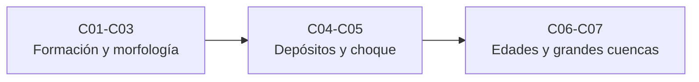

# B61 — Cráteres de impacto y geología de impactos

> **Bloque de la malla `0.2.0`.** Ver el [programa completo](../../PROGRAMA_ACADEMICO_COMPLETO.md).

**Programa:** Programa Integral de Astronomía, Astrofísica, Ciencias Espaciales e Ingeniería Aeroespacial
**Área:** A05 — Ciencias planetarias, astroquímica y habitabilidad
**Nivel:** N3 (fundamentos disciplinares) · **Clases:** 7 · **Carga:** por calibrar con el uso
**Estado:** guía pedagógica del bloque (resumen de qué se aprende en cada clase). Las clases enlazadas en la tabla ya están redactadas; todas conservan el estado E0 en el catálogo hasta registrar revisión disciplinar.

## 🎯 Propósito del bloque

Enseña **cómo se forma un cráter de impacto y cómo se lee su geología**: la mecánica de la eyección y las leyes de escalado, la morfología de los cráteres simples y la de los complejos (colapso, picos centrales, terrazas), los mantos de ejecta como depósitos y marcadores estratigráficos, la fusión por impacto y el metamorfismo de choque, la datación por conteo de cráteres con sus incertidumbres y, por último, las cuencas multianillo y los grandes impactos. Cada clase cierra con un laboratorio en Python que se contrasta con un caso analítico, con dos vías independientes o con una simulación de semilla fija, y distingue lo consultado de lo ilustrativo y lo sintético de lo observado.

## 📚 Al terminar el bloque podrás

1. Plantear el radio de un cráter en el régimen de gravedad, deducir sus exponentes y comprobar su consistencia dimensional.
2. Describir la geometría de un cráter simple y cerrar un balance de volumen entre la cavidad transitoria, el cráter aparente y el relleno de brecha.
3. Explicar la transición simple–compleja por gravedad, calibrar un modelo con un cuerpo y contrastarlo con otro.
4. Calcular el espesor y el volumen de un manto de ejecta y comparar la ley empírica con una deducción balística.
5. Hallar la presión de choque por acoplamiento de impedancias y clasificarla en efectos de choque y fusión.
6. Obtener una edad de modelo con su incertidumbre de Poisson a partir de una función de producción y una cronología.
7. Generar anillos de cuenca, inferir el proyectil y la energía de un gran impacto y propagar la incertidumbre de los supuestos.

## 🧭 Secuencia del bloque

**Descripción textual.** Tres tramos encadenados: la mecánica de formación y la morfología de los cráteres (C01–C03), los depósitos y los efectos del choque en la roca (C04–C05) y la cronología y los grandes impactos (C06–C07).

## 🗂️ Las 7 clases en resumen

**Navegación:** cada clase enlaza a la anterior, a la siguiente y a este bloque.

La columna «Evidencia» indica el producto que demostrará el aprendizaje. Los laboratorios usan datos **sintéticos** o **ilustrativos** (rotulados); ningún cráter, superficie o cuenca reales se modelan ni se cuentan.

### Tramo 1 · Formación y morfología

| ID | Clase | Qué se aprende | Evidencia |
|---|---|---|---|
| [B61-C01](../clases/B61/B61-C01-dinamica-de-eyeccion-y-escalado-de-crateres/CLASE.md) | Dinámica de eyección y escalado de cráteres | Radio transitorio en régimen de gravedad, exponentes dimensionales, masa eyectada y alcance balístico. | Ficha del escalado de un cráter |
| [B61-C02](../clases/B61/B61-C02-crateres-simples-morfologia-y-formacion/CLASE.md) | Cráteres simples: morfología y formación | Casquete esférico, volumen, ensanchamiento y balance con lente de brecha. | Ficha de la geometría de un cráter simple |
| [B61-C03](../clases/B61/B61-C03-crateres-complejos-colapso-picos-centrales-y-terrazas/CLASE.md) | Cráteres complejos: colapso, picos centrales y terrazas | Umbral por gravedad calibrado y contrastado, exponente libre y relajación de pendientes. | Ficha de la transición simple–compleja |

### Tramo 2 · Depósitos y choque

| ID | Clase | Qué se aprende | Evidencia |
|---|---|---|---|
| [B61-C04](../clases/B61/B61-C04-mantos-de-ejecta-y-depositos-de-impacto/CLASE.md) | Mantos de ejecta y depósitos de impacto | Ley de espesor, volumen del manto y exponente deducido de la balística. | Ficha del manto de ejecta |
| [B61-C05](../clases/B61/B61-C05-fusion-por-impacto-y-metamorfismo-de-choque/CLASE.md) | Fusión por impacto y metamorfismo de choque | Presión por acoplamiento de impedancias, efectos por rango de presión y volumen fundido. | Ficha de la presión de choque |

### Tramo 3 · Edades y grandes cuencas

| ID | Clase | Qué se aprende | Evidencia |
|---|---|---|---|
| [B61-C06](../clases/B61/B61-C06-datacion-por-conteo-de-crateres-funciones-de-produccion-y-edades-de-modelo/CLASE.md) | Datación por conteo de cráteres: funciones de producción y edades de modelo | Producción y cronología, cráteres sintéticos, edad por bisección e incertidumbre de Poisson. | Ficha de la edad de modelo por conteo |
| [B61-C07](../clases/B61/B61-C07-cuencas-multianillo-y-grandes-impactos/CLASE.md) | Cuencas multianillo y grandes impactos | Recurrencia de anillos, estimación del coeficiente, inversión del escalado y propagación de μ. | Ficha de la cuenca multianillo |

## 🧵 Hilos que atraviesan el bloque

- **Un mismo escalado:** C01 fija el radio transitorio; C02 y C03 lo vuelven geometría y colapso; C07 lo invierte para inferir proyectil y energía.
- **Del cráter al depósito:** C04 relaciona el volumen de la ejecta con el bol (C02) y deduce su exponente de la masa rápida de C01.
- **Incertidumbre:** C06 propaga el conteo a la edad (Poisson) y C07 propaga μ a la energía; ambas distinguen la incertidumbre estadística de la sistemática.
- **Observado frente a sintético:** ninguna superficie ni cuenca reales se cuentan o modelan. Los parámetros se rotulan como ilustrativos y solo se citan con fecha las páginas realmente consultadas, indicando cuando solo se leyó un resumen o un registro.

## 📝 Evaluación del bloque (propuesta, por calibrar)

- Fichas y ejercicios por clase, con retroalimentación y recuperación con evidencia distinta.
- Portafolio: ficha del escalado de un cráter (C01) y ficha de la edad de modelo por conteo (C06).
- Las condiciones críticas (rotular lo sintético e ilustrativo, no presentar lo simulado como observado y citar solo lo consultado) no se compensan con promedio.

## ⚠️ Seguridad y límites

El bloque es educativo. Los modelos son simplificados y no sustituyen a un hidrocódigo de impactos ni al análisis de datos reales; no se estima el riesgo de ningún objeto concreto ni se data ningún sitio real. Los coeficientes de la función de producción vienen de una fuente secundaria (código de un paquete) con una errata señalada; los demás parámetros se rotulan como ilustrativos.

## Roles que lo usan

- [Ciencias planetarias y astrogeología](../../rutas/ciencias-planetarias-y-astrogeologia.md)

## Fuentes consultadas

Consultadas el 2026-11-09. El estado indica hasta dónde se leyó cada una; el detalle por afirmación está en la sección 11 de cada clase.

- **[Neukum et al. 2001]** [Registro del DLR](https://elib.dlr.de/18259/) — solo el registro bibliográfico del artículo de Space Science Reviews 96; sin resumen ni texto.
- **[cratermaker]** [Módulo `production.neukum`](https://cratermaker.readthedocs.io/en/latest/_modules/cratermaker/components/production/neukum.html) — coeficientes de la función de producción y de la cronología lunar; fuente secundaria.
- **[Kurosawa y Takada 2018]** [arXiv:1806.07665](https://arxiv.org/abs/1806.07665) — solo el resumen.
- **[CosmoQuest 2017]** [Simple to Complex](https://cosmoquest.org/x/2017/12/cq-science-post-6-simple-to-complex/) — divulgación; orden de magnitud de la transición.
- **Holsapple (1993), McGetchin et al. (1973), Stöffler et al. (1991), Stöffler y Langenhorst (1994), Pike y Spudis (1987)** — conocidos solo por resultados de búsqueda web que los citan o resumen; los originales no se consultaron.

> Las fuentes realmente consultadas para cada afirmación se registran en la sección 11 de cada clase.

[🏠 Volver al programa](../../README.md) · [⬅️ B60 — Cinética y modelado astroquímico](./B60-cinetica-y-modelado-astroquimico.md) · [➡️ B62 — Espectroscopía molecular para astroquímica](./B62-espectroscopia-molecular-para-astroquimica.md)
