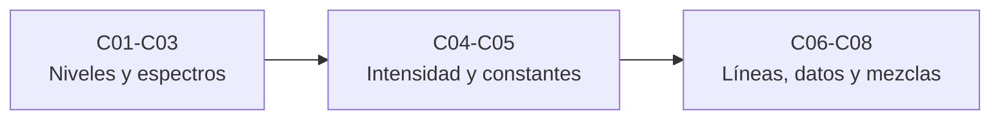

# B62 — Espectroscopía molecular para astroquímica

> **Bloque de la malla `0.2.0`.** Ver el [programa completo](../../PROGRAMA_ACADEMICO_COMPLETO.md).

**Programa:** Programa Integral de Astronomía, Astrofísica, Ciencias Espaciales e Ingeniería Aeroespacial
**Área:** A05 — Ciencias planetarias, astroquímica y habitabilidad
**Nivel:** N3 (fundamentos disciplinares) · **Clases:** 8 · **Carga:** por calibrar con el uso
**Estado:** guía pedagógica del bloque (resumen de qué se aprende en cada clase). Las clases enlazadas en la tabla ya están redactadas; todas conservan el estado E0 en el catálogo hasta registrar revisión disciplinar.

## 🎯 Propósito del bloque

Enseña **cómo se lee el espectro de una molécula y cómo se convierte en información astroquímica**: de qué niveles de energía salen las líneas (rotación, vibración, electrónica), qué fija su intensidad (momento dipolar y fuerza de línea), cómo se obtienen las constantes espectroscópicas ajustando frecuencias medidas, qué ensancha una línea (natural, Doppler, presión), de dónde salen los datos que se usan en la práctica (CDMS, JPL, HITRAN, LAMDA) y por qué, en una fuente rica en moléculas, las líneas se mezclan y se confunden. El ejemplo conductor es el monóxido de carbono (¹²C¹⁶O), cuyas líneas del catálogo JPL y niveles de LAMDA sirven de referencia verificable. Cada clase cierra con un laboratorio en Python que contrasta con un caso analítico o con un valor publicado y consultado, y distingue lo consultado de lo sintético.

## 📚 Al terminar el bloque podrás

1. Calcular niveles y frecuencias rotacionales de una molécula lineal (rotor rígido y con distorsión centrífuga) y aplicar las reglas de selección.
2. Describir los niveles vibracionales anarmónicos y construir las ramas P y R de una banda ro-vibracional.
3. Calcular factores de Franck-Condon entre dos osciladores desplazados y leer la progresión de una banda electrónica.
4. Relacionar momento dipolar, fuerza de línea, coeficiente de Einstein A e intensidad de catálogo, con sus unidades.
5. Ajustar constantes espectroscópicas por mínimos cuadrados ponderados y reportar su incertidumbre.
6. Comparar los anchos natural, Doppler y por presión y decidir cuál domina en cada entorno.
7. Leer una línea de catálogo (formato JPL y LAMDA), convertir unidades e intensidades entre temperaturas y reconocer las diferencias entre CDMS, JPL, HITRAN y LAMDA.
8. Estimar la probabilidad de coincidencia de líneas en una mezcla y diseñar un criterio de identificación robusto.

## 🧭 Secuencia del bloque

**Descripción textual.** Tres tramos encadenados: de los niveles de energía al espectro (C01–C03), de la intensidad y del ajuste a las constantes (C04–C05), y del ancho de línea y los bancos de datos a la identificación en mezclas (C06–C08).

## 🗂️ Las 8 clases en resumen

**Navegación:** cada clase desarrollada enlaza a la anterior, a la siguiente y a este bloque.

La columna «Evidencia» indica el producto que demostrará el aprendizaje. Los laboratorios usan datos **sintéticos** (rotulados), valores publicados con fuente y fecha o líneas de catálogo realmente consultadas.

### Tramo 1 · Niveles y espectros

| ID | Clase | Qué se aprende | Evidencia |
|---|---|---|---|
| [B62-C01](../clases/B62/B62-C01-espectros-rotacionales-de-moleculas-niveles-y-reglas-de-seleccion/CLASE.md) | Espectros rotacionales de moléculas: niveles y reglas de selección | Rotor rígido, `B`, niveles `BJ(J+1)`, regla `ΔJ = ±1` y distorsión centrífuga frente a líneas del catálogo JPL. | Ficha del espectro rotacional |
| [B62-C02](../clases/B62/B62-C02-espectros-vibracionales-de-moleculas/CLASE.md) | Espectros vibracionales de moléculas | Oscilador anarmónico, origen de banda y ramas P y R de una banda ro-vibracional. | Ficha de la banda ro-vibracional |
| [B62-C03](../clases/B62/B62-C03-transiciones-electronicas-moleculares/CLASE.md) | Transiciones electrónicas moleculares | Principio de Franck-Condon: osciladores desplazados y progresión vibracional. | Ficha de Franck-Condon |

### Tramo 2 · Intensidad y constantes

| ID | Clase | Qué se aprende | Evidencia |
|---|---|---|---|
| [B62-C04](../clases/B62/B62-C04-momentos-dipolares-y-fuerza-de-linea/CLASE.md) | Momentos dipolares y fuerza de línea | Fuerza de línea, coeficiente de Einstein A e intensidad de catálogo; momento dipolar implicado. | Ficha de la intensidad de línea |
| [B62-C05](../clases/B62/B62-C05-constantes-espectroscopicas-y-ajuste-de-espectros/CLASE.md) | Constantes espectroscópicas y ajuste de espectros | Mínimos cuadrados ponderados, covarianza y χ² reducido con líneas reales y sintéticas. | Ficha del ajuste espectroscópico |

### Tramo 3 · Líneas, datos y mezclas

| ID | Clase | Qué se aprende | Evidencia |
|---|---|---|---|
| [B62-C06](../clases/B62/B62-C06-ensanchamiento-de-lineas-moleculares-natural-doppler-y-por-presion/CLASE.md) | Ensanchamiento de líneas moleculares: natural, Doppler y por presión | Anchos natural, Doppler y de presión; perfil de Voigt y régimen dominante. | Ficha del ancho de línea |
| [B62-C07](../clases/B62/B62-C07-bancos-de-datos-moleculares-cdms-jpl-hitran-y-lamda/CLASE.md) | Bancos de datos moleculares: CDMS, JPL, HITRAN y LAMDA | Lectura de líneas de catálogo, conversión de unidades y de temperatura, y qué ofrece cada banco. | Ficha de lectura de catálogos |
| [B62-C08](../clases/B62/B62-C08-mezclas-moleculares-y-confusion-de-lineas/CLASE.md) | Mezclas moleculares y confusión de líneas | Densidad de líneas, probabilidad de coincidencia y criterio de identificación por varias líneas. | Ficha de confusión de líneas |

## 🧵 Hilos que atraviesan el bloque

- **Del nivel a la línea:** C01–C03 dan la frecuencia; C04 da la intensidad; C06 da la forma. Una línea queda descrita por posición, área y ancho.
- **Un mismo molécula conductora:** el CO sirve de caso de contraste en casi todas las clases, con líneas del catálogo JPL y niveles de LAMDA consultados el 2026-11-09.
- **Unidades y conversiones:** cm⁻¹, MHz, GHz, Debye, nm²·MHz y cm⁻¹/(molécula cm⁻²) conviven; C04 y C07 los ordenan.
- **Incertidumbre:** C05 propaga el error de las frecuencias a las constantes; C08 cuantifica el riesgo de identificar mal.
- **Observado frente a sintético:** los espectros de C03, C06 y C08 son sintéticos y se rotulan; ninguna línea simulada se presenta como observada.

## 📝 Evaluación del bloque (propuesta, por calibrar)

- Fichas y ejercicios por clase, con retroalimentación y recuperación con evidencia distinta.
- Portafolio: ficha del ajuste espectroscópico (C05) y ficha de lectura de catálogos (C07).
- Las condiciones críticas (rotular lo sintético, no presentar una simulación como observación y citar solo lo consultado) no se compensan con promedio.

## ⚠️ Seguridad y límites

El bloque es educativo. Los modelos (rotor rígido, osciladores armónicos desplazados, perfiles sencillos) son simplificaciones y no sustituyen a un análisis espectroscópico de laboratorio ni a un catálogo actual: antes de identificar una especie en datos reales hay que consultar la versión vigente del banco correspondiente. Las líneas de catálogo reproducidas en las clases son un número mínimo, citado con fecha, para ejercicios de verificación; no se reproduce ningún catálogo.

## Roles que lo usan

- [Astroquímica y astrobiología](../../rutas/astroquimica-y-astrobiologia.md)

## Fuentes consultadas

Consultadas el 2026-11-09 (detalle y alcance en la sección 11 de cada clase):

- **[CODATA]** [NIST Fundamental Physical Constants (CODATA 2022)](https://physics.nist.gov/cuu/Constants/Table/allascii.txt) — constantes `h`, `c`, `k`, `u`.
- **[NIST-WB]** [NIST Chemistry WebBook, carbon monoxide, constants of diatomic molecules](https://webbook.nist.gov/cgi/cbook.cgi?ID=C630080&Mask=1000) — `ωe`, `ωexe`, `Be`, `αe`, `De`, `re` del CO.
- **[JPL-DOC]** Pickett, Cohen, Drouin y Pearson, *Submillimeter, Millimeter, and Microwave Spectral Line Catalog* (informe del 2 de mayo de 2003; [spec.jpl.nasa.gov](https://spec.jpl.nasa.gov/ftp/pub/catalog/doc/catintro.pdf)) — formato de línea, unidades e ecuaciones de intensidad.
- **[JPL-CO]** [Catálogo JPL, archivo de CO (etiqueta 28001)](https://spec.jpl.nasa.gov/ftp/pub/catalog/c028001.cat) — seis primeras líneas.
- **[LAMDA]** [Leiden Atomic and Molecular Database](https://home.strw.leidenuniv.nl/~moldata/) y su [archivo de CO](https://home.strw.leidenuniv.nl/~moldata/datafiles/co.dat) (Schöier et al. 2005, A&A 432, 369) — niveles, pesos y coeficientes A.
- **[CDMS]** [Cologne Database for Molecular Spectroscopy](https://cdms.astro.uni-koeln.de/classic/) — solo la página de portada y sus citas; no se consultaron sus entradas.
- **[HITRAN]** [HITRAN](https://hitran.org/) y su [página de definiciones y unidades](https://hitran.org/docs/definitions-and-units/) — definición de intensidad, semiancho por aire y exponente de temperatura.

> Textos de referencia clásicos de espectroscopía molecular (Herzberg, Townes y Schawlow, Gordy y Cook) **no se consultaron**: las relaciones estándar que usan las clases las verifica cada laboratorio contra los valores consultados.

[🏠 Volver al programa](../../README.md) · [⬅️ B61 — Cráteres de impacto y geología de impactos](./B61-crateres-de-impacto-y-geologia-de-impactos.md) · [➡️ B63 — Exploración in situ y análisis de muestras planetarias](./B63-exploracion-in-situ-y-analisis-de-muestras-planetarias.md)
