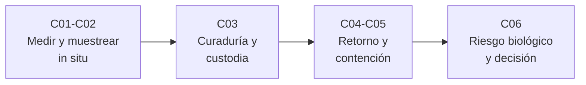

# B63 — Exploración in situ y análisis de muestras planetarias

> **Bloque nuevo de la estructura `0.2.0`.** Sus 6 clases fueron programadas por la reorganización y están redactadas en estado E0 (texto redactado, pendiente de revisión). Ver el [programa completo](../../PROGRAMA_ACADEMICO_COMPLETO.md).

**Programa:** Programa Integral de Astronomía, Astrofísica, Ciencias Espaciales e Ingeniería Aeroespacial
**Área:** A05 — Ciencias planetarias, astroquímica y habitabilidad
**Nivel:** N3 (fundamentos disciplinares) · **Clases:** 6 · **Carga:** por calibrar con el uso
**Estado:** guía pedagógica del bloque. Las clases enlazadas en la tabla están redactadas; todas conservan el estado E0 en el catálogo hasta registrar revisión disciplinar. Ninguna está verificada ni impartida.

## 🎯 Propósito del bloque

Enseña **cómo se mide en el sitio, cómo se toma y cuida una muestra y cómo se decide si puede volver a la Tierra sin riesgo**. Parte de la instrumentación de una sonda o un rover (cámaras, espectrómetros, sismómetros), sigue con la estrategia de muestreo y con la curaduría y la cadena de custodia, y cierra con el enfoque regulatorio y defensivo del retorno de muestras: salvaguardas históricas y de política, contención y marcos de decisión sobre riesgo biológico. Cada clase termina con un cálculo verificable contra un caso analítico; los números de los modelos son **sintéticos** o **ilustrativos** y están rotulados como tales.

## 📚 Al terminar el bloque podrás

1. Relacionar el tamaño de un píxel, el rango y la señal de un instrumento in situ con lo que se puede resolver, y ubicar un sismo con una sola estación.
2. Calcular cuántas muestras se necesitan para cubrir una litología con una confianza dada.
3. Describir y comprobar una cadena de custodia con registros a prueba de manipulación y un balance de masa de la muestra.
4. Explicar la lógica de una arquitectura de retorno de muestras (sellado, ruptura de la cadena de contacto, revisiones) y calcular cómo se combinan barreras independientes.
5. Aplicar los principios de contención (presión negativa, filtración, renovación de aire) con un modelo de balance.
6. Usar un marco bayesiano de decisión para combinar pruebas negativas y decidir entre liberar y retener una muestra.

## 🧭 Secuencia del bloque

**Descripción textual.** Cuatro tramos encadenados: lo que se hace en la superficie (C01–C02), lo que se hace con la muestra desde que se obtiene (C03), cómo se trae y se aísla (C04–C05) y cómo se decide si es segura (C06).

## 🗂️ Las 6 clases en resumen

**Navegación:** cada clase enlaza a la anterior, a la siguiente y a este bloque.

La columna «Evidencia» indica el producto que demostrará el aprendizaje.

### Tramo 1 · Medir y muestrear in situ

| ID | Clase | Qué se aprende | Evidencia |
|---|---|---|---|
| [B63-C01](../clases/B63/B63-C01-instrumentacion-de-sondas-y-rovers-planetarios/CLASE.md) | Instrumentación de sondas y rovers planetarios | Escala de píxel, ruido de fotones y localización sísmica con una estación. | Ficha de un instrumento in situ |
| [B63-C02](../clases/B63/B63-C02-muestreo-superficial-y-estrategias-de-recoleccion/CLASE.md) | Muestreo superficial y estrategias de recolección | Masa de un testigo y probabilidad de cubrir litologías con N muestras. | Plan de muestreo con confianza |

### Tramo 2 · La muestra después de tomarla

| ID | Clase | Qué se aprende | Evidencia |
|---|---|---|---|
| [B63-C03](../clases/B63/B63-C03-curaduria-y-cadena-de-custodia-de-muestras/CLASE.md) | Curaduría y cadena de custodia de muestras | Registro encadenado por hash, balance de masa y contaminación por mezcla. | Registro de custodia verificable |

### Tramo 3 · Retorno y contención

| ID | Clase | Qué se aprende | Evidencia |
|---|---|---|---|
| [B63-C04](../clases/B63/B63-C04-misiones-de-retorno-de-muestras-salvaguardas-historicas-y-regulatorias/CLASE.md) | Misiones de retorno de muestras: salvaguardas históricas y regulatorias | Categoría V, ruptura de la cadena de contacto y combinación de barreras. | Ficha de salvaguardas de un retorno |
| [B63-C05](../clases/B63/B63-C05-contencion-de-muestras-extraterrestres-instalaciones-y-principios/CLASE.md) | Contención de muestras extraterrestres: instalaciones y principios | Cascada de presión, filtración y tiempo de limpieza por renovación de aire. | Ficha de principios de contención |

### Tramo 4 · Decidir bajo incertidumbre

| ID | Clase | Qué se aprende | Evidencia |
|---|---|---|---|
| [B63-C06](../clases/B63/B63-C06-evaluacion-de-riesgos-biologicos-de-muestras-marcos-de-decision/CLASE.md) | Evaluación de riesgos biológicos de muestras: marcos de decisión | Actualización bayesiana con pruebas negativas y decisión liberar/retener. | Marco de decisión con umbrales |

## 🧵 Hilos que atraviesan el bloque

- **Trazabilidad:** C03 registra qué pasó con cada muestra; C04 y C05 la extienden a la nave y a la instalación.
- **Incertidumbre explícita:** C01 (ruido), C02 (confianza de cobertura), C04 (barreras), C06 (probabilidades).
- **Lo simulado no es lo observado:** todos los laboratorios usan datos sintéticos rotulados; las cifras de misiones y políticas se citan con fuente y fecha.
- **Enfoque defensivo:** C04–C06 tratan la protección de la Tierra y de las muestras; no describen cómo manipular agentes biológicos.

## 📝 Evaluación del bloque (propuesta, por calibrar)

- Fichas y ejercicios por clase, con retroalimentación y recuperación con evidencia distinta.
- Portafolio: el marco de decisión de C06 con sus umbrales y supuestos declarados.
- Las condiciones críticas (rotular lo sintético, no presentar un modelo como valor regulatorio u observado y citar solo lo consultado) no se compensan con promedio.

## ⚠️ Seguridad y límites

El bloque es educativo y de enfoque defensivo. Las probabilidades, tasas de fuga y parámetros de las clases C04–C06 son **ilustrativos** y no son requisitos regulatorios ni valores de ninguna instalación real; no sustituyen a la política vigente de protección planetaria ni a las normas de bioseguridad. No se incluyen procedimientos para cultivar, manipular o liberar agentes biológicos.

## 📖 Fuentes consultadas

Consultadas el 2026-11-09 (el detalle por clase está en la sección 11 de cada una):

- COSPAR, *Policy on Planetary Protection* (junio de 2021), PDF leído con PyMuPDF.
- NASA, Safety and Mission Assurance, página de protección planetaria.
- NASA Johnson Space Center, Astromaterials Acquisition and Curation (portada y página lunar).
- NASA, página del rover Perseverance (componentes).
- McDonnell et al. (2026), registro del USGS (solo resumen) del protocolo de evaluación de seguridad de muestras de Marte.
