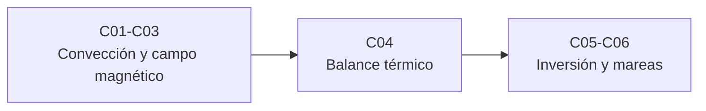

# B65 — Geofísica de interiores planetarios

> **Bloque de la malla `0.2.0`.** Ver el [programa completo](../../PROGRAMA_ACADEMICO_COMPLETO.md).

**Programa:** Programa Integral de Astronomía, Astrofísica, Ciencias Espaciales e Ingeniería Aeroespacial
**Área:** A05 — Ciencias planetarias, astroquímica y habitabilidad
**Nivel:** N3 (fundamentos disciplinares) · **Clases:** 6 · **Carga:** por calibrar con el uso
**Estado:** guía pedagógica del bloque (resumen de qué se aprende en cada clase). Las clases enlazadas en la tabla ya están redactadas; todas conservan el estado E0 en el catálogo hasta registrar revisión disciplinar.

## 🎯 Propósito del bloque

Enseña **cómo se razona sobre el interior de un planeta que no se puede abrir**: cómo un manto sólido convecciona y cómo ese enfriamiento fija la evolución térmica; por qué un núcleo líquido en rotación puede sostener un campo magnético y qué mide una escala de Elsasser; cómo la corteza magnetizada guarda la memoria de un campo antiguo; cómo el flujo de calor superficial separa el calor radiactivo del enfriamiento secular; cómo se combinan masa, momento de inercia y otros datos en una inversión y por qué su solución no es única; y de dónde sale el calor interno de un satélite que no tiene radiactividad suficiente, el calentamiento por marea. Cada clase cierra con un laboratorio en Python que contrasta con un caso analítico o con dos vías independientes, y distingue lo consultado de lo ilustrativo.

## 📚 Al terminar el bloque podrás

1. Calcular un número de Rayleigh, verificar el umbral crítico y seguir un enfriamiento parametrizado del manto.
2. Estimar el campo de una dinamo con la escala de Elsasser y el tiempo de decaimiento óhmico de un campo dipolar.
3. Calcular la anomalía magnética de una corteza magnetizada y recuperar su momento con incertidumbre.
4. Separar calor radiactivo y enfriamiento secular en el flujo superficial y calcular un geotermo y el enfriamiento de la litosfera oceánica.
5. Resolver un modelo interior de dos capas con masa y momento de inercia y reconocer la no unicidad de la inversión.
6. Calcular el calentamiento por marea de un satélite con la fórmula de Peale y contrastarla con una integración numérica de la órbita.

## 🧭 Secuencia del bloque

**Descripción textual.** Tres tramos encadenados: convección, dinamo y magnetismo remanente (C01–C03), el balance térmico que los alimenta (C04) y la confrontación con datos y el caso de los satélites con calor de marea (C05–C06).

## 🗂️ Las 6 clases en resumen

**Navegación:** cada clase desarrollada enlaza a la anterior, a la siguiente y a este bloque.

La columna «Evidencia» indica el producto que demostrará el aprendizaje. Los laboratorios usan datos **sintéticos** o **ilustrativos** (rotulados) o valores publicados con fuente y fecha.

### Tramo 1 · Convección, dinamo y magnetismo remanente

| ID | Clase | Qué se aprende | Evidencia |
|---|---|---|---|
| [B65-C01](../clases/B65/B65-C01-conveccion-del-manto-y-evolucion-termica-de-interiores-planetarios/CLASE.md) | Convección del manto y evolución térmica de interiores planetarios | Umbral crítico de Rayleigh, escala de flujo `Nu ∝ Ra^β` y enfriamiento parametrizado. | Ficha de la convección del manto |
| [B65-C02](../clases/B65/B65-C02-dinamos-planetarias-y-campos-magneticos-de-origen-interno/CLASE.md) | Dinamos planetarias y campos magnéticos de origen interno | Número de Reynolds magnético, escala de Elsasser y decaimiento óhmico del dipolo. | Ficha de la dinamo planetaria |
| [B65-C03](../clases/B65/B65-C03-magnetismo-cortical-remanente-y-anomalias-magneticas/CLASE.md) | Magnetismo cortical remanente y anomalías magnéticas | Anomalía de una esfera magnetizada, integración numérica y ajuste del momento. | Ficha de la anomalía magnética |

### Tramo 2 · Balance térmico

| ID | Clase | Qué se aprende | Evidencia |
|---|---|---|---|
| [B65-C04](../clases/B65/B65-C04-flujo-termico-planetario-y-balance-termico-del-interior/CLASE.md) | Flujo térmico planetario y balance térmico del interior | Flujo medio, geotermo con producción radiactiva y enfriamiento de la litosfera. | Ficha del balance térmico |

### Tramo 3 · Inversión y mareas

| ID | Clase | Qué se aprende | Evidencia |
|---|---|---|---|
| [B65-C05](../clases/B65/B65-C05-inversion-geofisica-conjunta-validacion-de-modelos-interiores/CLASE.md) | Inversión geofísica conjunta: validación de modelos interiores | Dos capas con masa y momento de inercia, familia de soluciones y restricción adicional. | Ficha de la inversión conjunta |
| [B65-C06](../clases/B65/B65-C06-calentamiento-por-marea-y-equilibrio-termico-en-satelites/CLASE.md) | Calentamiento por marea y equilibrio térmico en satélites | Fórmula de Peale frente a integración numérica de la órbita y equilibrio térmico. | Ficha del calentamiento por marea |

## 🧵 Hilos que atraviesan el bloque

- **El calor manda:** C01 y C04 miden el mismo calor desde dos lados (la convección que lo transporta y el flujo que sale); C02 y C06 dependen de él para sostener un campo o fundir un satélite.
- **Dos vías independientes:** cada laboratorio contrasta una solución cerrada con un cálculo numérico, o una fórmula con una integración.
- **Incertidumbre y no unicidad:** C03 ajusta con ruido y error estándar; C05 muestra que pocos datos admiten una familia de modelos.
- **Observado frente a ilustrativo:** ningún cuerpo real se modela con parámetros ajustados a datos; las viscosidades, conductividades, rigideces y modelos de capas son ilustrativos y se rotulan. Solo se citan con fecha las páginas realmente consultadas, y de varias solo el resumen.

## 📝 Evaluación del bloque (propuesta, por calibrar)

- Fichas y ejercicios por clase, con retroalimentación y recuperación con evidencia distinta.
- Portafolio: ficha de la dinamo planetaria (C02) y ficha de la inversión conjunta (C05).
- Las condiciones críticas (rotular lo ilustrativo, no presentar un modelo de juguete como el interior de un cuerpo real y citar solo lo consultado) no se compensan con promedio.

## ⚠️ Seguridad y límites

El bloque es educativo. Los modelos son simplificados (viscosidades constantes o en ley sencilla, capas homogéneas, respuesta de marea de un solo parámetro) y no sustituyen a un código de convección, de dinamo o de evolución térmica de investigación ni a una inversión de misión. No se ajusta ningún cuerpo concreto a datos.

## Roles que lo usan

- [Ciencias planetarias y astrogeología](../../rutas/ciencias-planetarias-y-astrogeologia.md)
- [Astroquímica y astrobiología](../../rutas/astroquimica-y-astrobiologia.md)

## Fuentes consultadas

Consultadas el 2026-11-09 (el detalle por afirmación está en la sección 11 de cada clase; de varias fuentes solo se leyó el resumen, y se indica):

- **[NASA-FS]** NASA/GSFC NSSDC, *Fact Sheets* de la Tierra (actualizada 15-nov-2024), Marte (19-may-2025), la Luna (11-ene-2024), Júpiter (2-oct-2024) y los satélites jovianos (6-dic-2023).
- **[CODATA]** [NIST, Fundamental Physical Constants, ajuste CODATA 2022](https://physics.nist.gov/cuu/Constants/Table/allascii.txt).
- **[DD10]** Davies y Davies, *Earth's surface heat flux*, Solid Earth 1, 5–24, 2010, doi:10.5194/se-1-5-2010 (resumen).
- **[A99]** Acuña et al., *Global Distribution of Crustal Magnetization Discovered by the Mars Global Surveyor MAG/ER Experiment*, Science 284, 790–793, 1999, doi:10.1126/science.284.5415.790 (resumen vía Crossref).
- **[P79]** Peale, Cassen y Reynolds, *Melting of Io by Tidal Dissipation*, Science 203, 892–894, 1979, doi:10.1126/science.203.4383.892 (resumen vía Crossref).
- **[Y13]** Yadav et al., arXiv:1304.6163 y arXiv:1310.0175, 2013 (resúmenes).
- **[FK23]** Ferrick y Korenaga, arXiv:2304.07660, 2023 (resumen).
- **[B25]** Bagheri et al., arXiv:2505.14743, 2025 (resumen).

> Las fórmulas clásicas de la clase (Rayleigh–Bénard, Elsasser, geotermo, Peale) se **verifican numéricamente** en cada laboratorio, pero no se consultaron en un libro de texto: figuran como «no consultado».
