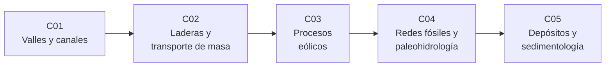

# B66 — Geomorfología y procesos superficiales planetarios

> **Bloque nuevo de la estructura vigente.** Sus 5 clases estaban programadas por la ampliación y ahora están redactadas. Ver el [programa completo](../../PROGRAMA_ACADEMICO_COMPLETO.md).

**Programa:** Programa Integral de Astronomía, Astrofísica, Ciencias Espaciales e Ingeniería Aeroespacial
**Área:** A05 — Ciencias planetarias, astroquímica y habitabilidad
**Nivel:** N3 (fundamentos disciplinares) · **Clases:** 5 · **Carga:** por calibrar con el uso
**Estado:** guía pedagógica del bloque (resumen de qué se aprende en cada clase). Las clases enlazadas en la tabla ya están redactadas; todas conservan el estado E0 en el catálogo hasta registrar revisión disciplinar.

## 🎯 Propósito del bloque

Enseña **cómo leer las formas de una superficie planetaria como evidencia de los procesos que las crearon** y cómo cambian esos procesos cuando cambian la gravedad, la atmósfera y el fluido. Recorre los valles y canales (qué caudal y qué régimen de flujo implican), las laderas y el transporte de masa, el transporte eólico de arena, las redes fluviales fósiles con la estimación de caudal y duración del agua, y los depósitos sedimentarios como archivo de ambientes pasados. Cada clase cierra con un laboratorio en Python con semilla fija que escala una ley terrestre a Marte, Venus o Titán y distingue lo consultado de lo ilustrativo.

## 📚 Al terminar el bloque podrás

1. Estimar la velocidad, el caudal y el número de Froude de un canal con la ecuación de Darcy–Weisbach y ver cómo escalan con la gravedad.
2. Evaluar la estabilidad de una ladera con pendiente infinita y prever velocidad, tiempo y alcance de un deslizamiento en otro cuerpo.
3. Calcular el umbral de movimiento de granos por el viento y la longitud de saltación en cuatro entornos.
4. Extraer una red de drenaje de un modelo de terreno sintético y estimar el caudal y la duración mínima del agua que la excavó.
5. Calcular velocidades de caída, números de Rouse y la progradación de un delta, y clasificar facies sintéticas.
6. Rotular qué es observado, qué es ley consultada y qué es ilustrativo en cada inferencia geomorfológica.

## 🧭 Secuencia del bloque

**Descripción textual.** Cinco clases encadenadas: el flujo en canales (C01), el movimiento por gravedad en laderas (C02), el transporte por el viento (C03), la lectura de redes de drenaje y su caudal y duración (C04) y los depósitos sedimentarios que registran esos procesos (C05). El hilo común es el escalado con la gravedad.

## 🗂️ Las 5 clases en resumen

**Navegación:** cada clase enlaza a la anterior, a la siguiente y a este bloque.

La columna «Evidencia» indica el producto que demostrará el aprendizaje. Los laboratorios usan datos **sintéticos** o **ilustrativos** (rotulados) o valores publicados con fuente y fecha.

### Tramo 1 · Procesos de transporte en la superficie

| ID | Clase | Qué se aprende | Evidencia |
|---|---|---|---|
| [B66-C01](../clases/B66/B66-C01-valles-y-canales-morfologia-y-origen-en-superficies-planetarias/CLASE.md) | Valles y canales: morfología y origen en superficies planetarias | Velocidad, caudal y Froude de un canal con Darcy–Weisbach; escala con `√g`. | Ficha hidráulica de un canal en tres cuerpos |
| [B66-C02](../clases/B66/B66-C02-procesos-de-ladera-y-transporte-de-masa/CLASE.md) | Procesos de ladera y transporte de masa | Pendiente infinita, presión de poros y alcance de un deslizamiento. | Ficha de estabilidad y alcance de una ladera |
| [B66-C03](../clases/B66/B66-C03-procesos-eolicos-dunas-ripples-y-erosion-planetaria/CLASE.md) | Procesos eólicos: dunas, ripples y erosión planetaria | Velocidad umbral de fricción y longitud de saltación en cuatro entornos. | Tabla de umbrales eólicos |

### Tramo 2 · Leer el registro

| ID | Clase | Qué se aprende | Evidencia |
|---|---|---|---|
| [B66-C04](../clases/B66/B66-C04-redes-fluviales-fosiles-y-paleohidrologia-marciana/CLASE.md) | Redes fluviales fósiles y paleohidrología marciana | Flujo D8, acumulación, densidad de drenaje y duración mínima del agua. | Ficha paleohidrológica de una cuenca sintética |
| [B66-C05](../clases/B66/B66-C05-depositos-sedimentarios-y-sedimentologia-planetaria/CLASE.md) | Depósitos sedimentarios y sedimentología planetaria | Velocidad de caída, número de Rouse, progradación de un delta y facies. | Columna estratigráfica sintética con facies |

## 🧵 Hilos que atraviesan el bloque

- **Escalado con la gravedad:** `√g` en C01, `g` y tiempos en C02, umbral en C03, caída en C05.
- **Inferir procesos desde formas:** C01, C04 y C05 van de la forma al caudal, la duración y el ambiente.
- **Observado frente a modelado:** todo número del bloque es un modelo con datos sintéticos o ilustrativos; ninguno es una medición.
- **Verificación independiente:** cada laboratorio contrasta con un caso analítico o con otra vía de cálculo.

## 📝 Evaluación del bloque (propuesta, por calibrar)

- Fichas y ejercicios por clase, con retroalimentación y recuperación con evidencia distinta.
- Portafolio: la ficha paleohidrológica (C04) con sus supuestos y su sensibilidad.
- Las condiciones críticas (rotular lo ilustrativo y sintético, no presentar un modelo como observación y citar solo lo consultado) no se compensan con promedio.

## ⚠️ Seguridad y límites

El bloque es educativo. Las leyes son relaciones de escala simplificadas (pendiente infinita, fricción constante, granos esféricos, flujo uniforme) y no sustituyen a la literatura primaria ni a la interpretación de datos de misión. Las cifras de Marte, Venus y Titán proceden de las fichas citadas o están rotuladas como ilustrativas; las atmósferas y granos de Titán no se consultaron.

## 📖 Fuentes consultadas en el bloque (resumen)

Consultadas el 2026-11-09: las fichas de datos planetarios de la NASA/NSSDC (Tierra, Marte, Venus), la tabla de parámetros físicos de satélites del JPL (Titán: `GM` y radio medio), las constantes del NIST (CODATA 2022: `R` y `gₙ`) y el resumen del artículo de revisión de Kok et al. (2012) sobre arena y polvo transportados por el viento. De Kok et al. solo se consultó el resumen. Las leyes de escala (Darcy–Weisbach, pendiente infinita, Bagnold, Rouse, Stokes) son relaciones estándar que verifica cada laboratorio y no se consultaron en una fuente concreta. La ficha de Titán de la NASA no listó gravedad, presión ni temperatura de superficie: esos datos no se consultaron.

## Fuentes de orientación preliminar

- **[NASA-PDS]** [NASA Planetary Data System](https://pds.nasa.gov/) — Archivo de datos de misiones planetarias.
- **[USGS-ASTRO]** [USGS Astrogeology Science Center](https://astrogeology.usgs.gov/) — Cartografía y geología planetaria.
- **[ESA-SCIENCE]** [European Space Agency Science](https://www.esa.int/Science_Exploration/Space_Science) — Misiones, descubrimientos y material científico institucional.
- **[ADS]** [NASA Astrophysics Data System](https://ui.adsabs.harvard.edu/) — Índice bibliográfico de literatura astronómica y física.

> La asociación de estas fuentes es orientativa por bloque. Las fuentes realmente consultadas para cada afirmación se registran en la sección 11 de cada clase.

## Roles que lo usan

- [Ciencias planetarias y astrogeología](../../rutas/ciencias-planetarias-y-astrogeologia.md)

[🏠 Volver al programa](../../README.md) · [➡️ B67 — Prospección y evaluación de reservas de recursos extraterrestres](./B67-prospeccion-y-evaluacion-de-reservas-de-recursos-extraterrestres.md)
