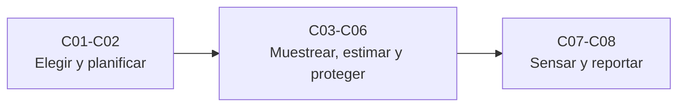

# B67 — Prospección y evaluación de reservas de recursos extraterrestres

> **Bloque de la malla `0.2.0`.** Ver el [programa completo](../../PROGRAMA_ACADEMICO_COMPLETO.md).

**Programa:** Programa Integral de Astronomía, Astrofísica, Ciencias Espaciales e Ingeniería Aeroespacial
**Área:** A05 — Ciencias planetarias, astroquímica y habitabilidad
**Nivel:** N3 (fundamentos disciplinares) · **Clases:** 8 · **Carga:** por calibrar con el uso
**Estado:** guía pedagógica del bloque (resumen de qué se aprende en cada clase). Las clases enlazadas en la tabla ya están redactadas; todas conservan el estado E0 en el catálogo hasta registrar revisión disciplinar.

## 🎯 Propósito del bloque

Enseña **cómo se decide dónde buscar un recurso volátil en otro cuerpo, cómo se confirma, cuánto hay y qué tan seguro es ese número**: la selección de sitios con criterios múltiples, el programa de prospección por fases con actualización bayesiana, el muestreo criogénico y su presupuesto de pérdida, la estimación de recursos y reservas con categorías de confianza, el kriging para interpolar entre muestras, la pérdida térmica de hielo enterrado, los sensores de neutrones y de masas y el informe de disponibilidad con percentiles. Cada clase cierra con un laboratorio en Python que contrasta con una solución analítica o con una simulación de semilla fija, y distingue lo consultado de lo ilustrativo. **Todos los datos del bloque son sintéticos.**

## 📚 Al terminar el bloque podrás

1. Comparar sitios con criterios de unidades distintas sin que el orden dependa de las unidades, y medir la robustez frente a los pesos.
2. Diseñar un programa de fases y calcular su probabilidad posterior y su costo esperado.
3. Calcular la presión de vapor del hielo con una ecuación publicada y el presupuesto de pérdida de una muestra.
4. Propagar incertidumbres a una masa de hielo, asignar categorías de confianza y convertir recursos en reservas con factores modificadores.
5. Interpolar con kriging ordinario, estimar su varianza y validarlo.
6. Modelar la onda térmica en el regolito y la pérdida de hielo enterrado, y explicar por qué no basta la temperatura media.
7. Invertir conteos de neutrones y desmezclar un espectro de masas con su incertidumbre.
8. Redactar un informe con P90, P50 y P10, disponibilidad, factores dominantes y límites.

## 🧭 Secuencia del bloque

**Descripción textual.** Tres tramos encadenados: elegir el sitio y planificar la prospección (C01–C02), muestrear, estimar y proteger el volátil (C03–C06) y medirlo con sensores y reportarlo con incertidumbre (C07–C08).

## 🗂️ Las 8 clases en resumen

**Navegación:** cada clase desarrollada enlaza a la anterior, a la siguiente y a este bloque.

La columna «Evidencia» indica el producto que demostrará el aprendizaje. Los laboratorios usan datos **sintéticos** o **ilustrativos** (rotulados) o valores publicados con fuente y fecha.

### Tramo 1 · Elegir y planificar

| ID | Clase | Qué se aprende | Evidencia |
|---|---|---|---|
| [B67-C01](../clases/B67/B67-C01-seleccion-de-sitios-de-extraccion-con-criterios-multiples/CLASE.md) | Selección de sitios de extracción con criterios múltiples | Normalización min-max, puntaje ponderado, frente de Pareto y robustez frente a los pesos. | Ficha de selección multicriterio |
| [B67-C02](../clases/B67/B67-C02-diseno-de-un-programa-de-prospeccion-por-fases/CLASE.md) | Diseño de un programa de prospección por fases | Bayes encadenado, costo esperado y comparación con perforar todo. | Ficha del programa de prospección por fases |

### Tramo 2 · Muestrear, estimar y proteger

| ID | Clase | Qué se aprende | Evidencia |
|---|---|---|---|
| [B67-C03](../clases/B67/B67-C03-muestreo-criogenico-y-preservacion-de-volatiles-en-muestras/CLASE.md) | Muestreo criogénico y preservación de volátiles en muestras | Presión de vapor del hielo, flujo de sublimación y temperatura máxima de manipulación. | Ficha del presupuesto de pérdida de una muestra |
| [B67-C04](../clases/B67/B67-C04-estimacion-de-reservas-y-categorias-de-recursos/CLASE.md) | Estimación de reservas y categorías de recursos | Propagación de incertidumbre, categorías por confianza y conversión a reserva. | Ficha de recursos y reservas de un bloque |
| [B67-C05](../clases/B67/B67-C05-modelos-geoestadisticos-de-distribucion-de-volatiles/CLASE.md) | Modelos geoestadísticos de distribución de volátiles | Variograma, kriging ordinario, varianza de kriging y validación cruzada. | Ficha del modelo geoestadístico |
| [B67-C06](../clases/B67/B67-C06-perdida-de-volatiles-por-sublimacion-y-migracion-termica/CLASE.md) | Pérdida de volátiles por sublimación y migración térmica | Onda térmica, transmisión de poro y desigualdad de Jensen en la pérdida anual. | Ficha de pérdida térmica de un depósito |

### Tramo 3 · Sensar y reportar

| ID | Clase | Qué se aprende | Evidencia |
|---|---|---|---|
| [B67-C07](../clases/B67/B67-C07-sensores-para-volatiles-espectrometria-de-neutrones-y-de-masas/CLASE.md) | Sensores para volátiles: espectrometría de neutrones y de masas | Conteo de Poisson, tiempo de detección y desmezcla ponderada de un espectro. | Ficha de detección y cuantificación de volátiles |
| [B67-C08](../clases/B67/B67-C08-informe-de-disponibilidad-de-volatiles-con-incertidumbre/CLASE.md) | Informe de disponibilidad de volátiles con incertidumbre | Percentiles analíticos y Monte Carlo, atribución de varianza, calibración y plantilla del informe. | Ficha del informe de disponibilidad con incertidumbre |

## 🧵 Hilos que atraviesan el bloque

- **De la decisión al número:** C01–C02 deciden dónde y cómo buscar; C03–C06 llevan del muestreo a la masa y a su pérdida; C07–C08 la miden y la reportan.
- **Una misma masa:** el producto `área × espesor × densidad × fracción de hielo × factores` reaparece en C04 y C08, con sus incertidumbres propagadas de forma analítica y por Monte Carlo.
- **Incertidumbre:** C02 usa probabilidades, C04 intervalos y categorías, C05 varianza de kriging, C07 conteos de Poisson y C08 percentiles calibrados.
- **El hielo se pierde con la temperatura:** C03 y C06 comparten la presión de vapor de una ecuación publicada y muestran por qué la oscilación térmica importa más que la media.
- **Observado frente a sintético:** ningún sitio, depósito ni instrumento real se modela; todos los datos son inventados y rotulados, y solo se citan con fecha las páginas realmente consultadas.

## 📝 Evaluación del bloque (propuesta, por calibrar)

- Fichas y ejercicios por clase, con retroalimentación y recuperación con evidencia distinta.
- Portafolio: ficha del programa por fases (C02) y ficha del informe de disponibilidad (C08).
- Las condiciones críticas (rotular lo sintético, no presentar lo simulado como observado, no declarar reservas de ningún sitio real y citar solo lo consultado) no se compensan con promedio.

## ⚠️ Seguridad y límites

El bloque es educativo. Los modelos son simplificados y no sustituyen ni una declaración de recursos o reservas conforme a una norma de reporte, ni un estudio de prospección real. No se evalúa, certifica ni recomienda ningún sitio, empresa o instrumento concreto. Las categorías, los umbrales y las convenciones de percentiles son didácticos y no reproducen ninguna norma.

## Roles que lo usan

- [Recursos extraterrestres y economía industrial espacial](../../rutas/recursos-extraterrestres-y-economia-industrial-espacial.md)

## Fuentes de orientación preliminar

- **[Murphy-Koop]** [Murphy y Koop (2005), vapour pressures of ice and supercooled water](https://zenodo.org/records/1236243) — Ecuación de la presión de vapor del hielo (consultada el 2026-11-09, solo la ecuación (7)).
- **[NASA-VIPER]** [NASA, VIPER](https://science.nasa.gov/mission/viper) — Contexto de una misión de prospección de hielo polar (consultada el 2026-11-09).
- **[GIS-Geography]** [GIS Geography, semivariograma](https://gisgeography.com/semi-variogram-nugget-range-sill/) — Definiciones divulgativas de pepita, meseta y rango (consultada el 2026-11-09).
- **[CRIRSCO]** [CRIRSCO, International Reporting Template](https://crirsco.com/templates/international-reporting-template/) — Solo la descripción general de la organización; las definiciones de categorías no se consultaron.
- **[Feldman-1998, Colaprete-2010]** Feldman et al., *Science* 281, 1496 (1998) y Colaprete et al., *Science* 330, 463 (2010) — solo resúmenes obtenidos por búsqueda web el 2026-11-09; los textos no se consultaron.

> La asociación de estas fuentes es orientativa por bloque. Las fuentes realmente consultadas para cada afirmación se registran en la sección 11 de cada clase.

[🏠 Volver al programa](../../README.md) · [⬅️ B66 — Geomorfología y procesos superficiales planetarios](./B66-geomorfologia-y-procesos-superficiales-planetarios.md) · [➡️ B68 — Química de granos y hielos interestelares](./B68-quimica-de-granos-y-hielos-interestelares.md)
