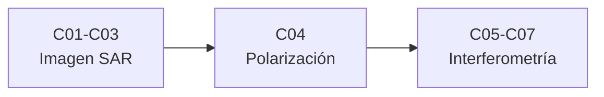

# B69 — Radar de apertura sintética e interferometría (profundización)

> **Bloque de la estructura vigente.** Ver el [programa completo](../../PROGRAMA_ACADEMICO_COMPLETO.md).

**Programa:** Programa Integral de Astronomía, Astrofísica, Ciencias Espaciales e Ingeniería Aeroespacial
**Área:** A05 — Ciencias planetarias, astroquímica y habitabilidad
**Nivel:** N3 (fundamentos disciplinares) · **Clases:** 7 · **Carga:** por calibrar con el uso
**Estado:** guía pedagógica del bloque (resumen de qué se aprende en cada clase). Las clases enlazadas en la tabla ya están redactadas; todas conservan el estado E0 en el catálogo hasta registrar revisión disciplinar.

## 🎯 Propósito del bloque

Enseña **cómo un radar de apertura sintética (SAR) produce una imagen y cómo dos imágenes dan una medida de movimiento del suelo**: el principio Doppler que fija la resolución en azimut, la formación de la imagen con compresión en alcance y en azimut y la corrección de la migración de celda, el ruido speckle y su filtrado, la polarimetría con la descomposición de Pauli, la coherencia interferométrica y sus fuentes de decorrelación, la medición de subsidencia y deslizamientos con InSAR y la evaluación de la calidad de un interferograma. Cada clase cierra con un laboratorio en Python sobre datos **sintéticos** (rotulados) que contrasta el cálculo con un caso analítico o con una cota teórica.

## 📚 Al terminar el bloque podrás

1. Explicar por qué la resolución en azimut de un SAR es L/2 y no depende de la distancia, a partir de la historia de fase Doppler.
2. Formar una imagen a partir de ecos crudos simulados y medir su resolución, su lóbulo lateral y el efecto de la migración de celda.
3. Describir el speckle como ruido multiplicativo, calcular su contraste y el número equivalente de vistas, y filtrarlo con multivista y con el filtro de Lee.
4. Calcular el vector de Pauli y la entropía de un conjunto de blancos y explicar qué mecanismo de dispersión representan.
5. Modelar la coherencia interferométrica y sus decorrelaciones por ruido, tiempo y geometría, y reconocer el sesgo del estimador.
6. Convertir la fase interferométrica en desplazamiento en la línea de visión, descomponerlo con dos geometrías y reconocer el límite del gradiente de fase.
7. Evaluar un interferograma con la cota de la desviación de fase, los residuos de desenvoltura y el cierre de fase de tripletes.

## 🧭 Secuencia del bloque

**Descripción textual.** Tres tramos encadenados: de la señal Doppler a una imagen sin demasiado speckle (C01–C03), la información de polarización (C04) y la interferometría, desde la coherencia hasta la evaluación del resultado (C05–C07).

## 🗂️ Las 7 clases en resumen

**Navegación:** cada clase desarrollada enlaza a la anterior, a la siguiente y a este bloque.

La columna «Evidencia» indica el producto que demostrará el aprendizaje. Los laboratorios usan datos **sintéticos** rotulados; no se procesa ninguna escena observada.

### Tramo 1 · Imagen SAR

| ID | Clase | Qué se aprende | Evidencia |
|---|---|---|---|
| [B69-C01](../clases/B69/B69-C01-principio-doppler-y-resolucion-en-azimut-del-sar/CLASE.md) | Principio Doppler y resolución en azimut del SAR | Historia de fase, tasa Doppler, ancho de banda y resolución L/2. | Ficha del principio Doppler |
| [B69-C02](../clases/B69/B69-C02-formacion-de-imagenes-sar/CLASE.md) | Formación de imágenes SAR | Compresión en alcance y azimut, migración de celda y su corrección. | Ficha de la formación de la imagen |
| [B69-C03](../clases/B69/B69-C03-ruido-speckle-y-filtrado-en-imagenes-sar/CLASE.md) | Ruido speckle y filtrado en imágenes SAR | Contraste, número equivalente de vistas, multivista y filtro de Lee. | Ficha del speckle y su filtrado |

### Tramo 2 · Polarización

| ID | Clase | Qué se aprende | Evidencia |
|---|---|---|---|
| [B69-C04](../clases/B69/B69-C04-polarimetria-sar/CLASE.md) | Polarimetría SAR | Matriz de dispersión, descomposición de Pauli y entropía. | Ficha de la polarimetría |

### Tramo 3 · Interferometría

| ID | Clase | Qué se aprende | Evidencia |
|---|---|---|---|
| [B69-C05](../clases/B69/B69-C05-coherencia-interferometrica-y-decorrelacion/CLASE.md) | Coherencia interferométrica y decorrelación | Estimador de coherencia, su sesgo y decorrelación por ruido, tiempo y geometría. | Ficha de la coherencia |
| [B69-C06](../clases/B69/B69-C06-deslizamientos-y-subsidencia-medidos-con-insar/CLASE.md) | Deslizamientos y subsidencia medidos con InSAR | De fase a desplazamiento, límite del gradiente y descomposición ascendente–descendente. | Ficha de la deformación |
| [B69-C07](../clases/B69/B69-C07-evaluacion-de-la-calidad-de-un-interferograma/CLASE.md) | Evaluación de la calidad de un interferograma | Cota de la desviación de fase, residuos y cierre de fase. | Ficha de la calidad del interferograma |

## 🧵 Hilos que atraviesan el bloque

- **De la señal a la medida:** C01–C03 forman y limpian la imagen; C05–C07 usan la fase de dos imágenes para medir movimiento.
- **Un mismo sensor sintético:** los laboratorios reutilizan una configuración ilustrativa de banda C (λ = 0,0555 m, v = 7100 m/s, R₀ = 850 km, antena de 12 m) que no es la de ningún satélite real.
- **Incertidumbre:** la coherencia (C05) fija la desviación de la fase (C07), que a su vez fija el error del desplazamiento (C06).
- **Observado frente a sintético:** ninguna escena real se procesa; todo resultado numérico proviene de simulaciones con semilla fija y se rotula como tal.

## 📝 Evaluación del bloque (propuesta, por calibrar)

- Fichas y ejercicios por clase, con retroalimentación y recuperación con evidencia distinta.
- Portafolio: ficha de la formación de la imagen (C02) y ficha de la calidad del interferograma (C07).
- Las condiciones críticas (rotular lo sintético, no presentar lo simulado como observado y citar solo lo consultado) no se compensan con promedio.

## ⚠️ Seguridad y límites

El bloque es educativo. Los modelos son simplificados (blancos puntuales, atmósfera y topografía ya corregidas) y no sustituyen a un procesador SAR operativo ni a la validación de un resultado de deformación; no se interpreta ningún movimiento real del terreno ni se evalúa el riesgo de ninguna ladera. Un resultado InSAR real exige además corrección atmosférica, de órbita y de topografía, y validación con datos independientes.

## Roles que lo usan

- [Observación terrestre y geointeligencia científica](../../rutas/observacion-terrestre-y-geointeligencia-cientifica.md)

## Fuentes consultadas

- **[S1]** NASA Earthdata, «Synthetic Aperture Radar (SAR)» (https://www.earthdata.nasa.gov/learn/earth-observation-data-basics/sar) — consultada el 2026-11-09 (página completa): apertura sintética, resolución, speckle, polarización e InSAR. Es una página divulgativa; las fórmulas de las clases las verifican los laboratorios, no esta fuente.
- No consultados (por tanto no citados en las clases): el manual de SAR de la NASA/ASF y la publicación de principios de InSAR de la ESA (TM-19), cuyos enlaces dieron error 404 el 2026-11-09.

> Las fuentes realmente consultadas para cada afirmación se registran en la sección 11 de cada clase.

[🏠 Volver al programa](../../README.md) · [⬅️ B68 — Química de granos y hielos interestelares](./B68-quimica-de-granos-y-hielos-interestelares.md)
