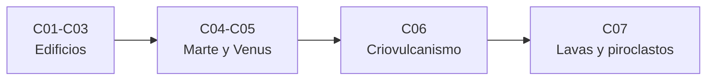

# B70 — Vulcanismo planetario

> **Bloque de la malla `0.2.0`.** Ver el [programa completo](../../PROGRAMA_ACADEMICO_COMPLETO.md).

**Programa:** Programa Integral de Astronomía, Astrofísica, Ciencias Espaciales e Ingeniería Aeroespacial
**Área:** A05 — Ciencias planetarias, astroquímica y habitabilidad
**Nivel:** N3 (fundamentos disciplinares) · **Clases:** 7 · **Carga:** por calibrar con el uso
**Estado:** guía pedagógica del bloque (resumen de qué se aprende en cada clase). Las clases enlazadas en la tabla ya están redactadas; todas conservan el estado E0 en el catálogo hasta registrar revisión disciplinar.

## 🎯 Propósito del bloque

Enseña **cómo se lee y se modela el vulcanismo de otros mundos con relaciones simples y comprobables**: los estilos basálticos (escudos, fisuras, llanuras), los domos de magmas evolucionados, la mecánica de las calderas, el caso de Marte con la datación por cráteres, la búsqueda de actividad reciente en Venus, el criovulcanismo y, por último, la reología de las lavas y el transporte de piroclastos. En todas, la gravedad, la viscosidad y la resistencia del material fijan la forma que se observa. Cada clase cierra con un laboratorio en Python que contrasta el modelo con un caso analítico, e indica qué es consultado, qué es ilustrativo y qué es sintético.

## 📚 Al terminar el bloque podrás

1. Calcular el volumen de un escudo y el caudal de una fisura (flujo de Poiseuille) y su escala con la gravedad.
2. Predecir el perfil y la altura de un domo con resistencia a la fluencia.
3. Plantear la condición de colapso de un pistón de caldera y el hundimiento que deja un volumen evacuado.
4. Invertir una densidad de cráteres a una edad con su incertidumbre de Poisson.
5. Estimar el contraste térmico de una lava reciente en Venus a 1,02 µm.
6. Calcular la sobrepresión que necesita el agua para subir por una capa de hielo y la velocidad de salida de un chorro de vapor.
7. Obtener el caudal de un flujo newtoniano y de Bingham y el alcance de un clasto balístico con y sin resistencia del aire.

## 🧭 Secuencia del bloque

**Descripción textual.** Cuatro tramos encadenados: la forma de los edificios (C01–C03), dos planetas rocosos concretos (C04–C05), el vulcanismo de hielo (C06) y el transporte de lava y piroclastos (C07).

## 🗂️ Las 7 clases en resumen

**Navegación:** cada clase desarrollada enlaza a la anterior, a la siguiente y a este bloque.

La columna «Evidencia» indica el producto que demostrará el aprendizaje. Los laboratorios usan datos **sintéticos** o **ilustrativos** (rotulados) o valores publicados con fuente y fecha.

### Tramo 1 · Los edificios volcánicos

| ID | Clase | Qué se aprende | Evidencia |
|---|---|---|---|
| [B70-C01](../clases/B70/B70-C01-volcanismo-basaltico-escudos-fisuras-y-llanuras-planetarias/CLASE.md) | Volcanismo basáltico: escudos, fisuras y llanuras planetarias | Volumen de un escudo, flujo en una fisura y su escala con la gravedad. | Ficha del volcanismo basáltico |
| [B70-C02](../clases/B70/B70-C02-domos-volcanicos-y-vulcanismo-evolucionado/CLASE.md) | Domos volcánicos y vulcanismo evolucionado | Perfil plástico de un domo, altura y volumen. | Ficha del domo |
| [B70-C03](../clases/B70/B70-C03-calderas-planetarias-formacion-y-colapso/CLASE.md) | Calderas planetarias: formación y colapso | Condición de colapso del pistón y hundimiento por volumen evacuado. | Ficha de la caldera |

### Tramo 2 · Marte y Venus

| ID | Clase | Qué se aprende | Evidencia |
|---|---|---|---|
| [B70-C04](../clases/B70/B70-C04-vulcanismo-marciano-provincias-edades-y-evolucion/CLASE.md) | Vulcanismo marciano: provincias, edades y evolución | Edad a partir de la densidad de cráteres y su incertidumbre de Poisson. | Ficha de la edad de una provincia |
| [B70-C05](../clases/B70/B70-C05-actividad-volcanica-venusina-llanuras-coronas-e-indicios-de-actividad-reciente/CLASE.md) | Actividad volcánica venusina: llanuras, coronas e indicios de actividad reciente | Contraste de Planck de una lava reciente a 1,02 µm. | Ficha del indicio de actividad |

### Tramo 3 · Vulcanismo de hielo

| ID | Clase | Qué se aprende | Evidencia |
|---|---|---|---|
| [B70-C06](../clases/B70/B70-C06-criovulcanismo-lavas-heladas-y-emision-de-volatiles/CLASE.md) | Criovulcanismo: lavas heladas y emisión de volátiles | Sobrepresión para subir agua por el hielo y chorro de vapor sónico. | Ficha del criovulcanismo |

### Tramo 4 · Lavas y piroclastos

| ID | Clase | Qué se aprende | Evidencia |
|---|---|---|---|
| [B70-C07](../clases/B70/B70-C07-flujos-de-lava-y-depositos-piroclasticos/CLASE.md) | Flujos de lava y depósitos piroclásticos | Caudal newtoniano y de Bingham y alcance balístico. | Ficha de flujos y piroclastos |

## 🧵 Hilos que atraviesan el bloque

- **La gravedad como escala:** C01, C02, C06 y C07 comparan la Tierra, la Luna, Marte, Venus y Encélado cambiando solo `g`.
- **Reología:** viscosidad (C01, C07), resistencia a la fluencia (C02, C07) y resistencia al corte (C03) deciden la forma.
- **Observado frente a modelado:** C04 y C05 separan lo medido por misiones de lo que el modelo predice.
- **Un cálculo contra su caso analítico:** cada laboratorio integra numéricamente y compara con una fórmula cerrada.

## 📝 Evaluación del bloque (propuesta, por calibrar)

- Fichas y ejercicios por clase, con retroalimentación y recuperación con evidencia distinta.
- Portafolio: ficha del domo (C02) y ficha de flujos y piroclastos (C07).
- Las condiciones críticas (rotular lo ilustrativo y lo sintético, no presentar lo simulado como observado y citar solo lo consultado) no se compensan con promedio.

## ⚠️ Seguridad y límites

El bloque es educativo. Los modelos son simplificados y no sustituyen a un modelo numérico de erupciones ni a la evaluación de un peligro volcánico real; no se pronostica ninguna erupción. Las propiedades de lavas, rocas y hielos son ilustrativas y se rotulan como tales.

## 📖 Fuentes consultadas en el bloque (resumen)

Las clases citan, con localizador, qué respalda cada fuente, fecha de consulta (2026-11-09) y estado. Las gravedades, radios y la temperatura de Venus proceden de las hojas de datos de la NASA/NSSDC (Venus, Marte, Luna y satélites de Saturno; para Encélao la hoja da masa y dimensiones y la gravedad se calculó). De Herrick y Hensley (2023), Shalygin et al. (2015), Wilson y Head (1994) y Porco et al. (2006) solo se consultó el resumen; de Hartmann y Neukum (2001), Crawford y Stevenson (1988) y Nye (1952) solo los metadatos bibliográficos. Las constantes SI son las definidas por el SI (h, k, c) y CODATA para G. Los coeficientes de cráteres, las propiedades de las lavas y los volúmenes de los ejemplos son ilustrativos o sintéticos y están rotulados en cada clase.

## Roles que lo usan

- [Ciencias planetarias y astrogeología](../../rutas/ciencias-planetarias-y-astrogeologia.md)

## Fuentes de orientación preliminar

- **[NASA-DATA]** [NASA Science Data](https://science.data.nasa.gov/) — Portal general de datos y servicios científicos.
- **[USGS-VOLC]** [USGS Volcano Hazards Program](https://www.usgs.gov/programs/VHP) — Orientación general sobre volcanes (no consultada para las clases).

> La asociación de estas fuentes es orientativa por bloque. Las fuentes realmente consultadas para cada afirmación se registran en la sección 11 de cada clase.

[🏠 Volver al programa](../../README.md) · [➡️ B71 — Mecánica orbital fundamental](./B71-mecanica-orbital-fundamental.md)
