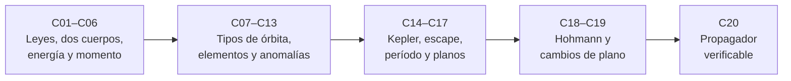

# B71 — Mecánica orbital fundamental

> **Bloque de la malla `0.2.0`.** Ver el [programa completo](../../PROGRAMA_ACADEMICO_COMPLETO.md).

**Programa:** Programa Integral de Astronomía, Astrofísica, Ciencias Espaciales e Ingeniería Aeroespacial
**Área:** A06 — Mecánica orbital, navegación y vuelo espacial
**Nivel:** N3 (fundamentos disciplinares) · **Clases:** 20 · **Carga:** por calibrar con el uso
**Estado:** guía pedagógica del bloque (resumen de qué se aprende en cada clase). Las clases enlazadas en la tabla ya están redactadas; todas conservan el estado E0 en el catálogo hasta registrar revisión disciplinar.

## 🎯 Propósito del bloque

Enseña **cómo se mueve un cuerpo bajo la gravedad de otro y cómo se calcula ese movimiento con números verificables**. Parte de las leyes de Kepler y de la gravitación de Newton, plantea el problema de dos cuerpos con su parámetro gravitacional `μ`, deduce las cantidades que se conservan (energía y momento angular específicos), clasifica las órbitas por su excentricidad y las describe con los seis elementos clásicos. Resuelve la ecuación de Kepler, calcula velocidades de escape y períodos, y termina con las maniobras más simples (Hohmann y cambios de plano) y con un propagador kepleriano cuya salida se contrasta con un integrador independiente. Cada clase cierra con un laboratorio en Python, con semilla fija cuando hay azar, que declara unidades, sistema de referencia, datos y tolerancias.

## 📚 Al terminar el bloque podrás

1. Obtener `GM` desde un semieje y un período, y contrastarlo con los valores nominales de la IAU.
2. Calcular energía y momento angular específicos de una órbita y comprobar que se conservan en una integración numérica.
3. Pasar entre apsides, semieje, excentricidad, período y velocidades en órbitas circulares, elípticas e hiperbólicas.
4. Convertir elementos clásicos en vector de estado y de vuelta, con el cuadrante correcto de `Ω`, `ω` y `ν`, y saber cuándo un elemento está mal condicionado.
5. Resolver la ecuación de Kepler con varios métodos y elegir el valor inicial según la excentricidad.
6. Dimensionar una transferencia de Hohmann y un cambio de plano y saber cuándo conviene combinarlos.
7. Verificar un propagador kepleriano con invariantes, un integrador independiente y tolerancias declaradas.

## 🧭 Secuencia del bloque

**Descripción textual.** Veinte clases encadenadas: las leyes y el problema de dos cuerpos con sus invariantes (C01–C06), la clasificación de las órbitas y los elementos clásicos (C07–C13), las herramientas de cálculo —ecuación de Kepler, escape, período y marcos orbitales— (C14–C17), las maniobras elementales (C18–C19) y la verificación de un propagador (C20). El hilo común es que cada fórmula se comprueba con una segunda vía.

## 🗂️ Las 20 clases en resumen

**Navegación:** cada clase enlaza a la anterior, a la siguiente y a este bloque.

La columna «Evidencia» indica el producto que demostrará el aprendizaje. Los laboratorios usan constantes con fuente y fecha (NIST, IAU, NASA/NSSDC) o datos **sintéticos** o **ilustrativos** rotulados.

### Tramo 1 · Fundamentos de la dinámica orbital

| ID | Clase | Qué se aprende | Evidencia |
|---|---|---|---|
| [B71-C01](../clases/B71/B71-C01-leyes-de-kepler/CLASE.md) | Leyes de Kepler | Comprueba `a³/T²` en Tierra, Marte y la Luna, la ley de las áreas con una integración numérica y estima `GM` desde `a` y `T`. | Ficha de las tres leyes con `GM` estimado frente al nominal |
| [B71-C02](../clases/B71/B71-C02-ley-de-gravitacion-universal/CLASE.md) | Ley de gravitación universal | Aceleración `GM/r²`, ensayo de la Luna de Newton y masa de la Tierra desde `GM/G`. | Ficha de la gravitación con el ensayo de la Luna |
| [B71-C03](../clases/B71/B71-C03-ecuacion-de-movimiento-de-dos-cuerpos/CLASE.md) | Ecuación de movimiento de dos cuerpos | Movimiento relativo `r̈ = −μ r/r³`, masa reducida, baricentro Tierra–Luna y convergencia de un integrador RK4. | Ficha del problema de dos cuerpos con su orden de convergencia |
| [B71-C04](../clases/B71/B71-C04-parametro-gravitacional/CLASE.md) | Parámetro gravitacional | `μ = GM` frente a `G` y `M` por separado, propagación de la incertidumbre y conversión de unidades. | Tabla de parámetros gravitacionales con incertidumbre |
| [B71-C05](../clases/B71/B71-C05-energia-orbital-especifica/CLASE.md) | Energía orbital específica | `ε = v²/2 − μ/r = −μ/(2a)`, vis-viva y conservación en una órbita numérica. | Ficha energética de una órbita de transferencia geoestacionaria |
| [B71-C06](../clases/B71/B71-C06-momento-angular-especifico/CLASE.md) | Momento angular específico | `h = r × v`, `h = √(μ p)`, velocidad areolar y relación `r_p v_p = r_a v_a`. | Ficha de momento angular con el balance en periápside y apoápside |

### Tramo 2 · Tipos de órbita y elementos

| ID | Clase | Qué se aprende | Evidencia |
|---|---|---|---|
| [B71-C07](../clases/B71/B71-C07-orbitas-circulares/CLASE.md) | Órbitas circulares | `v = √(μ/r)`, período, radio geoestacionario y circulares en Tierra, Luna y Marte. | Tabla de órbitas circulares en cuatro entornos |
| [B71-C08](../clases/B71/B71-C08-orbitas-elipticas/CLASE.md) | Órbitas elípticas | Geometría de la elipse, `r_p`, `r_a`, velocidades extremas y suma de distancias a los focos. | Ficha de una órbita elíptica con su geometría |
| [B71-C09](../clases/B71/B71-C09-orbitas-parabolicas-e-hiperbolicas/CLASE.md) | Órbitas parabólicas e hiperbólicas | `e ≥ 1`, `C3 = v∞²`, ángulo de giro y parámetro de impacto de una hipérbola. | Ficha de una órbita de escape con `C3` y ángulo de giro |
| [B71-C10](../clases/B71/B71-C10-semieje-mayor-y-excentricidad/CLASE.md) | Semieje mayor y excentricidad | Elementos `a` y `e` desde los apsides y desde un vector de estado; sensibilidad a un error de velocidad. | Ficha de `a` y `e` con la sensibilidad a `δv` |
| [B71-C11](../clases/B71/B71-C11-inclinacion-y-nodo-ascendente/CLASE.md) | Inclinación y nodo ascendente | `i` desde `h_z/h`, nodo ascendente con el cuadrante correcto y latitud máxima. | Ficha de `i` y `Ω` recuperados en 1.000 casos sintéticos |
| [B71-C12](../clases/B71/B71-C12-argumento-del-periapsis/CLASE.md) | Argumento del periapsis | `ω` desde los vectores nodo y excentricidad; mal condicionamiento cuando `e → 0` y argumento de latitud. | Ficha de `ω` con su error frente a `e` |
| [B71-C13](../clases/B71/B71-C13-anomalias-orbitales/CLASE.md) | Anomalías orbitales | `ν`, `E`, `M`; relaciones y ecuación del centro frente al cálculo exacto. | Tabla de anomalías de una órbita de excentricidad dada |

### Tramo 3 · Cálculo y maniobras

| ID | Clase | Qué se aprende | Evidencia |
|---|---|---|---|
| [B71-C14](../clases/B71/B71-C14-ecuacion-de-kepler/CLASE.md) | Ecuación de Kepler | Newton, bisección y punto fijo para `M = E − e sin E`; valor inicial y caso hiperbólico. | Informe de convergencia de tres solucionadores |
| [B71-C15](../clases/B71/B71-C15-velocidad-de-escape/CLASE.md) | Velocidad de escape | `v_esc = √(2μ/r)`, comparación con las fichas de la NASA y efecto de la rotación. | Tabla de velocidades de escape con su contraste |
| [B71-C16](../clases/B71/B71-C16-periodo-orbital/CLASE.md) | Período orbital | `T = 2π√(a³/μ)`, independencia de `e`, sensibilidad y período sinódico. | Tabla de períodos contrastados con las fichas |
| [B71-C17](../clases/B71/B71-C17-movimientos-en-planos-orbitales/CLASE.md) | Movimientos en planos orbitales | Sistema perifocal, rotación 3‑1‑3 y componentes radial y transversal del movimiento. | Ficha de transformación perifocal–inercial con invariantes |
| [B71-C18](../clases/B71/B71-C18-maniobra-de-hohmann/CLASE.md) | Maniobra de Hohmann | `Δv₁`, `Δv₂` y tiempo de vuelo de Hohmann; barrido que muestra el mínimo y comparación con la bielíptica. | Ficha de Hohmann LEO→GEO y Tierra→Marte |
| [B71-C19](../clases/B71/B71-C19-cambios-de-plano-simples/CLASE.md) | Cambios de plano simples | `Δv = 2 v sin(Δi/2)`, cambio combinado con Hohmann y reparto óptimo del cambio de plano. | Ficha de coste de un cambio de plano |
| [B71-C20](../clases/B71/B71-C20-propagador-kepleriano-verificable/CLASE.md) | Propagador kepleriano verificable | Propagador kepleriano frente a un integrador independiente, invariantes y retroceso en el tiempo. | Informe de verificación del propagador con tolerancias |

## 🧵 Hilos que atraviesan el bloque

- **Un solo parámetro, `μ = GM`:** C04 explica por qué se usa `μ` y no `G` y `M` por separado; todas las clases lo emplean.
- **Invariantes como prueba:** energía (C05) y momento angular (C06) sirven de control en C03, C17 y C20.
- **Segunda vía en cada laboratorio:** integración numérica frente a fórmula cerrada, vis‑viva frente a elementos, Newton frente a bisección.
- **Simulado no es observado:** ninguna cifra del bloque es una efeméride ni una medición de una misión; los datos de partida están rotulados.
- **Límites del modelo kepleriano:** dos cuerpos puntuales; las perturbaciones se tratan en [B72](./B72-perturbaciones-y-evolucion-de-orbitas.md).

## 📝 Evaluación del bloque (propuesta, por calibrar)

- Fichas y ejercicios por clase, con retroalimentación y recuperación con evidencia distinta.
- Portafolio: el informe de verificación del propagador (C20) con sus tolerancias y casos.
- Las condiciones críticas (rotular lo ilustrativo y lo sintético, declarar unidades y sistema de referencia, no presentar un cálculo como efeméride y citar solo lo consultado) no se compensan con promedio.

## ⚠️ Seguridad y límites

El bloque es educativo. Usa el problema de dos cuerpos puntuales, sin atmósfera, sin achatamiento, sin terceros cuerpos ni presión de radiación; sus resultados no sirven para planificar ni operar una misión. Las constantes se tomaron de NIST, IAU y NASA/NSSDC y las trayectorias son sintéticas. No se consultaron JPL Horizons, SPICE ni los informes de NTRS: no se usan como respaldo de ninguna cifra.

## 📖 Fuentes consultadas en el bloque (resumen)

Consultadas el 2026-11-10: la tabla CODATA 2022 del NIST (`G` y `gₙ`), la Resolución B3 de la IAU 2015 (constantes nominales `(GM)` del Sol y de la Tierra y el radio ecuatorial terrestre, leída del PDF con PyMuPDF), las fichas de datos de la Tierra, Marte y la Luna de la NASA/NSSDC y el capítulo 4‑1 de *Basics of Space Flight* de la NASA, que describe la órbita de Hohmann. Las leyes de Kepler, la gravitación de Newton y las fórmulas orbitales son relaciones estándar que cada laboratorio verifica con una segunda vía; no se consultaron en una fuente concreta. No se consultaron JPL Horizons, SPICE, NTRS ni IERS.

## Fuentes de orientación preliminar

- **[JPL-HORIZONS]** [JPL Solar System Dynamics Horizons](https://ssd.jpl.nasa.gov/horizons/) — Efemérides y geometría del sistema solar.
- **[JPL-SPICE]** [NASA NAIF SPICE](https://naif.jpl.nasa.gov/naif/) — Geometría de observación, referencias espaciales y tiempos.
- **[NASA-NTRS]** [NASA Technical Reports Server](https://ntrs.nasa.gov/) — Informes técnicos e investigación histórica y actual.
- **[IERS]** [International Earth Rotation and Reference Systems Service](https://www.iers.org/) — Rotación terrestre y sistemas de referencia.

> La asociación de estas fuentes es orientativa por bloque. Las fuentes realmente consultadas para cada afirmación se registran en la sección 11 de cada clase.

## Roles que lo usan

- [Astrodinámica interplanetaria](../../rutas/astrodinamica-interplanetaria.md)
- [Navegación, guiado y autonomía espacial](../../rutas/navegacion-guiado-y-autonomia-espacial.md)
- [Ingeniería y construcción de satélites y CubeSats](../../rutas/ingenieria-y-construccion-de-satelites-y-cubesats.md)

[🏠 Volver al programa](../../README.md) · [➡️ B72 — Perturbaciones y evolución de órbitas](./B72-perturbaciones-y-evolucion-de-orbitas.md)
