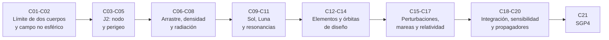

# B72 — Perturbaciones y evolución de órbitas

> **Bloque ampliado (`0.2.0`).** Además de las 20 clases de la malla base, el bloque tiene 1 clase programada por la ampliación (`B72-C21`), redactada y listada en el tramo 8. Ver el [programa completo](../../PROGRAMA_ACADEMICO_COMPLETO.md).

**Programa:** Programa Integral de Astronomía, Astrofísica, Ciencias Espaciales e Ingeniería Aeroespacial  
**Área:** A06 — Mecánica orbital, navegación y vuelo espacial  
**Nivel:** N3 (fundamentos disciplinares) · **Clases:** 20 + 1 de la ampliación · **Carga:** por calibrar con el uso  
**Estado:** guía pedagógica del bloque (resumen de qué se aprende en cada clase). Las clases enlazadas en la tabla ya están redactadas; todas conservan el estado E0 en el catálogo hasta registrar revisión disciplinar. La clase `B72-C21` (ampliación `0.2.0`) también está redactada y conserva el mismo estado.

## 🎯 Propósito del bloque

Enseña **por qué una órbita real no es una elipse kepleriana y cómo se cuantifica lo que la desvía**: la forma de la Tierra (J2 y los armónicos zonales), la atmósfera, la luz del Sol, la atracción del Sol y de la Luna, las resonancias, las mareas y la relatividad. Después ordena las herramientas para predecir su efecto: tasas seculares, elementos osculadores y medios, órbitas de diseño (heliosíncronas y congeladas), desarrollos perturbativos, integración numérica, análisis de sensibilidad y comparación de propagadores, hasta el propagador SGP4 de los catálogos públicos. Cada clase cierra con un laboratorio en Python de biblioteca estándar, ejecutado, cuyo resultado se verifica contra una fórmula analítica, una integración independiente o una conservación.

## 📚 Al terminar el bloque podrás

1. Estimar el tamaño relativo de J2, la atmósfera, la presión de radiación y la marea del Sol y de la Luna según la altitud.
2. Calcular las tasas seculares de `Ω` y `ω` por J2, la inclinación crítica y la inclinación heliosíncrona, y la excentricidad congelada.
3. Calcular arrastre, coeficiente balístico, vida útil y presión de radiación con parámetros declarados.
4. Distinguir un elemento osculador de uno medio y estimar el error de confundirlos.
5. Integrar numéricamente una órbita perturbada, elegir método y paso, y medir sensibilidad y error frente a una referencia.
6. Leer un conjunto de elementos de dos líneas, convertirlo a elementos de Brouwer y elegir SGP4 o SDP4.
7. Rotular qué es consultado, qué es sintético o ilustrativo y qué no se consultó en cada resultado.

## 🧭 Secuencia del bloque

**Descripción textual.** Ocho tramos encadenados: el límite de dos cuerpos y el campo no esférico (C01–C02), J2 y sus tasas seculares (C03–C05), las fuerzas no gravitatorias (C06–C08), los terceros cuerpos y las resonancias (C09–C11), los elementos y las órbitas de diseño (C12–C14), las aproximaciones, mareas y relatividad (C15–C17), la integración, la sensibilidad y la comparación de propagadores (C18–C20) y la ampliación con SGP4 (C21).

## 🗂️ Las 21 clases en resumen (20 de la malla base + 1 de la ampliación)

**Navegación:** cada clase enlaza a la anterior, a la siguiente y a este bloque.

La columna «Evidencia» indica el producto que demostrará el aprendizaje. Los laboratorios usan datos **sintéticos** o **ilustrativos** (rotulados) o valores publicados con fuente y fecha.

### Tramo 1 · El límite de dos cuerpos y el campo no esférico

| ID | Clase | Qué se aprende | Evidencia |
|---|---|---|---|
| [B72-C01](../clases/B72/B72-C01-limitaciones-del-problema-de-dos-cuerpos/CLASE.md) | Limitaciones del problema de dos cuerpos | Orden de magnitud de cada perturbación y separación entre Kepler y una órbita con J2. | Ficha de perturbaciones dominantes |
| [B72-C02](../clases/B72/B72-C02-potencial-gravitatorio-no-esferico/CLASE.md) | Potencial gravitatorio no esférico | Potencial zonal, gradiente y verificación con diferencias finitas. | Tabla de armónicos zonales |

### Tramo 2 · J2: nodo, perigeo y sus tasas seculares

| ID | Clase | Qué se aprende | Evidencia |
|---|---|---|---|
| [B72-C03](../clases/B72/B72-C03-perturbacion-j2-terrestre/CLASE.md) | Perturbación J2 terrestre | Tasas seculares de J2 de `Ω`, `ω` y `M` frente a una integración RK4. | Tabla de tasas seculares J2 |
| [B72-C04](../clases/B72/B72-C04-precesion-del-nodo-orbital/CLASE.md) | Precesión del nodo orbital | Regresión del nodo, periodo de regresión y verificación con el promedio de Gauss. | Tabla de regresión del nodo |
| [B72-C05](../clases/B72/B72-C05-precesion-del-argumento-del-periapsis/CLASE.md) | Precesión del argumento del periapsis | Precesión del perigeo, inclinación crítica `63,4349°` y caso Molniya. | Ficha de precesión del perigeo |

### Tramo 3 · Fuerzas no gravitatorias: arrastre, densidad y radiación

| ID | Clase | Qué se aprende | Evidencia |
|---|---|---|---|
| [B72-C06](../clases/B72/B72-C06-arrastre-atmosferico/CLASE.md) | Arrastre atmosférico | Coeficiente balístico, decaimiento por vuelta con aire en rotación y vida útil. | Ficha de decaimiento orbital |
| [B72-C07](../clases/B72/B72-C07-modelos-de-densidad-atmosferica/CLASE.md) | Modelos de densidad atmosférica | Densidad hidrostática ilustrativa y sensibilidad a la temperatura exosférica. | Ficha de sensibilidad de la densidad |
| [B72-C08](../clases/B72/B72-C08-presion-de-radiacion-solar/CLASE.md) | Presión de radiación solar | Irradiancia, presión `S/c`, sombra cilíndrica y excentricidad forzada en GEO. | Ficha de presión de radiación |

### Tramo 4 · Terceros cuerpos y resonancias

| ID | Clase | Qué se aprende | Evidencia |
|---|---|---|---|
| [B72-C09](../clases/B72/B72-C09-perturbaciones-solares/CLASE.md) | Perturbaciones solares | Marea solar, precesión del polo orbital y verificación con 180 días de RK4. | Ficha de marea solar |
| [B72-C10](../clases/B72/B72-C10-perturbaciones-lunares/CLASE.md) | Perturbaciones lunares | Marea lunar frente a solar y deriva de inclinación geoestacionaria. | Ficha de deriva lunisolar |
| [B72-C11](../clases/B72/B72-C11-resonancias-orbitales-perturbaciones-y-evolucion-de-orbitas/CLASE.md) | Resonancias orbitales — Perturbaciones y evolución de órbitas | Relación de Laplace, órbitas resonantes con la rotación terrestre y péndulo de resonancia. | Ficha de resonancias |

### Tramo 5 · Elementos y órbitas de diseño

| ID | Clase | Qué se aprende | Evidencia |
|---|---|---|---|
| [B72-C12](../clases/B72/B72-C12-variaciones-de-elementos-osculadores/CLASE.md) | Variaciones de elementos osculadores | Osculador frente a medio, semirrango de `a` y error de periodo. | Ficha de osculador y medio |
| [B72-C13](../clases/B72/B72-C13-orbitas-heliosincronicas/CLASE.md) | Órbitas heliosincrónicas | Inclinación heliosíncrona, altitud máxima y deriva de la hora local. | Tabla de órbitas heliosíncronas |
| [B72-C14](../clases/B72/B72-C14-orbitas-congeladas/CLASE.md) | Órbitas congeladas | Excentricidad congelada con J2 y J3 y raíz numérica de Gauss. | Ficha de órbita congelada |

### Tramo 6 · Aproximaciones, mareas y relatividad

| ID | Clase | Qué se aprende | Evidencia |
|---|---|---|---|
| [B72-C15](../clases/B72/B72-C15-aproximaciones-perturbativas/CLASE.md) | Aproximaciones perturbativas | Lindstedt–Poincaré y error relativo de un desarrollo de primer orden. | Tabla de error perturbativo |
| [B72-C16](../clases/B72/B72-C16-modelado-de-mareas/CLASE.md) | Modelado de mareas | Radio síncrono, `da/dt` con `k₂/Q` ilustrativo y balance de momento angular. | Ficha de marea orbital |
| [B72-C17](../clases/B72/B72-C17-efectos-relativistas-orbitales/CLASE.md) | Efectos relativistas orbitales | Avance relativista del periapsis de Mercurio y de satélites sintéticos. | Ficha de efectos relativistas |

### Tramo 7 · Integración, sensibilidad y comparación de propagadores

| ID | Clase | Qué se aprende | Evidencia |
|---|---|---|---|
| [B72-C18](../clases/B72/B72-C18-integracion-numerica-perturbada/CLASE.md) | Integración numérica perturbada | Euler, RK4 y Dormand–Prince: orden, coste y conservación de integrales. | Ficha de integrador |
| [B72-C19](../clases/B72/B72-C19-analisis-de-sensibilidad-orbital/CLASE.md) | Análisis de sensibilidad orbital | Error a lo largo de la trayectoria por `δa`, linealidad y sensibilidad a `B`. | Ficha de sensibilidad orbital |
| [B72-C20](../clases/B72/B72-C20-comparacion-de-propagadores-de-fidelidad-distinta/CLASE.md) | Comparación de propagadores de fidelidad distinta | Escalera de cuatro propagadores frente a una verdad sintética. | Ficha de fidelidad de propagadores |

### Tramo 8 · Ampliación `0.2.0`: SGP4 y teoría general de perturbaciones

| ID | Clase | Qué se aprende | Evidencia |
|---|---|---|---|
| [B72-C21](../clases/B72/B72-C21-propagador-sgp4-y-teoria-general-de-perturbaciones/CLASE.md) | Propagador SGP4 y teoría general de perturbaciones | Elementos de dos líneas, Kozai a Brouwer, SGP4 o SDP4 y tasas seculares. | Ficha de elementos de dos líneas |

## 🧵 Hilos que atraviesan el bloque

- **Orden de magnitud y acumulación:** C01 ordena las perturbaciones; C03–C10 muestran que lo pequeño se acumula; C19 mide cuánto.
- **Medio frente a osculador:** C03 y C12 separan tasas seculares de oscilaciones; C20 y C21 muestran el precio de confundirlos.
- **Órbitas de diseño:** C05, C13 y C14 usan J2 y J3 para fijar el perigeo, la hora local y la excentricidad.
- **Parámetros inciertos:** C06–C08 y C16 dependen de densidad, `Cr` y `k₂/Q`, todos ilustrativos; el bloque no los presenta como medidos.
- **Verificación independiente:** cada laboratorio contrasta con una fórmula, una integración o una conservación.

## 📝 Evaluación del bloque (propuesta, por calibrar)

- Fichas y ejercicios por clase, con retroalimentación y recuperación con evidencia distinta.
- Portafolio: la ficha de fidelidad de propagadores (C20) con su verdad sintética declarada y su sensibilidad (C19).
- Las condiciones críticas (rotular lo ilustrativo y sintético, no presentar un modelo como observación y citar solo lo consultado) no se compensan con promedio.

## ⚠️ Seguridad y límites

El bloque es educativo. Las fórmulas son de primer orden y las integraciones usan pocos términos de fuerza; no sustituyen a un propagador operativo, a un servicio oficial de elementos ni a una decisión de operación de vuelo. Las órbitas, las densidades, `B`, `Cr`, `k₂/Q` y las verdades de comparación son sintéticos o ilustrativos y están rotulados. SGP4 no se implementa completo: solo su inicialización y sus tasas seculares.

## 📖 Fuentes consultadas en el bloque (resumen)

Consultadas el 2026-11-10: las fichas de datos de la NASA/NSSDC (Tierra, Luna, Sol, Marte, Júpiter, Mercurio y satélites de Júpiter), la tabla de parámetros físicos de satélites del JPL (Luna, Ío, Europa), las constantes del NIST (CODATA 2022: `c`, `G`, `k`, `u`), la Resolución B3 de la IAU 2015 (texto del PDF extraído con PyMuPDF), el *Spacetrack Report No. 3* de Hoots y Roehrich (texto del PDF extraído con PyMuPDF: clasificación por periodo y constantes WGS-72), el artículo de Kelso sobre el formato de dos líneas, el catálogo de órbitas de la NASA Earth Observatory, la página de datos de irradiancia de SORCE, el registro del resumen de la *U.S. Standard Atmosphere, 1976* y el artículo de revisión de Will (2014), del que solo se usó la cifra de `43″/siglo`. Las fórmulas (tasas seculares, Gauss, marea de tercer cuerpo, mareas de `Q` constante, Lindstedt–Poincaré, Dormand–Prince, inicialización de SGP4) son relaciones estándar que verifica cada laboratorio y no se consultaron en una fuente concreta. No se consultaron: modelos de densidad operativos, el campo gravitatorio de alto grado, las Convenciones IERS, efemérides, SGP4 completo ni elementos de dos líneas reales. Las cifras sintéticas o ilustrativas están rotuladas como tales en cada clase.

## Fuentes de orientación preliminar

- **[JPL-HORIZONS]** [JPL Solar System Dynamics Horizons](https://ssd.jpl.nasa.gov/horizons/) — Efemérides y geometría del sistema solar.
- **[JPL-SPICE]** [NASA NAIF SPICE](https://naif.jpl.nasa.gov/naif/) — Geometría de observación, referencias espaciales y tiempos.
- **[NASA-NTRS]** [NASA Technical Reports Server](https://ntrs.nasa.gov/) — Informes técnicos e investigación histórica y actual.
- **[IERS]** [International Earth Rotation and Reference Systems Service](https://www.iers.org/) — Rotación terrestre y sistemas de referencia.

> La asociación de estas fuentes es orientativa por bloque. Las fuentes realmente consultadas para cada afirmación se registran en la sección 11 de cada clase.
