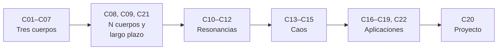

# B73 — Mecánica celeste, resonancias y caos

> **Bloque ampliado (`0.2.0`).** Además de las 20 clases de la malla base, el bloque tiene 2 clases programadas por la ampliación (`B73-C21` a `B73-C22`), redactadas y listadas en el tramo 2 y el tramo 5. Ver el [programa completo](../../PROGRAMA_ACADEMICO_COMPLETO.md).

**Programa:** Programa Integral de Astronomía, Astrofísica, Ciencias Espaciales e Ingeniería Aeroespacial
**Área:** A06 — Mecánica orbital, navegación y vuelo espacial
**Nivel:** N3 (fundamentos disciplinares) · **Clases:** 22 · **Carga:** por calibrar con el uso
**Estado:** guía pedagógica del bloque (resumen de qué se aprende en cada clase). Las 22 clases enlazadas en las tablas están redactadas; todas conservan el estado E0 en el catálogo hasta registrar revisión disciplinar.

## 🎯 Propósito del bloque

Enseña **qué cambia cuando un cuerpo ya no se mueve en un problema de dos cuerpos**: con un tercero aparecen puntos de equilibrio, órbitas periódicas, regiones prohibidas y trayectorias que se pegan a variedades invariantes; con varios, aparecen las resonancias, la deriva secular y el caos. El bloque recorre el problema restringido de tres cuerpos (marco rotatorio, puntos de Lagrange, estabilidad, órbitas periódicas, variedades y constante de Jacobi), la integración numérica de muchos cuerpos y de largo plazo, las resonancias de movimiento medio y seculares con su captura, el caos determinista medido con exponentes de Lyapunov y difusión, y cuatro aplicaciones (anillos, sistemas exoplanetarios, satélites irregulares y sistemas lunares) más las capturas temporales. Cada clase cierra con un laboratorio en Python (biblioteca estándar) que se ejecuta con datos publicados con fuente y fecha o con datos sintéticos rotulados, y que se contrasta con una segunda vía de cálculo.

## 📚 Al terminar el bloque podrás

1. Escribir y integrar el problema restringido de tres cuerpos en unidades adimensionales y comprobar que la constante de Jacobi se conserva.
2. Pasar entre el marco inercial y el sinódico, localizar los cinco puntos de Lagrange y decidir su estabilidad lineal.
3. Corregir una órbita periódica por disparo, hallar la dirección de una variedad invariante y leer una región prohibida con la constante de Jacobi.
4. Elegir un integrador (simpléctico o no) según el horizonte, y medir su error de energía, su convergencia y su reversibilidad.
5. Identificar una resonancia de movimiento medio o secular, y estimar la probabilidad de captura de una migración.
6. Medir el caos con exponentes de Lyapunov y con difusión, y traducirlo a un horizonte de predicción.
7. Aplicar lo anterior a anillos, planetas exoplanetarios, satélites irregulares, sistemas lunares y cuerpos coorbitales, y rotular qué es dato publicado, qué es modelo y qué es sintético.

## 🧭 Secuencia del bloque

**Descripción textual.** Seis tramos encadenados: el problema restringido de tres cuerpos (C01–C07), la integración de muchos cuerpos y de largo plazo (C08, C09 y la programada C21), las resonancias (C10–C12), el caos (C13–C15), las aplicaciones a anillos, exoplanetas, irregulares, lunas y coorbitales (C16–C19 y la programada C22) y el proyecto integrador (C20). El hilo común es que cada resultado se contrasta con una segunda vía y se acota su validez.

## 🗂️ Las 22 clases en resumen (20 de la malla base + 2 de la ampliación)

**Navegación:** cada clase enlaza a la anterior, a la siguiente y a este bloque.

La columna «Evidencia» indica el producto que demostrará el aprendizaje. Los laboratorios usan datos **sintéticos** o **ilustrativos** (rotulados) o valores publicados con fuente y fecha.

### Tramo 1 · El problema restringido de tres cuerpos

| ID | Clase | Qué se aprende | Evidencia |
|---|---|---|---|
| [B73-C01](../clases/B73/B73-C01-problema-restringido-de-tres-cuerpos/CLASE.md) | Problema restringido de tres cuerpos | Ecuaciones del CR3BP adimensional en el marco rotatorio; integración y conservación de la constante de Jacobi. | Ficha del CR3BP Tierra–Luna con control de conservación |
| [B73-C02](../clases/B73/B73-C02-marcos-rotatorios-sinodicos/CLASE.md) | Marcos rotatorios sinódicos | Paso entre el marco inercial y el sinódico: velocidades, Coriolis y centrífuga. | Tabla de transformaciones con prueba de ida y vuelta |
| [B73-C03](../clases/B73/B73-C03-puntos-de-equilibrio-de-lagrange/CLASE.md) | Puntos de equilibrio de Lagrange | Localizar L1–L5 de un sistema y compararlos con la aproximación de Hill. | Tabla de L1–L5 de Tierra–Luna y Sol–Tierra |
| [B73-C04](../clases/B73/B73-C04-estabilidad-local-de-lagrange/CLASE.md) | Estabilidad local de Lagrange | Linealización, autovalores de los puntos colineales y criterio de Routh del triángulo. | Ficha de estabilidad de cinco puntos y tres sistemas |
| [B73-C05](../clases/B73/B73-C05-orbitas-periodicas/CLASE.md) | Órbitas periódicas | Corrección diferencial de una órbita de Lyapunov alrededor de L1. | Ficha de una órbita periódica con su período y su Jacobi |
| [B73-C06](../clases/B73/B73-C06-variedades-invariantes/CLASE.md) | Variedades invariantes | Dirección estable e inestable de L1 y trayectoria sobre la variedad. | Ficha de variedad con tasa de crecimiento verificada |
| [B73-C07](../clases/B73/B73-C07-constante-de-jacobi/CLASE.md) | Constante de Jacobi | Curvas de velocidad cero, valores en L1–L5 y regiones prohibidas. | Mapa de regiones permitidas por valor de `C` |

### Tramo 2 · Muchos cuerpos y tiempos largos

| ID | Clase | Qué se aprende | Evidencia |
|---|---|---|---|
| [B73-C08](../clases/B73/B73-C08-sistemas-de-n-cuerpos/CLASE.md) | Sistemas de N cuerpos | Suma directa, integrador simpléctico y leyes de conservación en un sistema joviano. | Ficha de conservación de un sistema de cinco cuerpos |
| [B73-C09](../clases/B73/B73-C09-integracion-de-largo-plazo/CLASE.md) | Integración de largo plazo | Error de energía de integradores simplécticos y no simplécticos, pendiente log–log y reversibilidad. | Comparación de integradores en 10⁴ órbitas |
| [B73-C21](../clases/B73/B73-C21-pasos-cercanos-a-satelites-naturales-en-integracion-de-n-cuerpos/CLASE.md) | Pasos cercanos a satélites naturales en integración de N cuerpos *(ampliación `0.2.0`)* | Encuentro hiperbólico con una luna, paso fijo frente a paso adaptativo. | Comparación de errores de deflexión |

### Tramo 3 · Resonancias

| ID | Clase | Qué se aprende | Evidencia |
|---|---|---|---|
| [B73-C10](../clases/B73/B73-C10-resonancias-de-movimiento-medio/CLASE.md) | Resonancias de movimiento medio | Cocientes de movimiento medio y la relación de Laplace de los satélites galileanos. | Tabla de resonancias con residuos |
| [B73-C11](../clases/B73/B73-C11-resonancias-seculares/CLASE.md) | Resonancias seculares | Teoría secular de Laplace–Lagrange de dos planetas y sus frecuencias propias. | Ficha secular de un par Júpiter–Saturno |
| [B73-C12](../clases/B73/B73-C12-captura-y-escape-resonante/CLASE.md) | Captura y escape resonante | Péndulo de intensidad variable: área de la separatriz, invariante adiabático, escape y fracción capturada con deriva. | Curva de captura frente a tasa (semilla fija) |

### Tramo 4 · Caos

| ID | Clase | Qué se aprende | Evidencia |
|---|---|---|---|
| [B73-C13](../clases/B73/B73-C13-caos-determinista/CLASE.md) | Caos determinista | Mapa estándar: sensibilidad a condiciones iniciales y horizonte de predicción. | Ficha de dos regímenes (regular y caótico) |
| [B73-C14](../clases/B73/B73-C14-exponentes-de-lyapunov/CLASE.md) | Exponentes de Lyapunov | Exponente máximo por dos métodos y tiempo de Lyapunov. | Tabla de exponentes frente a `K` |
| [B73-C15](../clases/B73/B73-C15-difusion-orbital/CLASE.md) | Difusión orbital | Coeficiente de difusión del mapa estándar frente a la teoría cuasi-lineal. | Tabla de difusión frente a `K` |

### Tramo 5 · Aplicaciones: anillos, planetas y lunas

| ID | Clase | Qué se aprende | Evidencia |
|---|---|---|---|
| [B73-C16](../clases/B73/B73-C16-dinamica-de-anillos/CLASE.md) | Dinámica de anillos | Límite de Roche, cizalla kepleriana, ensanchamiento viscoso y resonancias de Mimas. | Ficha de un anillo de Saturno con sus escalas |
| [B73-C17](../clases/B73/B73-C17-estabilidad-de-sistemas-exoplanetarios/CLASE.md) | Estabilidad de sistemas exoplanetarios | Separación en radios de Hill mutuos y tiempo hasta el primer cruce. | Mapa de estabilidad frente a separación (sintético) |
| [B73-C18](../clases/B73/B73-C18-satelites-irregulares/CLASE.md) | Satélites irregulares | Fracción de la esfera de Hill, inclinación y estabilidad prógrada y retrógrada. | Ficha de los irregulares de Júpiter con su estabilidad |
| [B73-C19](../clases/B73/B73-C19-mecanica-de-sistemas-lunares/CLASE.md) | Mecánica de sistemas lunares | Esfera de Hill, plano de Laplace y precesión por `J2` en Júpiter. | Ficha dinámica del sistema galileano |
| [B73-C22](../clases/B73/B73-C22-capturas-temporales-y-cuasi-satelites/CLASE.md) | Capturas temporales y cuasi-satélites *(ampliación `0.2.0`)* | Clasificar órbitas coorbitales: renacuajo, herradura y cuasi-satélite. | Tabla de clasificación de órbitas coorbitales |

### Tramo 6 · Proyecto integrador

| ID | Clase | Qué se aprende | Evidencia |
|---|---|---|---|
| [B73-C20](../clases/B73/B73-C20-proyecto-de-integracion-celeste-de-precision/CLASE.md) | Proyecto de integración celeste de precisión | Presupuesto de error, convergencia y reversibilidad de una integración celeste. | Informe de precisión de una integración |

## 🧵 Hilos que atraviesan el bloque

- **Cantidades conservadas:** la constante de Jacobi (C01, C07), la energía y el momento angular (C08, C09, C20) y su deriva como medida de calidad.
- **Linealizar y luego salir de lo lineal:** autovalores en C04, variedades en C06, resonancias en C10–C12 y caos en C13–C15.
- **Escalas de tiempo:** período orbital, período de libración, tiempo secular, tiempo de Lyapunov y tiempo de difusión.
- **Observado frente a modelado:** los datos de satélites y planetas son valores publicados; toda trayectoria, exponente o probabilidad del bloque es un resultado de modelo con datos sintéticos o ilustrativos, nunca una observación.
- **Verificación independiente:** cada laboratorio contrasta con un caso analítico o con otra vía de cálculo.

## 📝 Evaluación del bloque (propuesta, por calibrar)

- Fichas y ejercicios por clase, con retroalimentación y recuperación con evidencia distinta.
- Portafolio: el informe de precisión de la integración (C20), con su presupuesto de error y su convergencia.
- Las condiciones críticas (rotular lo ilustrativo y sintético, no presentar un modelo como observación y citar solo lo consultado) no se compensan con promedio.

## ⚠️ Seguridad y límites

El bloque es educativo. Los integradores son de pocas líneas y de paso fijo o adaptativo sencillo, sin el rigor de una efeméride de precisión; no sustituyen a las efemérides del JPL ni a la literatura primaria, y ningún resultado sirve para planificar una misión. Las condiciones iniciales que no proceden de una fuente son sintéticas y están rotuladas; las teorías (Routh, Hill, Laplace–Lagrange, Chirikov) se verifican numéricamente en cada laboratorio pero no se consultaron en su publicación original.

## 📖 Fuentes consultadas en el bloque (resumen)

Consultadas el 2026-11-10: la tabla de parámetros físicos de planetas y de satélites del JPL (radios medios, `GM` de la Luna, los satélites galileanos y Titán), las tablas de elementos orbitales medios de los satélites del JPL (época J2000, plano de Laplace en los planetas gigantes), las fichas de datos de la NASA/NSSDC (Sol, Júpiter, Saturno, planetas, satélites joviano y saturniano) y la página de la órbita del telescopio Webb en L2 (NASA). Las leyes y teorías (Routh, Hill, Laplace–Lagrange, Chirikov, Roche, Gladman, Kozai) son resultados estándar que cada laboratorio verifica y no se consultaron en su fuente original. No se consultó el Archivo de Exoplanetas de la NASA (respondió 503): los sistemas exoplanetarios del bloque son sintéticos. La tabla de elementos de satélites del JPL da, para los galileanos, periodos que no sirven para decidir resonancias (ver B73-C10); las páginas de la NASA no fijan una incertidumbre propia en varios campos; se indica en cada clase.

## Fuentes de orientación preliminar

- **[JPL-HORIZONS]** [JPL Solar System Dynamics Horizons](https://ssd.jpl.nasa.gov/horizons/) — Efemérides y geometría del sistema solar.
- **[JPL-SPICE]** [NASA NAIF SPICE](https://naif.jpl.nasa.gov/naif/) — Geometría de observación, referencias espaciales y tiempos.
- **[NASA-NTRS]** [NASA Technical Reports Server](https://ntrs.nasa.gov/) — Informes técnicos e investigación histórica y actual.
- **[IERS]** [International Earth Rotation and Reference Systems Service](https://www.iers.org/) — Rotación terrestre y sistemas de referencia.

> La asociación de estas fuentes es orientativa por bloque. Las fuentes realmente consultadas para cada afirmación se registran en la sección 11 de cada clase.

## Roles que lo usan

- [Astrodinámica interplanetaria](../../rutas/astrodinamica-interplanetaria.md)
- [Astrofísica estelar y galáctica](../../rutas/astrofisica-estelar-y-galactica.md)
- [Navegación, guiado y autonomía espacial](../../rutas/navegacion-guiado-y-autonomia-espacial.md)
- [Seguridad, defensa y resiliencia de infraestructuras espaciales](../../rutas/seguridad-defensa-y-resiliencia-de-infraestructuras-espaciales.md)

[🏠 Volver al programa](../../README.md) · [➡️ B74 — Estimación de órbitas y navegación espacial](./B74-estimacion-de-orbitas-y-navegacion-espacial.md)
